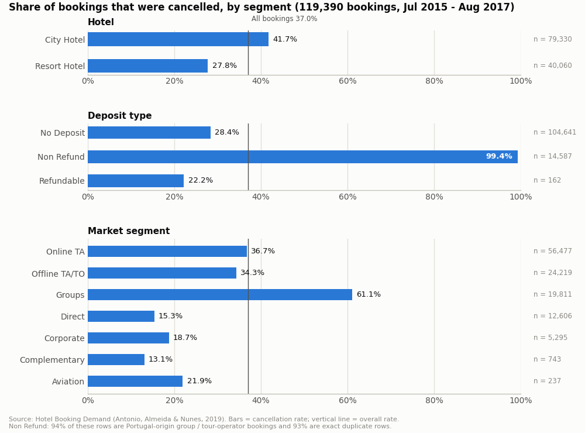
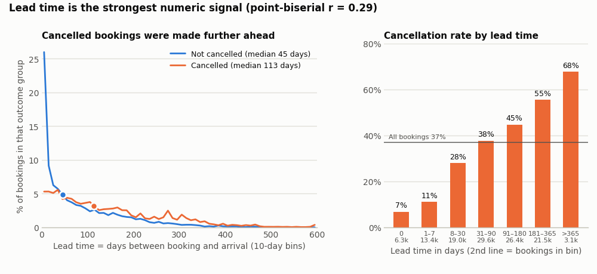
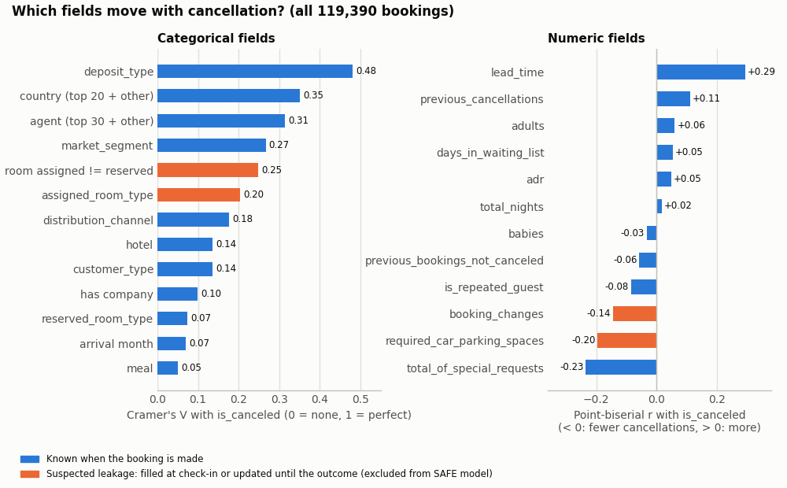

# T1 酒店訂單取消預測＋AI 挽留簡報:深度資料分析與目標草稿

> **2026-11-07 補充核對**：下文保留 11/4 實驗紀錄；「只用訂房當下欄位」未獲事件資料證明，0.872 是抵達年份留後測試，不能視為即時新訂單上線成績。訂金類型由抵達／取消前交易推導，ADR 亦非已證明的下訂報價。後續設計以 [11：Airbnb 與酒店取消可行性](../11_Airbnb與酒店取消_可行性與資料來源.md) 及 [原始來源核對](../raw/hotel_sources_2026-11-07.md) 為準。

> **一句話**:資料夠用、題目可行。用 2016 年以前的訂單預測 2017 年會不會取消,沒調參的簡單模型 ROC-AUC 就有 0.87(經驗規則 0.75)。但 26.8% 的列是重複列,不退款團體單幾乎全部取消,扣掉這些「送分題」後只剩 0.81,AT2 要兩種分數都報。
> **建立**:2026-11-04｜**資料**:Hotel Booking Demand(Antonio, de Almeida & Nunes, 2019, *Data in Brief* 22:41–49),用 TidyTuesday 版 CSV
> **數字怎麼來的**:全部用 Python 腳本實際算出來(附錄 A),沒有估計值。寫「論文說」的地方已對照論文全文(ISCTE 典藏 PDF,p.42、p.45)。
> **用途**:T1 選題的可行性依據,以及 1.12「項目目標/具體目標」的討論區草稿(§8;簡體版在文末 §9,方便直接複製)。

---

## 0. 先看結論(5 點)

1. **規模**:119,390 筆 × 32 欄。兩家葡萄牙酒店:城市酒店在里斯本,79,330 筆;度假酒店在阿爾加維(Algarve),40,060 筆。抵達日 2015-07 ~ 2017-08。取消率 37.0%(城市 41.7%、度假 27.8%)。
2. **最大的坑**:31,994 筆(26.8%)和另一筆一模一樣。不退款(Non Refund)14,587 筆有 99.4% 取消,其中 93% 是重複列,94% 同時是「國籍葡萄牙＋團體或線下旅行社」的訂單。這比較像「整批先保留、之後整批取消」,打電話給客人挽留不了。
3. **洩漏**:`reservation_status`、`reservation_status_date` 等於答案本身,一定要刪。車位、分配房型、修改次數是入住或取消時才確定的值,也刪。國籍、訂金類型、特殊需求是灰色地帶(論文自己說國籍常要到入住才知道),所以保留並做消融實驗(一次拿掉一個欄位,看分數掉多少)。
4. **可行性**:用時間切分(訓練用 2016 年以前、測試用 2017 年),只用訂房當下的欄位:邏輯迴歸 0.871、梯度提升樹 0.872,經驗規則 0.748。如果只聯絡風險最高的 20%,名單裡 87% 真的會取消。只看能打電話挽留的個人訂單時,AUC 是 0.813、命中率 68.5%。最保守的欄位組合是 0.790。
5. **商業意義**:被取消的房費占全部預訂房費的 39%。名單改用「取消機率 × 訂單金額」排序,聯絡 20% 的個人訂單就涵蓋 59.5% 的取消房費(隨機挑是 20%)。但 21% 的取消在下訂後 1 天內就發生,所以要在下訂當下就評分,不能等到入住前才處理。

---

## 1. 資料概況

### 1.1 資料概況表

| 項目 | 數值 |
|---|---|
| 來源 | Antonio, de Almeida & Nunes (2019), *Data in Brief* 22:41–49, doi:10.1016/j.dib.2018.11.126;CC BY 4.0 開放授權(論文首頁) |
| 檔案 | TidyTuesday 2020-02-11 `hotels.csv`,16,855,599 bytes(16.9 MB)。兩家酒店合成一檔,多了一欄 `hotel`(論文原本每家一檔、各 31 欄) |
| 規模 | 119,390 列 × 32 欄 |
| 酒店 | 城市酒店 79,330 筆(66.4%)、度假酒店 40,060 筆(33.6%) |
| 期間 | 抵達日 2015-07-01 ~ 2017-08-31(26 個月);最後狀態日期 2014-10-17 ~ 2017-09-14 |
| 答案欄 | `is_canceled`:取消 44,224 筆(37.04%);城市 33,102 筆(41.73%)、度假 11,122 筆(27.76%) |
| 最後狀態 | 退房 Check-Out 75,166、取消 Canceled 43,017、沒來 No-Show 1,207(占取消的 2.7%) |
| 欄位型態 | 整數 16、小數 4、文字 12。照意思分:答案 1、抵達日期 4、類別 9、代碼(ID)2、數值 14、洩漏 2 |
| 缺值 | 真正缺的只有 `children` 4 筆、`country` 488 筆。`agent`/`company` 的 NULL 是「不適用」(論文 p.45) |
| 重複列 | 31,994 筆(26.8%)和前面某一筆完全相同(§2 #1) |
| 時間切分 | 訓練:抵達 2015-07 ~ 2016-12,78,703 筆(取消 36.19%);測試:2017-01 ~ 2017-08,40,687 筆(取消 38.70%) |
| 論文的時間點設計 | 作者盡量取「抵達前一天」變更紀錄裡的值來避免洩漏(p.42、p.45),但也提醒有些值是入住時才改的(§5.4) |

### 1.2 資料字典(32 欄)

「能不能用」是本文的判定:可用/灰色(保留,但要做消融)/刪(洩漏)/答案。

| # | 欄位 | 白話意思 | 型態 | 缺值或特殊值 | 不同值 | 範圍或例子 | 能不能用 |
|---|---|---|---|---|---|---|---|
| 1 | hotel | 哪家酒店 | 文字 | — | 2 | City Hotel / Resort Hotel | 可用 |
| 2 | is_canceled | 有沒有取消 | 0/1 | — | 2 | 37.04% 是 1 | 答案 |
| 3 | lead_time | 下訂到抵達隔幾天 | 整數 | — | 479 | 0–737 | 可用 |
| 4 | arrival_date_year | 抵達年 | 整數 | — | 3 | 2015–2017 | 不進模型(時間切分下會外插) |
| 5 | arrival_date_month | 抵達月 | 文字 | — | 12 | January–December | 可用 |
| 6 | arrival_date_week_number | 抵達週數 | 整數 | — | 53 | 1–53 | 可用 |
| 7 | arrival_date_day_of_month | 抵達日 | 整數 | — | 31 | 1–31 | 可用 |
| 8 | stays_in_weekend_nights | 週末晚數 | 整數 | — | 17 | 0–19 | 可用(論文:入住時可能改) |
| 9 | stays_in_week_nights | 平日晚數 | 整數 | — | 35 | 0–50 | 可用(同上) |
| 10 | adults | 大人數 | 整數 | 0 人 403 筆 | 14 | 0–55 | 可用(同上) |
| 11 | children | 小孩數 | 小數 | NA 4 筆 | 5 | 0–10 | 可用,缺的補 0 |
| 12 | babies | 嬰兒數 | 整數 | — | 5 | 0–10 | 可用 |
| 13 | meal | 餐別 | 文字 | Undefined 1,169 | 5 | BB / HB / SC / FB / Undefined | 可用,Undefined 併入 SC(論文:兩者都是不含餐) |
| 14 | country | 國籍(ISO 3 碼) | 文字 | NULL 488(0.41%) | 177 | PRT / GBR / FRA… | 灰色 |
| 15 | market_segment | 市場區隔 | 文字 | Undefined 2 | 8 | Online TA / Groups… | 可用 |
| 16 | distribution_channel | 訂房通路 | 文字 | Undefined 5 | 5 | TA/TO / Direct… | 可用 |
| 17 | is_repeated_guest | 是不是回頭客 | 0/1 | — | 2 | 3.19% 是 1 | 可用 |
| 18 | previous_cancellations | 這位客人以前取消過幾次 | 整數 | — | 15 | 0–26 | 可用 |
| 19 | previous_bookings_not_canceled | 以前沒取消的訂單數 | 整數 | — | 73 | 0–72 | 可用 |
| 20 | reserved_room_type | 預訂房型(代碼) | 文字 | — | 10 | A / D / E… | 可用 |
| 21 | assigned_room_type | 實際分配的房型 | 文字 | — | 12 | A / D / E… | 刪(入住時才分配) |
| 22 | booking_changes | 修改次數(算到入住或取消為止) | 整數 | — | 21 | 0–21 | 刪 |
| 23 | deposit_type | 訂金類型 | 文字 | — | 3 | No Deposit / Non Refund / Refundable | 灰色 |
| 24 | agent | 旅行社代碼 | 數字代碼(其實是類別) | NULL 16,340(13.69%)=不是旅行社訂的 | 333 | 9、240、1… | 可用(當類別) |
| 25 | company | 公司代碼 | 數字代碼(其實是類別) | NULL 112,593(94.31%) | 352 | 40、223… | 可用(當類別) |
| 26 | days_in_waiting_list | 在等候名單上幾天 | 整數 | — | 128 | 0–391 | 可用 |
| 27 | customer_type | 客戶類型 | 文字 | — | 4 | Transient / Transient-Party / Contract / Group | 可用 |
| 28 | adr | 平均每晚房價 | 小數 | 負值 1、0 元 1,959 | 8,879 | −6.38–5,400 | 可用(要清理) |
| 29 | required_car_parking_spaces | 要幾個車位 | 整數 | — | 5 | 0–8 | 刪 |
| 30 | total_of_special_requests | 特殊需求數(如雙床、高樓層) | 整數 | — | 6 | 0–5 | 灰色 |
| 31 | reservation_status | 最後狀態 | 文字 | — | 3 | Check-Out / Canceled / No-Show | 刪(就是答案) |
| 32 | reservation_status_date | 最後狀態的日期 | 日期字串 | — | 926 | 2014-10-17 ~ 2017-09-14 | 刪(看日期就知道答案) |

---

## 2. 資料品質問題

| # | 問題 | 筆數(比例) | 影響 | 建議處理 |
|---|---|---|---|---|
| 1 | **完全相同的重複列** | 31,994(26.8%)。共 8,171 組,最大一組 180 筆一模一樣;914 組 ≥ 10 筆,合計 20,335 筆 | 重複列的取消率 58.4%,不重複的 26.2%;去重後整體取消率從 37.0% 變 27.5% | 資料沒有訂單編號,分不出是「同一團訂了好幾間一樣的房」還是匯出時重複 → 不直接刪,但評估時一定另報去重版。時間切分下沒有任何一筆重複列跨到訓練/測試兩邊(已驗證 0 筆) |
| 2 | **不退款(Non Refund)反常** | 14,587(12.2%);取消率 99.36%;占全部取消的 32.8% | 照理說全額預付的人最不會取消,這裡剛好相反。97.2% 是團體或線下旅行社,97.2% 國籍是 PRT(兩者同時成立 94.4%),92.9% 是重複列,只有 0.16% 有特殊需求 | 推測是旅行社整批保留房、之後整批釋出。從「打電話挽留」名單分開處理,評估時另報「排除不退款」版 |
| 3 | 房價 adr 異常 | 負值 1 筆(−6.38);0 元 1,959 筆(1.64%,其中 680 筆是招待 Complementary);> 500 只有 3 筆,最大 5,400(1 筆:城市酒店、住 1 晚、已取消;第二大是 510) | 偏態 10.5,會拉歪平均值和金額試算 | 負值改 0,上限截在 600(模型已這樣做);0 元單在成本效益分析另外標 |
| 4 | 住 0 晚 | 715(0.60%),房價全是 0,取消率 4.9% | 可能是當天取消或只用不住(推測) | 保留;成本效益分析排除 |
| 5 | 人數怪 | 大人 0 人 403 筆;大人、小孩、嬰兒全是 0 的有 180 筆;大人 > 4 人 16 筆(最多 55);嬰兒 9 人、10 人各 1 筆;小孩 10 人 1 筆 | 量少,可能是團體主單或輸入錯 | 標記,總人數截斷 |
| 6 | children 缺值 | 4 筆 | 很少 | 補 0 |
| 7 | country 缺值 | 488 筆(0.41%),這些的取消率 13.7% | 少;國籍本身另有洩漏疑慮(§5.3) | 當成「未知」一類 |
| 8 | agent、company 的 NULL | agent 16,340(13.7%)、company 112,593(94.3%) | 論文說 NULL 是「不是透過旅行社/公司訂的」,不算缺值。代碼看起來是數字,其實是類別(agent 333 種、company 352 種) | 當類別;只留常見的前 N 個,其餘併成「其他」(只用訓練期算 N) |
| 9 | 未定義的類別 | meal Undefined 1,169;market_segment Undefined 2;distribution_channel Undefined 5 | 論文說 meal 的 Undefined 和 SC 同義(都不含餐) | meal 併入 SC;另外兩個併入「其他」 |
| 10 | 各月份資料量不均 | 7、8 月有 3 年資料,其他月份只有 2 年;同一個月的訂單數 2015 < 2016 < 2017 | 直接把各月加總會看錯淡旺季 | 季節性只用 2016 全年看(§3.6) |
| 11 | 欄位不是「下訂當下」的值 | 全部欄位 | 論文取的是「抵達前一天」的值,也提醒國籍、人數、房型常在入住時才更正 | 見 §5 |

---

## 3. 重要分布

### 3.1 答案欄和分群

*圖 a:依酒店、訂金類型、市場區隔分的取消率;直線是整體 37.0%。*

- 取消率:整體 37.04%;城市 41.73%、度假 27.76%。
- 依市場區隔:團體 61.1% 最高,直接訂 15.3%、招待 13.1% 最低。
- 依客戶類型:散客(Transient)40.8%、散客同行(Transient-Party)25.4%、合約(Contract)31.0%、團體(Group)10.2%。
- 回頭客 14.5%,新客 37.8%。

### 3.2 提前天數 lead_time(下訂到抵達隔幾天)

*圖 b:左邊是取消和沒取消兩群的提前天數分布;右邊是依天數分組的取消率。*

- 平均 104.0 天,中位數 69 天(Q1 18、Q3 160、P90 265、P99 444、最大 737)。右偏,偏態 1.35。
- 當天訂 5.3%、7 天內 16.5%、超過 180 天 20.7%、超過一年 2.6%。
- 城市中位數 74 天、度假 57 天。
- **沒取消的中位數 45 天,取消的 113 天。**

### 3.3 房價 adr

- 平均 101.8,中位數 94.6(Q1 69.3、Q3 126.0、P99 252)。偏態 10.5,被極端值拉高。
- 城市中位數 99.9、度假 75.0。
- 取消的 96.2、沒取消的 92.5,差很小。
- 論文沒寫幣別(葡萄牙酒店,推測是歐元)。

### 3.4 住幾晚、人數、特殊需求

- 住幾晚:平均 3.43 晚、中位數 3 晚;63.4% 住 1–3 晚,超過 7 晚的 4.4%。城市平均 2.98 晚、度假 4.32 晚。
- 人數:2 位大人 75.1%、1 位大人 19.3%;有小孩 7.2%、有嬰兒 0.8%。
- 特殊需求:0 個 58.9%、1 個 27.8%、2 個 10.9%、3 個以上 2.4%。
- 其他:要車位 6.2%、回頭客 3.2%、以前取消過 5.4%、改過訂單 15.1%、上過等候名單 3.1%、房型被換過 12.5%。

### 3.5 類別欄位

- 市場區隔:線上旅行社(Online TA)47.3%、線下旅行社/旅遊業者(Offline TA/TO)20.3%、團體 16.6%、直接訂 10.6%、公司 4.4%、招待 0.6%、航空 0.2%。
- 訂房通路:旅行社(TA/TO)82.0%、直接 12.3%、公司 5.6%、GDS 0.2%。
- 訂金類型:不用訂金 87.6%、不退款 12.2%、可退款 0.1%。
- 客戶類型:散客 75.1%、散客同行 21.0%、合約 3.4%、團體 0.5%。
- 餐別:BB(含早餐)77.3%、HB(半膳)12.1%、SC(不含餐)8.9%、Undefined 1.0%、FB(全膳)0.7%。
- 國籍:共 177 國,前 10 名占 84.4%。

| 國籍 | 筆數 | 占比 | 取消率 |
|---|---|---|---|
| PRT 葡萄牙 | 48,590 | 40.70% | **56.64%** |
| GBR 英國 | 12,129 | 10.16% | 20.22% |
| FRA 法國 | 10,415 | 8.72% | 18.57% |
| ESP 西班牙 | 8,568 | 7.18% | 25.41% |
| DEU 德國 | 7,287 | 6.10% | 16.71% |
| ITA 義大利 | 3,766 | 3.15% | 35.40% |
| IRL 愛爾蘭 | 3,375 | 2.83% | 24.65% |
| BEL 比利時 | 2,342 | 1.96% | 20.24% |
| BRA 巴西 | 2,224 | 1.86% | 37.32% |
| NLD 荷蘭 | 2,104 | 1.76% | 18.39% |

### 3.6 季節性(只用 2016 全年,避免月份資料量不均)

| 2016 | 訂單最少的月 | 訂單最多的月 | 取消率最低 | 取消率最高 |
|---|---|---|---|---|
| 城市酒店 | 1 月 1,364 筆 | 10 月 4,219 筆 | 1 月 32.1% | 10 月 46.1% |
| 度假酒店 | 1 月 884 筆 | 10 月 1,984 筆 | 1 月 13.5% | 8 月 34.3% |
| 兩家合計 | 1 月 2,248 筆 | 10 月 6,203 筆 | 1 月 24.8% | 10 月 40.5% |

- 城市酒店春、秋兩季訂單多,取消也多;度假酒店的取消集中在暑假(7 月 31.6%、8 月 34.3%)。
- **年對年漂移**:同樣看 1–8 月,2016 年取消 34.70%、2017 年 38.70%,多了 4.0 個百分點,代表測試期比訓練期更常取消。
- 抵達日是星期幾:週四 41.2%、週五 40.6% 最高,週日 32.3% 最低。

### 3.7 取消發生在什麼時候(只用來理解業務,不進模型)

用 `reservation_status_date` 算 43,017 筆取消(不含 No-Show):

- **離抵達日多遠取消**:中位數 56 天(Q1 19、Q3 130、平均 88.3)。7 天內才取消的 11.9%,30 天內 33.7%,90 天以前就取消的 36.1%。
- **下訂後多久取消**:中位數 26 天;下訂當天或隔天就取消的 21.4%;7 天內 34.2%;30 天內 53.7%。排除不退款後,中位數只有 15 天,7 天內就取消的 39.7%。
- 取消的那一刻,離入住還剩整段等待期的 72%(中位數),也就是大多在下訂後不久就取消。
- **白話**:如果等到入住前 7 天才打電話,88% 的取消早就發生了。評分要在下訂當下就做,挽留動作也要早。

### 3.8 被取消的房費

- 取消訂單的房費(房價 × 晚數)合計 16,727,237,占全部預訂房費 42,723,561 的 **39.15%**;取消的房晚 154,217 / 409,257(37.7%)。
- 2017 測試期:取消房費 7,223,580 / 17,034,844(42.40%)。
- 注意:這是「名目上被取消的房費」。房間可能再賣出去,所以不等於真正的損失。

---

## 4. 和取消最相關的因素

*圖 c:左邊是類別欄位的 Cramér's V(0 = 沒關係、1 = 完全決定),右邊是數值欄位的點二系列相關 r(負 = 越多越不會取消)。橘色是疑似洩漏、模型不用的欄位。*

### 4.1 類別欄位(Cramér's V;全部 p < 0.001)

| 欄位 | V | 取消率最高/最低的類別 |
|---|---|---|
| deposit_type 訂金類型 | **0.482** | 不退款 99.4%;不用訂金 28.4%;可退款 22.2% |
| country 國籍(前 20 國＋其他) | 0.351 | PRT 56.6%;前 10 國最低的是 DEU 16.7% |
| agent 旅行社(前 30＋其他) | 0.314 | 代碼 1 是 73.4%(7,191 筆);代碼 28 是 6.6%;沒經旅行社 24.7% |
| market_segment 市場區隔 | 0.267 | 團體 61.1%;直接訂 15.3%;招待 13.1% |
| 房型被換過(分配 ≠ 預訂)〔洩漏〕 | 0.248 | 被換過 5.4%,沒換 41.6% |
| assigned_room_type〔洩漏〕 | 0.203 | — |
| distribution_channel 訂房通路 | 0.177 | 旅行社 41.0%;直接 17.5% |
| hotel 酒店 | 0.137 | 城市 41.7%;度假 27.8% |
| customer_type 客戶類型 | 0.136 | 散客 40.8%;團體 10.2% |
| 有沒有公司代碼 | 0.099 | 有 17.5%,沒有 38.2% |
| reserved_room_type 預訂房型 | 0.074 | — |
| 抵達月份 | 0.070 | 6 月 41.5%、4 月 40.8% 最高;1 月 30.5% 最低(3 年合計) |
| meal 餐別 | 0.051 | 全膳 59.9%(798 筆);含早餐 37.4% |
| 抵達年 | 0.026 | 2017 年 38.7%、2016 年 35.9% |

### 4.2 數值欄位(點二系列相關 r;正 = 越大越常取消)

| 欄位 | r | 分組取消率 |
|---|---|---|
| lead_time 提前天數 | **+0.293** | 0 天 6.8% → 1–7 天 11.0% → 8–30 天 27.9% → 31–90 天 37.7% → 91–180 天 44.7% → 181–365 天 55.5% → 一年以上 67.7% |
| total_of_special_requests 特殊需求 | **−0.235** | 0 個 47.7%;1 個 22.0%;2 個 22.1%;3 個以上 16.8% |
| required_car_parking_spaces 車位〔洩漏〕 | −0.196 | 要車位的 7,416 筆:**0 筆取消** |
| booking_changes 修改次數〔洩漏〕 | −0.144 | 沒改過 40.9%;改過 15.7% |
| previous_cancellations 以前取消次數 | +0.110(Spearman +0.270) | 0 次 33.9%;1 次 94.4%;2 次以上 52.7% |
| is_repeated_guest 回頭客 | −0.085 | 回頭客 14.5%,新客 37.8% |
| adults 大人數 | +0.060 | — |
| previous_bookings_not_canceled 以前沒取消的單 | −0.057 | 有 1 筆以上 5.5%;0 筆 38.0% |
| days_in_waiting_list 等候名單天數 | +0.054 | 0 天 36.2%;1–30 天 75.5%;超過 30 天 61.6% |
| adr 房價 | +0.048 | 0 元以下 10.9%;0–50 是 23.2%;50 以上都在 38–40% |
| 總晚數 | +0.018 | 1 晚 25.1%;2 晚 44.0%;3 晚 41.9%;超過 14 晚 55.4% |
| stays_in_weekend_nights 週末晚數 | −0.002(p = 0.54,不顯著) | — |

### 4.3 白話結論

- 最強的訊號是「誰訂的、怎麼訂的」:訂金類型、國籍、旅行社、市場區隔。
- 數值欄位裡最強的是提前天數(越早訂越常取消)和特殊需求(有提需求的人比較少取消)。
- 房價和住幾晚跟取消幾乎沒關係(|r| < 0.05)。
- 有幾個看起來最強的關係其實要打折:
  - 車位、換房、修改次數是洩漏。
  - 「以前取消過 1 次 = 94.4% 取消」裡有 58.4% 是不退款單、76.7% 是重複列;排除不退款後仍有 86.6%(2,519 筆),所以訊號是真的,只是被放大了。
  - 「旅行社代碼 1 = 73.4%」排除不退款後只剩 38.7%,接近平均值,主要是團體單造成的。

---

## 5. 洩漏欄位

### 5.1 一定要刪(直接等於答案)

| 欄位 | 證據 |
|---|---|
| reservation_status | Canceled＋No-Show = 44,224 筆,剛好等於 `is_canceled = 1`;Check-Out 75,166 筆,剛好等於 0 |
| reservation_status_date | 取消單的日期 100% 落在抵達日當天或之前;退房單有 99.96% 剛好等於「抵達日＋住幾晚」,看日期就知道答案 |

### 5.2 刪掉(入住或取消時才確定的值)

| 欄位 | 證據 |
|---|---|
| assigned_room_type(和「房型被換過」) | 房間入住時才分配;被換過的取消率只有 5.4%(沒換 41.6%)。論文也說分配房型的分布在取消/沒取消兩群明顯不同 |
| required_car_parking_spaces | 要車位的 7,416 筆沒有一筆取消,很可能是到場才登記 |
| booking_changes | 論文定義是「從訂單進系統到**入住或取消**為止」的修改次數,所以取消單的次數被提早截斷(沒取消平均 0.293 次、取消 0.098 次) |

### 5.3 灰色地帶(保留,但每個都做消融)

| 欄位 | 疑慮 | 拿掉後 AUC(SAFE 梯度提升樹 0.872) |
|---|---|---|
| country 國籍 | 論文提醒酒店**常到入住才知道客人正確國籍**(p.45)。PRT 占取消單的 62.2%、占沒取消單的 28.0%;排除不退款後,PRT 取消率 38.9%、其他國家 23.3% | 0.829(−0.043,影響最大) |
| deposit_type 訂金類型 | 論文說這欄是用「抵達或取消日之前」的付款算出來的,也是結果時點的值 | 0.867(−0.005,旅行社和市場區隔帶了相同資訊) |
| total_of_special_requests 特殊需求 | 可能在入住前陸續增加,論文沒說是哪個時點的值 | 0.858(−0.014) |
| 三個全拿掉(STRICT) | 最保守的下限 | **0.790** |
| adults、children、晚數、meal | 論文說客人常在入住時才改人數、晚數,這幾欄的分布在兩群明顯不同 | 目前保留;AT2 要寫成假設 |

### 5.4 論文怎麼說(改寫,不是原文)

作者知道洩漏的問題,所以每個欄位盡量取「抵達前一天」變更紀錄裡的值。但作者也提醒:客人常在入住或住宿期間才改人數、晚數、房型,酒店也常到入住才知道正確國籍。所以就算取的是抵達前的值,有些欄位在取消和沒取消兩群的分布本來就不同,使用時要考慮(論文 p.42、p.45)。

**對我們的意思**:這份資料沒有一組「完全乾淨」的欄位。AT2 要說清楚用的是哪一組,並同時報 SAFE(主模型)和 STRICT(下限)兩個分數。

---

## 6. 可行性實驗結果

### 6.1 設定

- **切分**:訓練 = 抵達日 2015-07-01 ~ 2016-12-31(78,703 筆);測試 = 2017-01-01 ~ 2017-08-31(40,687 筆,取消 38.70%)。調參和挑欄位都沒碰測試資料。
- **兩份考卷**
  - **A「全部 2017 訂單」**:40,687 筆。
  - **B「可以打電話挽留的個人訂單」**:A 去掉不退款單和重複列,剩 31,355 筆(取消 31.2%)。
- **三組欄位**
  - FULL:只刪 2 個硬洩漏欄位和抵達年。
  - SAFE:FULL 再刪車位、分配房型、修改次數(主模型)。
  - STRICT:SAFE 再刪國籍、訂金類型、特殊需求。
- **模型**:不用模型(隨機挑)、2 個經驗規則、邏輯迴歸(LR)、隨機森林(RF,300 棵樹)、梯度提升樹(GBDT,scikit-learn HistGradientBoosting,和 LightGBM 同一類)。**都沒調參**,每個模型在這台電腦上 1–5 秒就練完。
- **5 紅旗規則**(模擬櫃檯憑經驗判斷):符合一條加 1 分,≥ 3 分就標記成高風險。5 條是:① 提前超過 90 天 ② 沒有任何特殊需求 ③ 訂金類型是不退款 ④ 以前取消過 ⑤ 市場區隔是團體或線上旅行社。排序時同分的比提前天數。
- **指標**
  - ROC-AUC:整體排序能力,0.5 = 亂猜、1 = 完美。
  - PR-AUC:只看「取消」這一類的排序品質。
  - 門檻 0.5 的精確率/召回率。
  - **只聯絡前 20%**:命中率 = 名單裡真的會取消的比例;抓到率 = 抓到全部取消的幾成。A 的抓到率理論上限是 20% ÷ 38.7% = 51.7%。
  - 前 20% 涵蓋的取消房費(房價 × 晚數)。

### 6.2 主表(考卷 A:全部 2017 訂單,40,687 筆)

| # | 方法 | 欄位 | ROC-AUC | PR-AUC | 門檻 0.5 精確率 / 召回率 | 前 20% 命中率 / 抓到率 | 前 20% 涵蓋取消房費 |
|---|---|---|---|---|---|---|---|
| 0 | 不用模型(隨機挑) | — | 0.50 | 0.391 | — | 39.6% / 20.5% | 20.2% |
| 1 | 規則:只看提前天數 | 1 欄 | 0.655 | 0.509 | — | 51.6% / 26.7% | 28.6% |
| 2 | 規則:5 紅旗(≥ 3 分) | 5 條 | 0.748 | 0.688 | 75.2% / 42.3%(標記 21.8%) | 73.1% / 37.8% | 36.4% |
| 3 | 邏輯迴歸 LR | SAFE | 0.871 | 0.827 | 81.3% / 55.3% | 86.8% / 44.9% | 40.8% |
| 4 | 隨機森林 RF | SAFE | 0.854 | 0.811 | 82.0% / 55.2% | 85.1% / 44.0% | 39.6% |
| 5 | **梯度提升樹 GBDT** | **SAFE** | **0.872** | **0.830** | 81.3% / 58.8% | **87.4% / 45.2%** | 39.4% |
| 6 | 同 #5,改按「機率 × 金額」排序 | SAFE | — | — | — | 77.9% / 40.2% | **56.6%** |
| 7 | GBDT | SAFE − 特殊需求 | 0.858 | 0.807 | 76.6% / 55.6% | 84.6% / 43.7% | 38.6% |
| 8 | GBDT | SAFE − 訂金類型 | 0.867 | 0.818 | 80.9% / 58.2% | 86.7% / 44.8% | 40.2% |
| 9 | GBDT | SAFE − 國籍 | 0.829 | 0.793 | 79.1% / 55.4% | 85.5% / 44.2% | 40.1% |
| 10 | GBDT | **STRICT** | **0.790** | 0.726 | 71.7% / 44.6% | 74.8% / 38.7% | 39.9% |
| 11 | LR | FULL(含疑似洩漏) | 0.892 | 0.850 | 82.5% / 62.2% | 88.9% / 45.9% | 43.2% |
| 12 | RF | FULL | 0.877 | 0.832 | 83.2% / 58.6% | 86.7% / 44.8% | 40.1% |
| 13 | GBDT | FULL | 0.894 | 0.852 | 81.9% / 63.7% | 89.3% / 46.1% | 40.9% |
| — | 完美預知(上限) | — | 1.00 | 1.00 | — | 100% / 51.7% | 78.8% |

- 洩漏欄位確實會灌水:FULL 比 SAFE 高 0.02(0.894 vs 0.872)。
- 邏輯迴歸和梯度提升樹幾乎一樣好(0.871 vs 0.872),而且邏輯迴歸的機率比較準(Brier 0.147 vs 0.153)。所以要用更複雜的模型,得拿數字證明值得。
- 隨機森林沒調參,反而最差(0.854)。

### 6.3 換成比較難的考卷

| 評估資料 | 筆數 | 取消率 | SAFE GBDT | SAFE LR | FULL GBDT |
|---|---|---|---|---|---|
| A 全部 2017 | 40,687 | 38.7% | 0.872 | 0.871 | 0.894 |
| 只看城市酒店 | 27,508 | 42.5% | 0.884 | 0.876 | 0.896 |
| 只看度假酒店 | 13,179 | 30.8% | 0.849 | 0.864 | 0.899 |
| 去重 | 31,692 | 31.9% | 0.819 | 0.822 | 0.852 |
| 排除不退款 | 36,561 | 31.8% | 0.827 | 0.825 | 0.857 |
| **B 排除不退款＋去重** | **31,355** | **31.2%** | **0.813** | 0.816 | 0.848 |
| 訓練和測試都去重後重練 | 31,692 | 31.9% | 0.817 | — | — |

**考卷 A 前 10% 的名單 100% 都會取消,但這 100% 全是不退款單**:99.8% 國籍 PRT、92.2% 是重複列。也就是說,模型最有把握的那一段是「整批取消的團體單」,打電話救不回來。前 20% 名單裡也有 50.7% 是不退款單。

在考卷 B 上,每種名單「只聯絡 20%」的效果:

| 名單怎麼挑 | 命中率 | 抓到率 | 涵蓋取消房費 |
|---|---|---|---|
| 隨機 | 31.2% | 20.0% | 20.0% |
| 紅旗規則(4 條,這份考卷沒有不退款) | 52.9% | 33.9% | 38.3% |
| 模型:按取消機率排 | **68.5%** | **43.9%** | 46.3% |
| 模型:按「機率 × 金額」排 | 66.4% | 42.5% | **59.5%** |
| 完美預知(上限) | 100% | 64.1% | 87.1% |

紅旗規則在考卷 B 的 AUC 是 0.689,模型是 0.813。

### 6.4 為什麼不能隨機切分

同一個 SAFE GBDT,如果改用隨機 70/30 切分,AUC 會變成 **0.944**(時間切分是 0.872),原因如下:

- 隨機切的時候,30.7% 的測試列在訓練集裡有一模一樣的複本,這些列的取消率是 60.3%,模型等於先看過答案。
- 只看沒有複本的測試列,AUC 是 0.886,還是比時間切分高。推測是因為隨機切也讓模型先看到了 2017 年的趨勢。
- 時間切分下,重複列一筆都沒有跨到兩邊(重複列的抵達日一定相同,只會落在同一邊)。

AT2 寫「為什麼用時間切分」時,直接用這組數字。

### 6.5 模型靠什麼判斷(前 10 名)

做法:在 2017 測試資料抽 12,000 筆,把某一欄打亂(重複 5 次),看 AUC 掉多少(SAFE GBDT)。

| 名次 | 欄位 | AUC 掉多少 |
|---|---|---|
| 1 | agent 旅行社 | 0.124 |
| 2 | country 國籍 | 0.094 |
| 3 | deposit_type 訂金類型 | 0.073 |
| 4 | total_of_special_requests 特殊需求 | 0.036 |
| 5 | lead_time 提前天數 | 0.030 |
| 6 | customer_type 客戶類型 | 0.015 |
| 7 | previous_bookings_not_canceled | 0.008 |
| 8 | market_segment 市場區隔 | 0.006 |
| 9 | adr 房價 | 0.004 |
| 10 | previous_cancellations | 0.003 |

- 其他欄位都 < 0.002。
- FULL 版的前 7 名裡有車位(0.036,第 4 名)和房型被換(0.015,第 7 名),洩漏欄位真的被模型拿去用。
- 邏輯迴歸係數最大的也是特定旅行社/公司代碼、不退款、國籍 AGO/PRT。模型很依賴「哪個通路來的」,但這些代碼是這兩家酒店自己的,換一家酒店就不能用。

### 6.6 機率準不準(校準)

- SAFE GBDT 的 Brier 分數是 0.153(越低越好):邏輯迴歸 0.147,全部猜同一個取消率是 0.238。
- 把預測機率分成 10 組,中間幾組明顯低估:預測平均 18% 的那組實際是 34.5%,預測 32% 的那組實際是 48.3%;預測 86% 的那組實際只有 75.4%(高估)。
- 原因之一是 2017 年的取消率比訓練期高 4 個百分點。
- 成本效益分析要用機率算錢,所以要先校準。

### 6.7 結論:可行

- **技術上**:沒調參的模型在「未來」資料上就有 0.87,比經驗規則(0.75)好很多,筆電幾秒就能練完。技術風險低。
- **難的地方**是「誠實評估」和「變成商業價值」:
  - 分數要扣掉團體單和洩漏,真實範圍大約在 0.79–0.87。
  - 名單要分成「打電話」和「跟旅行社確認」兩種。
  - 要在下訂當下就評分。
  - AI 簡報要可信。
- 這些正好是 AT2 的 HD 要看的東西:分布、相關性、前沿基準、有說服力的指標。

---

## 7. 對 AT2 的意義

### 7.1 「數據與資源」:HD 要的特徵、分布、相關性

本文件 §1–§5 已經有這些內容,而且都有數字:

- 資料字典(32 欄)
- 品質審計(11 項)
- 單一欄位分布(偏態、離群值、季節性、漂移)
- 欄位和答案的關係(Cramér's V、點二系列相關、分組取消率)
- 洩漏判定

報告可以直接用 3 張圖:a 分群取消率、b 提前天數、c 相關強度(洩漏欄位標橘色)。這 3 張是給讀者看的說明圖,和探索用的圖分開。

### 7.2 「方法」:基準 vs 前沿 AI

| 層級 | 方法 | 角色 | 現況/備註 |
|---|---|---|---|
| 人工基準 | 5 紅旗規則 | 模擬櫃檯經驗 | A 0.748、B 0.689 |
| 簡單基準 | 邏輯迴歸 | 好解釋、機率較準 | A 0.871、Brier 0.147 |
| 強基準(表格資料的前沿基準) | 梯度提升樹:XGBoost / LightGBM / CatBoost | Grinsztajn et al.(2022)比較 45 個資料集後發現,中型表格資料仍是樹模型最強 | HistGB 0.872(沒調參);CatBoost 能直接處理旅行社、國籍這類多類別欄位 |
| 前沿 AI ① | TabPFN 表格基礎模型(Hollmann et al., 2025, *Nature*) | 不用調參,直接預測 | 論文設計上限 1 萬筆、500 欄;本資料訓練集 78,703 筆,要抽樣或分段比較(例如只用度假酒店,或只用最近 6 個月) |
| 前沿 AI ② | 大型語言模型(LLM)寫挽留簡報 | AT3 HD 要的「把前沿 AI 整合成可行動的功能」 | 只餵模型算出的前 3 個原因(SHAP 值)和訂單欄位,規定只能用給定的事實 |
| 評估 AI | 程式自動比對事實＋人工評分(可加 LLM 評審) | 防止 AI 亂講 | 事實錯誤 0 筆是硬門檻 |

- **選擇標準**:時間切分 AUC、考卷 B 的名單命中率、校準、能不能說出原因、單筆延遲、成本(筆電跑不跑得動、API 要多少錢)。
- **前人研究**:Antonio, Almeida & Nunes(2017, IEEE ICMLA)用同一批資料做過取消預測,資料論文本身也建議拿它當對照。引用前要讀原文,確認他們怎麼切分、分數多少(尚未讀)。

### 7.3 「實驗與評估」

- 固定用時間切分,不要隨機切(§6.4:隨機切的 0.944 是灌水的)。
- 兩份考卷都報:A 全部、B 可挽留的個人訂單。
- 消融實驗:灰色欄位一次拿掉一個,報 SAFE 和 STRICT 兩個分數。
- 業務指標:20% 名單的命中率、抓到率、涵蓋房費,一律和「隨機」「紅旗規則」比。
- AT3 再加**回放模擬**:每天只排「當天還沒取消」的訂單,算「在客人取消**之前**就抓到」的比例。`reservation_status_date` 只用來決定訂單哪天還開著,不當特徵。

### 7.4 「風險管理」可以先寫進去的 6 條

1. 重複列和團體單讓分數虛高 → 兩份考卷都報。
2. 欄位不是下訂當下的值 → SAFE 和 STRICT 都報,假設寫清楚。
3. 資料舊(2015–2017,疫情前),而且只有葡萄牙 2 家 → 結論只說「這兩家、這段期間」;旅行社和公司代碼換一家酒店就不能用。
4. 沒有挽留紀錄,不知道打了電話客人會不會真的留下來(因果效果)→ 成本效益只能做假設情境＋敏感度分析。
5. LLM 會編造事實 → 只給結構化事實、用程式比對、0 錯誤門檻。
6. 論文沒寫幣別,取消的房間也可能再賣出去 → 金額是「名目上的取消房費」,不是淨損失。

### 7.5 分工建議(依 05 團隊版的背景)

- **Kenny**:模型、LLM 簡報、測試與評估。
- **隊友 C**(旅遊/賽事規劃):挽留動作清單、簡報評分表,當領域評審。
- **隊友 A、B**(運維/雲端機房):系統架構圖、資料流水線、部署計畫(版本控制、監控、什麼時候重訓)、原型的執行環境。

---

## 8. 項目目標與具體目標(草稿)

寫法照 1.8 Telco 社群測驗的正解:aim 寫業務成果,不寫「試哪些演算法」或「建資料庫」;objectives 照「做出預測器 → 評估準不準 → 算划不划算」的順序,每條都可驗證〔11 §12、interactive/單元一_12〕。

### 8.1 項目目標(Project aim)

> 針對酒店擬議的「入住前主動聯絡、挽留訂單」做法,提早找出最可能取消、損失最大的訂單,並用 AI 為每筆訂單寫出看得懂的原因和建議動作,讓訂房團隊把有限人力用在刀口上,減少取消造成的空房營收損失。

### 8.2 項目具體目標(Project objectives)

評估資料 A = 2017-01 ~ 2017-08 抵達的全部訂單(40,687 筆,完全不參與訓練);B = A 去掉不退款團體單和重複列(31,355 筆)。括號裡是目前的基準數字。

1. **開發單筆訂單取消風險預測器(只用訂房當下就知道的欄位)**
   - 達成標準:A 上 ROC-AUC ≥ 0.88(0.872);B 上 ≥ 0.83(0.813)。同時報最保守欄位組合的成績(0.790),讓大家知道下限。
   - 期限:AT2(2026-12-11)交設計和基準;AT3(2027-02-19)交最終結果。
2. **評估預測器在「人力只夠聯絡 20% 訂單」時好不好用**
   - 達成標準:B 上名單命中率 ≥ 70%、抓到的取消 ≥ 45%(68.5% / 43.9%;紅旗規則 52.9% / 33.9%;隨機 31.2% / 20%)。A 依城市、度假兩家拆開評估,AUC 都 ≥ 0.86(0.884 / 0.849)。
   - 期限:AT3。
3. **用預測器推動挽留聯絡的定量成本效益分析**
   - 做法:在 B 上比較「模型名單/規則名單/隨機名單」各聯絡 20% 時,能挽回多少房費。
   - 達成標準:按「機率 × 金額」排序的名單涵蓋 ≥ 63% 的取消房費(59.5%;規則 38.3%;隨機 20%;完美預知 87.1%)。機率先校準到 Brier ≤ 0.14(0.153)。再對「聯絡後挽回率 5–30%」和「每次聯絡成本」做敏感度分析,算出划算的最低挽回率。
   - 期限:AT2 寫方法;AT3 交結果。
4. **AI 挽留簡報**
   - 做法:用大型語言模型,根據每筆高風險訂單的前 3 大原因(SHAP 值)和訂單資料,寫出 3 句以內的說明和 1 個建議動作。
   - 達成標準:從 B 的高風險訂單抽 100 筆,事實錯誤 0 筆(用程式自動比對簡報裡的每個數字和欄位);旅遊業背景的隊友評為「看得懂、可以照做」的 ≥ 80%。這兩個目標值還沒有基準,AT2 前先試做 20 筆再校正。
   - 期限:AT2 前試做並定出評分表;AT3 達標。
5. **互動式原型**
   - 做法:網頁介面選一個日期,就列出未來 30 天抵達訂單的風險排行、原因和 AI 簡報;不退款團體單另外標示。
   - 達成標準:3 位非技術使用者都能在 5 分鐘內完成「找出下週風險最高的 10 筆,並說出主要原因」;單筆評分 < 1 秒,單筆簡報 < 10 秒。
   - 期限:AT3(2027-02-19)。

### 8.3 交付成果(Deliverables)

| 時間 | 交付成果 | 成熟度(課程 1.8 階梯) | 對應目標 |
|---|---|---|---|
| AT2(2026-12-11) | 計畫報告 PDF(≤ 3,000 words)＋15 分鐘簡報 | 設計報告 | 全部 |
| AT2 | EDA 和基準實驗的可重現腳本與結果表(本文件的數字可以一鍵重跑) | 概念驗證 | 1、2 |
| AT2 前 | 20 筆 AI 簡報試做＋評分表 v1 | 概念驗證 | 4 |
| AT3(2027-02-19) | 原型系統:Python 預測器＋LLM 簡報模組＋互動網頁介面 | 原型(主功能完成,未達上線品質) | 1、4、5 |
| AT3 | 技術報告:預測器評估、成本效益與敏感度分析、AI 簡報評估、部署計畫(資料、模型、程式的版本控制,監控,什麼時候重訓) | 技術報告 | 2、3、4 |
| AT3 | 成果展示(現場操作原型)＋使用說明 | — | 5 |

### 8.4 成功標準(業務語言 → 指標 → 目標值 → 評估資料)

| # | 業務語言(給非技術的人看) | 指標 | 目標值 | 目前基準 | 評估資料 |
|---|---|---|---|---|---|
| 1 | 整體來說分得出誰比較會取消 | ROC-AUC | ≥ 0.88 | 0.872 | A |
| 2 | 去掉整批取消的團體單,還是分得出來 | ROC-AUC | ≥ 0.83 | 0.813 | B |
| 3 | 每天打的電話,大多打給真的會取消的人 | 前 20% 名單命中率 | ≥ 70% | 68.5%(規則 52.9%、隨機 31.2%) | B |
| 4 | 會取消的人,事先抓到將近一半 | 前 20% 名單抓到率 | ≥ 45% | 43.9%(上限 64.1%) | B |
| 5 | 兩家酒店都能用 | 各酒店 ROC-AUC | 都 ≥ 0.86 | 城市 0.884、度假 0.849 | A 依酒店拆開 |
| 6 | 先救損失最大的訂單 | 前 20% 名單涵蓋的取消房費 | ≥ 63% | 59.5%(規則 38.3%) | B |
| 7 | 機率可以拿來算錢 | Brier 分數(越低越好) | ≤ 0.14 | 0.153 | A |
| 8 | AI 簡報不能亂講 | 100 筆中事實錯誤的筆數 | 0 | 尚未試做 | B 的高風險訂單抽 100 筆 |
| 9 | 櫃檯看得懂、知道要做什麼 | 領域評審評「可以照做」的比例 | ≥ 80% | 尚未試做 | 同上 100 筆 |
| 10 | 不懂技術的人也會用 | 任務完成時間 | 3 人都 ≤ 5 分鐘 | — | AT3 前的可用性測試 |
| 11 | 夠快 | 單筆評分/單筆簡報時間 | < 1 秒 / < 10 秒 | 模型訓練 1–5 秒(單筆還沒測) | 原型實測 |

### 8.5 不在範圍內(防止範圍蔓延)

- 真的上線、串接酒店訂房系統(PMS)、真的聯絡旅客。
- 量測「聯絡後真的留下來」的因果效果:資料沒有挽留紀錄,只做假設情境和敏感度分析。
- 超賣(overbooking)最佳化、動態定價。
- 不退款團體單的整批取消:只標示「請和旅行社確認」,不放進打電話名單。
- 把模型推廣到其他酒店:旅行社和公司代碼是這兩家自己的。

### 8.6 用課程清單自我檢查(技術目標檢查清單 4 大項)

| 清單大項 | 我們怎麼做到 |
|---|---|
| 不是本領域的人也看得懂 | 每條先用業務話寫(例如「每天打的電話大多打給真的會取消的人」),指標放在括號裡 |
| 判斷得出什麼時候算達成 | 每條都有指標＋目標值＋評估資料(A、B 兩份 2017 保留資料,和 100 筆抽樣) |
| 是理想的目標 | 涵蓋這個用例的關鍵技術(風險評分＋原因＋AI 簡報＋介面);同一套也能用在預測 No-Show、團體單釋出、超賣規劃 |
| 是有現實可行性的挑戰 | 基準已證明做得到(0.872);但目標要再進步(B ≥ 0.83、Brier ≤ 0.14、AI 簡報 0 錯誤),不是現成就有 |

Telco 對照:aim 寫的是業務成果;objectives 是「預測器 → 評估 → 成本效益」再加 AI 簡報和介面;「比較 N 種演算法」「建資料庫」不當目標,放在方法裡寫。

### 8.7 (可選)研究問題草稿(已過研究問題檢查清單)

- **RQ1**:只用訂房當下就知道的資料,能不能在客人取消之前,把會取消的個人訂單排到名單前面,而且比櫃檯的經驗規則準?(停止條件:B 上 AUC ≥ 0.83,20% 名單命中率 ≥ 70%)
- **RQ2**:讓 AI 根據模型找出的原因寫挽留建議,旅遊業評審認為「可以照做」的比例有多高?會不會出現訂單裡沒有的資訊?(停止條件:100 筆抽樣,≥ 80% 可照做,0 筆事實錯誤)

---

## 附錄 A:怎麼重現

- **腳本**(還在這台電腦的暫存資料夾,**尚未進 repo**):`C:\Users\kenny\AppData\Local\Temp\claude\476d15717a45c1e6\66c84686-18d2-4c45-af00-b5ddefa1104b\scratchpad\deep\T1\scripts\`
  - `eda.py`:概況、資料字典、分布、相關、品質、洩漏證據、季節性
  - `model.py`:時間切分基準(規則、LR、RF、GBDT;FULL、SAFE 和消融)、分群穩健性、重要性
  - `ablation.py`:訂金類型和 STRICT 的消融
  - `extra.py`:「機率 × 金額」排序、完美預知上限、校準分組
  - `extra2.py`:隨機切分對照、2016 季節性
  - `hardsubset.py`:考卷 B 的名單指標
  - `topcheck.py`:前 10%/20% 名單的組成
  - `timing.py`:下訂到取消的天數
  - `dupcheck.py`:重複列的組數
  - `overlap.py`:強訊號和不退款單的重疊
  - `charts.py`:3 張圖
- **資料**:同一資料夾的 `data\hotels.csv`(16,855,599 bytes)。結果 JSON/CSV 在 `out\`。
- **環境**:`Machine Learning\.venv`(pandas 2.2.2、numpy 2.0.2、scikit-learn 1.6.1、scipy 1.15.3、matplotlib 3.10.0)。用 `python -I scripts\<名稱>.py data\hotels.csv out` 執行,全部跑完約幾分鐘。
- **可重現性**:隨機種子固定 42。`model.py` 跑過兩次,主表數字完全相同。
- **建議**:選定 T1 後,把腳本搬到 repo(例如 `Innovation Studio/analysis/T1/`),AT2 附錄才引用得到。

## 附錄 B:參考文獻

**已核對**(本次打開原文或官方索引):

- Antonio, N., de Almeida, A., & Nunes, L. (2019). Hotel booking demand datasets. *Data in Brief, 22*, 41–49. https://doi.org/10.1016/j.dib.2018.11.126(讀了 ISCTE 典藏 PDF 全文:酒店地點、欄位定義、「抵達前一天」快照、國籍要到入住才知道的提醒、NULL = 不適用、CC BY 4.0)
- Antonio, N., Almeida, A., & Nunes, L. (2017). Predicting hotel bookings cancellation with a machine learning classification model. In *Proceedings of the 16th IEEE International Conference on Machine Learning and Applications (ICMLA)* (pp. 1049–1054). https://doi.org/10.1109/ICMLA.2017.00-11(只從上面那篇的參考文獻表核對到書目,原文還沒讀)
- Grinsztajn, L., Oyallon, E., & Varoquaux, G. (2022). Why do tree-based models still outperform deep learning on typical tabular data? *NeurIPS 2022 Datasets and Benchmarks Track*. https://arxiv.org/abs/2207.08815(核對了摘要:45 個資料集,中型表格資料仍是樹模型最強)
- Hollmann, N., Müller, S., Purucker, L., Krishnakumar, A., Körfer, M., Hoo, S. B., Schirrmeister, R. T., & Hutter, F. (2025). Accurate predictions on small data with a tabular foundation model. *Nature, 637*, 319–326. https://doi.org/10.1038/s41586-024-08328-6(核對了摘要:上限 1 萬筆、500 欄)

**待核對**(憑記憶列出,引用前要查):

- Lundberg, S. M., & Lee, S.-I. (2017). A unified approach to interpreting model predictions. *NeurIPS 30*.(SHAP)
- Prokhorenkova, L., et al. (2018). CatBoost: Unbiased boosting with categorical features. *NeurIPS 31*.
- Chen, T., & Guestrin, C. (2016). XGBoost: A scalable tree boosting system. *KDD 2016*.
- Zheng, L., et al. (2023). Judging LLM-as-a-judge with MT-Bench and Chatbot Arena. *NeurIPS 36 Datasets and Benchmarks*.

---

## 9. 簡體版(放在文末方便複製;可直接貼到 1.12 討論區)

> 括號裡的數字是目標值;想更低調可以刪掉括號。

**项目目标(Project aim)**

针对酒店打算在客人入住前主动联系、挽留订单的做法,提前找出取消风险高、损失大的订单,并用 AI 给出原因说明和建议动作,减少取消造成的空房收入损失。

**项目具体目标(Project objectives)**

1. 开发单笔订单的取消风险预测器,只用下单时就能知道的信息(在 2017 年保留测试数据上 AUC ≥ 0.88)。
2. 评估预测器在"人力只够联系 20% 订单"时是否好用,城市酒店和度假酒店分开评估(在可挽留的个人订单上,名单中真正会取消的比例 ≥ 70%)。
3. 做定量的成本效益分析:比较按模型、按简单规则、随机挑选三种联系名单能挽回多少收入,并做敏感度分析。
4. 用大语言模型为高风险订单生成简短的原因说明和建议动作,抽样检查不能出现事实错误。
5. 做一个可操作的原型界面,让非技术人员也能查看风险排名、原因和 AI 说明。
