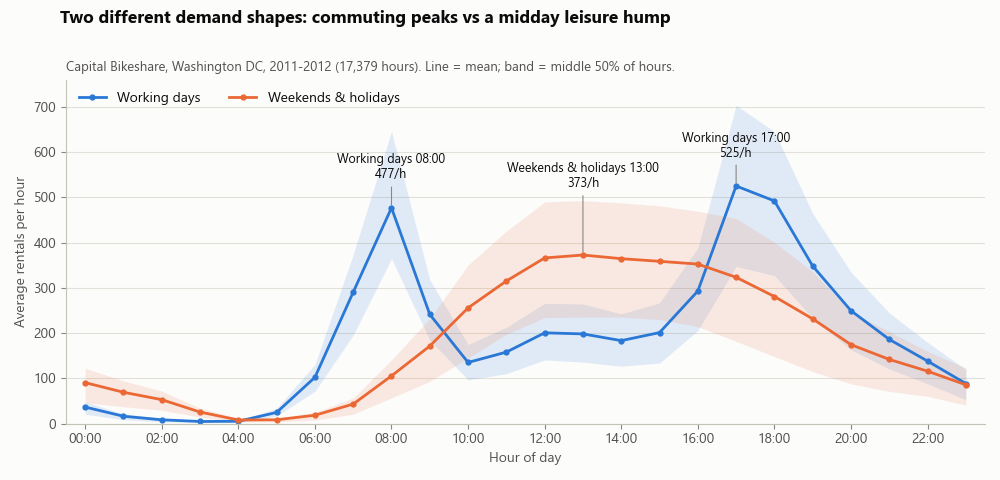
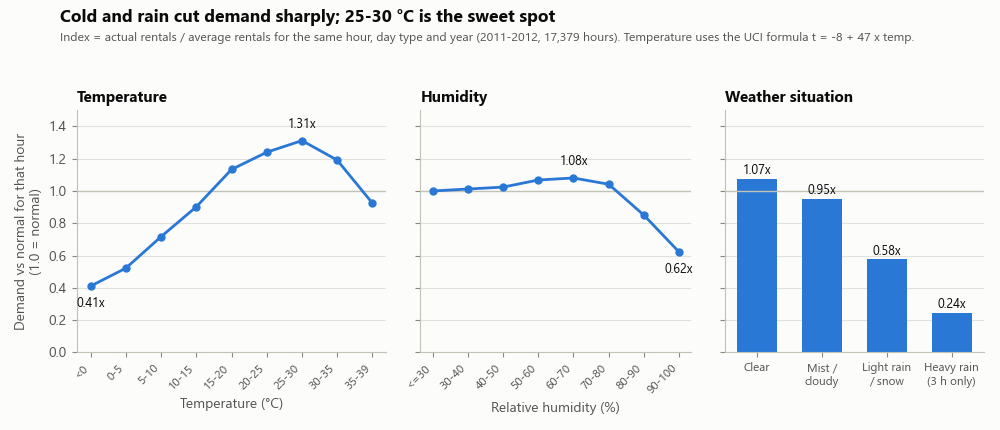
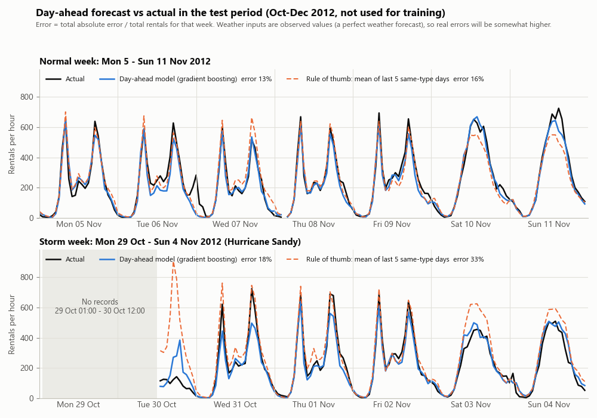

# T2 共享單車需求預測 + AI 調度日報:深度資料分析與項目目標草稿

> **這份是什麼**:選題 T2(共享單車)的真實資料分析、可行性實驗,以及 1.12「目標設定」要用的項目目標/具體目標草稿。所有數字都是用 Python 實際算出來的,不是估的。
> **資料**:UCI Bike Sharing Dataset(id 275),美國華盛頓特區 Capital Bikeshare,2011–2012,CC BY 4.0。
> **建立**:2026-11-04。分析程式在本機 session 暫存區執行(沒有放進 repo),設定寫在附錄 A,照著可以重跑。
> **用語**:課程專有名詞照課程(項目目標、具體目標、可交付成果、利益相關者),其他用台灣用語。圖的標籤是英文。

---

## 0. 一分鐘結論

1. **做得起來**:只用「前一天以前看得到的資料 + 天氣」預測隔天每個小時的用車量,在沒參與訓練的 2012 年 10–12 月,誤差約是平均需求的 **19.4%**(天氣用實測值)到 **約 21%**(模擬天氣預報誤差)。調度員常用的經驗法則(最近 5 個同類型日、同一小時的平均)是 **25.5%**。模型大約把誤差降 2 成。
2. **需求有兩種完全不同的形狀**:工作日是通勤雙峰(8 點 477 次/小時、17 點 525 次/小時),週末假日是中午單峰(13 點 373 次/小時)。兩條曲線的相關只有 0.50,一定要分開處理。
3. **天氣是第二重要的因素**:去掉時段的影響後,氣溫和需求的相關是 0.60;低於 0°C 只剩平常的 0.41 倍,25–30°C 最高(1.31 倍);小雨/小雪只剩 0.58 倍。有沒有天氣資料,誤差差 5–9 個百分點。
4. **資料品質要先處理 4 件事**:少了 165 個小時(UCI 網頁卻寫「沒有缺值」)、兩份官方說明的溫度換算公式不一樣、Readme 的季節代碼標錯、有 3 種錯值(體感溫度、濕度 0、大量風速 0)。
5. **最大限制**:只有全系統每小時總量,沒有站點和位置 → 能回答「什麼時候、要準備多少」,回答不了「哪一站缺車」。AI 日報要寫成「時段 + 車輛/人力準備量」的建議。

---

## 1. 資料概況

### 1.1 資料概況表

| 項目 | 內容 |
|---|---|
| 來源 | UCI Machine Learning Repository,Bike Sharing Dataset(id 275);作者 Hadi Fanaee-T(葡萄牙波爾圖大學 LIAAD) |
| 原始出處 | Capital Bikeshare 公開行程紀錄,彙總成每小時、每天;天氣取自 freemeteo.com,假日取自華府政府假日表 |
| 授權 | CC BY 4.0;使用時要引用 Fanaee-T & Gama(2013),doi:10.1007/s13748-013-0040-3 |
| 下載 | <https://archive.ics.uci.edu/static/public/275/bike+sharing+dataset.zip>(279,992 bytes ≈ 273 KB;免帳號) |
| 檔案 | hour.csv 17,379 列 × 17 欄;day.csv 731 列 × 16 欄;Readme.txt |
| 期間 | 2011-01-01 到 2012-12-31(731 天,照理應有 17,544 個小時) |
| 粒度 | **全系統**每小時租借總次數;沒有站點、沒有經緯度、沒有個人資料 |
| 預測目標 | cnt(每小時租借次數)= casual(非會員)+ registered(會員);17,379 列全部相加正確 → 預測 cnt 時要刪掉這兩欄,不然等於偷看答案 |
| 空值 | 0 個(兩個檔案都是) |
| 總量 | 3,292,679 次租借(2011 年 1,243,103 次;2012 年 2,049,576 次) |
| 兩個檔案的關係 | day.csv 每天的 cnt = hour.csv 當天各小時加總,731 天全部對得上 → 用 hour.csv 就夠 |

### 1.2 資料字典(hour.csv 17 欄)

| 欄位 | 意思 | 原始範圍 | 換成真實單位(本分析採用) | 備註 |
|---|---|---|---|---|
| instant | 列編號 | 1–17,379 | — | 不當特徵 |
| dteday | 日期 | 2011-01-01 ~ 2012-12-31 | — | |
| season | 季節 | 1–4 | 1 冬、2 春、3 夏、4 秋 | Readme 寫 1=春,**是錯的**(§2 #3) |
| yr | 年份 | 0/1 | 0 = 2011、1 = 2012 | |
| mnth | 月份 | 1–12 | | |
| hr | 小時 | 0–23 | | |
| holiday | 假日 | 0/1 | 共 21 天 | 只標在週一到週五的國定/特區假日 |
| weekday | 星期 | 0–6 | 0 = 週日 … 6 = 週六 | 用日曆核對過,17,379 列全對 |
| workingday | 工作日 | 0/1 | 1 = 不是週末也不是假日 | 核對過全對;68.3% 的小時是工作日 |
| weathersit | 天氣狀況 | 1–4 | 1 晴/少雲、2 霧/陰、3 小雨/小雪/雷雨、4 大雨/冰雹/暴雪 | 小時數:11,413 / 4,544 / 1,419 / **3** |
| temp | 氣溫(正規化) | 0.02–1.00 | °C = −8 + 47 × temp → −7.1 ~ 39.0°C | 公式採 UCI 網頁版(§2 #2) |
| atemp | 體感溫度(正規化) | 0–1 | °C = −16 + 66 × atemp → −16 ~ 50°C | 和 temp 相關 0.988 |
| hum | 相對濕度 | 0–1 | × 100 = % | |
| windspeed | 風速 | 0–0.85 | × 67 → 0–57(說明沒寫單位,推測 km/h) | |
| casual | 非會員租借次數 | 0–367 | | 佔總量 18.8% |
| registered | 會員租借次數 | 0–886 | | 佔總量 81.2% |
| cnt | 總租借次數 | 1–977 | | **預測目標**;最小值是 1,沒有任何 0 |

---

## 2. 資料品質問題

| # | 問題 | 證據(實算) | 影響 | 建議處理 |
|---|---|---|---|---|
| 1 | **少了 165 個小時** | 2 年應有 17,544 小時,只有 17,379 列(少 0.94%),分散在 76 天;UCI 網頁寫「沒有缺值」 | 算「昨天同時段」「上週同時段」時會對錯位置 | 先補回完整時間軸再算(本分析已這樣做) |
| 1a | 其中 76 小時是零星缺口 | 64 個缺 1 小時、6 個缺 2 小時;全部缺失裡 2/3 落在凌晨 0–5 點;缺口前後那 1 小時的租借中位數只有 3 次 | 很可能是「那小時 0 次租借,所以沒有那一列」 | 補 0 |
| 1b | 另外 89 小時是 5 段長時間中斷 | 2012-10-29 01:00 ~ 10-30 12:00(36 小時,颶風 Sandy;10/29 全天只剩 1 列、22 次);2011-01-26 18:00 ~ 01-27 15:00(22 小時;當天 16 點出現少見的 weathersit 4,推測是大雪);2011-08-27 18:00 ~ 08-28 06:00(13 小時,時間對得上颶風 Irene);2011-01-18 00–11 點(12 小時,原因不明);2011-02-22 00–05 點(6 小時,原因不明) | 系統停擺或資料中斷,**不能補 0** | 標成「停擺」;訓練時加旗標;AI 日報遇到極端天氣要提醒人工確認 |
| 2 | **溫度換算公式,兩份官方說明不一樣** | zip 裡的 Readme 寫「除以 41(氣溫)/ 50(體感)」;UCI 網頁寫 (t − t_min) / (t_max − t_min),氣溫 −8 ~ 39°C、體感 −16 ~ 50°C | 報告裡的「幾度」差很多:1 月平均 Readme 版 9.7°C、網頁版 3.2°C | 採網頁版(理由見表下) |
| 3 | **Readme 的季節代碼標錯** | Readme:1 春、2 夏、3 秋、4 冬;UCI 網頁:1 冬、2 春、3 夏、4 秋;資料裡 season 1 是 12/21–3/20(整個 1、2 月) | 照 Readme 會把冬天講成春天 | 用網頁版標籤;建模直接用月份 |
| 4 | 體感溫度錯值 | 2012-08-17 全天 24 小時 atemp 都是 0.2424(換算 = 0°C),當天氣溫卻是 21–32°C | 那天的體感特徵是錯的 | 建模用 temp、不用 atemp(兩者相關 0.988,捨棄不可惜)。2011-07-21/22 有 13 小時體感比氣溫高 10°C 以上,是熱浪加潮濕,合理,不是錯值 |
| 5 | 濕度 0 | 2011-03-10 有 22 小時濕度 = 0%,但那天在下雨(weathersit 3) | 錯值 | 當缺值,用前後天補 |
| 6 | 風速 0 太多 | 2,180 小時(12.5%)剛好是 0;0 到 6 km/h 之間沒有任何值;夜間 16–19% 是 0、下午只有 6–8% | 可能是無風,也可能是缺值,分不出來 | 加一個「風速 = 0」旗標,不當成精確的 0 |
| 7 | 極端天氣樣本太少 | weathersit 4 只有 3 小時 | 模型學不到 | 併入第 3 類;極端天氣改用規則 + 警示 |
| 8 | 假日標記太粗 | 21 個假日當天的量,是前後兩週工作日的 0.26 倍(2012 聖誕節)到 1.30 倍(2012 退伍軍人節)都有;解放日、退伍軍人節早上 7–8 點比非工作日同時段的平常高 3.4–7.1 倍 | 只靠一個 0/1 假日欄,模型會猜錯 | 假日分成「真的放假」和「多數人照常上班」兩類;另加「感恩節到新年」的節日期間旗標 |
| 9 | 只有全系統總量 | 沒有站點、沒有位置 | 做不了「哪一站缺車」,也做不了課程案例那種熱點地圖 | 範圍定在「什麼時候、多少」;站點層級列為未來擴充(Capital Bikeshare 有公開的逐筆行程資料,但要另外整理) |
| 10 | 資料舊、成長快 | 2011 → 2012 總量成長 64.9% | 序列不穩定,隨機切分會高估準確度 | 一律用時間切分(本分析已這樣做);報告寫清楚年份限制 |

**為什麼溫度採 UCI 網頁版公式(#2)**(實算):
- Readme 版下,兩個華府冬天**沒有任何一小時低於 0°C**(最低 0.8°C),不合常理;網頁版有 561 小時(3.2%)低於 0°C,最低 −7.1°C,1 月平均 3.2°C、7 月平均 27.5°C。
- 網頁版的體感溫度:0°C 以下比氣溫低 4.9°C、0–5°C 低 3.3°C(風寒),30–35°C 高 3.6°C、35°C 以上高 4.8°C(悶熱),溫和無風(10–20°C、風速 < 15)只差 0.5°C,符合常理;Readme 版連 0–5°C 都「體感比較暖」(+1.3°C),溫和無風時也高 3.9°C。
- 2012-08-17 的錯值 0.2424,用網頁版換算剛好是 0.0°C,像是預設值;用 Readme 版是 12.1°C,看不出意義。
- 相關係數不受影響(線性換算),只影響報告裡寫的「幾度」。

---

## 3. 重要分布

### 3.1 每小時租借量(預測目標 cnt)

| 統計量 | 值 |
|---|---|
| 平均 / 中位數 | 189.5 / 142 次 |
| 標準差 | 181.4(變異係數 0.96) |
| 最小 / 最大 | 1 / 977 |
| 10% / 25% / 75% / 90% / 99% 分位數 | 9 / 40 / 281 / 451 / 782 |
| 偏態 | 1.28(右偏,平均大於中位數) |
| 取 log 後的偏態 | −0.82(變成左偏,修過頭) |
| 開根號後的偏態 | 0.29(最接近對稱) |
| 一小時 ≤ 10 次的比例 | 11.4% |
| 最忙的 20% 小時 | 佔全部租借的 51.3% |

- 白話:大部分小時不多,少數尖峰小時特別多,半夜常常只有個位數。
- 每天:平均 4,504 次、中位數 4,548、標準差 1,937;最少 22 次(2012-10-29,Sandy),最多 8,714 次(2012-09-15,週六)。每天的量幾乎對稱(偏態 −0.05)。

### 3.2 會員和非會員

- 非會員佔 18.8%;工作日只佔 13.2%,週末假日佔 31.7%。
- 每天平均:工作日 = 會員 3,978 + 非會員 607 = 4,585 次;週末假日 = 會員 2,959 + 非會員 1,371 = 4,330 次。
- 工作日早上 8 點,95.3% 是會員(通勤);週末 12–16 點,非會員佔 36.8%(休閒)。
- 白話:每天的總量差不多,但「誰在騎」「幾點騎」完全不同。

### 3.3 時段 × 工作日(圖 a)

- **工作日**:17 點 525、18 點 492、8 點 477 次/小時;凌晨 3 點只有 4.9 次 → 尖峰約是離峰的 106 倍。7–9 點加 16–19 點這 7 個小時,佔工作日租借量的 57.9%。
- **週末/假日**:13 點 373、12 點 366、14 點 365 次/小時;凌晨 4 點最低(8.3 次)。
- 兩條曲線的相關只有 0.50;假日的曲線像週末(相關 0.96),不像工作日(0.68)。
- **同一時段每天也差很多**:工作日 8 點,最少的 10% 日子低於 210 次、最多的 10% 高於 719 次;17 點是 196 到 844 次。「每天都一樣」的假設會錯很大,這正是需要預測的原因。

### 3.4 季節、月份、星期、假日

- 每天平均(季節,用網頁版標籤):冬 2,604、春 4,992、夏 5,644、秋 4,728 次。
- 月份:1 月 2,176 次最低、6 月 5,772 次最高(差 2.65 倍);9 月 5,767 次也很高。
- 星期:總量很平(週日 4,229 最低、週五 4,690 最高);但非會員週六 1,465、週日 1,338 次,是週二、週三(約 551–556)的 2.4–2.7 倍。
- 假日:平均每天 3,735 次(工作日 4,585、一般週末 4,390)。和前後 14 天的工作日比,中位數是 0.82 倍,但個別差很大:2012 聖誕節 0.26 倍、感恩節 0.45–0.49 倍;國慶日 1.13–1.28 倍、2012 退伍軍人節 1.30 倍。

### 3.5 年成長

- 2011 → 2012:總量 +64.9%(1,243,103 → 2,049,576 次);會員 +68.4%、非會員 +50.8%;每小時平均 143.8 → 234.7 次。
- 成長在變慢:1–9 月 +69.3%,10–12 月 +51.8%;1 月 +153%、3 月 +157%,到 12 月只剩 +42%。
- 意思:用「全部歷史平均」預測 2012 年會嚴重低估(§5 的 N1 在 2012 Q2、Q3 低估 4 成以上),要靠最近幾週的資料抓水準。

### 3.6 異常日和異常小時

和「以當天為中心的 15 天中位數」比,有 27 天不到一半、14 天不到 4 成。最嚴重的幾天:

| 日期 | 星期 | 當天次數 | 相對 15 天中位數 | 原因(推測) |
|---|---|---|---|---|
| 2012-10-29 | 一 | 22 | 0.00 | 颶風 Sandy,系統停擺(全天只剩 0 點 1 筆) |
| 2011-10-29 | 六 | 627 | 0.16 | 雨雪(weathersit 3,濕度 88%) |
| 2012-04-22 | 日 | 1,027 | 0.16 | 雨天(weathersit 3) |
| 2012-10-30 | 二 | 1,096 | 0.19 | Sandy 隔天,13 點後才有資料 |
| 2011-12-07 | 三 | 705 | 0.20 | 雨天(濕度 97%) |
| 2011-08-27 | 六 | 1,115 | 0.24 | 時間對得上颶風 Irene,18 點後中斷 |
| 2012-12-26 | 三 | 441 | 0.25 | 聖誕節隔天,雨雪 |

- **異常高的小時**(比同年份、同類型日、同時段的平常高 3.4–7.1 倍):假日早上 7–8 點(2012-04-16 解放日 7 點 7.1 倍、2012-11-12 退伍軍人節 7 點 4.8 倍 → 推測多數人照常上班);2011-08-23 下午 14–15 點 4.1–4.7 倍(時間對得上當天下午的維吉尼亞州地震,推測是疏散人潮);國慶日晚上 21–22 點 3.4–4.0 倍(煙火)。
- 用「同時段 × 工作日」的四分位距抓離群值:130 個偏高的小時(0.7%),沒有偏低的。

### 3.7 自相關(現在跟過去有多像)

| 落後 | 原始序列 | 去掉「時段 × 工作日 × 年份」平均後 |
|---|---|---|
| 1 小時 | 0.843 | 0.876 |
| 2 小時 | 0.592 | 0.729 |
| 3 小時 | 0.402 | 0.620 |
| 24 小時(昨天同時段) | 0.819 | 0.593 |
| 48 小時 | 0.687 | — |
| 168 小時(上週同時段) | **0.876** | 0.549 |
| 336 小時(兩週前同時段) | 0.872 | — |

- 原始序列:上週同時段(0.876)比昨天同時段(0.819)還像,因為週一像週一、週六像週六。
- 去掉平常規律以後的「今天比平常多或少」:會延續好幾個小時(1 小時 0.88、3 小時 0.62),也會部分延續到隔天(0.59)→ 用「最近幾天的狀況」預測隔天有用。
- 每天的序列:前一天 0.849、上週同一天 0.757。

---

## 4. 和需求最相關的因素

### 4.1 相關係數

「去掉時段後」= 先把每小時的量換成「比同年份、同工作日類型、同時段的平均多或少」(取 log),再算相關;這樣可以排除「下午比較暖、下午人也比較多」這種假相關。

| 因素 | 每小時 Pearson / Spearman | 去掉時段後 Pearson / Spearman | 每天 Pearson / Spearman | 白話 |
|---|---|---|---|---|
| 氣溫 | 0.405 / 0.423 | **0.599 / 0.635** | **0.627** / 0.622 | 最重要的天氣因素;越暖越多,太熱會降 |
| 體感溫度 | 0.401 / 0.423 | 0.606 / 0.638 | 0.631 / 0.623 | 和氣溫幾乎一樣,擇一使用 |
| 天氣狀況(1–4) | −0.142 / −0.126 | **−0.311 / −0.252** | −0.297 / −0.272 | 下雨下雪明顯變少 |
| 濕度 | −0.323 / −0.360 | −0.073 / −0.045 | −0.101 / −0.098 | 原始相關多半是假的:半夜濕度高、需求也低;只有 > 90%(多半在下雨)才真的掉 |
| 風速 | +0.093 / +0.127 | −0.134 / −0.111 | −0.235 / −0.217 | 原始是正的(下午風大、人也多),去掉時段後才是負的 |
| 時段 | 0.394 / 0.511 | — | — | 雙峰,不是直線關係,相關係數低估了它(見 4.3) |
| 年份 | 0.250 / 0.207 | — | 0.567 / 0.572 | 一年成長 65% |
| 季節 | 0.178 / 0.185 | 0.443 / 0.435 | 0.406 / 0.398 | 主要透過氣溫起作用 |
| 月份 | 0.121 / 0.126 | 0.310 / 0.325 | 0.280 / 0.272 | 同上 |
| 工作日 | 0.030 / 0.021 | — | 0.061 / 0.058 | 總量差不多,但形狀完全不同(§3.3) |
| 假日 | −0.031 / −0.030 | −0.066 / −0.056 | −0.068 / −0.064 | 平均影響小,個別假日差很大(§3.4) |

### 4.2 分組看倍數(圖 b)

倍數 = 實際租借 ÷ 同年份、同工作日類型、同時段的平均(1.0 = 平常)。

| 條件 | 倍數(小時數) |
|---|---|
| 氣溫 < 0°C / 0–5 / 5–10 / 10–15°C | 0.41(561)/ 0.52(2,011)/ 0.72(3,241)/ 0.90(2,516) |
| 氣溫 15–20 / 20–25 / **25–30** / 30–35 / 35–39°C | 1.13(2,540)/ 1.24(3,825)/ **1.31**(1,976)/ 1.19(625)/ 0.93(84) |
| 濕度 ≤ 80% / 80–90% / 90–100% | 1.00–1.08(13,411)/ 0.85(2,800)/ 0.62(1,168) |
| 風速 ≤ 20 / 20–30 / 30–40 / 40–57 km/h | 1.02(14,976)/ 0.93(1,739)/ 0.80(601)/ 0.62(63) |
| 晴 / 霧陰 / 小雨小雪 / 大雨暴雪 | 1.07(11,413)/ 0.95(4,544)/ 0.58(1,419)/ 0.24(3) |

- 小雨時,工作日尖峰(8、17、18 點)是 0.62 倍,週末下午(12–16 點)是 0.58 倍 → 通勤族下雨也會改搭別的交通工具。
- 非會員對天氣比較敏感:小雨 0.46 倍(會員 0.60)、低於 5°C 只剩 0.19 倍(會員 0.56)、25–30°C 是 1.59 倍(會員 1.24)。

### 4.3 每個因素能解釋多少

用「分組平均」當最簡單的規則,在全部資料上看能解釋多少變化(R²;這是擬合程度,不是預測能力,預測能力看 §5):

| 只用 | 能解釋的變化 |
|---|---|
| 幾點 | 50.1% |
| 幾點 × 是不是工作日 | 63.5% |
| 再加年份 | 74.1% |
| 再加月份 | 88.0% |

剩下約 12% 是天氣、事件和隨機起伏。白話:**「幾點、哪種日子」決定大部分,天氣和特殊事件決定剩下的、也是最難的那一塊。**

---

## 5. 可行性實驗結果

### 5.1 實驗設定

- **情境 A(隔天日報,主情境)**:前一天結束時,預測隔天 24 個小時。只能用 24 小時以前的租借資料(昨天同時段、上週同時段、最近 5 個同類型日同時段平均、上一個同類型日同時段、前一天總量、前 7 天平均總量),加上日曆和天氣。
- **情境 B(下一小時,對照用)**:再加 1–3 小時前的租借量。日報用不到,只用來看「越接近越準」差多少。
- **時間切分**:訓練 2011-01-08 ~ 2012-09-30(15,050 小時;前 7 天沒有「上週」資料先去掉);測試 2012-10-01 ~ 12-31(2,168 小時,平均每小時 219.2 次、每天 5,165 次)。另外用 2012 Q2、Q3 當測試期各再做一次,看結果穩不穩。
- 測試期每天用「前一天的實際值」更新 lag,模型本身不重新訓練。
- **天氣**:用實測值,等於假設天氣預報完全準(偏樂觀);另外做「不用天氣」和「模擬預報誤差」(§5.3)。
- **模型設定事先固定,沒有用測試期調參數**(所以是保守的起點):隨機森林 300 棵樹;梯度提升用 HistGradientBoosting(Poisson 損失、學習率 0.05、600 輪);線性迴歸用「時段 × 工作日」「星期」「月份」「天氣狀況」的虛擬變數,加氣溫、氣溫平方、濕度、風速。
- **指標**:MAE(平均每小時差幾次)、RMSE(大錯罰比較重)、**WAPE = MAE ÷ 平均需求**(本文主指標);另看工作日尖峰(7–9、16–19 點)、每天總量、每小時 ≥ 500 次的高峰警示(測試期共 237 個高峰小時)、每天最忙的那個小時有沒有抓對(±1 小時)。
- 不用 MAPE:11.4% 的小時 ≤ 10 次,差 5 次就是 50%,會被半夜的小數字放大 → 改用 WAPE。

### 5.2 主結果(測試期 2012-10-01 ~ 12-31)

| 方法 | 日報能用 | MAE | RMSE | WAPE(MAE ÷ 平均) | 尖峰 WAPE | 每天總量 WAPE | 高峰警示 召回 / 精確 | 最忙時段抓對 |
|---|---|---|---|---|---|---|---|---|
| N1 歷史平均(時段 × 工作日) | ✔ | 79.4 | 119.0 | 36.2% | 33.7% | 32.0% | 21% / 80% | 60% |
| N2 上週同時段 | ✔ | 70.1 | 117.0 | 32.0% | 26.6% | 24.9% | 74% / 65% | 64% |
| N3 經驗法則:最近 5 個同類型日、同時段平均 | ✔ | 55.9 | 93.1 | **25.5%** | 18.7% | 19.8% | 80% / 69% | 68% |
| M1 線性迴歸(日曆 + 天氣) | ✔ | 71.7 | 98.9 | 32.7% | 24.8% | 17.2% | 52% / 86% | 56% |
| M2 線性迴歸 + 前一天以前的 lag | ✔ | 49.4 | 77.1 | 22.6% | 16.4% | 15.1% | 78% / 78% | 62% |
| M3 隨機森林 + lag | ✔ | 44.9 | 71.7 | 20.5% | **15.4%** | **13.3%** | 80% / 79% | 70% |
| **M4 梯度提升 + lag** | ✔ | **42.5** | **66.4** | **19.4%** | 16.2% | 13.7% | 72% / 87% | 71% |
| M4a 梯度提升,只用日曆 + 天氣 | ✔ | 43.6 | 68.6 | 19.9% | 19.3% | 14.6% | 64% / 90% | 63% |
| M4b 梯度提升 + lag,不用天氣 | ✔ | 52.9 | 84.4 | 24.1% | 18.1% | 19.0% | 65% / 73% | 64% |
| M5 梯度提升 + 1–3 小時前(下一小時) | ✘ | 28.4 | 44.9 | 13.0% | 10.8% | 7.2% | 79% / 87% | 79% |

- M4 的 R² 是 0.892。去掉 Sandy 兩天後 WAPE 19.2%,幾乎不變。
- M4 每天的誤差:中位數 11.8%;43.5% 的日子在 10% 以內、62.0% 在 15% 以內。
- N2 有 39 小時因為上週同時段沒資料,改用 N1 的值。

### 5.3 天氣資料有多重要(M4,同一測試期)

| 天氣怎麼給 | WAPE | 尖峰 WAPE | 每天總量 WAPE |
|---|---|---|---|
| 實測逐時天氣(= 完美預報) | 19.4% | 16.2% | 13.7% |
| 模擬逐時預報誤差(假設:氣溫 ±2°C、濕度 ±8 點、風速 ±5 km/h、20% 的小時天氣狀況差一級;5 次平均) | **20.9%**(20.8–21.1%) | 18.0% | 14.8% |
| 完全不用天氣(M4b) | 24.1% | 18.1% | 19.0% |
| 只給「整天」的天氣摘要(日平均、當天最差天氣) | 26.3% | 23.3% | 21.9% |

- **上線後的合理預期**:隔天預測誤差約 21%(有逐時天氣預報)到 24%(沒有),仍然比經驗法則 25.5% 好,但優勢從 24% 縮到 6–18%。
- 要避開的坑:用逐時天氣訓練、卻拿整天摘要來預測,誤差反而比不用天氣還高(26.3%)→ 改法:訓練和上線用同一種天氣資料(都用逐時預報)。
- 只用日曆 + 天氣的 M4a,在完美天氣下和 M4 差不多(19.9%),遇到預報誤差就掉得比較多(22.1% 對 20.9%;尖峰 21.4% 對 18.0%)→ 加上「最近幾天」的資料,模型比較不怕天氣預報不準。

### 5.4 換測試期也成立嗎(WAPE)

| 方法 | 2012 Q2 | 2012 Q3 | 2012 Q4(主) |
|---|---|---|---|
| N3 經驗法則 | 20.0% | 15.4% | 25.5% |
| M2 線性迴歸 + lag | 18.8% | 16.1% | 22.6% |
| M3 隨機森林 + lag | 17.3% | 14.0% | 20.5% |
| M4 梯度提升 + lag | 16.4% | 13.6% | 19.4% |
| M4a 只用日曆 + 天氣 | 14.3% | 13.3% | 19.9% |
| M4b 不用天氣 | 25.3% | 19.1% | 24.1% |
| M5 下一小時 | 12.9% | 11.1% | 13.0% |

- M4 三季都贏經驗法則,誤差低 12–24%。Q4 最難(感恩節、聖誕節、Sandy、天氣轉冷),Q3 最容易。
- **沒有天氣資料,模型不一定贏經驗法則**:M4b 在 Q2(25.3% 對 20.0%)和 Q3(19.1% 對 15.4%)都輸 → 天氣預報是這個系統的必要輸入。

### 5.5 最重要的特徵(M4;把特徵打亂後 MAE 增加多少)

| 特徵群組 | MAE 增加 |
|---|---|
| 最近的歷史(7 個 lag 一起打亂) | +132.0 |
| 天氣(5 欄) | +30.2 |
| 日曆(6 欄) | +11.0 |

- 單一特徵前幾名:最近 5 個同類型日同時段平均 +121.2、氣溫 +15.5、時段 +9.5、濕度 +6.9、天氣狀況 +4.8、前 7 天平均總量 +4.2、星期 +3.8、上一個同類型日同時段 +3.7。
- 日曆看起來不重要,是因為「最近 5 個同類型日同時段平均」已經包含時段和工作日的資訊;在只用日曆 + 天氣的 M4a 裡,日曆打亂後 MAE +134.3、天氣 +41.6。白話:**時段規律最重要,天氣第二。**
- 下一小時模型(M5):1 小時前 +82.4、最近 5 個同類型日同時段平均 +73.6、時段 +15.8。

### 5.6 錯在哪裡(M4)

| 日期 | 情況 | 實際 | M4 預測 | 經驗法則 |
|---|---|---|---|---|
| 2012-11-22 | 週四,感恩節 | 2,425 | 5,565 | 5,991 |
| 2012-12-01 | 週六,陰霧但實際很多人騎(原因不明) | 5,191 | 2,921 | 3,485 |
| 2012-12-08 | 週六,同上 | 5,582 | 3,406 | 3,393 |
| 2012-12-22 | 週六,聖誕假期前,冷且風大(27 km/h) | 1,749 | 3,905 | 4,458 |
| 2012-11-24 | 週六,感恩節週末,冷且風大(25 km/h) | 2,277 | 4,368 | 5,169 |
| 2012-12-24 | 週一,聖誕夜(資料標成工作日) | 920 | 2,433 | 4,626 |

- 假日:哥倫布日(10/8)誤差 8.9%、退伍軍人節(11/12)6.3%,這兩個多數人照常上班,模型抓得到;感恩節多估 129%、聖誕節多估 112%,真的放假,模型高估一倍以上。
- 時段:白天 7–19 點誤差 16–20%;凌晨 2–3 點 43–50%(數字小,對調度影響不大)。
- 圖 c:一般週(11/5–11/11)M4 誤差 12.9%、經驗法則 16.4%;Sandy 週(10/29–11/4)M4 17.6%、經驗法則 32.8%。M4 用的是實測天氣、知道會下雨,真實預報不一定這麼準。

### 5.7 可行性結論

- ✔ 資料夠、規律強,固定設定的簡單模型就有約 19–21% 的誤差,比經驗法則好 → 適合當 AT2/AT3 的題目。
- ⚠ 真正的難點(也是 AT3 可以加分的地方):① 天氣要用預報;② 節日期間(感恩節到新年)錯最多;③ 尖峰時段的優勢不大(模擬預報下 18.0%,經驗法則 18.7%)。
- 這三點剛好是「做得到、但不簡單」的挑戰,符合技術目標檢查清單第 4 大項。

---

## 6. 對 AT2 的意義

### 6.1 和課程「出租車乘客需求」案例的對照

| 面向 | 課程案例:出租車 | 我們:共享單車 T2 | AT2 怎麼寫 |
|---|---|---|---|
| 業務問題 | 乘客等太久 → 縮短等候時間 | 尖峰缺車/缺位、臨時調度 → 提前排好車和人 | 寫我們自己的營運情境,不照抄案例 |
| 資料 | 10 年行程(含經緯度)+ 區域多邊形 + 天氣 API | 2 年全系統每小時總量,天氣已併好 | 資料準備比案例輕很多,省下的時間拿去做 AI 日報和評估 |
| 空間分析 | 上車點落在哪一區、熱點地圖 | **沒有站點資料** | 改做「時間熱點」:哪幾個小時、哪種日子、什麼天氣最忙 |
| 預測 | 各區未來需求 | 全系統隔天每小時需求 | 寫清楚「預測時間點 = 前一天傍晚」 |
| 輸出 | 地圖儀表板 | 預測曲線 + 高峰警示 + AI 調度日報 | 對到 AT3 的分析系統和使用者介面 |
| 方法 | 線性模型、深度學習 | 經驗法則 → 傳統 ML → 深度學習/基礎模型對照 → LLM 寫日報 | 見 6.3 |

### 6.2 要做得跟案例不一樣的地方

1. **先講清楚決策時間點**:隔天日報只能用前一天以前的資料。用了 1 小時前的資料,誤差看起來只有 13.0%,但那是即時預測,日報用不到 → 報告裡兩種都列,標清楚哪一個能用。
2. **天氣用預報**:實驗做「完美天氣 / 模擬預報誤差 / 不用天氣」三種,誠實寫出上線後的誤差範圍(約 21–24%)。
3. **加上假日/活動日曆**:由旅遊/活動背景的組員整理(感恩節到新年、國慶煙火、櫻花季週末、照常上班的假日)。目前錯最大的就是這些日子。
4. **極端天氣走規則**:颶風、暴雪時系統會停擺(Sandy 連續 36 小時沒有資料),日報直接標「需要人工確認」,不硬給數字。
5. **AI 日報的數字一律由模型產生**:LLM 只負責把數字寫成調度建議;再用程式自動核對日報裡每一個數字,確保沒有 LLM 自己編的數字。
6. **評估用時間切分 + 三個測試季**:證明不是運氣好(AT2 評分 C3 要「有說服力的指標」)。

### 6.3 基準方法和前沿 AI 怎麼放

| 層級 | 方法 | 角色 | 目前結果(2012 Q4 WAPE) |
|---|---|---|---|
| 簡單基準 | 上週同時段;時段 × 工作日歷史平均 | 最低標準 | 32.0%;36.2% |
| 現行做法基準 | 最近 5 個同類型日同時段平均(模擬調度員的經驗法則) | **要打敗的對象** | 25.5% |
| 傳統機器學習 | 線性迴歸、隨機森林、梯度提升 | 主力模型 | 22.6%、20.5%、19.4% |
| 前沿對照 1 | 深度學習時間序列模型(例:LSTM、Temporal Fusion Transformer) | AT2 評分要的「前沿基準方法」 | AT3 再做 |
| 前沿對照 2 | 時間序列基礎模型零樣本預測(例:Chronos、TimesFM) | 不用訓練就能預測,看能不能贏 | AT3 再做 |
| 前沿應用 | 大型語言模型寫調度日報 | 把預測變成看得懂、可以照做的建議 | AT3 做;評估方式見 §7 |

選擇標準(寫進 AT2):準確度(WAPE、尖峰 WAPE)、穩定度(三個測試季)、可解釋性(營運主管看得懂原因)、運算成本、部署難度。

### 6.4 先放進 AT2 風險表的風險

| 風險類別 | 風險指標 | 緩解措施 | 剩餘風險 |
|---|---|---|---|
| 資料範圍 | 沒有站點資料,調度建議只能到時段層級 | 範圍寫清楚;站點層級列為未來擴充 | 中 |
| 資料品質 | 165 個缺失小時、溫度公式、錯值 | 照 §2 處理,寫進資料品質報告 | 低 |
| 天氣預報 | 上線用預報,誤差從 19.4% 升到約 21–24% | 實驗做三種天氣情境;AT3 接天氣預報或用模擬誤差評估 | 中 |
| 資料過時 | 2011–2012 年資料,一年成長 65% | 時間切分 + 最近幾天的 lag;報告說明限制 | 中 |
| 特殊日 | 感恩節、聖誕節誤差超過 100% | 假日/活動日曆;特殊日標人工確認 | 中 |
| AI 日報 | LLM 寫錯數字或給出不合理建議 | 數字由程式填入並自動核對;營運背景組員審查 | 低 |
| 人員 | 時程衝突、有人退出 | 每人負責一塊、互相備援 | 低 |

---

## 7. 項目目標與具體目標(草稿,給 1.12 和 AT2 用)

### 7.1 項目目標(Project aim)

> **為共享單車營運團隊預測隔天每小時的用車需求,並自動產出 AI 調度日報,讓團隊在尖峰前把車輛和調度人力排好,降低尖峰時段的供需落差和臨時調度成本。**

寫法照 1.8 Telco 正解:「為誰的什麼決策 → 做什麼 → 達成什麼業務成果」;不寫演算法(演算法是手段,不是目標)。

### 7.2 項目具體目標(Project objectives)

期限:AT2 計畫報告與簡報 **2026-12-11**;AT3 原型與報告 **2027-02-19**。

| # | 具體目標 | 怎樣算達成(指標 + 目標值) | 評估資料 | 期限 | 現在的基準(本分析) |
|---|---|---|---|---|---|
| O1 | 找出並量化影響每小時需求的主要因素,整理成營運團隊看得懂的「需求規律表」 | 至少 5 個因素(時段 × 工作日、季節、氣溫、雨雪、假日/活動),每個都有「比平常多/少幾倍」和樣本數;§2 的 10 個資料問題都有處理方式 | 2011–2012 全部 17,379 小時 | AT2(12/11) | 初版已完成(§2–§4) |
| O2 | 開發隔天每小時需求預測器(只用前一天以前看得到的資料 + 天氣預報) | 整體 WAPE ≤ 20%,而且比經驗法則低至少 20%;每天總量 WAPE ≤ 14% | 保留測試期 2012-10-01 ~ 12-31(2,168 小時、92 天),天氣用模擬預報 | AT2 交設計和基準結果;AT3(2/19)交原型 | 完美天氣 19.4%、模擬預報 20.9%(經驗法則 25.5%);每天總量 13.7% / 14.8% |
| O3 | 評估預測器在尖峰、高峰和特殊日的可靠度,標出什麼時候要人工確認 | 工作日尖峰 WAPE ≤ 17%;≥ 500 次/小時的高峰警示,召回率和精確率都 ≥ 80%;2012 Q2、Q3、Q4 三季都贏經驗法則;特殊日(感恩節、聖誕節前後)全部標成「需人工確認」,或日誤差 ≤ 30% | 同上,加 2012 Q2、Q3 | AT3 | 尖峰 16.2%(模擬預報 18.0%);警示 72% / 87%;三季都贏(完美天氣);感恩節 +129%、聖誕節 +112% |
| O4 | 用大型語言模型把預測寫成調度日報(時段、需求量、和平常比、原因、建議) | 日報裡的數字 100% 對得上模型輸出(程式自動核對);兩位營運背景組員盲評,≥ 80% 的日報評為「可以直接用」(5 分量表 ≥ 4 分);每份產出 < 1 分鐘 | 測試期隨機抽 30 天的日報 | AT2 交設計和評分表;AT3 交原型和評估結果 | 還沒開始(§7.5 有示意) |
| O5 | 估算使用預測和日報後的業務效益(定量成本效益分析) | 把「尖峰錯估的車次」換算成調度車趟數和人力工時,假設參數由營運組員確認,並做 ±50% 敏感度分析;目標:尖峰錯估量比經驗法則少 ≥ 10% | 測試期的工作日尖峰小時 | AT3 | 完美天氣下,每個工作日尖峰錯估 517 次,經驗法則 596 次(少 13%);模擬預報下只少約 4% |

- 為什麼這些目標值合理:O2 的 20% 介於「完美天氣 19.4%」和「模擬預報 20.9%」之間,要靠假日日曆和調參數再進步約 1 個百分點 → 不是空想,也不是輕易就做得到。O3、O5 的尖峰目標比現況嚴格,是 AT3 要攻的地方。
- 對照 Telco 正解的三步(做出預測器 → 評估多準 → 算划不划算):O2 → O3 → O5;O1 和 O4 是我們題目的特色(看得懂的規律、AI 日報)。

### 7.3 交付成果(Deliverables)

| # | 交付成果 | 成熟度 | 對應目標 | 交付時間 |
|---|---|---|---|---|
| D1 | AT2 計畫報告 + 簡報(資料品質報告、需求規律、基準實驗、系統設計、時程與風險) | 設計報告 | O1–O5 | 2026-12-11 |
| D2 | 隔天需求預測器(Python,可重跑、有版本控制) | 原型 | O2、O3 | 2027-02-19 |
| D3 | AI 調度日報產生器(提示詞 + 數字自動核對 + 30 份樣本日報和評分結果) | 原型 | O4 | 2027-02-19 |
| D4 | 互動介面:選日期 → 看到隔天預測曲線、高峰警示、AI 日報 | 原型 | O2–O4 | 2027-02-19 |
| D5 | AT3 分析報告(評估結果、成本效益、部署與監控計畫)+ 成果展示 | 技術報告 + 演示 | O1–O5 | 2027-02-19 |

不在範圍(寫清楚可以防範圍蔓延):站點層級調度、接上真正的營運系統、下一小時即時預測上線 → 列為未來擴充。

### 7.4 成功標準(業務語言 → 指標 → 目標值 → 評估資料)

| 誰在意 | 業務語言 | 指標 | 目標值 | 評估資料 |
|---|---|---|---|---|
| 營運主管 | 明天每個小時大概多少人借車,要比現在的經驗法則準 | 每小時 WAPE | ≤ 20%,且比經驗法則低 ≥ 20% | 2012-10-01 ~ 12-31 保留測試期 |
| 調度員 | 尖峰時段不能估錯太多 | 工作日 7–9、16–19 點的 WAPE | ≤ 17% | 同上,工作日尖峰小時 |
| 調度員 | 爆量的時段要提早知道 | ≥ 500 次/小時的高峰警示 召回率 / 精確率 | 都 ≥ 80% | 同上(237 個高峰小時) |
| 營運主管、財務 | 明天整天要準備多少車和人 | 每天總量 WAPE | ≤ 14% | 同上(92 天) |
| 調度員 | 日報要看得懂、數字不能錯 | 數字一致率;「可以直接用」的比例 | 100%;≥ 80% | 測試期 30 份日報,兩位營運背景組員盲評 |
| 高層 | 不是運氣好,換季也成立 | 三個測試季都贏經驗法則 | 3 / 3 季 | 2012 Q2、Q3、Q4 |
| 財務 | 值不值得做 | 尖峰錯估量換算的調度成本 | 比經驗法則少 ≥ 10% | 測試期工作日尖峰 |

### 7.5 AI 調度日報長相(示意)

用模型對 2012-11-07(週三)的真實預測數字寫的示意稿;建議的規則之後由營運背景組員訂。

> **11/7(三)調度日報**:預估全天約 4,480 次,比最近 5 個工作日的平均少約 2 成(4–7°C 偏冷、全天陰霧,22 點後轉小雨)。尖峰:早上 8 點約 575 次、傍晚 17 點約 535 次。建議:補車在 7 點前完成;傍晚尖峰維持平常人力;22 點後下雨,夜間需求再降。

事後核對:實際 5,035 次(模型少估 11%,經驗法則多估 13%);7 個尖峰小時實際 2,862 次,模型 2,775 次(−3%),經驗法則 3,377 次(+18%)。

### 7.6 用課程檢查清單自我檢查(以 O2 為例)

| 技術目標檢查清單 | O2 |
|---|---|
| 非本領域的人也看得懂 | ✔「預測明天每個小時大概多少人借車」;WAPE 講成「誤差佔平均需求幾 %」 |
| 判斷得出何時達成(指標 + 目標值 + 評估資料) | ✔ WAPE ≤ 20%、比經驗法則低 ≥ 20%、2012 Q4 保留測試期 |
| 是理想的目標 | ✔ 涵蓋用例的核心技術(隔天逐時預測);同一套方法也能用在維修排班、其他城市、電動滑板車 |
| 是有現實可行性的挑戰 | ✔ 不是空想(完美天氣已 19.4%);也不簡單(模擬預報下 20.9%,還差約 1 個百分點) |

可以配一個研究問題(已過研究問題檢查清單):「加入天氣預報和假日/活動日曆後,隔天每小時用車量的預測誤差,能比現行經驗法則低多少?在尖峰時段和特殊日子是否仍然成立?」→ 外行看得懂;在保留測試期量完就算回答;答案現在還不知道;回答後直接告訴我們 O2、O3 做不做得到。

### 7.7 對到 AT2 範本(業務目標 2–3 個 → 分析目標 → 任務)

| 業務目標 | 分析目標 | 任務 |
|---|---|---|
| B1 尖峰前把車和人排好,降低供需落差 | A1 隔天每小時需求預測(O2、O3) | 特徵與基準實驗;模型比較與三季驗證 |
| B2 讓每天的調度決策更快、更一致 | A2 AI 調度日報(O4) | 日報格式與提示詞;數字核對與人工評分 |
| B3 證明值得投資 | A3 需求規律與成本效益(O1、O5) | 需求規律表;成本效益與敏感度分析 |

---

## 8. 簡體中文版(可直接貼到 1.12 討論區)

**项目目标**
为共享单车运营团队预测次日每小时的用车需求,并由 AI 自动生成调度日报,帮助团队提前把车辆和人手安排到高峰时段,减少高峰时段的供需落差和临时调度。

**项目具体目标**
1. 分析时段、工作日与节假日、季节和天气对用车量的影响,整理成运营团队看得懂的需求规律。
2. 开发次日每小时用车需求预测模型,在保留的测试数据上,误差比现有的经验做法低约两成。
3. 评估模型在高峰时段和特殊日子(节假日、恶劣天气)是否可靠,标出需要人工确认的情况。
4. 用大语言模型把预测结果写成调度日报,并请有运维经验的组员评估日报能否直接使用。
5. 估算使用预测和日报后,能减少多少调度误差和成本。

---

## 附錄 A:怎麼重跑

- 環境:Python 3.11;pandas 2.2.2、numpy 2.0.2、scipy 1.15.3、scikit-learn 1.6.1、matplotlib 3.10.0。
- 資料檔:bike+sharing+dataset.zip,SHA-256 = B70182D0D0508E9ABBB79306CE5C0CEC34869000F8220175AC83D11DBE845401。
- 步驟:① 建完整時間軸 2011-01-01 00:00 ~ 2012-12-31 23:00(17,544 小時),缺的小時在 lag 裡當缺值;② lag 用「剛好 N 小時前」計算;「同類型日」= 依 workingday 分組、同一小時,往前取;③ 切分照 §5.1;④ 模型設定照 §5.1,random_state = 42;⑤ 打亂特徵的重要度用測試期,重複 5 次。
- 倍數(§4.2)= 該組實際租借總和 ÷ 該組「同年份 × 同工作日類型 × 同時段」平均的總和。
- 程式放在本機 session 暫存區(沒有進 repo):`C:\Users\kenny\AppData\Local\Temp\claude\476d15717a45c1e6\66c84686-18d2-4c45-af00-b5ddefa1104b\scratchpad\deep\T2\scripts\`(01_eda.py、02_model.py、03_charts.py、04_extra.py);暫存區之後可能被清掉,要保留的話再放進 repo。

## 附錄 B:參考資料

- Fanaee-T, H., & Gama, J. (2013). Event labeling combining ensemble detectors and background knowledge. *Progress in Artificial Intelligence*, 1–15. <https://doi.org/10.1007/s13748-013-0040-3>
- UCI Machine Learning Repository. Bike Sharing Dataset (id 275). CC BY 4.0. <https://archive.ics.uci.edu/dataset/275/bike+sharing+dataset>
- 課程:[11_單元一_整合筆記.md](../11_單元一_整合筆記.md) §12(aim → objectives → deliverables)、§14(成功標準)、§21(兩份檢查清單)、§24(出租車案例);[研究问题检查清单_重點.md](../materials/files/研究问题检查清单_重點.md);[技术目标检查清单_重點.md](../materials/files/技术目标检查清单_重點.md);[單元一_12_社群測驗.md](../materials/interactive/單元一_12_社群測驗.md)。
