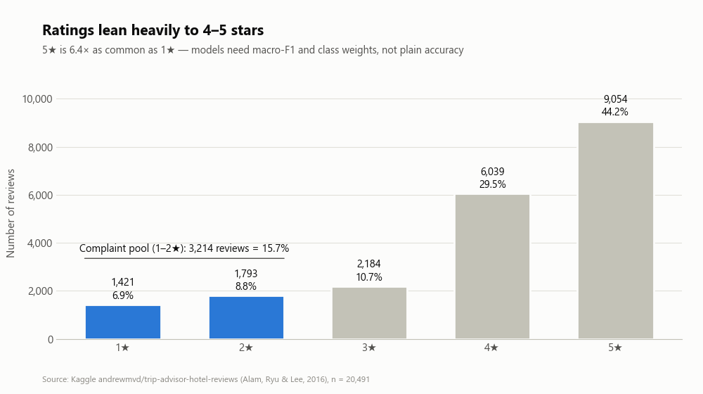
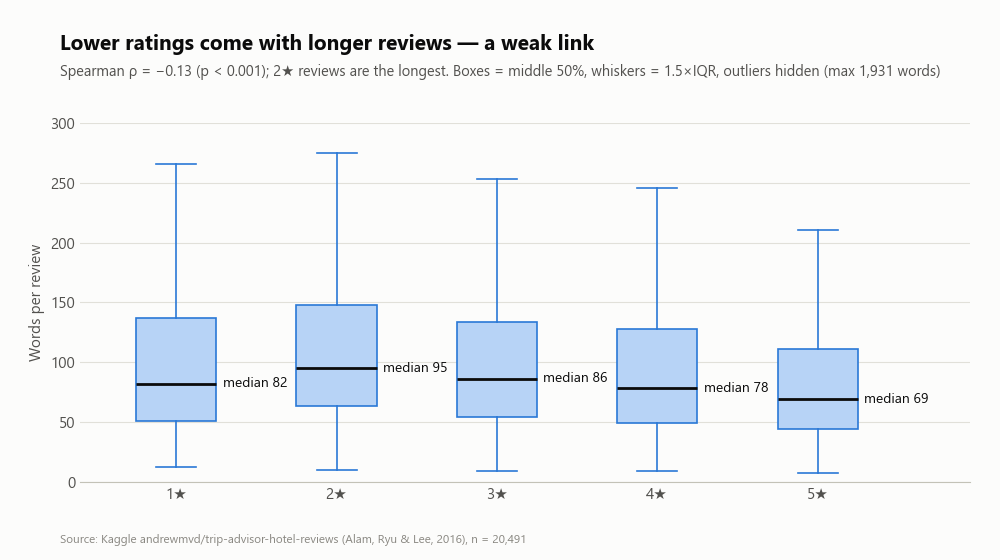
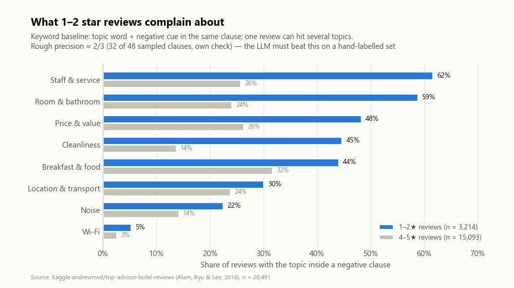

# T3 酒店評論 → AI 抱怨雷達:深度資料分析＋項目目標(2026-11-04)

> **一句話**:資料是可信的 Kaggle 原檔(兩份獨立鏡像逐位元組相同),文字訊號很強(最簡單的模型抓差評 macro-F1 0.88);最大限制是「只有評論＋星等 2 欄、沒有酒店名稱和日期、文字已被預處理」,所以要靠自己算的衍生變數和一份人工標註集,才撐得起 AT2 的「分布與相關性」和 LLM 評估。
>
> - **範圍**:下載公開資料、算數字、畫 3 張圖、寫項目目標;**沒有呼叫任何付費 LLM**,沒有登入任何網站。
> - **數字來源**:全部由腳本算出(腳本與中間檔在本機暫存資料夾,見附錄 A)。§5.4 的 48 句抽查是**產出者自己判讀,尚未經獨立複核**。
> - **用語**:跟課程一致,「項目」= 專案;「差評」= 1–2 星,「好評」= 4–5 星。

---

## 0. 先看結論

1. **資料可信**:Kaggle 官方 API(不用登入)顯示原檔 14,966,021 bytes;我從 Hugging Face 和 GitHub 兩個不同上傳者各抓一份,大小一樣、SHA-256 完全相同;20,491 則 × 2 欄,星等 1–5 = 1,421 / 1,793 / 2,184 / 6,039 / 9,054。
2. **乾淨但很瘦**:0 空值、0 空白、0 重複;但**沒有酒店名稱、日期、地點**;文字已被預處理(全小寫、the/and 這類虛詞全刪,not/no 保留),4.5% 有亂碼。
3. **很偏**:好評佔 73.7%,差評只有 15.7%(3,214 則);5 星是 1 星的 6.4 倍 → 評估一律看 macro-F1,不看準確率。
4. **差評在講什麼**:差評裡最常被抱怨的是服務/櫃台(62%)、房間設備(59%)、價格(48%)、清潔(45%);控制其他因素後,和差評關聯最強的是**服務、房間、清潔**(調整後勝算比 3.5、2.7、2.65)。差評多半是「出事 → 找櫃台 → 交涉失敗」的故事:told/said/asked/called/manager/desk 出現在 56% 的差評、28% 的好評。
5. **做得到**:TF-IDF＋邏輯迴歸抓差評 macro-F1 0.882(AUC 0.975)、猜 1–5 星 macro-F1 0.557(95.4% 的預測和真實星等相差不超過 1 顆)。但**用關鍵字分主題只對約 2/3**(抽查 32/48)→ 這正是 LLM 要補的地方。
6. **最大風險**:沒有酒店 ID 和日期,不能直接做「某一家酒店每個月的雷達」→ 原型要定位成「一批評論(例如一個酒店集團、一個目的地)的抱怨雷達」,上線時再接酒店自己的評論資料。

---

## 1. 資料來源與核對方式

| 項目 | 內容 |
|---|---|
| 原始來源 | Kaggle「Trip Advisor Hotel Reviews」(上傳者 andrewmvd / Larxel),檔案 `tripadvisor_hotel_reviews.csv` |
| 官方中繼資料(不用登入) | Kaggle 公開 API:`https://www.kaggle.com/api/v1/datasets/view/andrewmvd/trip-advisor-hotel-reviews`、`https://www.kaggle.com/api/v1/datasets/list/andrewmvd/trip-advisor-hotel-reviews` → 檔案 14,966,021 bytes、第 2 版(2020-09-30)、授權「Attribution-NonCommercial 4.0 International (CC BY-NC 4.0)」、說明寫「20k reviews crawled from Tripadvisor」、引用 Alam, Ryu & Lee (2016) |
| **實際分析用的檔** | Hugging Face 鏡像(固定 commit):<https://huggingface.co/datasets/patrickbdevaney/tripadvisor_hotel_reviews/resolve/3b30b8c05d489c8769ad9ad06441bc6bbff0a6c4/data/tripadvisor_hotel_reviews.csv>(2024-08-04 上傳) |
| 對照用第二份 | GitHub:<https://raw.githubusercontent.com/a-dossari/Trip_Advisor_Hotel_Reviews_Project/main/tripadvisor_hotel_reviews.csv>(commit ada6fe2,2022-01-06;README 寫明從 Kaggle andrewmvd 下載) |
| 第三個佐證(沒下載) | Hugging Face `argilla/tripadvisor-hotel-reviews`(2022-12,格式不同):資料集伺服器顯示 20,491 列,授權標 cc-by-nc-4.0 |
| 帳號 | 沒有登入任何網站,沒有用 cookie 或金鑰 |

**怎麼核對的**

1. **大小**:兩份都是 14,966,021 bytes,等於 Kaggle API 回報的檔案大小。
2. **內容指紋**:兩份的 SHA-256 都是 `b1e86762f5b2e82b3d75316e6973f6deb47430873535bde76aaf3112b919524c` → 不同上傳者、不同平台、相隔約 2.5 年,逐位元組相同。
3. **結構**:20,491 列 × 2 欄(`Review`、`Rating`);pandas 和 Python 內建 csv 模組兩種讀法列數一致,每列都剛好 2 個欄位。
4. **星等分布**:1–5 星 = 1,421 / 1,793 / 2,184 / 6,039 / 9,054(合計 20,491);在兩份檔上用兩套程式各算一次,結果一樣。
5. **限制**:Kaggle 的 CSV 本體要登入才能下載,所以「和 Kaggle 原檔相同」是由「大小相同＋兩份獨立鏡像雜湊相同」推得,**不是**直接比對 Kaggle 檔的雜湊。

---

## 2. 資料概況表

| 欄位 | 型別 | 內容 | 缺值 |
|---|---|---|---|
| `Review` | 文字 | 住客評論(英文,已被資料集作者預處理) | 0 |
| `Rating` | 整數 1–5 | 住客自己給的星等 | 0 |

| 項目 | 數值 |
|---|---|
| 評論數 | 20,491 |
| 空白評論 | 0 |
| 重複評論 | 0(文字完全相同 0;去掉多餘空白後 0;前 150 字相同也是 0) |
| 平均星等 / 中位數 | 3.95 / 4 |
| 差評(1–2 星) | 3,214 則(15.7%) |
| 每則字數(英文 words) | 平均 104.4、中位數 77、最短 7、最長 1,931 |
| 總字數 | 2,138,765 字;其中差評 386,667 字 |
| 含非 ASCII 亂碼 | 923 則(4.5%) |
| 有大寫字母 | 0 則(全小寫) |
| 提到 30 個常見目的地之一 | 45.5%(最多:Punta Cana/多明尼加 8.4%、紐約 4.6%、巴塞隆納 4.2%、阿姆斯特丹 3.7%、巴黎 3.6%) |
| 提到海灘/泳池/度假村 | 30.8% |
| **沒有的欄位** | 酒店名稱或 ID、日期、城市、住客類型、評論者、各分項分數 |

---

## 3. 資料品質問題

| # | 問題 | 證據 | 影響 | 處理 |
|---|---|---|---|---|
| 1 | **文字已被預處理** | the/and/a/is/was/to/of/i/very/but 出現在 **0%** 的評論;全小寫;標點幾乎只剩逗號(約 24.7 萬個) | LLM 讀到的是「電報體」;摘要引用原文不好讀;不能靠大小寫找人名、地名 | 提示詞先告訴 LLM「文字已去虛詞」;展示時註明「原文經資料集預處理」。好消息:not(58.6%)、no(32.8%)有保留,否定意思沒丟 |
| 2 | 縮寫被拆開 | `did n't` 這種寫法出現在 8,378 則(40.9%) | 一般斷詞會把 n't 丟掉,否定詞漏算 | 清理時改回 not(已做) |
| 3 | 亂碼 | 923 則(4.5%)有非 ASCII 字元,其中 724 則是彎引號被弄壞(didn't 變成 `didn__Ç_é_`),café 也變亂碼 | 關鍵字和模型會漏詞 | 規則修復(`didn__…` → did not 等);修完非 ASCII 剩 0 則 |
| 4 | **沒有酒店、時間、地點欄位** | 只有 2 欄 | 不能算「某家酒店」的抱怨,不能看月趨勢 | 見 §7.4 |
| 5 | 星等不是主題標籤 | 只有一個整體星等 | 不能直接證明「這則在抱怨清潔」判得對 | 兩位組員雙人標註(§8 具體目標 2) |
| 6 | 類別不平衡 | 5 星是 1 星的 6.4 倍 | 全猜 5 星準確率就有 44.2%,準確率會騙人 | macro-F1、分層切分、類別權重 |
| 7 | 3 星很模糊 | 5 級模型 3 星的 F1 只有 0.38;差評模型的 148 個誤報中 111 個是 3 星 | 「差評」的界線要先講好 | 差評 = 1–2 星;3 星另外當「有好有壞」看 |
| 8 | 星等和文字偶爾矛盾 | 測試集 643 則差評裡,17 則模型很有把握說「不是差評」(機率 ≤ 0.1);好評被很有把握判成差評的只有 1 則 | 少量標籤雜訊,任何模型都到不了 100% | 列「矛盾清單」給人看,不硬算 |
| 9 | 可能有員工名字 | 87 則出現 named(例如「一位叫某某的員工」) | 隱私 | 展示前遮蔽人名 |
| 10 | 地點集中 | Punta Cana 相關佔 8.4%,平均 3.75 星(其他 3.97 星),其中差評 20.7% | 結論會偏向度假村 | 分「度假村 vs 城市」各看一次 |

---

## 4. 重要分布

### 4.1 星等:嚴重偏向好評

| 星等 | 則數 | 比例 |
|---|---:|---:|
| 1 星 | 1,421 | 6.9% |
| 2 星 | 1,793 | 8.8% |
| 3 星 | 2,184 | 10.7% |
| 4 星 | 6,039 | 29.5% |
| 5 星 | 9,054 | 44.2% |
| **合計** | **20,491** | **100%** |

- 差評 3,214 則(15.7%)= 抱怨雷達的主要原料;好評 15,093 則(73.7%)。
- 最多 / 最少 = 9,054 / 1,421 = 6.4 倍 → 模型要用類別權重,評估看 macro-F1(每一類分別算 F1 再平均,少的類別也一樣重)。

### 4.2 長度:右偏,差評比較長(但關係很弱)

| 星等 | 中位數(字) | 平均(字) | 中間 50% |
|---|---:|---:|---|
| 1 星 | 82 | 112.4 | 51–137 |
| 2 星 | 95 | 126.6 | 63–148 |
| 3 星 | 86 | 114.7 | 54–134 |
| 4 星 | 78 | 107.8 | 49–128 |
| 5 星 | 69 | 94.0 | 44–111 |
| 全部 | 77 | 104.4 | 48–124 |

- 很右偏(偏度 4.5):約 5% 的評論在 25 字以下,約 5% 在 275 字以上,約 1% 在 502 字以上,最長 1,931 字。
- 字數和星等:Spearman ρ = −0.13(等級相關,−1 到 1,0 = 沒關係;p < 0.001);Kruskal–Wallis 檢定 H = 405(p < 0.001)→ **有關但很弱,而且不是直線**:2 星最長,1 星反而比 2 星短。
- 工作量:差評 3,214 則共 386,667 字;以每分鐘讀 200 字粗估(假設值),**人工讀完差評約要 32 小時**,還不含統計和寫報告。

### 4.3 主題與地點

- 差評平均命中 3.15 個「被抱怨的主題」(關鍵字法,會高估,見 §5.4);只有 4.1% 的差評一個主題都沒命中 → 8 個主題涵蓋面夠。
- 45.5% 的評論提到常見目的地;30.8% 提到海灘/泳池/度假村(這些評論平均 3.86 星,其他 3.99 星)。

---

## 5. 和低分最相關的因素

### 5.1 從文字「長出來」的變數 × 星等

全部 20,491 則;除了最後一列,p 都 < 0.001。

| 衍生變數(從文字算出) | 和星等的 Spearman ρ | 白話 |
|---|---:|---|
| 負面詞密度(每百字幾個 dirty、rude、broken…) | −0.55 | 最強,但它本身就是情緒字,有點循環 |
| 被抱怨的主題數 | −0.39 | 抱怨的面向越多,星等越低 |
| 否定詞密度(not/no/never…) | −0.38 | 差評的「不」特別多 |
| 房間設備被抱怨 | −0.32 | |
| 清潔被抱怨 | −0.29 | |
| 服務被抱怨 | −0.26 | |
| 價格被抱怨 | −0.21 | |
| 數字個數(時間、金額) | −0.15 | 差評常寫「等了 2 小時」「多收 50」這類細節 |
| 字數 | −0.13 | |
| 只看「有提到服務」(不分好壞) | **+0.08** | 方向跟「服務被抱怨」相反 → 只數關鍵字會判錯,一定要判斷褒貶 |
| 只看「有提到地點」 | +0.09 | 地點多半是被稱讚 |
| 只看「有提到 Wi-Fi」 | −0.01(p = 0.43,不顯著) | |

### 5.2 八個抱怨主題

「被抱怨」= 主題關鍵字和負面提示詞(not、dirty、rude、broken…)出現在同一個逗號分隔的句段;先排除「no problem」「not bad」這類其實是正面的說法。一則評論可以同時命中好幾個主題。

| 主題 | 差評中有提到 | 差評中被抱怨 | 3 星中被抱怨 | 好評中被抱怨 | 差評 / 好評 | 被抱怨時平均星等(沒被抱怨) | 調整後勝算比 |
|---|---:|---:|---:|---:|---:|---|---:|
| 服務/櫃台 | 78.6% | **61.7%** | 43.2% | 25.7% | 2.4 倍 | 3.46(4.20) | **3.53** |
| 房間設備 | 70.1% | **58.8%** | 48.1% | 24.1% | 2.4 倍 | 3.39(4.22) | **2.71** |
| 價格 | 67.1% | 48.3% | 43.1% | 26.3% | 1.8 倍 | 3.58(4.12) | 1.83 |
| 清潔 | 56.8% | 44.7% | 29.2% | 13.7% | **3.3 倍** | 3.20(4.14) | **2.65** |
| 早餐餐飲 | 62.1% | 44.0% | 45.3% | 31.7% | 1.4 倍 | 3.73(4.07) | 0.92 |
| 地點交通 | 54.0% | 30.0% | 35.7% | 23.8% | 1.3 倍 | 3.77(4.02) | 0.78 |
| 噪音 | 31.5% | 22.5% | 23.5% | 14.2% | 1.6 倍 | 3.63(4.02) | 1.18 |
| Wi-Fi | 9.0% | 5.3% | 5.3% | 2.6% | 2.1 倍 | 3.51(3.97) | 1.08 |

- 差評 n = 3,214、3 星 n = 2,184、好評 n = 15,093。8 個主題和「是不是差評」的卡方檢定都 p < 0.001。
- **調整後勝算比**:多變量邏輯迴歸(是否差評 ~ 8 個「被抱怨」旗標＋字數),其他條件一樣時,這個主題被抱怨會讓「是差評」的勝算變成幾倍;> 1 = 更像差評。字數本身的勝算比是 0.74(控制抱怨內容後,長不代表差)。
- 主題常一起出現(差評內的 φ 相關):清潔＋房間 0.31(最高)、服務＋早餐 0.18、服務＋價格 0.15、早餐＋價格 0.14。

**白話解讀(第一版「先改什麼」)**

- **前三名:服務/櫃台、房間設備、清潔** —— 差評裡又常見、勝算比又高。
- **清潔最能分出好壞**:差評 44.7% vs 好評 13.7%(3.3 倍),而且常和房間問題一起出現。
- **早餐和地點**:差評常提,但好評也常順便抱怨(31.7%、23.8%);控制其他因素後勝算比 < 1 → 是「小抱怨」,不是讓人打低分的主因,優先度往後放。
- 這是**關鍵字版**的排序,只能當起點;AT3 要用 LLM 標註和人工標註集重排一次(§8 具體目標 3)。

### 5.3 差評特有的字詞

方法:log-odds ratio with informative Dirichlet prior(Monroe, Colaresi & Quinn 2008),差評 vs 好評,只看出現 ≥ 20 次的單字和雙字詞。表中是「出現在幾 % 的評論」。

| 字詞 | 差評 | 好評 | | 字詞 | 差評 | 好評 |
|---|---:|---:|---|---|---:|---:|
| told | 24.9% | 4.6% | | dirty | 13.0% | 0.9% |
| desk | 26.2% | 13.0% | | rude | 11.3% | 1.2% |
| asked | 18.5% | 6.8% | | smell | 7.3% | 1.7% |
| said | 18.4% | 6.7% | | broken | 6.6% | 0.6% |
| called | 13.9% | 4.7% | | not work | 7.6% | 1.1% |
| manager | 11.6% | 2.5% | | charged | 6.5% | 1.2% |
| reservation | 8.4% | 2.8% | | not worth | 6.2% | 1.0% |
| phone | 8.0% | 2.2% | | not recommend | 7.6% | 1.3% |

好評這一側最突出的是 great(61.2% vs 差評 26.5%)、excellent、helpful、friendly、location、clean、quiet。

**各星等最常見的字**(去掉停用詞和 hotel、stay 這類到處都有的字;% = 出現在幾 % 的評論)

| | 差評(1–2 星) | 3 星 | 好評(4–5 星) |
|---|---|---|---|
| 單字前 10 | room 77%、staff 45%、rooms 43%、good 39%、service 34%、nice 29%、food 28%、people 27%、great 26%、desk 26% | room 77%、good 58%、staff 50%、great 47%、rooms 47%、nice 46%、location 45%、clean 43%、breakfast 36%、small 31% | room 66%、great 61%、staff 61%、good 45%、location 44%、clean 40%、rooms 40%、breakfast 39%、nice 37%、friendly 33% |
| 雙字詞前 10 | room not 13%、not good 8%、not recommend 8%、punta cana 8%、not work 8%、not worth 6%、staff not 6%、room service 5%、air conditioning 5%、staff friendly 5% | staff friendly 11%、great location 10%、room not 10%、not bad 9%、good location 8%、not good 7%、room clean 7%、walking distance 6%、not great 6%、punta cana 6% | staff friendly 12%、great location 11%、friendly helpful 8%、walking distance 8%、highly recommend 6%、staff helpful 6%、room clean 5%、minute walk 5%、punta cana 5%、room service 5% |

- 只看出現次數,三組長得很像(room、staff 都在最前面;差評裡也有 39% 出現 good)→ 要看「差評特有」的字和帶 not 的雙字詞,才看得出差評在講什麼。

**差評的樣子**

- **交涉失敗的故事**:told/said/asked/called/manager/desk 至少出現一個的比例 —— 差評 56.4%、3 星 41.2%、好評 27.7%。
- **東西壞了**:broken / not work 出現在 15.2% 的差評、2.1% 的好評。
- 所以 AI 要抓的不只是「哪個主題」,還有「發生什麼事、酒店怎麼處理」—— 這是關鍵字做不到、LLM 擅長的。

### 5.4 關鍵字法準不準(抽查)

- 隨機抽 48 個「差評中被判成某主題抱怨」的句段,我逐一判讀:**32 個對(66.7%,Wilson 95% 信賴區間 52.5%–78.3%)**。
- 16 個錯的類型:抱怨的是酒店以外的事(計程車貴、城鎮髒、訂房網站)3 個;主題其實被稱讚、抱怨的是別的(員工很好但房間令人失望)2 個;關鍵字有歧義(walk 其實在講沒電梯要爬樓梯、towel 是海灘占位)4 個;同一句裡抱怨的是另一個主題 2 個;去掉虛詞後看不懂 5 個。
- 意義:關鍵字的「涵蓋」夠(差評只有 4.1% 沒命中),但「準」只有約 2/3,§5.2 的佔比會偏高 → AT3 的 LLM 要在人工標註集上明顯贏過它。
- ⚠️ 產出者自己判讀,**需要另一位組員或 Codex 複核**;判讀紀錄見附錄 A。

---

## 6. 可行性實驗結果

### 6.1 設定

- 資料:20,491 則(沒有重複,不用去重);修亂碼、n't → not。
- 切分:依 1–5 星分層,訓練 80% / 測試 20%(隨機種子 42)→ 訓練 16,392 則、測試 4,099 則(1–5 星 = 284 / 359 / 437 / 1,208 / 1,811)。
- 模型:TF-IDF(單字＋雙字詞、至少出現 2 次、sublinear tf)＋邏輯迴歸。**只在訓練集**用 3 折交叉驗證挑參數(C ∈ {1, 4, 16} × 類別權重 {無, balanced},以 macro-F1 挑),測試集只用一次;另用最佳參數在全部資料跑 5 折交叉驗證看穩定度。
- 對照:全猜最多的那一類、依比例亂猜。

### 6.2 結果

| 任務 | 方法 | 準確率 | macro-F1 | 其他 |
|---|---|---:|---:|---|
| (a) 猜 1–5 星 | 全猜 5 星 | 0.442 | 0.123 | |
| | 依比例亂猜 | — | 0.204 | |
| | **TF-IDF＋邏輯迴歸**(C = 1、balanced) | **0.613** | **0.557** | 5 折 0.567 ± 0.004;相差 ≤ 1 顆星 95.4%;平均差 0.45 顆;各星 F1 = 0.67 / 0.45 / 0.38 / 0.54 / 0.75 |
| (b) 差評 vs 其他 | 全猜「不是差評」 | 0.843 | 0.457 | |
| | 依比例亂猜 | — | 0.510 | |
| | **TF-IDF＋邏輯迴歸**(C = 16、balanced) | **0.936** | **0.882** | 5 折 0.887 ± 0.006;ROC-AUC 0.975;平均精確率 0.889;差評這一類 precision 0.781 / recall 0.823 / F1 0.802 |

### 6.3 錯在哪裡

- **5 級**:1,587 個錯誤中 88.0%(1,397 個)只差 1 顆星;**4 星 ↔ 5 星互混就佔一半**(792 個,49.9%)。3 星最難(F1 0.38),會被分去 2 星(97)或 4 星(126)。→ 4 星和 5 星的文字很像(推論:住客自己對這條界線也不一致),5 級星等不適合當主要成功指標。
- **差評**:漏掉 114 則(recall 0.823)、誤報 148 則(precision 0.781);誤報裡 111 則(75%)其實是 3 星 → 錯誤集中在「普通、有點失望」的邊界。
- 模型最看重的差評訊號:not、worst、dirty、terrible、no、rude、not stay、told、not recommend、bad;好評訊號:great、excellent、wonderful、loved、perfect —— 和 §5.3 一致,模型學到的是合理的東西。
- **結論**:「AI 讀得懂好壞」不是難點;真正的難點是**分主題、說清楚原因、排出先後** —— 這就是項目的技術挑戰。

### 6.4 LLM 之後怎麼評估(這次沒有呼叫)

| 要驗證的事 | 標準答案 | 指標 | 比較對象 |
|---|---|---|---|
| AI 判斷好壞準不準(可信度) | 住客自己給的星等;同一份 4,099 則測試集(成本太高就分層抽 1,000 則) | 差評 macro-F1;1–5 星 macro-F1 | TF-IDF 基準 0.882 / 0.557;微調 Transformer |
| **AI 分主題準不準(核心)** | 兩位組員各自標註的 300 則(差評 200、3–5 星 100;8 主題 × 有沒有被抱怨),先算兩人一致度 Cohen's κ(扣掉碰巧一樣後的一致程度,≥ 0.6 算可用) | 每主題 precision / recall / F1、8 主題 macro-F1 | 關鍵字基準(同一批)、零樣本 NLI 分類器、人與人的一致度(當天花板) |
| AI 摘要有沒有亂講 | 摘要每句都附評論編號,人工回原文對 | 有原文支持的句子比例 | 目標 ≥ 90% |
| 建議有沒有用 | 旅遊業組員和其他非技術使用者 | 任務成功率、1–5 分有用度 | — |

規則:提示詞只拿訓練集的例子來調;測試集和標註集事先鎖住,不拿來改提示詞,避免「看答案調題目」。

---

## 7. 對 AT2 的意義

### 7.1 只有 2 欄,怎麼寫出 HD 的「特徵、分佈和相關性」

- AT2 評分標準 3 的 HD 寫「充分說明數據的特徵、總體分佈和相關性」,D 檔是「可能缺少有關數據分佈和相關性的統計信息」〔`assessments/_Canvas原文_AT1-AT4_2026-10-22.md` 評分標準 3〕→ 只有 2 欄的資料,一定要自己算出變數,才有東西可以講分布和相關。
- 本檔已經算出的衍生變數:

| 類別 | 變數 | 本檔的數字 |
|---|---|---|
| 文字結構 | 字數、句段數、每段字數、數字個數 | 字數 ρ −0.13、數字 ρ −0.15 |
| 語言訊號 | 否定詞密度、負面詞密度 | ρ −0.38、−0.55 |
| 主題 | 8 主題「有提到」與「被抱怨」旗標、被抱怨主題數 | 表 5.2;主題數 ρ −0.39 |
| 情境 | 度假村語境、30 個目的地 | 30.8%、45.5% |
| 模型衍生 | 差評機率、「星等和文字矛盾」 | AUC 0.975;矛盾 17 則 |
| LLM 衍生(AT3 才做) | 每主題褒貶、嚴重度、可行動的建議 | — |

- AT2 可以放的統計:星等分布(不平衡 6.4 倍)、字數分布(右偏 4.5)、各星等字數比較(Kruskal–Wallis)、Spearman 相關表(§5.1)、主題 × 差評卡方檢定(8 個都顯著)、主題共現 φ 矩陣、多變量邏輯迴歸的調整後勝算比 → 「分布」「相關性」都有統計數字。

### 7.2 基準方法和前沿 AI 怎麼配

由簡到難的階梯:

1. 全猜 / 依比例亂猜(下限)
2. 關鍵字規則(本檔;主題準度約 2/3)
3. TF-IDF＋邏輯迴歸(本檔;差評 0.882、1–5 星 0.557)—— 邏輯迴歸是課程單元二列出的監督學習方法
4. **深度學習**:微調 Transformer 分類模型(例如 DistilBERT、RoBERTa)猜星等/差評;標註少時,主題分類可用少樣本微調(例如 SetFit)
5. **前沿 AI**:LLM 零樣本 / 少樣本做「主題＋褒貶」標註(結構化輸出,每個判斷附原文片段);LLM 依主題寫摘要和改善建議(每句附評論編號);主題探索加 BERTopic(句向量＋分群),找 8 類以外的新主題(例如訂房、泳池/海灘)

**選擇標準**(AT2 要寫的「具有潛力的選擇標準」):① 標註集上的 macro-F1;② 摘要有原文支持的比例;③ 每千則成本;④ 全量處理時間;⑤ 能不能在本機跑(資料不外流);⑥ 判斷能不能追溯到原文。

這對到評分標準 3 HD 的兩點:「詳細說明前沿人工智能技術,例如大語言模型和深度學習,並提出具有潛力的選擇標準」、「具有說服力的實驗設計,其中包含前沿基準方法,以及採用有說服力指標的評估方法」。

### 7.3 授權與倫理

- **CC BY-NC 4.0**:課程作業屬於非商業用途,可以用;一定要標出處(Kaggle 資料集＋Alam, Ryu & Lee 2016)。若之後想做成商業產品,這份資料不能用,要改用酒店自己的評論或有授權的資料。
- **評論是從 TripAdvisor 爬下來的**(Kaggle 說明寫 crawled from Tripadvisor):文字的權利屬於原作者和平台 → 報告和簡報只引用短句,不轉貼整份資料、不再散布(推論:保守做法)。
- **不要碰評論者身分**:資料裡沒有評論者姓名或帳號(只有 2 欄),也不要拿評論文字回網站查是誰寫的;87 則出現 named(可能有員工名字),展示前遮蔽。
- **送外部 LLM**:這份是公開資料,風險低;但真實酒店的客訴可能有個資 → 部署計畫寫「可以換成本機模型」(兩位 IT 營運隊友的主場)。

### 7.4 最大資料風險和對策

| 風險 | 為什麼嚴重 | 對策 |
|---|---|---|
| **沒有酒店 ID、沒有日期** | 「告訴某家酒店經理先改什麼」本來要按酒店、按月看;這份資料做不到 | 原型定位成「一批評論的抱怨雷達」(一個集團、一個目的地);用內文地名或度假村語境分組示範;報告寫清楚「上線時接酒店自己的評論資料」;月趨勢列為不在範圍 |
| 沒有主題標籤 | 證明不了 AI 分主題準 | 300 則雙人標註(具體目標 2) |
| 文字已預處理＋4.5% 亂碼 | LLM 摘要引用時難讀,可能誤解 | 清理規則＋提示詞說明;摘要用「重點＋評論編號」,不貼長原文 |
| 星等偏斜、3 星模糊 | 指標失真 | macro-F1、分層切分、差評定義先講好 |

---

## 8. 項目目標與具體目標

依課程 1.8:**項目目標(aim)寫業務成果,不寫技術手段**;**具體目標(objectives)要具體、可達成、可驗證,全部完成時 aim 就該達成**;**可交付成果要有形、可核對**;技術目標要寫齊「指標＋目標值＋評估數據」〔`notes/11_單元一_整合筆記.md` §12、§14、§21〕。1.8 測驗的提醒:「試三種演算法」是手段、「建資料庫」是中間步驟,都不是目標 → 標註集放在具體目標 2 當「評估數據」,不單獨當目標。

### 8.1 項目目標(Project aim)

> 幫酒店(或酒店集團)的營運主管,從大量住客評論中快速找出低分住客最常抱怨、也最拉低評分的問題,並排出改善的先後順序,讓有限的改善預算先花在最能減少差評的地方。

### 8.2 項目具體目標(Project objectives)

| # | 具體目標 | 怎麼算達成(指標 → 目標值 → 評估數據) | 期限 | 目標值的依據 |
|---|---|---|---|---|
| 1 | **做出 AI 抱怨辨識工具**:讀每則評論,標出 8 類抱怨(清潔、服務、房間設備、噪音、地點交通、早餐餐飲、價格、Wi-Fi)＋其他,每個判斷附原文片段 | AT2 前用 50 則試跑:流程跑通、每則都有可對回原文的輸出、估出全量成本;AT3 前跑完全部 20,491 則 | 試跑 2026-12-11;完成 2027-02-19 | 關鍵字法下 95.9% 的差評至少命中 1 類(會高估,§4.3) |
| 2 | **驗證 AI 準不準** | ① 主題:兩位組員雙人標註的 300 則上,8 類 macro-F1 **≥ 0.80**,且比關鍵字基準高 **≥ 0.10**(兩人一致度 κ ≥ 0.6 才算數);② 好壞:4,099 則保留測試集上,差評 macro-F1 **≥ 0.88** | AT2 前標好 100 則並算出 κ、評估方法定案;AT3 前補到 300 則、完成驗證 | 關鍵字法抽查準度(precision)約 0.67,召回率要在標註集上才量得到;TF-IDF 基準 0.882 |
| 3 | **排出改善優先清單並估算效益** | 依「差評中佔比 × 調整後勝算比」排出前 3 名,和人工標註集算出的前 3 名**至少 2 個相同**;AI 每份改善摘要每句附評論編號,隨機抽 30 份,**≥ 90%** 的句子有原文支持;寫出節省的人工時間 | 2027-02-19 | 關鍵字版前 3 名 = 服務、房間、清潔(§5.2);人工讀完差評約 32 小時(§4.2) |
| 4 | **做出能操作的原型並請使用者驗收** | 網頁介面(選星等、主題、目的地 → 看佔比、代表評論、AI 改善清單);**至少 5 位**非技術使用者(含旅遊業組員)試用,**至少 4 位**能在 5 分鐘內說出前 3 大問題 | 2027-02-19 | AT3 評分要「交互式用戶界面」 |
| 5 | **控制成本、能重跑** | 全部 20,491 則的 AI 處理 **≤ 2 小時**、費用 **≤ AUD 20**;程式、提示詞、資料版本都有紀錄,換一批評論能重跑 | AT2 前用試跑換算;AT3 前實測 | 全部約 214 萬字;每字約 1.3 token 粗估約 280 萬 token(假設值,AT2 前依所選模型的價目換算) |

**分工對應**(方便 AT2 寫「每人職責」;建議,待隊會確認):Kenny → 1、2(方法與開發,也當標註者之一);旅遊業組員 → 2 的另一位標註者、3 的業務判斷;兩位 IT 營運組員 → 5(部署、成本、本機模型備案);4 全隊。

### 8.3 交付成果(Deliverables)

| 時間 | 交付成果 | 成熟度 | 對應具體目標 |
|---|---|---|---|
| 2026-12-11(AT2) | 項目計畫報告＋簡報 | 設計報告 | 全部 |
| 2026-12-11(AT2) | 基準實驗 notebook(本檔數字可重跑)、50 則 LLM 試跑紀錄、標註說明書＋首批 100 則一致度報告 | 概念驗證 | 1、2、5 |
| 2027-02-19(AT3) | 300 則雙人標註集(含一致度) | 已準備的資料集 | 2 |
| 2027-02-19(AT3) | 抱怨雷達網頁原型(AI 標註、優先清單、摘要) | 原型(主功能完成,未達上線品質) | 1、3、4 |
| 2027-02-19(AT3) | 分析報告(評估結果、優先清單、效益估算、部署與成本)＋展示講解 | 技術報告 | 2–5 |

### 8.4 成功標準(業務語言 → 指標 → 目標值 → 評估數據)

| 誰在乎 | 用他的話說「成功」 | 指標 | 目標值 | 評估數據 |
|---|---|---|---|---|
| 酒店經理(使用者) | 「5 分鐘內知道這批評論最該先改的 3 件事」 | 使用者測試成功人數 | ≥ 4 / 5 人,≤ 5 分鐘 | 至少 5 位非技術測試者 |
| 營運主管(發起人) | 「AI 說的問題要有憑有據」 | 摘要句子有原文支持的比例 | ≥ 90% | 隨機 30 份摘要人工核對 |
| 營運主管 | 「預算先花在最痛的地方」 | AI 前 3 名和人工前 3 名的重疊 | ≥ 2 / 3 | 300 則標註集 |
| 分析團隊 | 「主題分得準」 | 8 類 macro-F1 | ≥ 0.80,且 ≥ 關鍵字基準 + 0.10 | 300 則雙人標註集(κ ≥ 0.6) |
| 分析團隊 | 「AI 讀得懂好壞」 | 差評 macro-F1 | ≥ 0.88(微調模型挑戰 ≥ 0.90) | 保留測試集 4,099 則 |
| IT 營運(隊友) | 「跑得動、付得起」 | 全量處理時間、費用 | ≤ 2 小時、≤ AUD 20 | 20,491 則全量實跑紀錄 |

### 8.5 用課程的技術目標清單自查

- **外行看得懂**:目標用「抱怨、先改、5 分鐘」講;技術詞只出現在指標欄 ✔
- **判斷得出何時達成**:每條都有指標＋目標值＋評估數據 ✔
- **是理想的目標**:涵蓋這個用例的關鍵技術(分主題＋判褒貶＋有依據的摘要);同一套也能用在客服信件、問卷、App 評論 ✔
- **有現實可行性的挑戰**:抓差評已做到 0.88(做得到);主題標註關鍵字只有約 2/3,要做到 0.80 需要 LLM(有難度,但不是空想)✔

### 8.6 不在範圍內

上線級系統、即時抓 TripAdvisor、自動回覆住客、和訂房系統整合、多語言、按酒店或按月的趨勢(資料沒有這些欄位)。

---

## 9. 簡體版(可直接貼 1.12 討論區)

**项目目标**
帮酒店管理者从大量住客评论中,快速找出差评最常抱怨、最影响评分的问题,并排出先改哪里,让有限的改善预算先花在最能减少差评的地方。

**项目具体目标**
1. 做一个 AI 工具:读每条评论,标出它在抱怨什么(清洁、服务、房间、噪音、位置、餐饮、价格、Wi-Fi),并附上原文依据。
2. 检查 AI 准不准:用组员人工标注的 300 条评论来对,准确度要明显高于关键字方法(目标约八成);AI 判断的好坏也要和住客自己打的星级一致。
3. 排出改进的先后顺序:按"抱怨有多常见 × 跟低分关系多大"排出前 3 名,AI 写的每句建议都能对回原评论。
4. 做出能操作的网页原型,请不懂技术的同学试用,5 分钟内能说出最该先改的 3 件事;同时记录处理全部评论的时间和费用。

时间:12/11 前完成计划和基准测试;2/19 前完成原型和评估。

---

## 附錄 A:重現方式與檔案

- **暫存資料夾**(本機、不進 repo,session 結束可能被清掉):`C:\Users\kenny\AppData\Local\Temp\claude\476d15717a45c1e6\66c84686-18d2-4c45-af00-b5ddefa1104b\scratchpad\deep\T3\`
  - `scripts\analysis.py`(全部描述統計、主題、詞彙、基準模型;約 2 分鐘)、`charts.py`(3 張圖)、`crosscheck.py`(第二套程式重算)、`extra_stats.py`、`profile_text.py`
  - `download_hf_patrick\`、`download_gh_dossari\`(兩份下載檔,各放一個資料夾)
  - `out\results.json`(所有數字)、`derived_features.csv`(每則的衍生變數)、`spotcheck_negctx.txt`(抽查的 48 句)、`spotcheck_judgement.txt`(判讀結果)
- 執行:`python -I analysis.py <csv> <out_dir>`;環境 = `Machine Learning\.venv`(pandas 2.2.2、numpy 2.0.2、scikit-learn 1.6.1、scipy 1.15.3、matplotlib 3.10.0)
- **交叉檢查**:`crosscheck.py` 不用 pandas,改用 Python csv 模組和手寫排名,在 GitHub 那份檔上重算列數、星等分布、各星等中位字數、總字數、Spearman ρ → 全部和主分析一致(ρ = −0.1316)。這是同一個產出者的第二套程式,不算獨立驗證。

## 附錄 B:參考資料

- Alam, M. H., Ryu, W.-J., & Lee, S. (2016). Joint multi-grain topic sentiment: Modeling semantic aspects for online reviews. *Information Sciences, 339*, 206–223.(資料集要求引用;書目取自 Kaggle 說明)
- Larxel (andrewmvd). (2020). *Trip Advisor Hotel Reviews* [Data set, v2]. Kaggle. <https://www.kaggle.com/datasets/andrewmvd/trip-advisor-hotel-reviews>(CC BY-NC 4.0)
- Monroe, B. L., Colaresi, M. P., & Quinn, K. M. (2008). Fightin' words: Lexical feature selection and evaluation for identifying the content of political conflict. *Political Analysis, 16*(4), 372–403.(§5.3 的方法)
