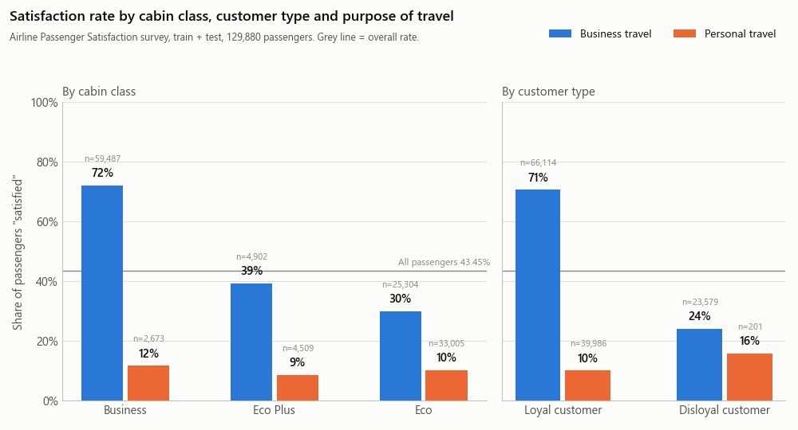
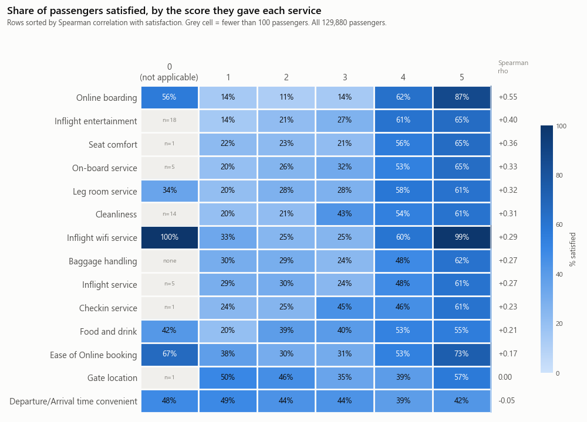
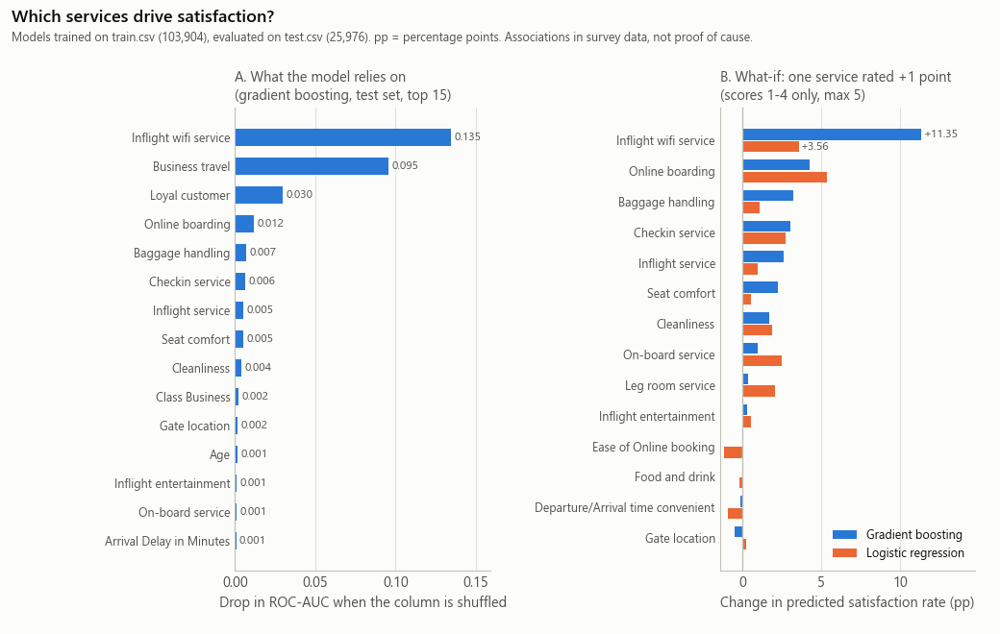

# T4 航空旅客滿意度 → AI 服務改善建議:深度資料分析＋項目目標

> 2026-11-04 · 資料實際下載、全部重算(不是二手數字)· 圖在 [img/](img/)(T4_*.png)
> 狀態:產出者自己算、自己核對;**還沒有非產出者獨立抽查**(R-獨立)。建議抽查:§1 的檔案大小與雜湊、§4 的客群比例、§6 的模型表。
> 用語:「滿意率」= 答案欄是 `satisfied` 的比例;「pp」= 百分點。

---

## 0. 一分鐘看完

- **資料拿到了,而且核對過**:不用登入 Kaggle,從 GitHub 公開鏡像下載;兩個檔的大小和 Kaggle 官方 API 公布的**一個 byte 都不差**,欄位、列數、答案值都對上。
- **規模**:129,880 份問卷(train 103,904、test 25,976)、22 個欄位＋答案欄;滿意 43.45%、中立或不滿意 56.55%。
- **最大的差別在「誰」**:商務旅行的人 58.4% 滿意、私人旅行只有 10.1%;商務艙 69.4%、經濟艙 18.8%。
- **服務項目裡**,單看相關最強的是線上登機(打 4–5 分的人 72.3% 滿意,打 1–3 分只有 13.0%);模型最依賴的是機上 Wi-Fi。
- **可行性沒問題**:梯度提升在官方測試集準確率 96.4%、ROC-AUC 0.995;最簡單的「全猜不滿意」只有 56.1%。
- **最大的資料風險**:來源和授權都查不到,而且資料有**很像人工規則產生的樣式**(例:經濟艙私人旅客 Wi-Fi 打 1–3 分的 25,778 人,一個滿意的都沒有;Wi-Fi 打 0 或 5 分的人在每個客群都 96.7–100% 滿意)。結論只能當「方法示範」,不能當成真實航空公司的發現。
- **對題目的意義**:「預測滿不滿意」本身不是賣點(有問卷就知道了);賣點是「哪一群人、改哪一項、預估多少」＋ LLM 把它寫成主管看得懂的建議書。

---

## 1. 資料來源與核對方式

### 1.1 實際用的檔案

| 項目 | 內容 |
|---|---|
| 下載網址(固定在某一版 commit) | train:<https://raw.githubusercontent.com/mananrg/DataScience/f6d248fb7bbc7568eefde0a81d33efb58adb2f70/train.csv><br>test:<https://raw.githubusercontent.com/mananrg/DataScience/f6d248fb7bbc7568eefde0a81d33efb58adb2f70/test.csv> |
| 鏡像 repo | GitHub `mananrg/DataScience`(2023-01-26/27 上傳;repo 沒有 LICENSE 檔) |
| 下載日期 | 2026-11-04 |
| 有沒有用帳號或 cookie | **沒有**。Kaggle 下載要登入,所以沒從 Kaggle 下載;只讀 Kaggle 不用登入的公開中繼資料 |
| 原始檔存在哪 | 只放在本機暫存資料夾,**沒有放進 repo** |

### 1.2 怎麼確認它就是 Kaggle 那一份(5 項)

| # | 核對什麼 | 對照來源 | 結果 |
|---|---|---|---|
| 1 | 檔案大小 | Kaggle 公開 API 的檔案清單(不用登入)`/api/v1/datasets/list/teejmahal20/airline-passenger-satisfaction`:test.csv 3,037,688 bytes、train.csv 12,193,089 bytes | 下載檔**完全一樣**;兩檔相加 15,230,777 = Kaggle API 公布的總大小(totalBytes) |
| 2 | 欄位名稱、順序、型別 | Kaggle 公開的 Croissant 中繼資料(機器可讀的資料說明) | 25 欄名稱和順序全部一致(第一欄沒有名字);型別:Arrival Delay 是小數,其餘數字欄是整數(只有 `id` 在 Croissant 標成文字) |
| 3 | 列數與答案欄 | 二手來源＋另一個獨立鏡像(Hugging Face `FeatEng/Data`,2024):split 也是 103,904 / 25,976 | train 103,904、test 25,976;答案欄只有 `satisfied`、`neutral or dissatisfied` 兩種值 |
| 4 | 內容雜湊 | GitHub 樹狀清單的 blob SHA-1;另一個不相干的 repo `sr9dc/DS_Airline_ML_Project_S2021`(2022-01 上傳) | train `235c6dbb…`、test `0372fb85…` 和 GitHub 一致;**sr9dc 的 test.csv 和這份 blob 完全相同** → 兩個不同人、相隔一年上傳的檔一模一樣 |
| 5 | 內部一致 | 自查 | `id` 剛好是 1–129,880、不重複、train/test 不重疊;第一欄是 0 起算的列號 |

- 沒做到的:Kaggle 只公布整包 zip 的 MD5(`vbICcgbSEU7zSPyGwcCExA==`,base64),沒有單檔雜湊 → 沒辦法做到「byte 級雜湊比對 Kaggle」,只能比大小＋欄位＋列數＋兩個鏡像互比。
- 之後要換成 Kaggle 正式下載版的話(Kenny 自己登入下載),比對這兩個 SHA-256 就知道是不是同一份:
  - train.csv `a15fab6d36a6123dedb035e1bc11b31f27b547671ce8d27762e74d96527c364f`
  - test.csv `2b58518af6e6c94334bf0f69160e29c5a5a082e340cf30f517473ede2bb1d898`
  - (兩檔都是 CRLF 換行;改過換行的檔雜湊會不同)

### 1.3 來源鏈與授權(查到的全部)

| 層 | 誰、哪裡 | 日期 | 授權欄寫什麼 | 說明寫了什麼 |
|---|---|---|---|---|
| 原始 | Kaggle `johndddddd/customer-satisfaction`「Passenger Satisfaction」,上傳者「John D」 | 2018-06-09 建立;06-10 第 2 版(版本說明「2015 passenger satisfaction」) | **Unknown** | 只有一句「US Airline passenger satisfaction survey」;兩個 xlsx(satisfaction.xlsx 13.3 MB、satisfaction_2015.xlsx 13.2 MB);**沒寫**資料從哪來、哪家航空、怎麼收集 |
| 整理版(我們用的) | Kaggle `teejmahal20/airline-passenger-satisfaction`,TJ Klein | 2020-02-20 | **Other (specified in description)**,但說明裡**沒有任何授權條款** | 「modified from this dataset by John D」、「cleaned up for the purposes of classification」 |
| 鏡像 | GitHub `mananrg/DataScience` | 2023-01 | repo 沒有 LICENSE | 只是轉存 |

- 查法:Kaggle 公開 API `/api/v1/datasets/view/…`(兩份都查了)、`/api/v1/datasets/list/…`、Croissant 中繼資料;另讀兩篇第三方文章。
- 〔外部〕MWSUG 2019 研討會論文(Patlolla,Oklahoma State University):John D 的兩個 xlsx **各 129,880 筆**,合計 259,760;一個檔有 Online Support 欄、另一個有 Inflight service 欄。
- 〔外部〕Towards Data Science〈Kaggle is Not a Base Source〉(Jen Wadkins,2021-08-10):作者在留言區被問過來源也沒回答;作者找到的兩個可能來源(ACSI 美國顧客滿意度指數、IATA Airsat)都對不上規模。
- 推論(不是原文):TJ Klein 版的 129,880 筆 = John D 其中一個檔;103,904 = 129,880 × 0.8 → 是 80/20 切分;檔裡有 Inflight service,所以來自有這一欄的那個 xlsx。
- **結論:原始收集者、航空公司、年份、抽樣方式、授權都查不到。** Kaggle 熱門度很高(下載 145,073 次、598 個公開 notebook),但熱門不等於來源清楚。

---

## 2. 資料概況表

合計 129,880 列 × 25 欄(第一欄是列號、`id` 是編號,兩者都不進模型)。

| 欄位 | 中文 | 型別 | 值域/類別(全部 129,880 筆) | 缺值 | 備註 |
|---|---|---|---|---|---|
| (第一欄,無名) | 列號 | 整數 | train 0–103,903、test 0–25,975 | 0 | 匯出時留下的索引,刪掉 |
| id | 問卷編號 | 整數 | 1–129,880 | 0 | 不重複;不能當特徵 |
| Gender | 性別 | 類別 | Female 65,899 / Male 63,981 | 0 | |
| Customer Type | 客戶類型 | 類別 | Loyal Customer 106,100 / disloyal Customer 23,780 | 0 | 「disloyal」怎麼定義沒寫 |
| Age | 年齡 | 整數 | 7–85,平均 39.4,中位數 40 | 0 | 未滿 18 歲 9,847 人 |
| Type of Travel | 旅行目的 | 類別 | Business travel 89,693 / Personal Travel 40,187 | 0 | |
| Class | 艙等 | 類別 | Business 62,160 / Eco 58,309 / Eco Plus 9,411 | 0 | |
| Flight Distance | 飛行距離 | 整數 | 31–4,983,中位數 844 | 0 | 單位沒寫(推測是英里) |
| Inflight wifi service | 機上 Wi-Fi | 整數 | 0–5,平均 2.73 | 0 | 0 = 不適用(說明只對這一欄寫) |
| Departure/Arrival time convenient | 起降時間方便 | 整數 | 0–5,平均 3.06 | 0 | |
| Ease of Online booking | 線上訂位 | 整數 | 0–5,平均 2.76 | 0 | |
| Gate location | 登機門位置 | 整數 | 0–5,平均 2.98 | 0 | |
| Food and drink | 餐飲 | 整數 | 0–5,平均 3.20 | 0 | |
| Online boarding | 線上登機 | 整數 | 0–5,平均 3.25 | 0 | |
| Seat comfort | 座椅舒適 | 整數 | 0–5,平均 3.44 | 0 | |
| Inflight entertainment | 機上娛樂 | 整數 | 0–5,平均 3.36 | 0 | |
| On-board service | 機上服務 | 整數 | 0–5,平均 3.38 | 0 | |
| Leg room service | 腿部空間 | 整數 | 0–5,平均 3.35 | 0 | |
| Baggage handling | 行李處理 | 整數 | **1–5**,平均 3.63 | 0 | 唯一沒有 0 的服務欄 |
| Checkin service | 報到服務 | 整數 | 0–5,平均 3.31 | 0 | |
| Inflight service | 空中服務 | 整數 | 0–5,平均 3.64 | 0 | |
| Cleanliness | 清潔 | 整數 | 0–5,平均 3.29 | 0 | |
| Departure Delay in Minutes | 起飛延誤(分) | 整數 | 0–1,592,中位數 0,平均 14.7 | 0 | |
| Arrival Delay in Minutes | 抵達延誤(分) | 小數 | 0–1,584,中位數 0,平均 15.1 | **393**(train 310、test 83) | 因為有缺值才變成小數 |
| satisfaction | 滿意度(答案欄) | 類別 | satisfied 56,428 / neutral or dissatisfied 73,452 | 0 | 中立和不滿意併成一類 |

- 14 項服務評分都只出現 0–5 的整數,沒有其他值。
- 原始版說明還列了 Flight cancelled、Flight time in minutes 兩欄,整理版沒有。

---

## 3. 資料品質問題

| # | 問題 | 數字 | 怎麼處理 |
|---|---|---|---|
| 1 | **0 分的意思不清楚**:說明只對 Wi-Fi 寫「0 = 不適用」,但 0 出現在 13 個欄位(只有行李處理沒有) | 0 分最多的:起降時間 6,681、線上訂位 5,682、Wi-Fi 3,916、線上登機 3,080、腿部空間 598、餐飲 132;**10,313 列(7.9%)至少有一個 0** | 0 當「不適用/缺值」,不要當成「最差」;單調模型裡把 0 改成缺值 |
| 2 | **0 分像有規則**:Wi-Fi 0 分的 3,916 人裡 99.7% 滿意;其中 3,660 人線上訂位也是 0 | | 報告裡講;做一次排除這些列的敏感度分析 |
| 3 | **答案欄看起來像規則產生的**(見 §3.1) | Wi-Fi 打 0 或 5 分的 18,272 人(14.1%),99.2% 滿意;其餘 34.3% | 列為最大風險(§8) |
| 4 | **分數不是線性**:多數服務 1–3 分的滿意率差不多,到 4 分才跳上去 | 線上登機 1/2/3/4/5 分:13.8%/11.5%/13.8%/62.3%/87.1%;行李處理、空中服務 3 分比 1 分還低;登機門位置是 U 型(49.9% → 34.7% → 56.8%) | 「+1 分」的效果要看從幾分加到幾分;模型要能處理非線性(樹模型,或把分數當類別) |
| 5 | 抵達延誤有缺值 | 393 筆(0.30%);這些人滿意率 42.2%,和整體 43.4% 差不多 → 看起來是隨機缺 | 用起飛延誤補(兩者 Pearson 0.965) |
| 6 | 年齡不太合理 | 7–85 歲;未滿 16 歲但「商務旅行」1,753 人、坐商務艙 1,114 人 | 報告提一句;不刪 |
| 7 | 延誤有極端值、而且很偏 | 56.5% 準點(0 分鐘);起飛延誤 > 180 分鐘 1,290 筆(1.0%),最長 1,592 分鐘(約 26.5 小時) | 分段或取 log;樹模型不受影響 |
| 8 | 結構怪 | 非忠誠客戶 23,780 人裡 23,579 人(99.2%)是商務旅行 | 報告提一句 |
| 9 | 答案欄把「中立」和「不滿意」併在一起 | | 建議書要寫「中立或不滿意」,不能寫成「不滿意」 |
| 10 | 缺少業務欄位 | 沒有日期、航線、航空公司、票價 | 不能做趨勢、不能算營收;成本效益要靠假設 |
| 11 | 沒有文字欄位 | | LLM 只能「寫」建議,不能「讀」評論找原因 |

沒問題的部分:

- **沒有重複列**(去掉 id 後 0 筆完全重複;也沒有「欄位一樣、答案不同」的衝突列)。
- **沒有排序洩漏**:只用 id 猜滿意度的 ROC-AUC 0.508、只用列號 0.497(0.5 = 亂猜)。
- **train 和 test 很一致**:滿意率 43.33% vs 43.90%;各數字欄平均差 ≤ 0.016 個標準差;年齡、距離、起飛延誤的 KS 檢定 p 值都 > 0.1 → 像隨機切分。

### 3.1 為什麼說「像規則產生的」(推論,無法證實)

真實問卷有很多雜訊,不會出現「某個條件下 100% 或 0%」。這份資料有很多:

| 客群(艙等 \| 旅行目的) | 客群本身滿意率 | 條件 | 人數 | 滿意率 |
|---|---|---|---|---|
| 經濟艙 \| 私人旅行 | 10.2% | Wi-Fi 打 1、2、3 分 | 25,778 | **0.0%** |
| 經濟艙 \| 私人旅行 | 10.2% | Wi-Fi 打 5 分 | 1,339 | **100%** |
| 經濟艙 \| 私人旅行 | 10.2% | Wi-Fi 打 0 分 | 667 | **100%** |
| 商務艙 \| 商務旅行 | 72.0% | 線上登機打 5 分 | 17,928 | 99.5% |
| 經濟艙 \| 商務旅行 | 29.9% | Wi-Fi 打 1 分 | 3,591 | 0.06% |

- 私人旅行的 4,072 位滿意旅客中,2,427 位(59.6%)的 Wi-Fi 是 0 或 5 分;Wi-Fi 是 1–4 分的私人旅客只有 4.4% 滿意。
- 只用兩條規則「Wi-Fi 是 0 或 5 分,或(線上登機 ≥ 4 而且是商務旅行)→ 滿意」,全部 129,880 筆就能猜對 88.6%。
- 深度 3 的決策樹(8 片葉子)在測試集就有 88.4%。
- 意思是:模型學到的「驅動因素」有一部分可能是資料產生方式,不是旅客真實行為。

---

## 4. 重要分布

整體:滿意 56,428(43.45%)、中立或不滿意 73,452(56.55%)→ 輕微不平衡,不需要特別處理。

| 分組 | 類別 | 人數(占比) | 滿意率 |
|---|---|---|---|
| 旅行目的 | 商務旅行 | 89,693(69.1%) | **58.4%** |
| | 私人旅行 | 40,187(30.9%) | **10.1%** |
| 艙等 | 商務艙 | 62,160(47.9%) | 69.4% |
| | 豪華經濟艙(Eco Plus) | 9,411(7.2%) | 24.6% |
| | 經濟艙 | 58,309(44.9%) | 18.8% |
| 客戶類型 | 忠誠 | 106,100(81.7%) | 47.8% |
| | 非忠誠 | 23,780(18.3%) | 24.0% |
| 性別 | 女 / 男 | 65,899 / 63,981 | 42.9% / 44.0%(幾乎沒差) |
| 年齡 | 7–17 歲 | 9,847(7.6%) | 16.7% |
| | 18–24 歲 | 14,815(11.4%) | 35.1% |
| | 25–39 歲 | 39,401(30.3%) | 39.0% |
| | 40–59 歲 | 53,602(41.3%) | **57.7%** |
| | 60 歲以上 | 12,215(9.4%) | 27.1% |
| 飛行距離 | ≤ 500 | 40,276(31.0%) | 33.6% |
| | 501–1,000 | 34,827(26.8%) | 32.5% |
| | 1,001–2,000 | 27,910(21.5%) | 46.1% |
| | 2,001–3,000 | 16,554(12.7%) | 65.0% |
| | > 3,000 | 10,313(7.9%) | 77.3% |

艙等 × 旅行目的(圖 a 左):

| 艙等 \| 旅行目的 | 人數(占比) | 滿意率 |
|---|---|---|
| 商務艙 \| 商務旅行 | 59,487(45.8%) | **72.0%** |
| 商務艙 \| 私人旅行 | 2,673(2.1%) | 11.7% |
| 豪華經濟艙 \| 商務旅行 | 4,902(3.8%) | 39.3% |
| 豪華經濟艙 \| 私人旅行 | 4,509(3.5%) | 8.7% |
| 經濟艙 \| 商務旅行 | 25,304(19.5%) | 29.9% |
| 經濟艙 \| 私人旅行 | 33,005(25.4%) | **10.2%** |

- 私人旅行不管坐哪一艙都只有 8.7–11.7% 滿意;商務旅行從經濟艙 29.9% 到商務艙 72.0%。
- 長程比較滿意,但長程多是商務艙(商務艙距離中位數 1,589,經濟艙 600)→ 距離和艙等互相混在一起,不能單獨解讀。
- 延誤(圖沒畫):起飛準點 45.9% 滿意,延誤 16–60 分鐘 37.5%,超過 60 分鐘約 36% 就不再往下掉;抵達準點 47.4%、延誤 16–60 分鐘 35.9%。滿意者平均抵達延誤 12.5 分鐘、不滿意者 17.1 分鐘。延誤有影響,但比艙等和旅行目的小很多。
- 起飛和抵達延誤幾乎是同一件事:Pearson 0.965(Spearman 0.74);70% 的航班兩者相差 5 分鐘以內。



---

## 5. 和滿意度最相關的因素

### 5.1 14 項服務(單看一項,不控制其他因素;圖 b)

| 服務 | Spearman ρ | 平均分:滿意 / 不滿意 | 打 4–5 分的滿意率 | 打 1–3 分的滿意率 | 差距 |
|---|---|---|---|---|---|
| 線上登機 Online boarding | **+0.549** | 4.03 / 2.66 | 72.3% | 13.0% | **+59.3 pp** |
| 機上娛樂 Inflight entertainment | +0.400 | 3.96 / 2.89 | 62.9% | 21.8% | +41.1 |
| 座椅舒適 Seat comfort | +0.361 | 3.97 / 3.04 | 60.2% | 22.0% | +38.1 |
| 機上服務 On-board service | +0.328 | 3.86 / 3.02 | 58.3% | 27.0% | +31.3 |
| 腿部空間 Leg room service | +0.317 | 3.82 / 2.99 | 59.8% | 26.1% | +33.7 |
| 清潔 Cleanliness | +0.305 | 3.75 / 2.93 | 57.0% | 30.9% | +26.2 |
| 機上 Wi-Fi Inflight wifi service | +0.287(不含 0 分:+0.372) | 3.16 / 2.40 | 74.4% | 27.0% | +47.4 |
| 行李處理 Baggage handling | +0.271 | 3.97 / 3.37 | 53.7% | 26.6% | +27.2 |
| 空中服務 Inflight service | +0.266 | 3.97 / 3.39 | 53.4% | 26.8% | +26.6 |
| 報到服務 Checkin service | +0.234 | 3.65 / 3.04 | 52.3% | 35.3% | +17.0 |
| 餐飲 Food and drink | +0.208 | 3.53 / 2.96 | 53.8% | 35.0% | +18.8 |
| 線上訂位 Ease of Online booking | +0.174(不含 0 分:+0.232) | 3.03 / 2.55 | 61.6% | 32.6% | +29.0 |
| 登機門位置 Gate location | −0.004 | 2.97 / 2.98 | 45.5% | 42.2% | +3.3 |
| 起降時間方便 Departure/Arrival time convenient | −0.052 | 2.96 / 3.13 | 40.5% | 45.7% | **−5.1** |

- 平均分和 ρ 的計算含 0 分;「打 1–3 分」那一欄不含 0 分。
- 登機門位置和起降時間方便跟滿意度**沒有關係或略為反向**(MWSUG 2019 論文也看到同樣現象)。
- Wi-Fi 的兩端特別怪:0 分 99.7%、5 分 99.0% 滿意,1–3 分只有 25–33%(§3.1)。



### 5.2 旅客和航班特徵

| 變數 | 和滿意度的關係 |
|---|---|
| 艙等 | Cramér's V 0.50(最強) |
| 旅行目的 | Cramér's V 0.45 |
| 客戶類型 | Cramér's V 0.19 |
| 性別 | Cramér's V 0.01(沒關係) |
| 飛行距離 | Spearman +0.26(和艙等混在一起) |
| 年齡 | Spearman +0.14 |
| 抵達延誤 / 起飛延誤 | Spearman −0.10 / −0.07 |

### 5.3 不同客群,重點不一樣(各客群內的 Spearman,前 3 名)

| 客群 | 人數 | 滿意率 | 前 3 名 |
|---|---|---|---|
| 商務旅行 | 89,693 | 58.4% | 線上登機 0.61、機上娛樂 0.50、座椅 0.46 |
| 私人旅行 | 40,187 | 10.1% | Wi-Fi 0.30、線上訂位 0.25、線上登機 0.20;其餘都 ≤ 0.06 |
| 商務艙 | 62,160 | 69.4% | 線上登機 0.55、機上娛樂 0.49、座椅 0.45 |
| 經濟艙 | 58,309 | 18.8% | Wi-Fi 0.46、線上登機 0.33、線上訂位 0.23 |
| 非忠誠客戶 | 23,780 | 24.0% | Wi-Fi 0.46、線上訂位 0.43、線上登機 0.41 |

→ 白話:商務客在意「登機順不順、坐得舒不舒服」;私人旅客和經濟艙幾乎只跟「數位服務」(Wi-Fi、訂位、線上登機)有關。這正好是「分客群寫建議書」的理由。

### 5.4 共線性(服務項目彼此很像)

- 起飛延誤 vs 抵達延誤:VIF 都是 14.8(> 10 算嚴重)→ 只留一個,或合併成一組看。
- 14 項服務的 VIF 最高 3.9(機上娛樂),其餘 ≤ 2.9 → 中度,可以接受。
- 服務項目兩兩 Spearman ≥ 0.5 的有 10 對(連兩個延誤欄是 11 對),大致分成三群(括號內是 ρ):
  - 數位/地面:Wi-Fi–線上訂位 0.711、線上訂位–登機門 0.463、起降時間–登機門 0.453
  - 機上硬體:機上娛樂–清潔 0.681、座椅–清潔 0.668、餐飲–清潔 0.647、餐飲–機上娛樂 0.611、座椅–機上娛樂 0.605、餐飲–座椅 0.558
  - 服務人員:行李處理–空中服務 0.631、機上服務–空中服務 0.569、機上服務–行李處理 0.537
- 主成分分析:第一主成分只解釋 27.1% → 有一點「整體印象」效應,但不是全部。
- **共線性造成的陷阱**:邏輯迴歸裡,線上訂位的係數是 **−0.20**(單看相關是 +0.17),起飛延誤的係數是 **+0.18**(單看是 −0.07)。如果直接照係數寫建議,會得到「把線上訂位做好會讓旅客更不滿意」這種錯誤結論。

---

## 6. 可行性實驗結果

設定:用 train.csv(103,904 筆)訓練,只在 test.csv(25,976 筆)評估一次;隨機種子 42;抵達延誤缺值用起飛延誤補。

### 6.1 模型比較(官方測試集)

| 模型 | 準確率 | ROC-AUC | F1(滿意) | 校準誤差 ECE | 5 折交叉驗證(train) |
|---|---|---|---|---|---|
| 全猜「不滿意」(樸素基線) | 56.1% | 0.500 | 0 | — | — |
| 單一規則「線上登機 ≥ 4 → 滿意」(從 train 挑最好的一條) | 78.3% | 0.788 | 0.770 | — | — |
| 邏輯迴歸(全部欄位,分數當數字) | 87.2% | 0.926 | 0.851 | 0.039 | 87.5% ± 0.22、0.927 ± 0.002 |
| 邏輯迴歸(只用 14 項服務＋延誤) | 81.3% | 0.876 | 0.784 | 0.053 | |
| 邏輯迴歸(分數當類別) | 93.3% | 0.979 | 0.922 | 0.009 | 93.4% ± 0.25、0.979 ± 0.001 |
| 隨機森林(300 棵) | 96.3% | 0.994 | 0.957 | 0.023 | |
| 梯度提升(sklearn HistGB) | **96.4%** | **0.995** | 0.958 | 0.008 | 96.3% ± 0.08、0.995 ± 0.0004 |
| XGBoost(500 棵) | **96.4%** | **0.995** | 0.959 | 0.005 | |
| 梯度提升＋單調限制(0 分當缺值) | 95.2% | 0.992 | 0.945 | 0.008 | 5 種訓練子集:95.2–95.3%、0.992 |

(「±」= 5 折之間的標準差。)

怎麼讀:

- **預測很容易**:樹模型都在 96% 左右。這也說明「預測滿不滿意」本身不是挑戰。
- **分數要當類別**:邏輯迴歸把分數當數字只有 87.2%,當類別(每個分數各一個開關)就到 93.3% → 證實 §3 第 4 點的非線性。
- **只看服務不夠**:只用服務項目的邏輯迴歸 81.3%,加上旅行目的、艙等、客戶類型才到 87.2%。
- **單調限制**(「任一服務加分,預測不能變差」)只少約 1.2 pp 準確率(96.4% → 95.2%),換到 what-if 不會算出反效果(§6.3)。
- 各客群準確率(梯度提升):商務艙 \| 商務旅行 97.8%(測試 11,979 筆)最高,經濟艙 \| 商務旅行 94.0%(5,047 筆)最低。
- 機率校準:梯度提升 ECE 0.008 → 預測機率和實際比例平均只差不到 1 pp,what-if 可以拿機率來算。
- 速度:梯度提升預測 1 位旅客約 6 毫秒;介面「拉一下滑桿就更新」沒問題。

### 6.2 主要驅動因素(控制其他因素後;圖 c 左)

置換重要度 = 把某一欄打亂後,模型的 ROC-AUC 掉多少(測試集,重複 10 次):

| 排名 | 欄位(梯度提升模型) | AUC 下降 | 準確率下降 |
|---|---|---|---|
| 1 | 機上 Wi-Fi | 0.135 | 14.3 pp |
| 2 | 旅行目的(商務) | 0.095 | 18.2 pp |
| 3 | 忠誠客戶 | 0.030 | 8.1 pp |
| 4 | 線上登機 | 0.012 | 3.3 pp |
| 5 | 行李處理 | 0.007 | 3.2 pp |
| 6 | 報到服務 | 0.006 | 2.8 pp |
| 7 | 空中服務 | 0.005 | 2.8 pp |
| 8 | 座椅舒適 | 0.005 | 2.6 pp |
| 9 | 清潔 | 0.004 | 2.1 pp |

- 兩個延誤欄一起打亂:AUC 只掉 0.0007 → 模型幾乎不靠延誤。
- **穩定度**:5 折交叉驗證,梯度提升每一折的前 5 名完全一樣(5/5);邏輯迴歸也是 5/5。兩種模型的前 5 名重疊 4/5。
- **只看服務項目的前 5 名**:

| 模型 | 前 5 名(由高到低) |
|---|---|
| 梯度提升 | Wi-Fi、線上登機、行李處理、報到服務、空中服務 |
| XGBoost | Wi-Fi、線上登機、行李處理、空中服務、報到服務 |
| 隨機森林 | Wi-Fi、線上登機、報到服務、行李處理、座椅舒適 |
| 邏輯迴歸 | 線上登機、Wi-Fi、報到服務、機上服務、腿部空間 |

→ 4 個模型都同意:Wi-Fi、線上登機、報到服務;3 個同意行李處理。
- **單看相關 ≠ 控制其他因素後**:機上娛樂單看相關排第 2(ρ 0.40),但模型幾乎不靠它(AUC 只掉 0.001),因為它和座椅、清潔高度相關,資訊被分走了。

### 6.3 What-if:某一項服務每位旅客 +1 分(1–4 分才加,5 分維持,0 分維持)→ 預估滿意率變化(圖 c 右)

測試集 25,976 人;基準預估滿意率 43.7–43.9%(依模型)。單位:pp,依單調模型排序。

| 服務 | 邏輯迴歸 | 邏輯迴歸(分數當類別) | 梯度提升 | 梯度提升＋單調 |
|---|---|---|---|---|
| 機上 Wi-Fi | +3.56 | +9.12 | **+11.35** | **+10.95** |
| 線上登機 | **+5.35** | +5.15 | +4.27 | +4.31 |
| 報到服務 | +2.72 | +1.63 | +3.07 | +3.17 |
| 行李處理 | +1.07 | +1.73 | +3.25 | +2.71 |
| 座椅舒適 | +0.53 | +1.42 | +2.27 | +2.62 |
| 空中服務 | +0.94 | +1.66 | +2.64 | +2.44 |
| 清潔 | +1.86 | +1.25 | +1.72 | +1.45 |
| 機上服務 | +2.52 | +1.53 | +0.95 | +1.18 |
| 腿部空間 | +2.06 | +1.07 | +0.38 | +0.78 |
| 機上娛樂 | +0.52 | −0.45 | +0.30 | +0.43 |
| 餐飲 | −0.22 | −0.14 | +0.02 | +0.04 |
| 線上訂位 | **−1.15** | +0.36 | +0.05 | +0.02 |
| 起降時間方便 | −0.92 | −1.34 | −0.13 | −0.07 |
| 登機門位置 | +0.25 | −0.69 | −0.48 | −0.43 |

| 檢查 | 結果 |
|---|---|
| 加 1 分後「預測反而變差」的旅客比例(12 項正相關服務) | 邏輯迴歸:線上訂位、餐飲 100%(係數被共線性翻成負的);不加限制的梯度提升:9–39%;**單調模型:0%** |
| 換 5 種訓練子集重算(單調模型) | 同一項目的估計最多只差 **0.32 pp** |
| 原始差距 vs 模型估計(線上登機) | 原始資料 4–5 分比 1–3 分高 59.3 pp;6 個模型估計「+1 分」只有 +3.28 到 +5.35 pp → 原始差距大部分是「商務客本來就打比較高分、也比較滿意」之類的其他因素 |
| 情境 B:把 1–3 分全拉到 4 分 | 線上登機:梯度提升 +1.31、單調 +1.46、邏輯迴歸(分數當類別)+4.30 → **模型之間差 3 倍**,這種數字要附範圍 |

各客群的 what-if(單調模型,+1 分,前 3 名;測試集):

| 客群 | 測試人數 | 滿意率 | 前 3 名(預估 pp) | 5 折前 5 名重疊 |
|---|---|---|---|---|
| 商務艙 \| 商務旅行 | 11,979 | 72.1% | 線上登機 +5.89、Wi-Fi +4.65、報到服務 +3.90 | 5/5 |
| 豪華經濟艙 \| 商務旅行 | 1,012 | 39.0% | Wi-Fi +9.71、行李處理 +7.81、線上登機 +7.69 | 5/5 |
| 經濟艙 \| 商務旅行 | 5,047 | 31.3% | Wi-Fi +13.63、線上登機 +6.36、報到服務 +5.43 | 5/5 |
| 商務艙 \| 私人旅行 | 516 | 9.5% | Wi-Fi +19.58;其餘都 < 0.5 | 最少 4/5 |
| 豪華經濟艙 \| 私人旅行 | 905 | 8.8% | Wi-Fi +18.63;其餘都 < 0.5 | 最少 4/5 |
| 經濟艙 \| 私人旅行 | 6,517 | 10.2% | Wi-Fi +18.89;其餘都 < 0.5 | 最少 3/5 |

(「5 折前 5 名重疊」= 用 5 種訓練子集各算一次,任兩次的前 5 名最少有幾項相同。)

- 私人旅行客群第 2–5 名的效果都小於 0.5 pp,排名本來就沒意義 → 目標要寫「只排效果 ≥ 1 pp 的項目」。
- **兩種模型在私人旅行客群不一致**:線上登機 +1 分,單調模型估 +0.16 到 +0.31 pp,邏輯迴歸(分數當類別)估 +3.24 到 +3.51 pp(後者沒有交互作用,等於把商務客的效果平均套到私人旅客身上)。商務旅行 3 個客群兩種模型的前 5 名重疊 4–5 項,私人旅行 3–4 項 → 兩種模型都 ≥ 1 pp 才算「確定」,只有一種模型 ≥ 1 pp 就標「不確定」。
- Wi-Fi 的大數字主要來自「4 分 → 5 分」那一跳(經濟艙私人旅客 4 分 26.0% 滿意、5 分 100%),和 §3.1 的怪樣式是同一件事 → **建議書不能把 Wi-Fi 寫成「最該投資」而不附警語**。



---

## 7. 對 AT2 的意義

1. **準則 3 的 HD 要「資料特徵、總體分布、相關性」**〔AT2 評分 準則 3〕→ §2–§5 和圖 a、b 已經是現成材料;AT2 裡照這個順序寫:答案欄比例 → 客群差異 → 14 項服務的相關 → 共線性與資料限制。
2. **基線已經齊**:課程 1.16 的基線類型〔11 §22〕這裡都有:樸素基線(全猜不滿意 56.1%)、簡單規則(78.3%)、業界標準(邏輯迴歸 87.2%/93.3%、隨機森林 96.3%)、表格資料常用的最強方法(梯度提升/XGBoost 96.4%)。要再往「前沿」加,可以選配 TabPFN(表格資料的基礎模型,Nature 2025;論文說在 1 萬筆、500 欄以內表現最好 → 要抽樣)。
3. **要先講清楚「為什麼要預測」**:有問卷就知道滿不滿意,評審可能問這題。AT2 要寫:預測模型是 what-if 和驅動因素排名的計算核心;另一個用途是「旅客只填了服務題、沒填整體滿意」時估計整體滿意。
4. **前沿 AI(LLM)放在哪裡**(準則 3 HD 要「前沿人工智能技術,例如大語言模型」):
   - **改善建議書**:程式先算好「事實表」(客群、人數、滿意率、前幾名服務、what-if 數字與模型間範圍、資料限制),LLM 只負責寫成 1 頁給主管看的建議;**LLM 只寫字、不算數字**。
   - **what-if 白話說明**:滑桿一動,LLM 用 2–3 句說「估計會變多少、適用哪一群人、為什麼只是估計」。
   - (選配)**自然語言問答**:主管問「經濟艙的商務客最該改什麼?」→ LLM 呼叫分析函式拿數字再回答。
   - LLM 部分的基線 = 固定模板(程式把數字填進固定句型)→ 比盲評分數,才看得出 LLM 有沒有加值。
5. **事實表範例**(經濟艙 \| 商務旅行,全部資料 25,304 人;這是給 LLM 的輸入,不是 LLM 的輸出):
   - 滿意率 29.9%(測試集 31.3%,5,047 人)
   - 前 3 名(單調模型,+1 分):Wi-Fi +13.63 pp、線上登機 +6.36 pp、報到服務 +5.43 pp;線上登機在邏輯迴歸(分數當類別)是 +6.27 pp → 兩個模型一致
   - 限制:問卷相關不是因果;Wi-Fi 的效果有資料樣式疑慮;「不滿意」含中立
6. **實驗設計直接套課程的變量框架**〔11 §22〕:自變量 = 模型(邏輯迴歸/隨機森林/梯度提升/單調梯度提升)和建議書寫法(LLM vs 模板);因變量 = 準確率、AUC、ECE、驅動因素穩定度、what-if 方向一致率、建議書數字一致率與盲評分數;控制變量 = 同一份 train/test、隨機種子 42、同一台電腦;非控制變量 = LLM 版本更新、評審個人偏好。
7. **新穎性要靠 LLM＋what-if＋分客群**,不是靠預測:這份資料在 Kaggle 有 598 個公開 notebook,「預測滿意度」已經被做過很多次。
8. **風險表要有兩條資料風險**:來源/授權不明、疑似規則產生(§8)。

---

## 8. 授權風險與報告裡怎麼寫

### 8.1 風險有多大

| 風險 | 程度 | 為什麼 | 對策 |
|---|---|---|---|
| 授權不明 | 中低(課程內使用) | 兩層都沒有明確授權;沒有授權條款就不能假設可以再散布。老師 10/29 說可以用 Kaggle 資料〔91 上課紀錄〕,但沒談授權 | 只做課程內非商業分析;**原始 CSV 不放進 repo、不放上公開網頁或作品集**,只放彙總表和圖;Zoom 時順便確認「授權欄寫 Other/Unknown 的 Kaggle 資料可以用嗎」 |
| 來源不明 | 中 | 不知道哪家航空、哪一年、怎麼抽樣 | 報告的「數據與資源」一節完整寫來源鏈;結論只說「在這份資料裡」 |
| 疑似規則產生 | **高**(影響結論可信度) | §3.1 | 把系統定位成「方法和工具示範」;做排除 Wi-Fi 0/5 分的敏感度分析;建議書固定附資料限制 |

### 8.2 報告裡怎麼寫(別這樣寫 → 改這樣寫)

| 別這樣寫 | 改這樣寫 |
|---|---|
| 「資料來自美國某航空公司 2015 年的旅客問卷」 | 「Kaggle 上公開的航空旅客滿意度問卷(TJ Klein 2020 年整理版,改自 John D 2018 年上傳的資料);原始收集者、航空公司和調查方式都沒有說明」 |
| 「本資料採用 XX 授權」 | 「Kaggle 授權欄寫『Other (specified in description)』,但說明裡沒有條款;原始版寫『Unknown』。我們只在課程內做非商業分析,不重新散布原始檔」 |
| 「航空公司應該優先投資 Wi-Fi」 | 「在這份資料裡,Wi-Fi 評分和滿意度的關係最強;但這個關係有不自然的規則樣式,只用來示範方法,不能直接當成真實航空公司的投資建議」 |
| 「線上登機提高 1 分,滿意率會增加 4 個百分點」 | 「模型估計:其他條件不變時,線上登機評分高 1 分,預估滿意率約高 3–5 個百分點(依模型不同);這是問卷資料裡的關聯,不是因果」 |
| 「旅客不滿意的原因是……」 | 「中立或不滿意的旅客,在……項目的評分明顯較低」 |

英文版(可直接放進報告的 Data and resources):

> Data source: "Airline Passenger Satisfaction" (TJ Klein, Kaggle, 2020), a cleaned version of "Passenger Satisfaction" (John D, Kaggle, 2018). The original collector, airline, survey period and sampling method are not documented, and no licence terms are given (Kaggle licence field: "Other (specified in description)" for the cleaned version and "Unknown" for the original). We use the data for non-commercial coursework only, do not redistribute the raw files, and treat all findings as illustrative of the method rather than as evidence about any specific airline.

---

## 9. 項目目標與具體目標

依課程 1.8 的寫法:aim 寫業務成果,不寫技術手段;objectives 要具體、可驗證,全部做完 aim 就達成〔11 §12、§16〕;每個技術目標寫齊「衡量指標＋目標值＋評估數據」〔技術目標檢查清單〕。

### 9.1 項目目標(Project aim)

**針對航空公司服務改善預算的分配,從旅客滿意度問卷找出「對哪一群旅客、改哪幾項服務」最能提高滿意比例,並寫成管理層可以直接討論的改善建議,讓同樣的預算換到更多滿意的旅客。**

### 9.2 具體目標(Project objectives)

| # | 目標 | 怎麼算完成(指標＋目標值＋評估資料) | 本次基線 | 期限 |
|---|---|---|---|---|
| O1 | **找出各客群的關鍵服務**:依艙等 × 旅行目的分成 6 個客群,排出每個客群「評分高 1 分、預估滿意率增加最多」的前 5 項服務 | 兩種模型(單調梯度提升、分數當類別的邏輯迴歸)都估計 ≥ 1 pp 的項目才列「確定」,其餘標「不確定」;從 train.csv 切 5 種訓練子集重算(在 test.csv 上算),前 5 名至少 4 項相同 | 商務旅行 3 個客群:5/5,兩模型重疊 4–5 項;私人旅行 3 個客群:兩模型都 ≥ 1 pp 的只有 Wi-Fi | AT2 前完成初版(2026-12-11) |
| O2 | **開發並評估滿意度預測器**(單一旅客層級;「任一服務加分,預測不會變差」) | 官方 test.csv 25,976 筆(訓練完全不用):準確率 ≥ 95%、ROC-AUC ≥ 0.99、ECE ≤ 0.02;另附可解釋對照(邏輯迴歸) | 95.2%、0.992、0.008(不加限制 96.4%、0.995) | 初版 AT2(12/11);定版 AT3(2027-02-19) |
| O3 | **開發 what-if 模擬**:選客群、調某項服務分數,立刻看到預估滿意率變化,並附模型之間的範圍 | test.csv:12 項正相關服務加 1 分後預測下降的旅客 = 0%;5 種訓練子集估計差距 ≤ 1 pp;每次調整 ≤ 1 秒(不含 LLM) | 0%(不加限制時 9–39%)、0.32 pp、單筆約 6 毫秒 | AT3(2027-02-19) |
| O4 | **用 LLM 寫改善建議書**:根據程式算好的事實表,替 6 個客群各寫 1 頁建議 | 6 客群 × 3 次 = 18 份:數字和事實表 100% 一致(程式自動比對);把相關寫成因果 0 句;3 位評審(含旅遊業隊友＋1 位非組員)盲評 1–5 分,平均 ≥ 4.0 且高於模板版 | 還沒做(本次沒有呼叫 LLM) | AT3(2027-02-19) |
| O5 | **成本效益與優先順序**:對前 5 項服務,用低/中/高 3 種成本情境估「每提高 1 pp 滿意率要花多少」,排出前 3 名 | 每個成本假設附出處或標「假設」;成本 ±50% 時前 3 名至少 2 項不變;旅遊業隊友審過 | 還沒做(資料沒有成本欄) | AT3(2027-02-19) |

- 邏輯:O1–O3 回答「改哪裡、對誰、預估多少」;O4 把答案變成主管能用的建議;O5 回答「預算先給誰」→ 全部做完,aim 就達成。
- 對到 AT2 範本三層(業務目標 → 分析目標 → 任務)的一種排法:業務目標 1「找出最值得改的服務」→ O1、O2、O3;業務目標 2「讓主管能直接用」→ O4;業務目標 3「預算排序」→ O5。
- 挑戰在哪(技術目標檢查清單「不是空想、也不是輕易做到」):預測本身已證明做得到;真正的挑戰是 O3 的「加分不能算出反效果、模型間差異要講清楚」和 O4 的「LLM 寫的數字不能錯、主管要覺得有用」。

### 9.3 交付成果

| 交付成果 | 時間 | 對應目標 | 成熟度〔11 §12〕 |
|---|---|---|---|
| AT2 計畫書＋簡報(含本檔的分布、相關、基線、架構、實驗設計、風險) | 2026-12-11 | O1 初版、O2 基線、O3–O5 設計 | 設計報告＋概念驗證結果 |
| 分析程式與資料處理紀錄(GitHub;不含原始 CSV,附下載＋雜湊核對步驟) | 持續;AT3 定版 | 全部 | 原型級程式碼 |
| 原型系統:Python 網頁介面(例:Streamlit),有客群篩選、驅動因素排名、what-if 滑桿、AI 建議書下載 | 2027-02-19 | O2–O5 | 原型(主功能完成、未達上線品質) |
| AT3 技術報告:模型評估、what-if 檢查、建議書評估、成本效益情境 | 2027-02-19 | 全部 | 技術報告 |
| AT3 成果展示(含現場 demo) | 第 12 週 | 全部 | |

不在範圍內:真實航空公司資料或正式上線;證明因果(問卷只能看關聯);即時資料串接;文字評論分析(資料沒有文字欄);營收預測(沒有票價/營收欄)。

### 9.4 成功標準(業務語言 → 指標 → 目標值 → 評估資料)

| 業務語言 | 指標 | 目標值 | 評估資料 | 本次基線 |
|---|---|---|---|---|
| 模型判斷旅客滿不滿意要夠準,主管才敢用 | 準確率、ROC-AUC | ≥ 95%、≥ 0.99 | test.csv 25,976 筆 | 95.2%、0.992(單調模型) |
| 模擬出來的機率要可信 | 校準誤差 ECE | ≤ 0.02 | test.csv | 0.008 |
| 找出的重點服務不是碰巧 | 5 種訓練子集的前 5 名重疊數(效果 ≥ 1 pp 的項目) | ≥ 4/5 | train.csv 切 5 種訓練子集,在 test.csv 上算 | 5/5(整體,以及商務旅行 3 個客群) |
| 重點服務不會因為換模型就變 | 兩種模型都 ≥ 1 pp 的項目才列「確定」 | 每個客群的建議只用「確定」項目 | test.csv | 商務旅行客群前 5 名重疊 4–5 項;私人旅行只有 Wi-Fi 確定 |
| 加分不能算出反效果 | 加 1 分後預測下降的旅客比例(12 項) | 0% | test.csv | 0%(單調);9–39%(不加限制) |
| 同一個情境每次算都差不多 | 5 種訓練子集的 what-if 差距 | ≤ 1 pp | test.csv | 0.32 pp |
| 介面要即時 | 調一次分數到出結果 | ≤ 1 秒(不含 LLM) | 本機筆電 | 單筆約 6 毫秒 |
| 建議書的數字不能錯 | 數字一致率 | 100% | 18 份建議書 | 尚無 |
| 建議書主管看得懂、用得上 | 盲評平均(1–5 分) | ≥ 4.0 且高於模板版 | 18 份 LLM 版 vs 18 份模板版,3 位評審 | 尚無 |
| 預算排序經得起假設變動 | 成本 ±50% 時前 3 名是否改變 | 至少 2 項不變 | 成本情境表 | 尚無 |

---

## 10. 簡體版(可直接貼到 1.12 討論區)

> 照課程 Telco 範例的寫法,個人版先不放目標值;目標值和評估數據在全隊定稿時再補(用 §9.2、§9.4)。

```text
项目目标(Project aim)
针对航空公司服务改善预算的分配,从旅客满意度问卷中找出对不同旅客群体最能提升满意度的服务项目,并整理成管理层可以直接讨论的改善建议,让同样的预算换来更多满意的旅客。

项目具体目标(Project objectives)
1. 按舱位和出行目的把旅客分组,找出每组最影响满意度的几项服务。
2. 开发旅客满意度预测模型,并评估它的准确性。
3. 开发“如果某项服务评分提高”的模拟功能,估计满意比例的变化。
4. 用大语言模型根据分析结果撰写改善建议,并检查建议里的数字与分析结果一致。
5. 结合成本假设,比较各项改善的性价比,列出优先顺序。
```

---

## 附:重現方式

- 環境:Python 3.11.9、pandas 2.2.2、numpy 2.0.2、scikit-learn 1.6.1、xgboost 3.0.2、scipy 1.15.3、statsmodels 0.15.0、matplotlib 3.10.0(`Machine Learning/.venv`)。
- 步驟:下載 §1.1 兩個檔 → 比對 §1.2 的大小與 SHA-256 → 跑分析程式。程式這次放在本機暫存資料夾(沒有放進 repo);要留存的話,另外決定放哪。
- 模型設定:邏輯迴歸先標準化、max_iter 5000;隨機森林 300 棵;HistGB 預設參數;XGBoost 500 棵、深度 6、學習率 0.1、subsample 0.8、colsample 0.8;單調模型對 12 項服務設 +1、兩個延誤設 −1、登機門位置和起降時間不限制,0 分改成缺值;全部 random_state = 42。
- 評估設定:測試集只用來評估;交叉驗證 = train.csv 分層 5 折(shuffle,種子 42);置換重要度重複次數:梯度提升 10、XGBoost 5、隨機森林 3;ECE 用 10 個等寬區間。
- what-if:只對 1–4 分加 1(5 分維持、0 分維持),報「平均預測機率」的變化;各客群數字用測試集。
- 訓練時間沒有列:跑的時候同一台電腦有其他工作,同一個 HistGB 有一次 124 秒、單調版只要 1.4 秒,時間不可靠。
