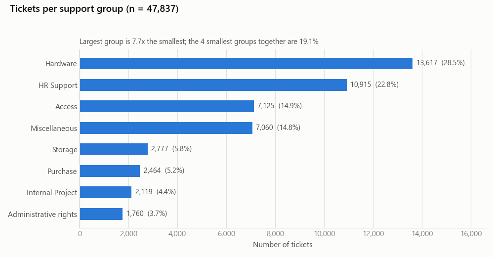
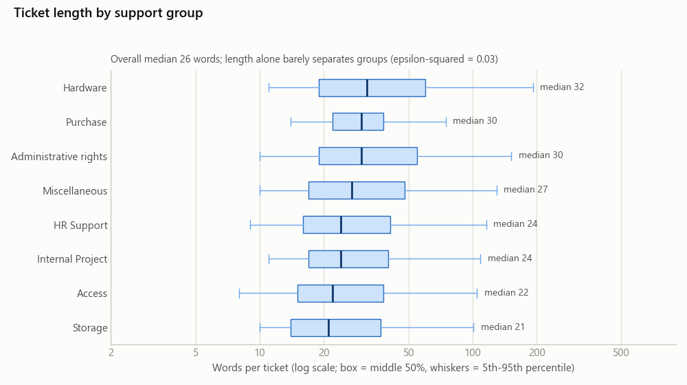
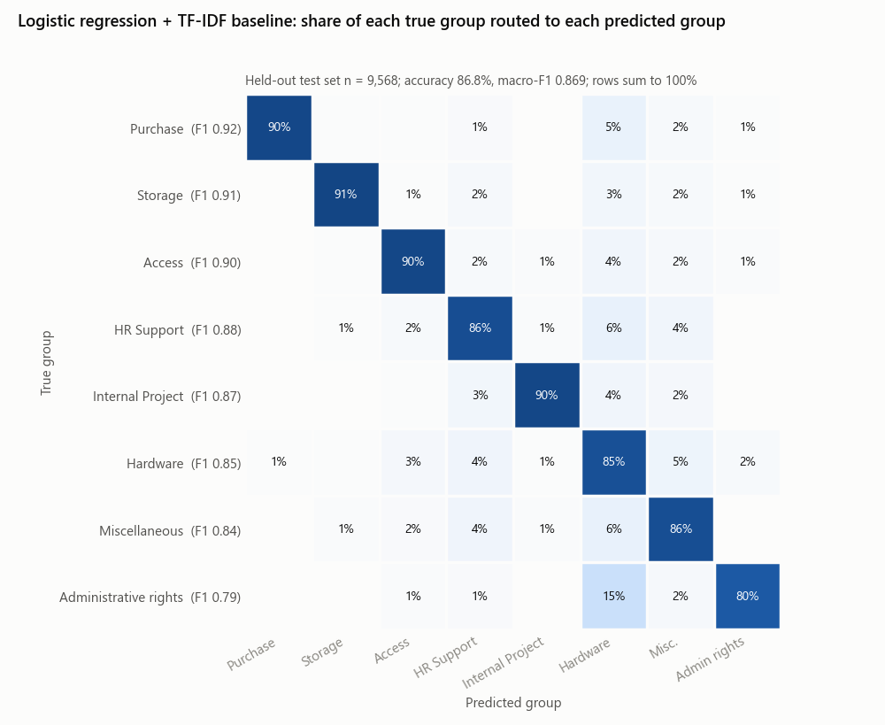

# T5 IT 工單自動分派＋AI 回覆草稿:深度資料分析與項目目標(草稿)

> 2026-11-04｜資料:Kaggle「IT Service Ticket Classification Dataset」第 1 版(CC0)｜圖:`img/T5_*.png`
> 狀態:數字都是這次實際下載、實際跑出來的;**還沒經過非產出者獨立核對**;8 個類別的定義要請兩位運維隊友確認。
> 隊友代號照 repo 慣例:隊友 A = 運維總監(北京)、隊友 B = IT 系統/雲端機房運維經理、隊友 C = 旅遊/俱樂部/賽事規劃。

---

## 0. 一分鐘看完

1. **資料拿到了,而且就是 Kaggle 原檔**:從公開的 GitHub 鏡像下載(沒登入、沒用 cookie),再用 Kaggle 免登入公開的 metadata 比對檔案大小和 md5,位元組完全相同。47,837 張工單 × 2 欄(工單文字、支援組),8 個支援組。
2. **很可能是真實企業工單,但被重度清理過**:到處是信件標頭殘留(71% 的工單有星期、月份或 pm)、簽名檔、羅馬尼亞文殘字、系統自動通知範本;同時全小寫、沒有數字和標點、只剩英文字典裡的字、人名全刪 —— 連 will、may、my、in 這些剛好也是人名的常用字都被刪光,vpn、jira、email、login 這些 IT 常用字也不見了。
3. **類別分得開**:傳統方法(TF-IDF＋邏輯迴歸)在 9,568 張保留測試集上準確率 86.8%、macro-F1 0.869(全部猜最大類只有 28.5%)。最常互相搞混的是 Hardware、HR Support、Miscellaneous 三組(占全部錯誤 46%);Administrative rights 最弱(F1 0.79,15% 被當成 Hardware)。
4. **可以「有把握才自動分派」**:門檻只用訓練資料決定,拿到測試集看一次:要求自動分派的正確率 ≥ 90% 時,可自動分派 91.3%;要求 ≥ 95% 時可自動分派 75.6%(每一組都 ≥ 90.8%),其餘 24.4% 轉人工。
5. **最大風險**:① 8 個類別名稱的來源沒寫(推測的上游公開版裡類別是數字代碼),要隊友抽樣核對;② 文字不像使用者真的會寫的句子,LLM 回覆草稿不能直接拿它評,要另做隊友盲審集;③ 6.0% 的測試工單在訓練集有幾乎一樣的「雙胞胎」,真正沒看過的新型工單準確率只有 83.9%。

---

## 1. 資料來源與核對方式

### 1.1 實際分析的檔案

| 項目 | 內容 |
|---|---|
| 原始頁面 | <https://www.kaggle.com/datasets/adisongoh/it-service-ticket-classification-dataset>(作者 Adison Goh;第 1 版,2024-02-18 更新;CC0 公眾領域;下載要登入 → **沒用**) |
| 實際下載 | GitHub `cibhibaskar/IT-service-ticket-classification`,commit `97846a2a`:<https://raw.githubusercontent.com/cibhibaskar/IT-service-ticket-classification/97846a2a5442245806701f406ed197417907a502/all_tickets_processed_improved_v3.csv> |
| 檔案 | `all_tickets_processed_improved_v3.csv`,14,568,920 bytes,CRLF 換行 |
| 指紋 | sha256 `044fdace33fa564e1e60453f2941dafc95539c99878b0d32746950394b9dd4d4`;git blob `e4e201bb63ad1ed60126de5853ec9c94a0cc32bc` |

### 1.2 怎麼確認它就是 Kaggle 原檔(全程沒用帳號、密碼、cookie)

| # | 對照來源 | 比對內容 | 結果 |
|---|---|---|---|
| 1 | Kaggle 免登入公開的 metadata:資料頁的 `/croissant/download`(Croissant 格式說明檔)與 `/api/v1/datasets/view/adisongoh/it-service-ticket-classification-dataset` | 檔名、47,837 列、2 欄、8 個類別名稱、總大小 14,568,920 bytes、官方 archive.zip 的 md5 | 全部相符 |
| 2 | 另一個 repo `Lunalykaya/IT-Service-Ticket-Classification`(commit `8603bdc4`)的 `data/archive (50).zip`,3,615,264 bytes | 算出 md5 = `nC/cGGE4Tw4NooODKqTlJg==`,和 Kaggle 官方 archive.zip(3.447 MB)的 md5 一字不差;zip 裡唯一的檔和 1.1 的 CSV 逐位元組相同 | **等於 Kaggle 官方下載檔** |
| 3 | 第三個 repo `adnankhan28/IT-Ticket-Classification`(commit `ec1a5b80`)的 `IT_Service_Tickets.csv` | git blob SHA | 相同(同一份位元組) |
| 4 | Hugging Face `saketgarodia1/IT-service-topic-classification-data`(revision `74335ce2`,重新切成 33,485/7,176/7,176) | 用 Hugging Face 公開統計 API 讀 8 類筆數再加總 | 8 類筆數完全相同 |
| 旁證 | `julianealves/service-ticket-classification`、`ManishRaikwar320/IT-Service-Ticket-Classification-ML` 的版本 | 小 47,838 bytes = 47,838 行的 CRLF 被改成 LF | 同一份檔,只差換行 |

**結論**:分析的就是 Kaggle 第 1 版原檔。下載檔都放在本機暫存資料夾,當成不可信資料處理(只讀,不執行)。

### 1.3 資料最早從哪來(推論:沒拿到上游原檔逐句比對)

Kaggle 頁沒寫來源。找到一個高度吻合的上游:2018 年 Microsoft 和 IT 服務公司 Endava 合作的公開案例(GitHub `karolzak/support-tickets-classification`,repo 為 MIT 授權)。它的 README 說資料是 Endava 內部 helpdesk 系統匯出、約 5 萬張「附使用者原始訊息、已分類」的工單,公開版已匿名化,檔名 `all_tickets.csv`。

| 證據 | 這份資料實測 |
|---|---|
| 該案例寫的清理步驟:刪信件標頭頁尾、刪 email/電話/網址、刪所有數字和非字母字元、刪非英文字(說有幾 % 的信是羅馬尼亞文)、只留英文字典字並刪掉人名、依內文去重 | 全部吻合(§3.1、§3.2) |
| 該 repo 附的英文字典 `wordsEn.txt`(109,582 字) | 本資料 2,085,566 個字 **100.00%** 都在裡面 |
| 該 repo 附的人名清單(5,164 個) | 在本資料出現 **0 次**;連 will、may、my、in、an、see、so 這些同時是人名的常用字都是 0;月份裡是人名的(january、april、june、august、september)0 次,不是人名的都有(march 4,462 次、november 6,146 次);sunday 0 次、monday 3,064 次 |
| 該案例依內文去重 | 本資料完全重複 0 筆 |
| 檔名 | `all_tickets.csv` → `all_tickets_processed_improved_v3.csv` |

自然英文不可能剛好避開所有人名字,這是同一套過濾器留下的「指紋」→ 來自 Endava 真實工單的可能性很高。但要注意:
- 上游原檔的下載連結有效期限到 2022-12-30(連結參數寫的),已過期,沒拿到原檔比對內容 → AT2 裡用「推論」語氣。
- Kaggle 上有一份 2019 年的上游鏡像 `aniketg11/supportticketsclassification`(檔案 `all_tickets.csv`;欄位 title、body、ticket_type、category、sub_category1、sub_category2、business_service、urgency、impact;授權寫 Unknown;下載要登入,沒下)。Kenny 若自己登入下載,可以 ① 逐句比對確認來源、② 多拿到緊急度、影響度、工單類型等欄位;授權不明,要用之前先問老師。
- 上游公開版的類別欄都用 LabelEncoder 編成數字(沒有名稱);Kaggle 版的 8 個英文類別名稱怎麼來的沒寫(欄名叫 Topic_group,可能是上傳者自己歸併、命名)→ **類別定義要請運維隊友核對**(§3.5)。

---

## 2. 資料概況表

| 項目 | 數值 |
|---|---|
| 大小 | 47,837 列 × 2 欄;14.6 MB |
| 欄位 | `Document`(工單文字,看起來是標題＋內文接在一起)、`Topic_group`(支援組,8 類) |
| 缺值 | 0 |
| 完全重複 | 0 列(連 2–3 個字的短工單也沒有重複 → 上游已去重) |
| 每張字數 | 最少 2、中位數 26、平均 43.6、最多 981;90% 的工單 ≤ 91 字、99% ≤ 284 字 |
| 每張字元數 | 中位數 175、最多 7,015 |
| 總字數/不同字數 | 2,085,566 / 12,327(22% 的字只出現 1 次) |
| 類別 | 8 類;最大 Hardware 28.5%、最小 Administrative rights 3.7%(相差 7.7 倍) |
| 授權 | CC0(公眾領域,可自由使用) |
| **沒有的欄位** | 時間、優先級/緊急度、處理人、解決時間、使用者、**回覆內容** |

---

## 3. 資料品質問題

### 3.1 文字被重度清理(對 LLM 影響最大)

| 現象 | 數字 | 影響 |
|---|---|---|
| 全小寫、沒有數字、沒有標點 | 有大寫的 0 張、有數字的 0 張;非字母字元只出現在 16 張(殘留的「.」「,」) | 錯誤碼、版本號、分機、日期全沒了 |
| 只剩英文字典字 | 100.00% 的字在 109,582 字的字典裡 | 不在字典的 IT 字整個消失:vpn、jira、skype、sharepoint、wifi、citrix、email、login 全是 0 次;字典裡有的才留下(laptop 2,757 次、password 2,970、printer 1,183、windows 767、excel 726、outlook 656) |
| 人名刪光,連帶刪掉同形的常用字 | 人名清單 0 次;will、may、my、in、an、see、so 都是 0 次 | 句子殘缺 |
| 大部分停用字被刪 | the 只出現 1,924 次,占全部字 0.09%(一般英文約 5%) | 讀起來像關鍵字串,不像句子 |
| 標題＋內文接在一起 | 21.1% 的工單開頭幾個字在後面又出現一次 | 例:`machine upgrade machine upgrade hello having performance issues machines impacting client possible make upgrade` |

第一筆資料長這樣(前 12 個字):`connection with icon icon dear please setup icon per icon engineers please`。

### 3.2 真實還是合成?

| 指向「真實工單」的跡象 | 數字/例子 |
|---|---|
| 信件標頭殘留(時間數字被刪,只剩星期、月份、pm) | 71.1% 的工單含星期、月份或 pm;29.6% 有「星期 … pm」;例:`external user access to local server tuesday july pm user hi colleague needs station` |
| 回覆/轉寄串 | re 出現在 21.1% 的工單、sent 18.6% |
| 簽名檔 | 1,490 張以 `kind regards administrator` 結尾;ext(分機)出現在 11.4% |
| 羅馬尼亞文殘字(只剩剛好拼得出英文字的) | bun 94 張、conform 59 張;只有羅馬尼亞文才有的 pentru、multumesc 0 張;例:`personal weekend work notes friday fwd personal weekend bun conform solicit la act flow` |
| 跨國辦公室城市名 | bucharest 451 張、belgrade 363、bogota 279、frankfurt 162 |
| 系統自動通知和手寫信混在一起 | `new purchase po` 開頭 1,212 張(1,210 張是 Purchase);`accept decline requests` 256 張(250 張是 Storage) |
| 長尾分布 | 字數 2–981;12,327 個不同字,22% 只出現 1 次 |
| 指向「LLM 合成」的跡象 | 沒看到:沒有合成資料常見的句型整齊、長度集中、文法完整 |

**判斷**:很可能是真實企業工單(經過重度清理、去重、匿名),不是 LLM 生成的。AT2 寫法:
- 別寫「這是某公司的真實資料」→ 改寫「依公開資訊推論為匿名化的真實企業工單,清理方式與 2018 年 Microsoft–Endava 公開案例的過濾指紋吻合」,附 §1.3 的表。
- 別寫「資料品質很好、可直接使用」→ 改寫「文字經重度清理,適合做分類;做回覆生成時另以人工改寫的自然句子評估」。

### 3.3 重複與近似重複

- 完全重複 0 張;去掉多餘空白後仍是 0;用字組合完全相同、只是順序不同的 76 張。
- 近似重複(TF-IDF 餘弦相似度,1 = 用字一模一樣):9,568 張測試工單和 38,269 張訓練工單比,最像的那張相似度 ≥ 0.99 的占 0.17%、≥ 0.95 占 2.5%、≥ 0.9 占 6.0%、≥ 0.8 占 12.6%、≥ 0.5 占 33.5%。大多是系統通知,例:`critical alert sent critical alert following alert occurred status active tape library`。
- 相似度 ≥ 0.9 的「雙胞胎」裡,有 4.3% 被標成不同組 → 標註本身有不一致。
- 影響:有相似歷史工單的分得準(≥ 0.9 那組準確率 96.2%);沒看過的新型工單(< 0.5,占測試集 66.5%)只有 83.9% → 主結果要另外報新型工單(§6.6)。

### 3.4 太短、太長

- ≤ 3 字 49 張、≤ 5 字 287 張、≤ 10 字 3,229 張(6.8%);例:`unlock account locked`、`monitor monitor monitor`。
- > 300 字 413 張(0.9%),最長 981 字,多是整串轉寄信。
- 短的不一定難:測試集 ≤ 5 字的 54 張準確率 87.0%;最長的四分之一(47–953 字)84.9%,比最短的四分之一(2–17 字,88.1%)低 → 長信常混好幾件事。

### 3.5 類別本身

- 類別名稱來源不明(§1.3)。
- Miscellaneous(14.8%)是雜項組,和 Hardware、HR Support 用字重疊最多(§5.2)。
- Administrative rights 實際多是「升級/安裝」:37.7% 含 upgrade、28.2% 含 outlook、25.5% 含 windows → 它和 Hardware 的界線要隊友定義(測試集有 15.1% 被判成 Hardware)。
- 模型很有把握(≥ 90%)卻和標籤不同的訓練工單有 407 張(1.1%),是「可能標錯」的候選。例:
  - 標 Hardware、模型判 Access:`reset oracle password sent october reset password struggling into can you please reset password`(看起來像標錯)
  - 標 Access、模型判 Hardware:`cannot log into laptop called advised she cannot log into her laptop`(兩邊都說得通)
  - 標 Hardware、模型判 Administrative rights:`low wireless connection speed after windows upgrade wireless low speed hi after upgrade did`
  - 最多的組合:標 Hardware 判 HR Support 40 張、標 HR Support 判 Miscellaneous 33 張、標 Access 判 Hardware 26 張 → 這 407 張很適合給隊友 A、B 抽查。

### 3.6 個資與授權

- 人名、數字、email、網址都刪了,但仍有城市名、辦公室地址片段(`floor blvd district` 結尾 235 張)、職稱;抽樣也看到 1 例疑似姓氏殘留 → 風險低但不是零。
- 授權 CC0,可自由使用;上游案例的 repo 是 MIT 授權,沒有另外寫資料授權。
- 做法:報告和簡報只放 15 字以內的片段,不貼整張工單。

---

## 4. 重要分布

### 4.1 類別(圖 a)

| 類別 | 張數 | 占比 | 累計 | 白話(看代表字推的,要隊友確認) |
|---|---:|---:|---:|---|
| Hardware | 13,617 | 28.5% | 28.5% | 筆電、螢幕、會議室設備、連線 |
| HR Support | 10,915 | 22.8% | 51.3% | 新進/離職、請假、工時卡、HR 系統 |
| Access | 7,125 | 14.9% | 66.2% | 帳號、密碼重設、系統權限(Confluence、Git) |
| Miscellaneous | 7,060 | 14.8% | 80.9% | 變更、核准、加入名單等雜項 |
| Storage | 2,777 | 5.8% | 86.7% | 共用資料夾、信箱容量、存取申請 |
| Purchase | 2,464 | 5.2% | 91.9% | 採購單通知、收貨 |
| Internal Project | 2,119 | 4.4% | 96.3% | 專案代碼、pipeline 設定 |
| Administrative rights | 1,760 | 3.7% | 100% | 升級、安裝軟體(要管理員權限) |

- 最大/最小 = 7.7 倍;最小 4 類合計 19.1%;標準化熵 0.884(1 = 完全平均)→ 中度不平衡,要看 macro-F1,不能只看準確率(全部猜 Hardware 就有 28.5%)。

### 4.2 長度(圖 b)

| 類別 | 中位數(字) | 中間 50% | 平均 | 最長 |
|---|---:|---:|---:|---:|
| Storage | 21 | 14–37 | 34.4 | 497 |
| Access | 22 | 15–38 | 35.6 | 934 |
| HR Support | 24 | 16–41 | 37.8 | 817 |
| Internal Project | 24 | 17–40 | 37.7 | 876 |
| Miscellaneous | 27 | 17–48 | 43.0 | 953 |
| Purchase | 30 | 22–38 | 34.9 | 418 |
| Administrative rights | 30 | 19–55 | 50.4 | 981 |
| Hardware | 32 | 19–60 | 56.3 | 931 |

- Kruskal–Wallis 檢定(比較多組分布的無母數檢定):H = 1,550.6,p < 0.001,但效果量 ε² = 0.032(很小)→ 各組長度有差,但長度幾乎不能拿來分類。
- Purchase 的中間 50% 最窄(22–38 字)→ 範本信多。

### 4.3 衍生特徵的分布與相關(給 AT2 用,做法見 §7.1)

| 衍生特徵 | 全部工單 | 最高/最低的組 | 和類別的關聯(Cramér's V,0 = 無關、1 = 完全決定) |
|---|---:|---|---:|
| 有招呼語(dear/hello/hi) | 87.2% | Purchase 93.6% / Storage 69.4% | 0.161 |
| 有致謝或結尾(thanks/thank/regards) | 84.2% | Purchase 96.5% / Storage 70.0% | 0.147 |
| 緊急字眼(urgent/asap/immediately/critical/emergency) | 5.9% | Internal Project 8.7% / Purchase 1.1% | 0.087 |
| 權限字(access/permission(s)/password/login) | 23.7% | Storage 56.4% / Purchase 1.5% | 0.341 |
| 採購字(purchase/order/buy/quote/invoice) | 11.3% | Purchase 76.3% / Internal Project 6.0% | 0.480 |
| 長度四分位 | — | — | 0.124 |

- 以上卡方檢定都 p < 0.001(樣本大,小差異也會顯著 → 看 V 的大小)。
- 特徵之間(Spearman 等級相關):字數 vs 用字多樣性 −0.548(長信重複多)、招呼語 vs 致謝 0.614(手寫信兩者常一起出現)、字數 vs 緊急字眼 0.185。

---

## 5. 類別之間怎麼區分

### 5.1 每組的代表字(卡方檢定挑出,只列「在該組特別多」的字)

| 類別 | 代表字:該組工單含這個字的比例 vs 其他組 | 前 5 個代表字至少出現 1 個(該組 vs 其他組) |
|---|---|---:|
| Purchase | po 70.6% vs 0.6%;purchased 65.3% vs 0.2%;purchase 68.0% vs 1.0% | 89.5% vs 4.3% |
| Internal Project | code 58.6% vs 3.2%;project 51.7% vs 2.7%;pipeline 12.0% vs 0.1% | 91.6% vs 7.1% |
| Storage | folder 28.8% vs 0.6%;decline 25.7% vs 0.2%;mailbox 25.6% vs 1.6% | 75.5% vs 3.1% |
| Administrative rights | upgrade 37.7% vs 0.5%;outlook 28.2% vs 0.3%;windows 25.5% vs 0.7% | 70.7% vs 1.6% |
| Access | confluence 19.6% vs 0.4%;password 16.4% vs 1.2%;reset 10.3% vs 0.3% | 54.2% vs 3.3% |
| HR Support | starter 18.9% vs 0.5%;leave 16.2% vs 2.2%;timecard 4.9% vs 0.2% | 51.1% vs 6.9% |
| Miscellaneous | change 24.6% vs 4.9%;approval 11.4% vs 1.3%;owner 8.1% vs 1.6% | 62.7% vs 14.1% |
| Hardware | laptop 10.5% vs 0.7%;monitor 6.4% vs 0.6%;connection 5.1% vs 0.3% | 31.0% vs 2.9% |

- 前 4 組有「招牌字」,一出現幾乎就能定組;招牌片語也很集中:`new starter` 1,923 張中 97.4% 是 HR Support、`password reset` 488 張中 97.3% 是 Access、`wants to access` 603 張中 96.7% 是 Storage。
- Hardware 沒有招牌字(前 5 個代表字只涵蓋 31.0% 的 Hardware 工單),第 7 名以後就是 sent、you、we、with 這類一般字 → 多是手寫長信,要靠整體用字判斷。

### 5.2 哪幾組最像(每組平均用字的餘弦相似度,1 = 一模一樣)

- 最像:Hardware–Miscellaneous 0.741、HR Support–Hardware 0.734、HR Support–Miscellaneous 0.721、Administrative rights–Hardware 0.697、Access–Hardware 0.669。
- 最不像:Purchase 和每一組都 ≤ 0.278(Purchase–Storage 0.159)。
- 這個排序和 §6.4 模型實際搞混的前幾名幾乎一樣 → 資料面就能預告哪裡會錯。

---

## 6. 可行性實驗結果

### 6.1 設定(白話)

- 切分:分層隨機抽 80% 訓練(38,269 張)、20% 測試(9,568 張),seed 42;測試集只在最後用一次。
- 特徵:TF-IDF(單字和相鄰兩字的組合,出現 ≥ 2 次才算,次數取對數)。
- 模型:邏輯迴歸、線性 SVM、Complement Naive Bayes、「全部猜最大類」;超參數用訓練集 5 折交叉驗證挑。
- 指標:準確率 = 猜對比例;F1 = 查準率(判成這組的有多少真的是)和查全率(這組的有多少被找到)的調和平均;macro-F1 = 8 組 F1 的平均,小組和大組一樣重要。

### 6.2 結果

| 方法 | 5 折交叉驗證 macro-F1(訓練集) | 測試準確率 | 測試 macro-F1 |
|---|---:|---:|---:|
| 全部猜 Hardware | 0.055 | 28.5% | 0.055 |
| Complement Naive Bayes | 0.802 ± 0.004 | 81.8% | 0.808 |
| 線性 SVM(C = 0.3,類別加權) | 0.862 ± 0.004 | 86.6% | 0.866 |
| **邏輯迴歸(C = 8,類別加權)** | **0.866 ± 0.004** | **86.8%** | **0.869** |

- 交叉驗證和測試集幾乎一樣(0.866 vs 0.869)→ 結果穩定。邏輯迴歸不做類別加權時交叉驗證 0.860,加權後小組比較被顧到;交叉驗證和測試集都是邏輯迴歸最好,所以後面都用它。
- 機率可信:預期校準誤差(ECE)0.035,也就是模型說「80% 把握」時,實際大約就是 80% 對 → 可以直接拿機率當自動分派門檻。

### 6.3 每組成績(圖 c)

| 類別 | 查準率 | 查全率 | F1 | 測試張數 |
|---|---:|---:|---:|---:|
| Purchase | 0.944 | 0.897 | 0.920 | 493 |
| Storage | 0.904 | 0.912 | 0.908 | 555 |
| Access | 0.900 | 0.899 | 0.899 | 1,425 |
| HR Support | 0.888 | 0.864 | 0.876 | 2,183 |
| Internal Project | 0.839 | 0.899 | 0.868 | 424 |
| Hardware | 0.859 | 0.850 | 0.855 | 2,724 |
| Miscellaneous | 0.819 | 0.860 | 0.839 | 1,412 |
| Administrative rights | 0.781 | 0.801 | 0.791 | 352 |

### 6.4 最常送錯的組合

| 真實 → 預測 | 張數 | 占真實組 |
|---|---:|---:|
| HR Support → Hardware | 129 | 5.9% |
| Hardware → Miscellaneous | 123 | 4.5% |
| Hardware → HR Support | 113 | 4.1% |
| Miscellaneous → Hardware | 83 | 5.9% |
| HR Support → Miscellaneous | 77 | 3.5% |
| Administrative rights → Hardware | 53 | **15.1%** |

- 雙向合計:HR Support–Hardware 242、Hardware–Miscellaneous 206、HR Support–Miscellaneous 137 → 這三對占全部 1,260 個錯誤的 46%。

### 6.5 有把握才自動分派:門檻 → 自動分派比例

做法:用訓練集 5 折交叉驗證得到的機率,找出「正確率剛好達標」的最低門檻;再拿到測試集看一次(門檻沒有看測試集調)。

| 目標正確率 | 門檻(最高機率 ≥) | 測試集自動分派比例 | 測試集正確率 | 每一組的自動分派正確率 | 換算每 1,000 張 |
|---|---:|---:|---:|---|---|
| ≥ 90% | 0.49 | 91.3% | 90.4% | 83.1%(Administrative rights)– 95.4%(Purchase);有 4 組低於 90% | 自動 913 張(約 88 張送錯)、人工 87 張 |
| ≥ 95% | 0.70 | 75.6% | 95.1% | 每一組都 ≥ 90.8% | 自動 756 張(約 37 張送錯)、人工 244 張 |
| ≥ 98% | 0.91 | 53.5% | 98.4% | 每一組都 ≥ 95.2% | 自動 535 張(約 8 張送錯)、人工 465 張 |

- 沒把握的(機率 < 0.70)占 24.4%,模型在這區只猜對 61.3% → 正好是該交給 LLM 或人工的部分;Hardware 有 30.2% 落在這區,Purchase 只有 10.8%。
- 新型工單(和訓練集最高相似度 < 0.5)用同樣門檻:0.49 → 自動 89.0%、正確 88.1%(沒達 90%);0.70 → 自動 70.2%、正確 93.6%。
- 建議 AT2 的標準用「整體 ≥ 95%、每一組 ≥ 90%」(0.70 那一列),不要只看整體 90% —— 那會讓 Administrative rights 的自動分派只有 83% 對。

### 6.6 近似重複有沒有灌水

| 和訓練集最高相似度 | 測試張數 | 準確率 | macro-F1 |
|---|---:|---:|---:|
| < 0.5(新型工單) | 6,364(66.5%) | 83.9% | 0.822 |
| 0.5–0.7 | 1,431 | 91.2% | 0.904 |
| 0.7–0.9 | 1,195 | 93.0% | 0.927 |
| ≥ 0.9(雙胞胎) | 578(6.0%) | 96.2% | 0.963 |

- 整體 86.8% 有一部分來自「歷史上有很像的工單」;對真正沒看過的新問題,誠實的數字是 83.9% / 0.822 → AT3 要另外報這一組。

### 6.7 要多少標註資料(學習曲線,線性 SVM)

| 訓練張數 | 500 | 1,000 | 2,000 | 5,000 | 10,000 | 20,000 | 38,269 |
|---|---:|---:|---:|---:|---:|---:|---:|
| 測試 macro-F1 | 0.746 | 0.780 | 0.803 | 0.824 | 0.839 | 0.855 | 0.866 |

- 5,000 張就有全量成績的 95% → 一家公司用幾千張歷史工單就能起步。
- 這也是 LLM 的比較對象:少樣本 LLM 每組只看幾張例子,要和「500 張標註」的 0.746、「全量」的 0.866 都比。

### 6.8 長度和難度

- 最短四分之一(2–17 字)準確率 88.1%、最長四分之一(47–953 字)84.9%。
- 長度和模型把握度的 Spearman 相關 −0.10(長信稍微沒把握);答對與否和長度(取對數)的點二系列相關 −0.036(幾乎無關)。

---

## 7. 對 AT2 的意義

### 7.1 只有 2 欄,「分布與相關性」怎麼交(準則 3 的 HD)

HD 要「充分說明數據的特徵、總體分佈和相關性」〔AT2 評分標準 3〕;D 檔是「可能缺少數據分佈和相關性的統計信息」。只有文字和類別兩欄 → 先從文字算出衍生特徵,再做分布和相關:

| 衍生特徵 | 已算出的結果 | 在 AT2 怎麼講 |
|---|---|---|
| 長度(字數、字元數) | 各組中位數 21–32;Kruskal–Wallis ε² = 0.032 | 資料特徵;長度不能單獨當分類依據 |
| 用字多樣性(不重複字 ÷ 總字數) | 平均 0.784;和長度 −0.548 | 長信多是重複的轉寄串 |
| 信件結構旗標:招呼語、致謝、標頭殘留、標題重複 | 87.2%、84.2%、71.1%、21.1%;招呼語和致謝 0.614 | 證明資料來自真實信件;分出「手寫信 vs 系統通知」 |
| 系統範本旗標(開頭 3 字和 ≥ 50 張相同) | 11.6% 的工單 | 分開報範本工單和手寫工單的成績 |
| 主題字旗標(權限字、採購字) | 和類別 Cramér's V 0.341、0.480 | 說明關鍵字規則能做到哪,為什麼還要模型 |
| 緊急字眼 | 5.9%;和類別 0.087 | 原資料沒有優先級,這是粗略的緊急度替代指標 |
| 模型衍生:把握度、和歷史工單的最高相似度 | 把握度 vs 長度 −0.10;相似度 < 0.5 準確率 83.9%、≥ 0.9 是 96.2% | 門檻設計、「新型工單」偵測 |
| (選用)上游鏡像的 urgency、impact、ticket_type | 未下載 | Kenny 自己下載且授權可用時,做「類別 × 緊急度 × 影響度」交叉表 |

圖表建議:類別長條圖(圖 a)、各組長度箱形圖(圖 b)、衍生特徵相關矩陣、類別 × 旗標熱度圖、混淆矩陣(圖 c)、門檻–自動分派比例曲線(§6.5 的表可直接畫)。

### 7.2 傳統基準 vs 前沿 AI(HD 要的前沿方法、選擇標準、前沿基準)

| 方法 | 角色 | 現況 | 為什麼要測 |
|---|---|---|---|
| 全部猜最大類 | 地板 | 28.5% / 0.055 | 證明不是隨便猜 |
| TF-IDF＋邏輯迴歸/SVM | 傳統基準(已完成) | 86.8% / 0.869 | 便宜、快、可解釋;前沿方法要贏它才有意義 |
| 句向量(embedding)＋邏輯迴歸 | 中間方案 | 待測 | 抓得到同義詞;可在本機跑 |
| 微調小型 Transformer(例如 DistilBERT) | 深度學習基準 | 待測 | HD 點名的深度學習 |
| LLM 零樣本(只給 8 組白話定義,由隊友 A、B 寫) | 前沿 | 待測 | 不需標註;加新組只要改定義 |
| LLM 少樣本(每組 3 例,或找最像的歷史工單當例子) | 前沿 | 待測 | 少量標註 vs 全量監督 |
| 混合:分類器處理有把握的 76%,沒把握的 24% 交給 LLM 或人工 | 系統設計 | 沒把握區目前只對 61.3% | 最可能的實際做法 |

- **選擇標準**(AT2 要寫):① 每組都顧到(macro-F1、最弱組 F1);② 正確率 ≥ 95% 時的自動分派比例;③ 每 1,000 張的費用;④ 回應時間;⑤ 資料能不能留在公司內(隱私;隊友 A 在北京連外網受限);⑥ 能不能說明理由;⑦ 加新支援組要不要重訓。
- **注意**:這份文字被清理成關鍵字串,LLM 擅長的是自然語句 → LLM 可能被低估。這正好是一個好的研究問題(答案現在不知道、可驗證):「在清理過的工單文字上,少樣本 LLM 的分類成績能不能追上傳統基準?」AT3 加一組「隊友改寫成自然句子」的對照。
- **成本控制**:LLM 只跑固定的 1,000 張分層子樣本(各組比例同測試集,seed 固定);1,000 張時準確率的 95% 信賴區間約 ±2 個百分點,夠用來做決定。

### 7.3 回覆草稿怎麼評:運維隊友盲審

資料集裡沒有回覆內容 → 不能用「跟標準答案比相似度」,要靠人評。

1. **評估集**:64 張(8 組 × 8 張),分層抽樣、固定 seed;排除 ≤ 5 字的和系統自動通知(那些只需要自動確認信)。
2. **兩種輸入**:(a)原始清理後文字;(b)隊友先把工單改寫成自然句子(不加真實資訊)→ 看清理過的文字對草稿品質的影響。
3. **三版草稿**:A 範本信(隊友先寫好每組一份標準確認信 = 人工基準);B LLM 零樣本;C LLM＋各組回覆要點(隊友寫:要跟使用者要什麼資訊、標準步驟、不能承諾什麼)。
4. **盲審**:Kenny 打亂順序、拿掉版本標記;隊友 A、B 各自獨立評,評完才討論。
5. **評分表**:① 能不能寄(直接寄/小改/大改/不能用);② 有沒有錯誤或危險指示(例如叫使用者提供密碼、關閉防毒);③ 有沒有問到下一步需要的資訊;④ 語氣。隊友 C(非 IT)只評「使用者看不看得懂」。
6. **指標與暫定目標**:C 版「直接寄＋小改」≥ 70%,且比 A 版高 ≥ 15 個百分點;錯誤/危險指示 0 則;兩位評審一致性(加權 Cohen's κ,0 = 跟碰運氣一樣、1 = 完全一致)≥ 0.6。
7. **限制**:64 張時比例的誤差約 ±12 個百分點 → 只用來決定「值不值得做下去」,不宣稱上線品質。

### 7.4 風險與備案

| 風險 | 證據 | 備案 |
|---|---|---|
| 類別定義來源不明 | 上游類別是數字代碼(§1.3) | 隊友盲審 200 張;一致率 < 80% → 用隊友重標的 200 張當黃金測試集,或合併定義不清的組 |
| 文字被清理,LLM 被低估 | §3.1 | 加「自然句子」對照組,兩種結果都報 |
| 近似重複灌水 | 6.0% 測試工單有雙胞胎 | 另報新型工單(相似度 < 0.5)的成績 |
| 沒有時間、優先級、回覆欄位 | §2 | 業務效益用模擬(計時小實驗、每 1,000 張換算),明講限制 |
| LLM 費用與連線 | 隊友 A 在北京 | 只在 1,000 張子集用 API;準備一個可本機跑的開源模型 |
| 個資殘留 | §3.6 | 只放 15 字以內片段 |

### 7.5 先問運維隊友的 4 個問題(需求獲取:現況與人工基準)

1. 你們服務台現在人工分派一張工單大約多久?轉錯組的比例大概多少?(人工基準)
2. Hardware、Administrative rights、Miscellaneous 的界線怎麼分?
3. 自動分派能接受的錯誤率是多少?哪一組送錯代價最高?(決定門檻;對應「哪種錯誤最貴」)
4. 哪些工單絕對不能自動回覆(帳號、權限、資安)?

---

## 8. 項目目標與具體目標(1.12 活動;AT2「業務目標/分析目標」第一版)

寫法照 1.8 Telco 正解:aim 寫業務成果,不寫手段;objectives 走「做出什麼 → 評估多準 → 算划不划算」,每條都有指標＋目標值＋評估資料(技術目標檢查清單)〔[11 §12、§14、§21](../11_單元一_整合筆記.md)〕。

### 8.1 項目目標(aim)

針對企業 IT 服務台每天收到的新工單,自動判斷該交給哪個支援組並草擬第一封回覆,讓服務台人員只需確認或小改,以減少人工分派的工作量、減少送錯組的來回轉單,讓使用者更快收到有用的第一次回覆。

### 8.2 具體目標(objectives)

| # | 具體目標 | 指標＋目標值(括號內是目前基準) | 評估資料 | 期限 |
|---|---|---|---|---|
| O1 | 完成資料理解與類別核對:做出分布與相關性分析,並請隊友 A、B 盲審 200 張分層抽樣工單的類別 | 報告專家和資料標籤的一致率、兩位專家之間的 κ;一致率 < 80% 就啟動備案(§7.4) | 200 張分層抽樣(固定 seed) | 2026-12-11(AT2) |
| O2 | 開發工單分派模型和「有把握才自動分派」規則 | 測試 macro-F1 ≥ 0.88(0.869);最弱組 F1 ≥ 0.82(0.791);自動分派正確率 ≥ 95% 且每組 ≥ 90% 時,自動分派 ≥ 80%(75.6%);新型工單 macro-F1 ≥ 0.84(0.822) | 9,568 張保留測試集;門檻只用訓練資料決定 | 2027-02-19(AT3) |
| O3 | 比較 LLM(零樣本、少樣本)和傳統基準,決定 LLM 用在哪一步 | 回答兩件事:① 少樣本 LLM 的 macro-F1 是否達到基準的 95%;② 交給 LLM 的「沒把握」工單,正確率能否從 61% 提到 ≥ 75%;同時報每 1,000 張費用和平均回應時間 | 1,000 張分層子樣本＋測試集裡機率 < 0.70 的 2,334 張 | 實驗設計 2026-12-11(AT2);結果 2027-02-19(AT3) |
| O4 | 開發回覆草稿功能,由隊友 A、B 盲審 | 「直接寄＋小改」≥ 70%,且比範本信高 ≥ 15 個百分點;錯誤/危險指示 0 則;評審一致性 κ ≥ 0.6 | 64 張盲審集(8 組 × 8 張) | 2027-02-19(AT3) |
| O5 | 做出可操作的原型,並算划不划算 | 原型能完成「貼上工單 → 建議支援組＋把握度＋回覆草稿 → 確認或修改」;計時小實驗每張處理時間中位數降低 ≥ 30%(暫定,和隊友定);換算每 1,000 張省下的人工分派次數與工時 | 隊友扮服務台人員,有/沒有原型各處理 20 張 | 2027-02-19(AT3) |

O1–O5 都完成 → aim 就有證據:能自動分派多少、送錯多少(O2)、AI 用在哪最划算(O3)、回覆能不能用(O4)、實際省多少時間(O5)。

### 8.3 交付成果(含成熟度)

| 時間 | 交付成果 | 成熟度 |
|---|---|---|
| 2026-12-11(AT2) | 項目計畫報告(資料品質、類別盲審結果、分布與相關性、基準實驗、實驗設計、時間線、風險);簡報投影片;基準方法 Python 程式 | 設計報告＋概念驗證 |
| 2027-02-19(AT3) | 可操作的原型(互動介面);評估報告(分派結果、LLM 比較、草稿盲審、成本效益);程式與重跑說明;展示 | 原型(主功能完成,未達上線品質) |

不在範圍內:串接真實工單系統、上線部署、使用任何公司的真實資料。

### 8.4 成功標準(依利益相關者;業務語言 → 指標 → 目標值 → 評估資料)

| 誰 | 業務語言 | 指標 | 目標值 | 評估資料 |
|---|---|---|---|---|
| 服務台主管 | 大部分工單不用人工分派,送錯的很少 | 自動分派比例(自動分派正確率 ≥ 95% 時) | ≥ 80%(基準 75.6%) | 9,568 張測試集 |
| 各支援組 | 不常收到別組的單,小組不被犧牲 | 每組自動分派正確率;最弱組 F1 | ≥ 90%;≥ 0.82 | 同上 |
| 分析團隊 | 整體分得準,遇到新問題也穩 | macro-F1;新型工單 macro-F1 | ≥ 0.88;≥ 0.84 | 同上;其中新型工單 6,364 張 |
| IT/財務主管 | AI 花得值得 | LLM 與基準的 macro-F1 比值;沒把握工單的正確率;每 1,000 張費用與回應時間 | ≥ 95%;≥ 75%;如實報告並和人工時間比 | 1,000 張子樣本;2,334 張沒把握工單 |
| 服務台人員 | 草稿能直接用、而且安全 | 「直接寄＋小改」比例;錯誤/危險指示 | ≥ 70%;0 則 | 64 張盲審集 |
| 使用者 | 更快收到有用的回覆 | 每張處理時間中位數 | 降低 ≥ 30%(暫定) | 計時小實驗 |
| 運維專家 | 資料可信 | 專家與標籤一致率;κ | 報告數字;< 80% 啟動備案 | 200 張盲審 |

### 8.5 用技術目標檢查清單自評

| 清單大項 | 自評 |
|---|---|
| 非本領域的人也看得懂 | aim 和目標欄用「分派、回覆、送錯、省時間」等白話;macro-F1、κ 只放在指標欄,§6.1 有白話解釋 |
| 判斷得出何時算達成 | 每條都有指標＋目標值＋評估資料;門檻和測試集事先固定 |
| 是理想的目標 | 涵蓋用例的兩個關鍵技術(分類＋生成);同一套也能用在 HR 服務台、客服信箱 |
| 是有現實可行性的挑戰 | 基準已到 0.869 / 75.6%,目標 0.88 / 80% 要靠更好的方法才達得到,但不是空想;LLM 在清理過的文字上表現未知 |

---

## 9. 重跑方法(附錄)

- 環境:Python 3.11.9、pandas 2.2.2、scikit-learn 1.6.1、scipy 1.15.3、matplotlib 3.10.0(`Machine Learning/.venv`)。
- 腳本(核對、分布與品質、清理指紋、模型與門檻、畫圖)放在本機 session 暫存資料夾,依這次的工作範圍沒有放進 repo;要保留請另存。
- 關鍵參數:`train_test_split(test_size=0.2, stratify=y, random_state=42)`;`StratifiedKFold(5, shuffle=True, random_state=42)`;`TfidfVectorizer(ngram_range=(1,2), min_df=2, sublinear_tf=True)`;`LogisticRegression(C=8, class_weight="balanced", max_iter=3000)`;`LinearSVC(C=0.3, class_weight="balanced")`;門檻用 `cross_val_predict(method="predict_proba")` 的訓練集機率決定。
- 近似重複:用訓練好的 TF-IDF 向量算「測試 × 訓練」餘弦相似度,取每張測試工單的最大值。
- 可能標錯:訓練集 5 折交叉驗證的機率 ≥ 0.9 但預測和標籤不同。
- 清理指紋:用 `karolzak/support-tickets-classification` 附的 `datasets/wordsEn.txt` 和 `datasets/CSV_Database_of_First_Names.csv` 逐字比對。

---

## 10. 簡體版(可直接貼 1.12 討論區)

**项目目标(Project aim)**

针对企业 IT 服务台每天收到的新工单,自动判断该交给哪个支持组,并草拟第一封回复,服务台人员只需确认或小改,从而减少人工分派的工作量和转错组的来回,让用户更快收到有用的回复。

**项目具体目标(Project objectives)**

1. 用公开的 IT 工单数据(约 4.8 万张、8 个支持组)完成数据理解,并请组里的运维同学抽查 200 张工单的分类是否合理(12/11 前写进项目计划)。
2. 开发工单分派模型,只在有把握时自动分派:自动分派的正确率 ≥ 95%,覆盖 ≥ 80% 的工单。
3. 比较大语言模型(零样本、少样本)和传统方法的效果、成本和速度,决定 AI 用在哪一步最合适。
4. 开发回复草稿功能,由运维同学盲评:≥ 70% 的草稿只需小改就能发出,且没有错误或危险的操作指示。
5. 做一个可操作的原型,估算每 1,000 张工单能省下多少人工分派和处理时间(2–5 在 2/19 前完成)。

