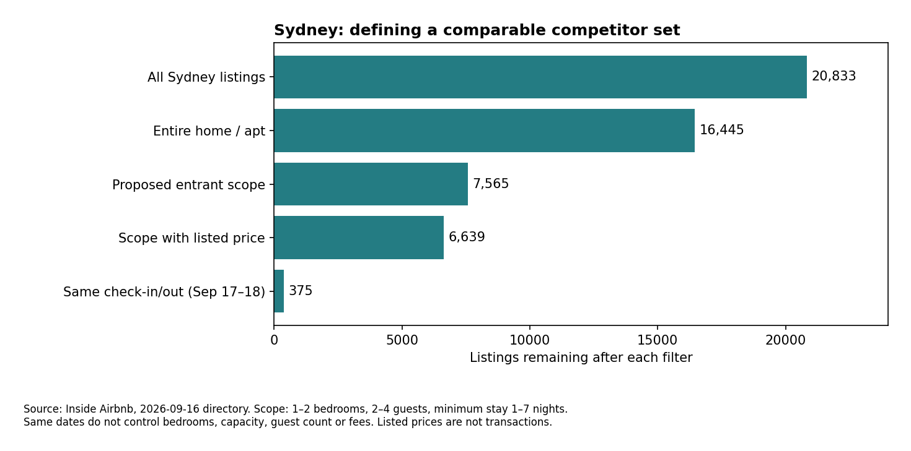

# Airbnb 雪梨新房東：資料範圍與業務分析方向

> **範圍更新**：Kenny後續指定2024年起、雪梨與墨爾本，並加入ROI選項。請以[15雙城與回報研究](15_Airbnb_2024起雙城與ROI_研究範圍.md)為目前範圍；本檔保留雪梨首輪實查紀錄。

> 2026-11-07，研究工作稿。Kenny 已確認：團隊組建／分工完成、選定 Airbnb 資料方向；本對話另確認以雪梨開始。以下細分範圍是研究建議，不代表組會已全數定案。
> 本輪兩條研究代理因用量限制未能啟動，改由主迴圈實查；另由非產出者獨立重算核心數字並抽核來源，見 [本輪核對紀錄](raw/airbnb_entrant_review_2026-11-07.md)。本稿是選定方向後的研究依據，不是正式交件稿。先前來源研究見 [11](11_Airbnb與酒店取消_可行性與資料來源.md)。

## 1. 業務問題先收斂

**建議題名：雪梨 Airbnb 新房東的競品定位與營運情境決策助手。**

使用者已持有或考慮投入一間房，希望決定目標客群、找到真正可比較的房源、理解價格位置、選擇必要設備及改善事項，並比較營運情境。房子所在位置若已固定，就分析現有位置的優劣；不能一律把「搬到熱門區」當可執行建議。

首版回答三件事：**和誰競爭？如何定位與改善？哪些價格／入住情境才可能達到目標？**

「最大性價比」要分清楚：旅客端可比較同價位的空間、設備及評論表現；房東端則比較成本與貢獻收益。兩者沒有共同的現成真值。`review_scores_value` 是曾評論旅客的感受，不能直接視為客觀性價比或所有客人的評價。

## 2. 核心資料與實際範圍

主來源：[Inside Airbnb 下載入口](https://insideairbnb.com/get-the-data/)，本次入口仍列 Sydney **2026-09-16**；實檔 `last_scraped` 為 **2026-09-17**。這是季度快照，不能稱 11 月即時房價。官方提供約近 12 個月季度資料，其他歷史需申請；本次未取得多期資料，不能承諾完整歷史面板。

| 核心表 | 本次確認 | 本專案用途／界線 |
|---|---|---|
| [listings.csv.gz](https://data.insideairbnb.com/australia/nsw/sydney/2026-09-16/data/listings.csv.gz) | 全量20,833×90，房源ID唯一；有價17,721 | 房型／地區／人數／臥室／設施／評分／最低晚數；不是成交資料 |
| [calendar.csv.gz](https://data.insideairbnb.com/australia/nsw/sydney/2026-09-16/data/calendar.csv.gz) | HTTP200，表頭僅listing_id、date、available、minimum_nights、maximum_nights | **這版無price**；不能照舊說明直接做逐日價格曲線；本輪僅讀表頭 |
| [reviews.csv.gz](https://data.insideairbnb.com/australia/nsw/sydney/2026-09-16/data/reviews.csv.gz) | 前輪確認有文字及日期，無逐則星等 | 可規劃主題與抱怨分析；本輪未全量下載、未做情緒評估 |
| [neighbourhoods.geojson](https://data.insideairbnb.com/australia/nsw/sydney/2026-09-16/visualisations/neighbourhoods.geojson) | HTTP200，38個feature，屬性含neighbourhood | 地區地圖與空間聚合；不要直接假設等於現行行政區 |

依 [Data Assumptions](https://insideairbnb.com/data-assumptions/)，不可訂可能是房東封鎖；座標亦經模糊處理。估計收益／入住率不可當實際帳務。資料為CC BY4.0，正式引用來源；repo只放程式、彙總及研究，不發布房東或評論者資料列。

### 實測可採用的首版樣本

從全量資料依序篩選：

| 篩選步驟 | 剩餘房源數 |
|---|---:|
| 全部雪梨房源 | 20,833 |
| 整套房 Entire home/apt | 16,445 |
| 整套＋1–2臥室＋可住2–4人＋最低入住1–7晚 | 7,565 |
| 上述樣本中價格非空 | 6,639 |
| 上述有價樣本中，同為9/17入住、9/18退房 | 375 |

缺失篩選欄位不自動補零；全量最低晚數缺13列。全量有2,846列最低晚數至少90晚，顯示資料包含不同營運型態；短住競品需先排除這類房源，而不是混算全市場平均。

價格非空樣本中，`price`與`price_quote_price_per_night`兩欄均有值的17,720列，全數差異小於AUD0.011。這支持兩欄此批觀測值相同，不代表總價、費用及報價人數口徑已釐清。

7,565列首版樣本有價格且有入住／退房日期者，分成873組日期。最大組375列，中位掛牌／報價為AUD333；這僅是該日、該篩選範圍的描述值，**不是新房東建議售價**。房源仍混有1／2房、2／4人，報價客人數與費用亦未完全控制；正式推薦應繼續分層，樣本太少則擴大範圍並告知。



完整彙總：[JSON](raw/airbnb_entrant_eda_2026-11-07.json)；可重現程式：[airbnb_entrant_eda.py](../analysis/airbnb_entrant_eda.py)。程式命令：

```powershell
python "Innovation Studio/analysis/airbnb_entrant_eda.py" "scratchpad/airbnb_2026-11-07/sydney_listings.csv.gz" "Innovation Studio/notes/raw/airbnb_entrant_eda_2026-11-07.json"
```

原檔SHA256：`06bbd629fbe93d9da1f2163e82d584a58738a53d7897d5c081f665aadc4e3c55`。跨裝置需依上列URL重新下載原檔；scratchpad不提交。

## 3. 你提供的補充來源：逐項判斷

| 來源 | 本次核對與現況 | 優先度與修正 |
|---|---|---|
| [Xotelo](https://xotelo.com/) | 無帳號金鑰實測：Sydney list HTTP200、total_count628；Oaks Sydney Castlereagh Suites，2026-11-20至22、2成人1房、AUD rates HTTP200，有3個報價、tax均null | 選做跨住宿替代品比較；一次成功不證明穩定／完整授權；需先釐清rate是每晚或總價及含稅口徑。**不能把11月酒店價與9月Airbnb價直接比較** |
| [Ticketmaster Discovery API](https://developer.ticketmaster.com/products-and-docs/apis/discovery-api/v2/) | 官方需apikey；預設每日5,000次、每秒5次，深頁限制1,000項 | 活動日曆優先；無key未實呼叫。涵蓋平台活動而非全部活動；有活動不等於已證明住宿需求上升 |
| [Open-Meteo](https://open-meteo.com/en/pricing) | Sydney forecast測試HTTP200；免費層有使用量與非商用限制，商用需另方案 | 首版延後。天氣預報與歷史實際天氣不同；單房源快照無法可靠辨識天氣價格效果；回溯模型不可用評分時尚未知的未來實際天氣 |
| [TfNSW GTFS](https://opendata.transport.nsw.gov.au/data/dataset/activity/timetables-complete-gtfs) | 此環境開所列頁回403，未取得當前GTFS | 車站距離有價值，但不能稱已串接或保證免key；先補下載／授權驗證，首版可只用既有地區 |
| [OSM Overpass](https://wiki.openstreetmap.org/wiki/Overpass_API) | 文件可讀；Sydney Central周邊小查詢本次406，資料尚未取得；[OSM授權](https://www.openstreetmap.org/copyright)為ODbL | 可作車站／海灘／景點座標候選；註來源，考慮資料覆蓋與房源座標模糊，不把直線距離稱步行時間 |
| [NSW Rent and Sales](https://dcj.nsw.gov.au/about-us/families-and-communities-statistics/housing-rent-and-sales/rent-and-sales-report.html) | 官方報表入口可讀，本次未匯出底層租金資料 | 可補長租機會成本；須對齊地區、房型、臥室與期間；每週長租不能與短租一晚直接比 |
| [Nager.Date](https://date.nager.at/api/v3/PublicHolidays/2026/AU) | HTTP200，2026澳洲回27列，含州別欄counties | 不可27列全套在雪梨；需global或AU-NSW，並按日期合併；公眾假期首選NSW官方核對，學校假期另表 |
| [SerpApi Google Hotels](https://serpapi.com/google-hotels-api) | 官方文件可讀；[價格頁](https://serpapi.com/pricing)當前免費250 searches/月，需帳號key；本次未呼叫 | 備援選做，非無限制免費；不能把API回應與儲存／重發布權利視為同一件事 |

額外兩個低成本核心來源：

- [NSW官方公眾假期](https://www.nsw.gov.au/about-nsw/public-holidays)：網頁列2026／2027及歷史PDF；可人工建立帶來源的小型日期表。銀行假日不是全體公眾假期，不要誤標。
- [NSW學校假期](https://www.nsw.gov.au/about-nsw/school-holidays)：另有2026日期及Division分類，不能用公眾假期代替；依分析地區選對學區口徑。

City of Sydney What's On頁本次逾時，不能宣稱已取得活動API。若先人工選少數大活動，應明示不是全部活動、保留主辦方日期與場館來源。City of Sydney範圍不等於整個雪梨資料集。

## 4. 從資料可以發展的業務方向

| 優先 | 問題／動作 | 分析與成果 | 邊界 |
|---|---|---|---|
| 必做A：競品集合 | 我實際和哪些房源競爭？ | 先位置、房型、臥室、人數、入住條件與報價日期，再距離／設備；顯示競品數與放寬條件 | 不用全雪梨均價當個別房源行情；未找到可比對象要提示 |
| 必做B：市場定位 | 適合夫妻、家庭還是商務？ | 依容量、廚房、Wifi、停車／洗衣／工作空間等形成候選定位，搭配評論人工核實 | 設備為自述；不能由容量直接斷言實際客群或需求 |
| 必做C：相對價值 | 同預算下提供什麼？ | 可比房源內比較價格分位、設備及review_scores_value，顯示分母、缺評分與新房源 | 價格、地段與評分相互混雜；「低價高評」不等於最大獲利 |
| 第二階段D：改善優先級 | 添設備／改善服務值得嗎？ | 設備普及率＋同類差異＋評論抱怨主題；先建待改善清單 | Wifi在首版樣本6,881/7,565、廚房7,103/7,565，普遍設備可能是基本期待；不是因果溢價。缺裝修成本與前後實驗，不能算真實裝修ROI |
| 條件式E：活動／假期 | 哪些日期值得人工檢視價格？ | 日期／地點／距離提示；補同房源同條件跨日期報價後，再比較模型 | 現有calendar無價格；不同房源不同日期的橫斷面差異不能直接當活動加價效果 |
| 情境F：營運收入 | 什麼價格、入住及成本情境可行？ | 低中高入住率、每晚收入、成本、法規可售天數，與長租機會成本比較 | 收入與入住率沒有真值，結果只稱試算；不能承諾最大收益或最佳投資 |

裝修風格若要研究，可先用房源文字與小樣本人工標註定義「明亮／工作友善／家庭設備」等可檢查特徵，檢查標註一致性。照片涉及取用方式、視覺偏差與隱私，本次不抓取；文字寫「豪華」也不等於實際裝修品質。

## 5. 收益試算的正確位置

可售夜數＝依法可售、房東願意開放及維護期間共同限制下的夜數；已售夜數＝可售夜數×假設入住率。

情境營運收益＝已售夜數×假設平均實收夜價－訂單數×每單淨清潔／周轉成本－平台與變動成本－固定營運成本。訂單數另由平均住晚數推導；長租收入是另一種機會成本比較，避免重複扣除。裝修投入另列一次性支出與攤提假設，不把營運收益直接稱稅後淨利。

[NSW官方STRA規則](https://www.planning.nsw.gov.au/the-planning-system/housing/short-term-rental-accommodation)目前對Greater Sydney部分非屋主同住短租的豁免開發途徑有每年180日限制，21天以上連續住宿有日數計算例外，並要求登記／安全等條件。這不是所有房源一律180晚；試算需先確認hosted/non-hosted、位置及適用路徑。本次僅核對官方概述，不提供個別物業合規判定。

## 6. 建議資料組合、模型與分工

**首版：Inside Airbnb listings＋neighbourhoods＋NSW假期表；評論抽樣作改善線索。** Ticketmaster用作活動提示擴充；TfNSW／OSM待取得後補位置；酒店即時價、天氣與長租比較均為第二階段，不作核心交付依賴。即時資料本身不保證評分，應能支援房東決策並有可重現評估。

若做價格模型：地區／同類中位數基準，對照一個樹模型；報MAE及各房型／地區誤差。目標價格與其他價格、原始報價、估計收益欄分離，避免直接讀到答案。評分、評論與成熟房東經驗不能假定新房東已擁有；新房東輸入模型先限地點、容量、格局及可控制設備，成熟房源績效作比較背景。

新增特徵是否更準是待實驗假說，不預先當結論。單快照僅能評估同批房源，不稱已驗證季節泛化；若多期，依房源ID與時間分組切分。

沿用四職責：專案負責定義目標物業與驗收；開發做篩選、地圖、競品與試算介面；Kenny做資料／匹配／模型與品質評估；業務／報告角色定義新房東決策、改善評分表與使用者任務驗收。

下一步依序：確認一個目標物業輪廓→確定同條件競品集合與剩餘樣本→釐清報價客人數／費用→建立基準→評估定位／改善建議是否有用。需要活動效果時，才擴充跨日期報價資料；Ticketmaster key由隊員自行申請並放環境變數，不貼群聊或進Git。

## 證據狀態

EDA程式已實跑，包含唯一ID、房型總數對賬、價差計數邊界與金額解析自檢；JSON與本稿數字來源一致。首次執行發現最低晚數空字串，已改為明確排除缺失並記錄缺值數。這些自檢之外，非產出者另用Decimal／csv重算關鍵數字，結果吻合，並抽核官方假設及STRA概述。未訓練模型、未做評論分析／收益或裝修效果試驗、未驗全部API長期穩定性；獨立複核範圍不代表這些項目已驗收。
