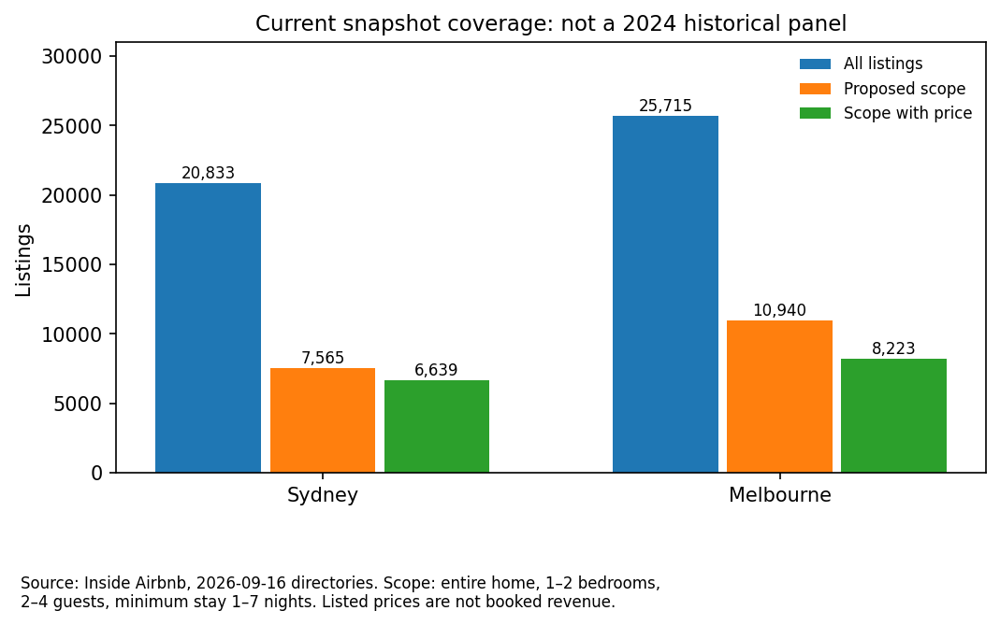

# Airbnb：2024年起雪梨／墨爾本的新房東定位與回報情境

> 2026-11-07。使用者已確認團隊與分工、Airbnb方向；本次明確指定研究目標為2024年起、雪梨與墨爾本，後續用其他城市作測試基準。本稿取代[14](14_Airbnb新房東_資料範圍與業務方向.md)的「先只用雪梨」範圍，歷史分析紀錄保留。
> 2024-01-01是研究樣本起點，不當作疫情結束日期。目標時間範圍與已取得資料範圍分開揭露；本次未取得2024年房源快照，不改稱已完成2024起完整面板。

## 1. 建議主線與可交付成果

**主線：新房東競品定位與短租經營決策；回報試算作其中一個決策功能。**

房東輸入城市、地區、格局、容量、設備與成本，系統找可比房源、解釋價格位置及改善線索，再用透明情境比較短租、長租或不投入。真正最大化收入須知道價格對訂單需求的反應；公開掛牌資料無法直接識別這個最適解。

若改成純「買房投資ROI」專案，還需要購置價格、成交／估值日期、交易費、貸款條件、持有稅費與維護資料，資料工程與假設會多於目前競品主線。若沒有個別物業資料，只能做區域層級或假設物業的情境，不宣稱投資推薦或精確預測回報。

## 2. 2024起資料能否取得：本次實查

[Inside Airbnb官方入口](https://insideairbnb.com/get-the-data/)寫明免費公開通常約近12個月季度資料，其他歷史需申請。兩城市入口目前均列2026-09-16，並不代表2024年檔案不存在，也不代表已免費取得。

[官方Data Requests](https://insideairbnb.com/data-requests/)將旅遊／Airbnb定價策略列為non-mission-aligned研究，通常須有資料預算；目前指南列兩城市歷史資料參考US$800。**這是指南而非本組報價、不是每年的確認費用；分類、期間、包含檔案、時效與授權須由站方確認。** 本次未送申請、未付款，不承諾核准或交付時間。

執行採兩條並行：

- **目標資料線：**申請2024-01-01至最新可用期，Sydney及Melbourne全部可用季度快照（優先listings，另詢calendar／reviews與地區邊界版本）。逐城逐期建立取得／缺失／schema矩陣。
- **先行版本：**利用兩城市已實際取得的2026-09快照做橫斷面競品原型；2024起舊評論只作現存房源的歷史評論活動／主題線索。先行版本不滿足完整2024起市場面板，須在AT2寫明依賴與替代範圍。

若2024起是不可妥協的條件，沒有歷史檔就不能宣稱資料已到手；預算或授權問題只能限制歷史部分，不必阻止目前雙城原型。申請草稿見[附錄](#附錄歷史資料詢價草稿未送出)。

## 3. 雙城目前已取得的可重現證據

來源日期均為2026-09-16目錄；雪梨實際last_scraped為9/17，墨爾本為9/17與9/18。名義同批仍不是完全相同抓取時刻。

| 資料項 | 雪梨 | 墨爾本 |
|---|---:|---:|
| listings列×欄 | 20,833×90 | 25,715×90 |
| 價格非空 | 17,721 | 19,004 |
| 整套／1–2房／2–4人／最低入住1–7晚 | 7,565 | 10,940 |
| 上述範圍價格非空 | 6,639 | 8,223 |
| 摘要評論有日期列 | 829,163 | 1,042,226 |
| 其中2024年評論列 | 134,978 | 174,079 |
| 其中2024年起評論列 | 474,233 | 546,972 |

完整來源URL、SHA、逐年筆數、抓取日與表頭見[彙總JSON](raw/airbnb_two_city_profile_2026-11-07.json)；程式：[airbnb_two_city_profile.py](../analysis/airbnb_two_city_profile.py)。

```powershell
python "Innovation Studio/analysis/airbnb_two_city_profile.py"
```

下載快取只留scratchpad。程式從公開直連下載墨爾本listings、兩城市摘要reviews，雪梨listings沿用已取得檔；並串流讀calendar表頭。新下載先寫.part，成功才替換快取。唯一ID與評論計數有assert。

兩城市calendar本次實查均只有`listing_id,date,available,minimum_nights,maximum_nights`，**沒有price**。兩城市的評論摘要只有房源ID與日期，並無全文；主題分析還要另外取得詳細reviews。摘要評論不是訂單、入住率或收入真值。

**存活／選樣偏差：**2026快照所附2024評論只涵蓋這份快照收錄房源的歷史，漏掉已退出／未收錄者；不能還原2024全市場供給或需求。2026亦不是完整年度。評論日期不是精確入住日期；不能用評論日直接歸因某活動的需求效果。

## 4. 資料契約：讓第二城市與後續城市可測

先定義共通欄位表，再寫最小城市對照，沒有必要一開始做泛用平台：

- 房源面板鍵：`city + snapshot_date + listing_id`；日期可細分目錄日與實際抓取日。跨城不依名稱／房東ID串成同一房源；經緯度、行政區名稱與邊界需驗版本。
- 共通條件：同房型、臥室、容量、住宿長度／報價日期、價格幣別與費用口徑。缺欄不是0；列出共同特徵與城市專有特徵。舊檔與90欄新版不能直接concat後忽略語義差異。
- 歷史只分析snapshot_date>=2024-01-01；評論另依review_date篩選。不要以first_review>=2024排掉所有成熟房源。
- 假期／學校假期／活動按**州、城市、日期／場館**標示；NSW／VIC不能共用一張未分州日曆。歷史活動需主辦方／政府原始日期資料；Ticketmaster現有／未來查詢不能當完整2024活動檔。
- 可及性用版本明確的地點與距離；直線距離不叫步行時間。設施與文字描述可作裝修代理，房源自述／照片風格不等於施工成本或因果價值。

## 5. 兩個業務選擇及資料需求

| 問題 | 現在可做 | 需要補的證據 |
|---|---|---|
| 新房東如何找競品／定位？ | 同城同類配對、競品數量、掛牌價分位、設備／評論背景 | 目標物業輪廓；報價人數、總費用可比性 |
| 哪些設備／裝修值得投入？ | 同類設備普及、評論主題、條件關聯 | 具體成本、前後結果與混雜控制；無法由溢價直接推ROI |
| 假期／活動／位置如何影響價格？ | 活動提醒、位置分群；有歷史檔才可擴時間分析 | 同房源、同查價條件跨日期報價；活動歷史與預訂提前期；calendar無價是核心缺口 |
| 如何最大化收入？ | 比較人工設定的價格×入住率情境 | 實際價格—需求反應、訂單／取消／帳務；無需求曲線不能優化真實收益 |
| 短租比長租划算嗎？ | 同地區／房型長租機會成本與短租情境 | 租金／成本時點與樣本對齊，營運費與合法可售夜數 |
| 買哪間房ROI最高？ | 只可示範假設物業回報與損益平衡 | 個別購置成本、融資、稅費、現金流；地區中位價不等於房源價格 |

長租來源：[NSW DCJ租售報告](https://dcj.nsw.gov.au/about-us/families-and-communities-statistics/housing-rent-and-sales/rent-and-sales-report.html)與[VIC DFFH歷史租金報告](https://www.dffh.vic.gov.au/publications/past-rental-reports)。VIC頁已確認2024年四季LGA中位租金Excel連結（如[2024年3月](https://www.dffh.vic.gov.au/quarterly-median-rents-local-government-area-march-quarter-2024-excel)）；本次未匯入工作簿與估值資料，不稱兩州成本底表已完成。需處理季度中位與移動年度中位的不同口徑。

## 6. 回報計算：先選對分母與成本

以一個年度、同幣別、明確稅前／融資口徑計算。實際輸入與情境假設必須分欄標示：

1. `已售夜數 = 適用規則及房東供給限制下的可售夜數 × 假設入住率`。以可售夜數為入住率分母，另列全年利用率，避免把180可售夜的100%稱全年住滿。
2. `訂單數 ≈ 已售夜數 ÷ 平均每單晚數`；清潔／周轉成本按訂單數，不能按每晚全額扣除。
3. `營運淨收入NOI = 情境實收營業收入 − 平台／變動費 − 周轉與清潔淨成本 − 固定營運／持有成本`。此處不扣融資本息、所得稅與折舊；租賃經營的租金屬營運成本，自有房長租收益則作替代方案，不重複當成本扣兩次。
4. 已持有房屋的「新增投入回報」＝相對替代方案的新增年度現金貢獻÷新增設備／裝修／開辦投入；不冒充整間房的投資回報。若分母<=0回報率不適用。
5. 購房無槓桿情境收益率＝年度NOI÷（購價＋交易成本＋初期整備投入）；這是本文自訂的總成本收益率，不等同市場慣例cap rate或持有期IRR。
6. 融資現金回報率＝（NOI－年度本金及利息償付）÷（頭期款＋自付交易／整備成本＋準備金）。本金還款影響現金流，不能忽略；同時不再把全部購價當自有資金。

不預設房價上漲，不把一次性裝修全扣當期營運費後又重複扣攤提。沒有個別物業的成本、實收與入住資料，就只交低／中／高情境、損益平衡及敏感度，不交「預測ROI」。如對已售夜數或夜價提出最適化，必須明示兩者的假定關係，不能同時將最高價格與最高入住率當可達成。

### 州別規則必須分開

- [NSW官方STRA](https://www.planning.nsw.gov.au/the-planning-system/housing/short-term-rental-accommodation)：Greater Sydney非hosted豁免開發途徑有180日上限及連續21天以上住宿的計算例外，並有登記／安全要求；不能無條件套用所有雪梨房源。
- [VIC SRO short stay levy](https://www.sro.vic.gov.au/owning-property/short-stay-levy/understanding-short-stay-levy)：2025-01-01起，適用短住的總booking fee徵7.5%，費基包括清潔等項目；有主要住所等排除條件。平台訂單通常由平台申報繳付，不能不看實收帳務就再向房東淨收入重扣一次。2024／2025政策特徵需按適用期區分，不能把NSW180日規則當墨爾本預設。

本次只核對官方概述，非逐物業法律／稅務適用判定。模型的規則輸入需記錄來源、生效日與檢查日，地方政府／公寓規約條件另查。

## 7. 實驗設計與可轉用其他城市的基準

先在雪梨建競品規則、價格基準與介面，墨爾本作第一個跨城測試；兩城都可展示，但不要一開始把兩城全部混訓後再稱墨爾本是外部測試。

- 同城：同區同格局中位數基準對照一個樹模型；MAE與各細分樣本數並列。若只有當前快照，稱橫斷面評估；有歷史才做早期訓練、晚期保留測試，同房源避免隨機穿越。
- 跨城：先凍結共通特徵與方法，報直接遷移表現，再另報用墨爾本少量資料校準的結果；墨爾本本地中位數若使用當地訓練資料，就明示其資料優勢。
- 第三城：預先選保留城市與測試時點；資料可比性、同語義特徵、價格／稅費與規則是入場檢查，不以城市數多寡當泛化證據。反覆調參的城市不再稱未見測試。
- 新房東沒有既有評論／Superhost／歷史收益，首版輸入模型只用位置、格局、容量、可控制設施；成熟房源績效留作比較資訊。兩價格欄及estimated_revenue／price_quote_raw不互相當特徵偷讀答案。
- 系統驗收：業務角色以固定物業任務檢查能否找出可比房源、理解條件與回報假設；AI僅依傳入事實與來源解釋，不捏造歷史活動或保證回報。

## 8. 本版的完成證據與仍缺項目

已實際下載／剖析雙城當期listings及歷史評論摘要、讀兩城calendar表頭；取得規模／欄位／篩選／逐年計數並留URL與SHA。下圖表達當前樣本而非2024全市場。



尚缺：2024起歷史快照、完整跨日期價格、詳細評論全文的雙城品質分析、個別物業成本與成交／帳務、收益實測、模型與第三城實驗。這些缺口不可由模擬資料或估計入住欄暗中補成觀測結果。獨立核對另見[紀錄](raw/airbnb_two_city_review_2026-11-07.md)。

## 附錄：歷史資料詢價草稿（未送出）

> We are a four-student team in UTS subject 421048 Innovation Studio. We are assessing an academic prototype for Airbnb entrant competitor positioning and transparent operating-return scenarios in Sydney and Melbourne. We seek all available quarterly snapshots from 1 January 2024 through the latest available release, prioritising detailed listings, and would like to confirm availability of calendars, reviews and versioned neighbourhood boundaries. Please confirm dates, schemas, licensing and permitted project/repository use, delivery timing, and any applicable academic or archival fees. We understand pricing-strategy research may require funding. We do not need personal contact details or non-public transaction data.

此草稿可交隊友送出詢價；本次沒有代寄、註冊、同意條款或承諾付款。
