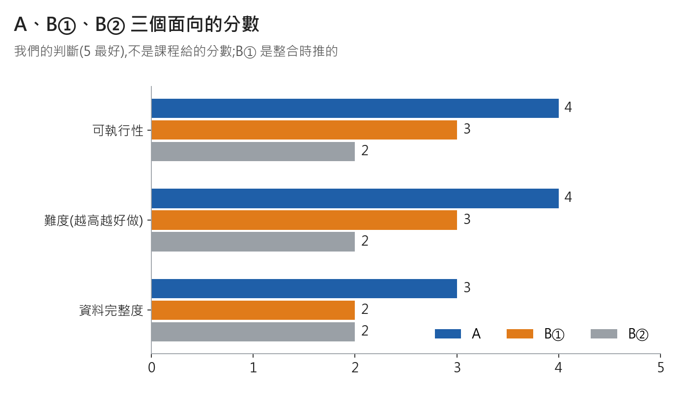
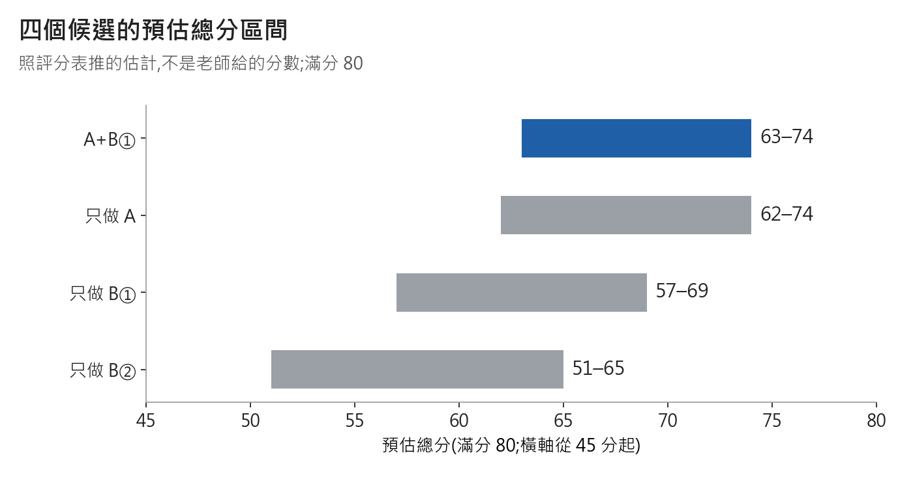
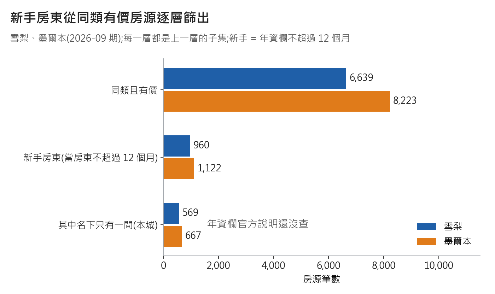

# 11/11 組會簡報大綱(口頭約 5 分鐘)

> 用途:Kenny 在 2026-11-11 21:00 組會上講的大綱,8 頁。
> 依據:[16_方案AB_深度分析.md](16_方案AB_深度分析.md)(下面的行號除另註外都指 16);題目與目標見 [17_定題與三層目標_v1.md](17_定題與三層目標_v1.md)(17 已獨立核對 READY,也是提案、待投票);Canvas 確認見 `raw/canvas_assignments_check_2026-11-11.md`。
> 狀態:**提案,待小組投票**,不是定案。第 4、5 頁是當晚主腦的回答,沒有另外找人核對。18 初版(8 頁與投票前 5 項)已由非產出者核對(READY,`raw/aim_review_2026-11-11.md`);之後新增的段落與投票項只有修改者回讀。2026-11-12 會後更正已由未參與撰寫的 Claude 分身核對(READY,必改 0;雪梨數字重算吻合;`raw/newhost_review_2026-11-12.md`);沒有其他家族模型核對;之後的小修只有修改者回讀。
> 2026-11-12 對賬更正:與 20 雪梨深度分析對過一次,更正清單見 raw/reconcile_20_vs_16-18_22_2026-11-12.md。

## 會後更正(2026-11-12)
- 當晚把「新上架房源(首評 12 個月內)」當資料端的新手代理 → 更正:**新手房東 = 年資欄 `hosts_time_as_host_*` 不超過 12 個月**(同類且有價:雪梨 960、墨爾本 1,122;17 §3 v1.1)。
- 「新上架房源」(2,028 / 2,056)降為輔助指標,只回答「這間房是不是新上架」;它當新手代理的命中率雪梨 35.7%、墨爾本 41.7%。
- 當晚說「`host_since` 是空的」→ 更正:墨爾本只有 2025-12 那期有值,它對得上的是帳號年資欄(`hosts_time_as_user_*`),所以我們判斷它是帳號註冊日,官方說明還沒查(19 §5)。
- 當晚引用的子集 444 / 514、688 / 713 改當舊口徑對照;新口徑「新手且名下只有一間(本城)」569 / 667。
- 年資欄欄義是推論、官方說明還沒查;雪梨 2025-12 期已驗證(20 §5),結論與墨爾本一致。投票結果尚未記回本檔與 17。

## 30 秒版(開口第一段)

我把 A、B 兩個方案用資料查過一遍。建議 A 當主線,B 縮成系統裡一個「試算功能」。原因很簡單:A 要的資料手上都有,B② 要的買房價,資料裡完全沒有;B① 的成本要使用者自己填。照評分表推(不是老師給的分數),這樣做預估分數最高(差距在誤差內)。

## 大綱

### 1. 結論:選 A+B①
- 畫面:A = 新上架房源競品定位(主線);B① = 已有房,算營運回報(只當試算功能);B② = 買房投資(不建議)
- 講:「我建議 A 當主線,B① 做成系統裡的試算功能。」
- 依據:16 L9–10、L116

### 2. 三個面向的分數
| 5 分最好(我們的判斷) | A | B① | B② |
|---|:-:|:-:|:-:|
| 可執行性 | 4 | 3 | 2 |
| 難度(越高越好做) | 4 | 3 | 2 |
| 資料完整度 | 3 | 2 | 2 |

圖:三面向分數,我們的判斷,5 最好

- 講:「A 三項都比較好做;B② 三項都最低或並列最低。」(資料完整度 B② 跟 B① 一樣是 2;B① 的分數是整合時推的,沒有單獨評過)
- 依據:16 L13–19

### 3. 為什麼不是 B②
- 畫面:①買房價、貸款、成本,資料裡沒有,要另外補 6 類外部資料、下 10 條假設(L391);②收入欄是推算的:掛牌價 × 入住晚數,晚數大約是近一年評論數 × 6(L193);③組內沒有金融或不動產背景(L69)
- 講:「B② 要的買價和成本,資料裡完全沒有。」
- 依據:16 §2.3(L191–198)、§4.2–4.3(L281–309)

### 4. 目標草稿要改的詞
- 畫面:「收入最大化」→「定價參考」(你的掛牌價在同類裡排第幾);「評估投資回報」→「情境試算」(照你填的假設算低/中/高);「裝修」→ 拿掉,只留「設施」
- 講:「方向不變,只把做不到的詞換掉。」
- 依據:17 §1 逐詞對照(L32–40)、16 L183、L335、§5 卡點表(L326–346);其餘的詞(2024 年以來、節假日、大型活動、法規)見 17 同一張表

### 5. 缺的資料用模擬補
- 畫面:①模擬和真實分開標,每張圖表都標;②模型準不準,只用真實掛牌價來驗;③參數從真實資料算,列成假設表(低/中/高),報告裡聲明用了 AI
- 講:「缺的用模擬補,但模擬和真實分開標。」
- 依據:課程紀錄 notes/10 L62(老師說資料可以用模擬生成)、notes/06 L244(提示詞不要帶結論);Canvas 作業說明沒提真實或模擬(`raw/canvas_assignments_check_2026-11-11.md` L37–39);不在 16 裡

### 6. 分數預估,和一句老實話
- 畫面:A+B① 約 63–74、只做 A 約 62–74、只做 B① 約 57–69、只做 B② 約 51–65(滿分 80;L33–36);**照評分表推的,不是老師給的**

圖:預估總分區間(估計,滿分 80)

- 講:「照估計 A+B① 略高,但只高一點,差距在估計誤差內。」(約 0.7 個百分點,只靠「業務影響」那一格;L38、L44)
- 依據:16 L29–44;L40 有等第說明(HD、D、C、P 是課程的等第,由高到低)

### 7. 接下來三週
- 畫面:本週(到 11/15):定題、三層目標、「新上架房源」定義 —— 誰做未定;下週(11/16–11/22):資料節(分布、缺值、相關)——「數據分析」;選好簡報時段 —— 誰做未定;再下週(11/23–11/29):方法比較、實驗設計、架構圖 ——「數據分析」,文獻 ——「報告呈現/業務理解」
- 講:「先定題,再做資料節,再做實驗設計。」
- 依據:16 L77–79(這是 repo 倒推的建議排程,不是課程規定);題目 11/15 前定案(L11)

### 8. 今晚要決定的事
- 畫面:下面「今晚要決定的事」那 9 項(7–9 是細項,時間不夠可會後再投)
- 講:「今晚先投前六項,7–9 看時間,其他我記下來,之後再投或再問。」
- 依據:16 §9.1(L415–422,涵蓋第 2、3、4 項);第 1 項見 16 L9–10;第 5 項見 17 §4;第 6 項見 17 §1(L21、L24);第 7–9 項見 17 §3、§6(L166–174)

## 今晚要決定的事(投票;推薦的放前面)

1. 主線:**A 當主線、B① 當試算功能** / B 當主線
2. B 指的是哪一種:**B① 已經有房,開短租划不划算** / B② 買一間房來投資(L417)
3. B 怎麼呈現:**只寫「情境回報(依你輸入的假設)」** / 寫「預測 ROI、建議價」(L418)
4. 歷史資料:**先用現在這一期做雪梨版,墨爾本當測試** / 先去詢價(誰寄、預算多少)(L419)
5. 模擬資料:**可以用,但分開標、模型只用真實資料驗** / 完全不用模擬
6. 題目名稱與目標句:**照 17 的提案**(題目與目標句見下方「題目與目標」;17 L21、L24) / 會後再改
7. 新手房東的定義(17 §3 v1.1、§6 第 2–3 項;會後更正):**新手房東 = 年資欄不超過 12 個月,「新上架(首評 12 個月內)」只當輔助** / 改用 24 個月版(新上架窗口另可改 6 或 18 個月)
8. 未評論房源(雪梨 588、墨爾本 816 筆;17 §3 表):**另列「未評論」組,系統裡照樣當競品顯示** / 不顯示
9. 州規則與短租密度(17 §6 第 6 項):**獨立成 BO3** / 併進 BO1

17 §6 其餘待決項不用投票,會後由負責職責定:新手房東用 12 還是 24 個月、「名下只有一間(本城)」要不要進實驗分群(第 2 項);年資欄欄義查官方說明(第 4 項);T2.1.2 節假日情境與 T3.1.2 密度地圖由誰做、大型活動延伸做不做(第 7 項,會後再定);模擬資料能不能當實驗評估依據是問老師(第 8 項,11/12 Zoom,見 TODO.md)。第 1 項(B①/B②)就是上面的第 2 項。

順便問(不用投票):每個職責每週能投入幾小時、誰當「數據分析」的備援、假期 12/14–1/17 能不能工作(L420–422)。

## 隊友可能問的 3 個問題(16 L442–449)

1. 「我們在分析誰?」→ 使用者是新房東,資料是競品。資料端的新手房東 = 年資欄(當房東多久)不超過 12 個月,同類且有價雪梨 960、墨爾本 1,122(17 §3 v1.1);`host_since` 對得上的是帳號年資欄(`hosts_time_as_user_*`),我們判斷它是帳號註冊日(官方說明還沒查),不能用;年資欄官方說明還沒查,故加註。(會後更正)
2. 「沒有成交價,怎麼知道系統講得對?」→ 我們不給最佳價,只說掛牌價在同類排第幾,任何人都能重算。這點 B 一樣做不到(L447)。
3. 「B① 資料明明夠,為什麼不當主線?」→ 成本要自己補、假設多,而且沒有可以驗證的目標。放進 A 當試算功能,故事留著,驗證由 A 扛(L449)。

## 不要這樣說 → 改這樣說

| 不要這樣說 | 改這樣說 | 依據 |
|---|---|---|
| 「系統能預測真實收入、算出最佳定價」 | 「你的掛牌價在同類房源裡,從便宜排到貴排第幾」 | 16 L23 |
| 「照這個價格一年會賺 X 元」 | 「照你輸入的假設,年收入落在低/中/高三種情境」 | 16 L107 |
| 「我們用上架日期篩出新房東」「首評 12 個月內就是新手房東」 | 「新手房東用年資欄不超過 12 個月(官方說明還沒查、加註);首評在最近 12 個月內只說『新上架房源』」 | 16 L108;17 §3 v1.1 |
| 「墨爾本整體的價格水準」 | 「墨爾本開放且有價房源的價格分布」,並寫出沒算進去的筆數 | 16 L346 |
| 「AI 重構了當地市場行情」 | 「用真實資料校準的模擬情境」 | 當晚回答,不在 16 |

## 題目與目標(提案,待投票)

- 題目(中文):新房東上架定位助手:雪梨與墨爾本 Airbnb 同類房源價格定位與短租情境試算(17 L21)
- 專案目標(提案):用雪梨、墨爾本 Airbnb 目前房源和 2024 年以來的評論,做競品定位工具:讓準備入行的新房東看掛牌價在同類排第幾、缺哪些設施,照自己的假設試算低/中/高收入,附州規則提醒(17 L24)
- BO1 準備上架的新房東:「我的對手是誰?我的掛牌價算便宜還是貴?缺什麼?」(主線,方案 A;17 L55)
- BO2 已有房的屋主:「拿來做短租、再添一些設備,大概收多少、多久回本?」(**B① 掛在這一條**;分析層定位是「情境試算」功能,不是實驗主線;17 L59–60)
- BO3 兩種使用者都要的:「做短租前,州規則有哪些要注意?附近短租多不多?」(17 L62)
- 「新手房東」提案定義 v1.1(待小組確認;會後更正):同類且有價房源裡,房東年資欄(年 × 12 + 月)不超過 12 個月;雪梨 960、墨爾本 1,122 筆;其中名下只有一間(本城) 569 / 667(17 §3)。年資欄欄義是推論、官方說明還沒查,加註使用
- 「新上架房源」(首評在抓取日往前 12 個月內,含起點當天)降為輔助指標:雪梨 2,028、墨爾本 2,056 筆;當新手代理命中率 35.7% / 41.7%、抓到率 75.3% / 76.4%(17 §3);當晚引用的 444 / 514、688 / 713 改當舊口徑對照
- 新上架房源 ≠ 新手房東:新上架 2,028 / 2,056 筆只來自 1,239 / 1,250 個 `host_id`,很多是老房東再上新房(17 §3)

圖:同類且有價 → 新手房東(當房東不超過 12 個月)→ 其中名下只有一間(本城),雪梨與墨爾本;年資欄官方說明還沒查(2026-11-12 更新)

- 全文與還沒定的 8 件事見 [17](17_定題與三層目標_v1.md)(§6,L166–174)

## Canvas 作業需求確認(2026-11-11)

- Canvas 作業頁現況跟 repo 紀錄一致:截止日、滿分、比重、字數、rubric 配分 0 處實質不同(報告 L1、L87);AT1、AT4 說明只做關鍵字抽查(報告 L96)
- 截止(台灣時間)與學期比重:AT2 報告與簡報 12/11(五)20:59,30%;AT3 報告與展示 2/19(五)20:59,40%;AT4 2/19(五)20:59,**20%**;AT1 最後一份 2/14(日)20:59,10%(報告 L9–16)
- AT3 只要求部署「計畫」(報告要有 Deployment Plan、rubric 要「可行計畫」),沒有要求真的部署上線(報告 L31–33)
- 作業說明沒提「資料必須真實」,也沒提模擬資料或 AI 生成(關鍵字抽查無命中);只有課程紀錄記老師口述允許(報告 L37–39)
- AT2 比重矛盾還在:頁首寫 20%、小標題寫各 15%、group 30%;老師沒有書面確認(報告 L23–25)
- 字數:AT2 報告 1,000–3,750 字;AT3 報告 2,000–5,000 字;AT1 每週貼文至少 100 字;字數怎麼算作業頁沒寫(報告 L54–56)
- 專案介紹 11/19 或 11/26:作業頁沒有,需看公告或單元頁(報告 L28、L93)
- 方法限制:內文是目視比對,不是逐字 diff,小幅措辭調整可能漏看(報告 L88)

## 數字來源對照(2026-11-12 會後更正新增)
- 960 / 1,122;569 / 667;命中率 35.7% / 41.7%;抓到率 75.3% / 76.4%:`raw/airbnb_new_host_definition_2026-11-12.json` 的 `cities.<城>.new_host_le12.scope_price`、`new_host_le12_and_single.scope_price`、`proxy_precision_pct(...)`、`proxy_recall_pct(...)`
- `host_since` 判斷是帳號註冊日(依據:對上 `hosts_time_as_user_*` 98.5%;官方說明還沒查):`raw/mel_c_hosts_time_2026-11-11.json` 的 `a_validate_tenure_fields.vs_host_since_user.exact_pct`;2,028 / 2,056 等舊數字見 17 文末
