# 19 墨爾本 Airbnb 深度分析
> IS-1111-MEL-MERGE,2026-11-11。給準備入行的新房東:競品定位工具的資料底稿。Inside Airbnb 墨爾本 2026-09-16 期為主,另有 3 期;價格都是掛牌價,不是成交價。
> 2026-11-12 對賬更正:19 與 20 互相對過一次,並與 16、17、18、22 對過;更正清單見 raw/reconcile_20_vs_19_2026-11-12.md、raw/reconcile_20_vs_16-18_22_2026-11-12.md。

## 0 一頁結論
- **市場(73.7%)**:整套房為主;35.8% 的房源屬於名下 5 間以上的房東。整套 1 房中位 $229、2 房 $309(掛牌價);房源數前 4 區占全體 55.5%。
- **同類比較(60 組)**:區 × 房間數分組;組小於 30 間就退回「全市同房間數、最近的 30 間」。同類比較才是工具的核心。
- **價格模型(MAE 75.1)**:比基準好,但只好一點(MAE:B0 87.4、B1 78.4、M1 75.2、M2 75.1,澳幣)。工具價值主要在同類定位,模型是輔助。
- **新手房東(1,122 間)**:找得到(用 `hosts_time_as_host_*`,不是 `host_since`)。原始掛牌價中位數幾乎持平(264.75 對 264),同組百分位 48.2 對 50.8、差約 2.6 個百分位點(單位是百分位點,不是 %),差很小但不是完全沒差;差在評論少(近一年 5 對 10)。
- **時間(旺 11、12、3 月)**:淡旺季看得到(評論、日曆);但同一間房 3 月到 9 月的掛牌價變化中位數 +1.5% 不能當漲跌,每期報價的入住日落在不同季節。

## 1 市場長相
**整套房占 73.7%;35.8% 的房源屬於名下 5 間以上的房東。**  
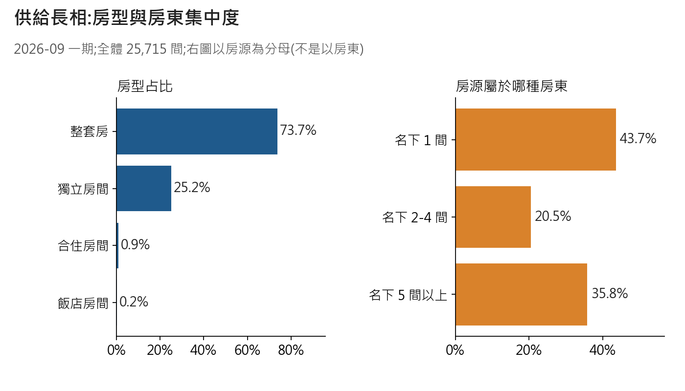
*圖:房型、房東規模、整套房房間數*  
怎麼讀:右圖的分母是「房源」不是房東:名下 1 間 43.7%、2–4 間 20.5%、5 間以上 35.8%。

**有價 19,004 間,中位數 $263;整套 1 房 $229、2 房 $309、3 房 $430(全體整套房,不限人數與晚數)。**  
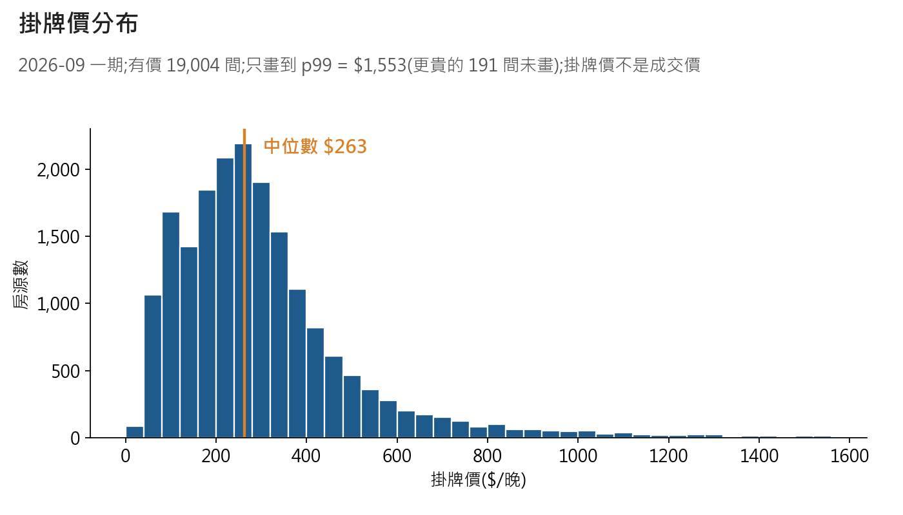
*圖:掛牌價分布(只畫到 p99)*

| 範圍(有價) | n | p25 | p50 | p75 |
|---|---|---|---|---|
| 全體 | 19,004 | $172 | $263 | $375 |
| 整套房 | 14,504 | $230 | $302 | $413 |
| 獨立房間 | 4,253 | $82 | $109 | $151 |
| 整套 1 房 | 4,749 | $187 | $229 | $285 |
| 整套 2 房 | 5,592 | $256 | $309 | $380 |
| 整套 3 房 | 2,267 | $338 | $430 | $576 |

怎麼讀:高於 p99($1,553)有 191 間,最高 $109,085;圖已截掉,分位數不受影響。價格是掛牌價,不是成交價。下表列前 6 區,30 區在 JSON。

**房源集中市中心:前 4 區占 55.5%;篩選樣本中位數最高 Yarra Ranges $310、最低 Knox $177。**  
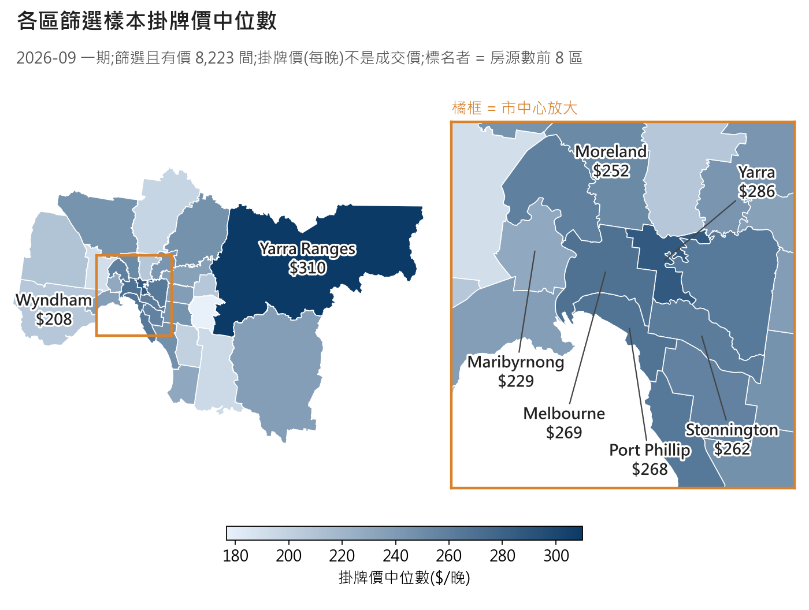
*圖:各區掛牌價中位數(右為市中心放大)*  
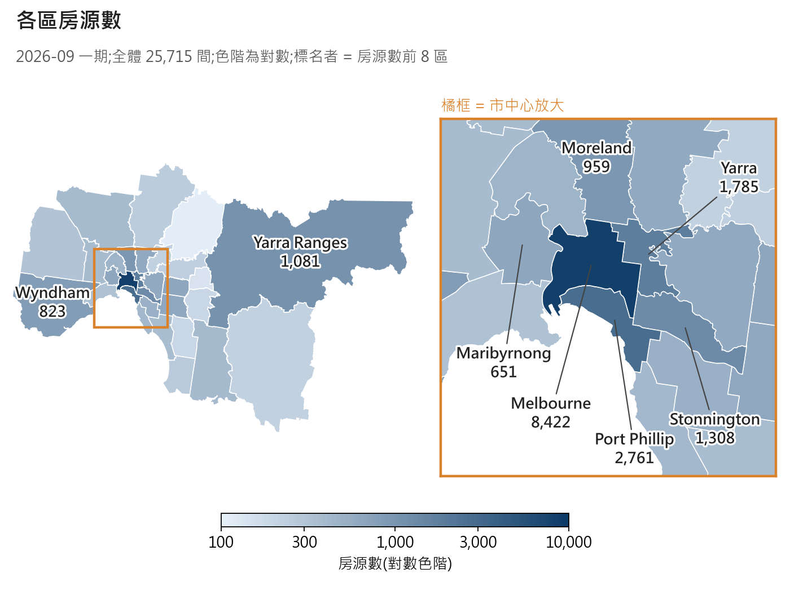
*圖:各區房源數(對數色階)*  
怎麼讀:顏色越深越高。價格高的區不等於房源多的區:房源最多是 Melbourne 區(8,422 間)。

| 區 | 房源數 | 篩選且有價 | 掛牌價中位 | 評分中位(該區全部有評分房源) | 整套房占比 |
|---|---|---|---|---|---|
| Melbourne | 8,422 | 3,487 | $269 | 4.82 | 83% |
| Port Phillip | 2,761 | 1,062 | $268 | 4.90 | 82% |
| Yarra | 1,785 | 674 | $287 | 4.91 | 80% |
| Stonnington | 1,308 | 478 | $262 | 4.89 | 81% |
| Yarra Ranges | 1,081 | 465 | $310 | 4.92 | 89% |
| Moreland | 959 | 228 | $252 | 4.86 | 59% |

**有評分 21,130 間(82.2%),評分中位數 4.86(全體有評分);5.0 分占 25.7%,低於 4 分占 2.9%。**2026-11-12 對賬補入;來源鍵見 raw/reconcile_20_vs_19_2026-11-12.md #18

## 2 同類房源怎麼比
**區 × 房間數共 60 組,中位數 41.5 間;24 組不足 30 間,但只涵蓋 432 間(94.7% 的房源在 30 間以上的組)。**

1. 找同區、同房間數的房源;30 間以上就用這組。
2. 不足 30 間 → 改用全市同房間數、直線距離最近的 30 間(不限區)。
3. 記下用了哪一步(1 或 2),報告時一起寫。

怎麼讀:套用規則後,每間房的比較組中位數 631 間(p10 = 51);退回「最近 30 間」時半徑中位數 8.3 公里。

**前 10 大區內,2 房比 1 房中位數高 58–114 澳幣;1 房以 Yarra Ranges(280)最貴、Darebin(184)最便宜。**  
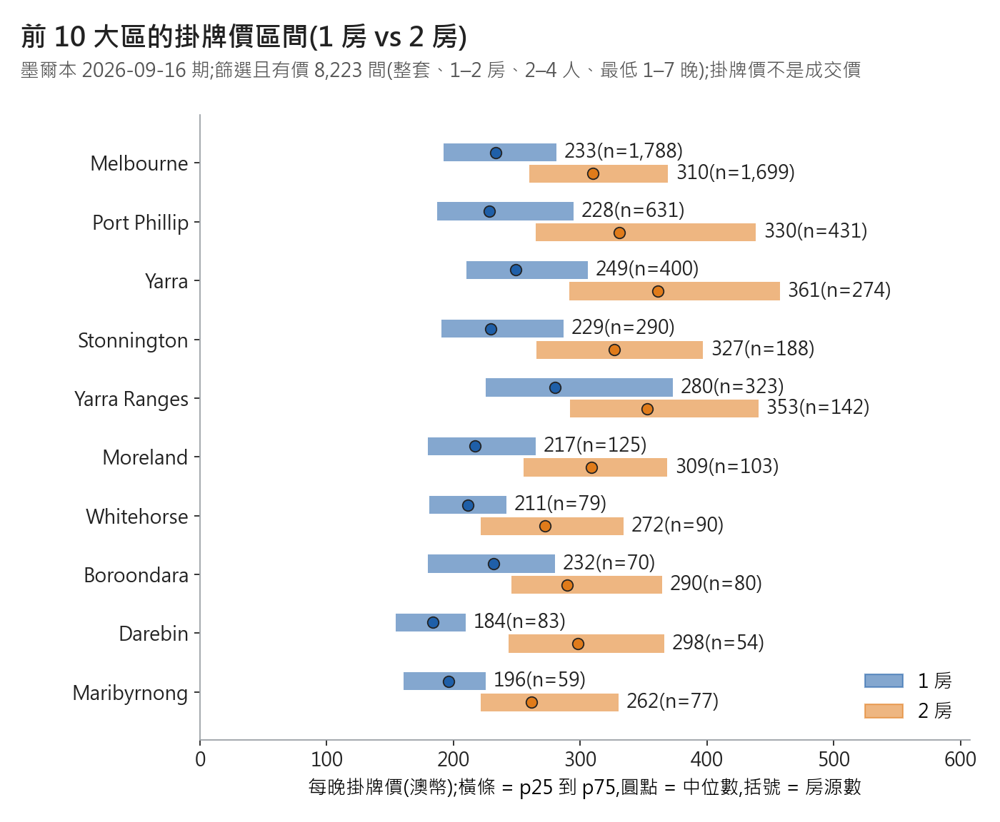
*圖:前 10 大區掛牌價區間(橫條 p25–p75,圓點中位數)*  
怎麼讀:你的價在橫條左邊 = 比同類 75% 便宜。完整 27 區 × 房間數的 p10–p90 在 JSON。

## 3 設施和價格
**每間房設施中位數 41 項;最常見 Smoke alarm 95.7%、Kitchen 93.9%、Wifi 90.4%。**  
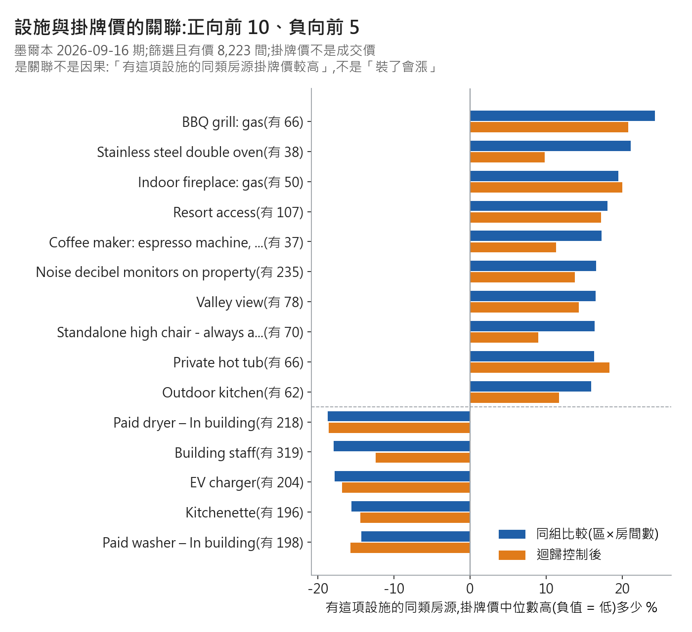
*圖:設施與掛牌價的關聯(同組比較)*

| 設施 | 有這項的房數 | 同組比較 | 迴歸控制後 |
|---|---|---|---|
| BBQ grill: gas | 66 | +24.3% | +20.8% |
| Indoor fireplace: gas | 50 | +19.5% | +20.0% |
| Paid dryer – In building | 218 | -18.7% | -18.6% |

怎麼讀:固定說法:「有 BBQ grill: gas 的同類房源,掛牌價中位數高 24.3%」。這是關聯,不代表裝了就會漲。兩種算法方向一致的比例 87.1%(264 項合格設施);正向前 10 多是少數房源才有的設施(37–235 間,信賴區間寬),負向多是公寓大樓型設施,比較像房源類型的訊號。264 項取最大 10 項,個別估計偏高;圖與表沒畫信賴區間,其中 Stainless steel double oven 的迴歸信賴區間 [-0.7, 21.4] 含 0。

## 4 價格模型實驗
**模型(M1 / M2)只比「區 × 房間數中位數」(B1)少猜錯約 3 澳幣,比全市中位數(B0)少約 12 澳幣(M2 比 B1 少猜錯約 4%、比 B0 約 14%;算法:(基準 MAE − M2 MAE)÷基準 MAE);M1 與 M2 幾乎打平。這是老實的結果。**

- 目標:猜每晚掛牌價(取對數訓練,誤差換回澳幣);樣本 8,209 間。
- 特徵:只用新房東上架前就知道的(區、位置、房型、房間數、人數、床、浴室、設施、最低入住晚數);不用評論、入住推算、行事曆。
- 切法:同一房東的房源分在同一折(5 折)。
- 指標:MAE(平均猜偏幾澳幣)、誤差中位數 %、落在兩成內的比例。

| 方法 | MAE 澳幣 | 誤差中位數 | 差 20% 以內 |
|---|---|---|---|
| B0 全市中位數 | 87.4 | 23.3% | 43.7% |
| B1 區 × 房間數中位數 | 78.4 | 20.5% | 49.0% |
| M1 線性(Ridge) | 75.2 | 19.7% | 50.5% |
| M2 梯度提升樹 | 75.1 | 19.2% | 51.9% |
| M2 + 房東名下房源數(對照) | 75.2 | 19.3% | 51.3% |

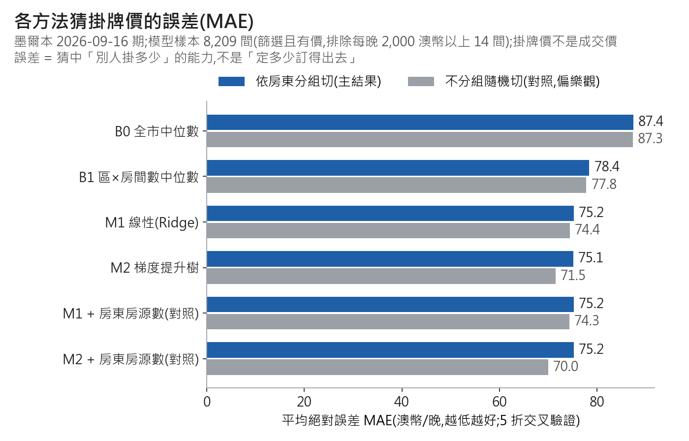
*圖:各方法 MAE 比較(越低越好)*  
怎麼讀:一般房源猜偏約 19%,大約一半猜在兩成內。加房東房源數沒幫助。誤差衡量「猜中別人掛多少」,不是「定多少訂得出去」。

- 不分房東隨機切會高估:M2 MAE 71.5(低 3.6)、M2 + 房東數 70.0(低 5.2);B0 / B1 / M1 只差 0.1–0.8。樹模型會記住同房東的習慣,所以主結果用分組切。
- 首評在 12 個月內的房源(新上架的代理)2,056 間(其中只有 41.7% 同時被年資欄推算為新手,見第 5 節):M2 MAE 67.6、誤差中位數 18.4%、兩成內 53.7%;其他 77.6 / 19.4% / 51.4%。這群沒有比較難猜;模型在年資欄推算的新手 1,122 間上的誤差未計算。
- 時間外部檢查:用 2026-06 期 8,255 間訓練,測 9 月新出現的 820 間,模型仍比基準好(M2 70.9、B1 77.8)。但這 820 間裡有 369 間(45.0%)的房東在 6 月訓練集出現過(以房源算,不是以房東人數算),所以不是「完全沒看過的房東」的檢查。線性和樹模型誰比較好,兩種檢查不一致(9 月內分房東驗證時線性 74.7、樹 77.3;時間檢查時樹 70.9、線性 72.6),所以只能說「兩個模型差不多」。
- 極端高價:每晚 2,000 澳幣以上 14 間(最高 90,000)不進訓練與主要誤差。放回去,M2 MAE 由 75.1 變 92.6,誤差中位數仍是 19.2%(幾乎不變)。

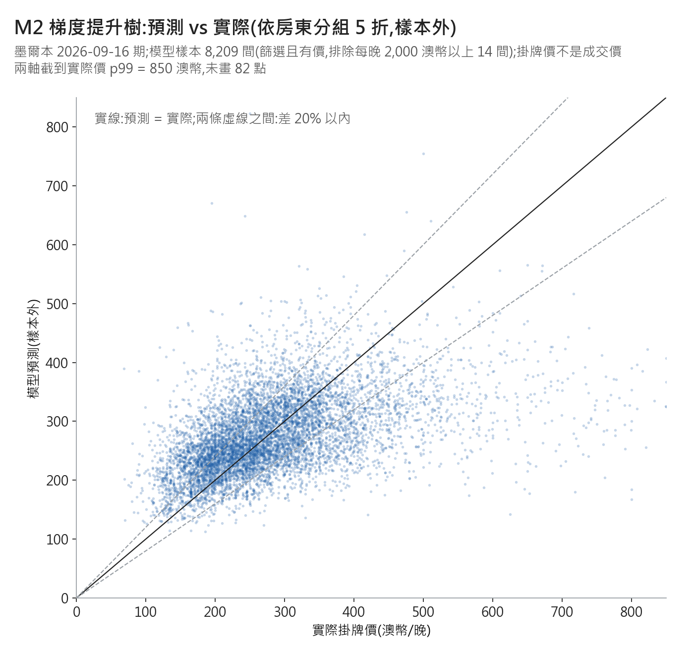
*圖:預測對實際(500 以上被猜低)*  
怎麼讀:點集中在 200–350;高價房(500 以上)系統性被猜低,模型把極端往中間拉。

## 5 新手房東
**`host_since` 是帳號註冊日(推斷);當房東多久,最像是看 `hosts_time_as_host_*`。用它推算的新手(開始當房東 ≤ 12 個月),篩選且有價 1,122 間(占篩選且有價 8,223 間的 13.6%)。**

| 欄位 | 實際意思 | 證據(2025-12 期) |
|---|---|---|
| `host_since` | 帳號註冊日(推斷) | 跟 `hosts_time_as_user_*` 完全相同 98.5%、差 1 個月內 100%(26,199 列) |
| `hosts_time_as_user_*` | 帳號年資 | 同上;以抓取日為基準,所以不是「兩欄基準日不同」 |
| `hosts_time_as_host_*` | 開始當房東以來(推測) | 對 `host_since` 完全相同只有 31.9%,59.6% 比它短;不大於帳號年資的比例 99.98%;2025-12 與 2026-09 兩期都在的 11,745 位房東,其中 11,743 位增加 9 個月(9,720 位)或 10 個月(2,023 位) |

> `host_since` 對得上帳號年資,這一半證據夠;「年資欄 = 當房東多久」是靠排除法推的,沒有官方定義,證據勉強。核對者補了一個檢驗:首評比回推的開始月早超過 1 個月的只有 1.14%,跟這個解讀不矛盾。

| 新手筆數(依年資欄) | 全體 | 篩選 | 篩選且有價 |
|---|---|---|---|
| 開始當房東 ≤ 12 個月(算法:年 × 12 + 月 ≤ 12,含剛好 12 個月;改成 < 12 個月會少 193 / 69 / 61 間) | 3,045 | 1,216 | 1,122 |
| 24 個月內 | 5,405 | 2,238 | 2,013 |
| 12 個月內且名下只有 1 間 | 1,698 | 732 | 667 |
| 24 個月內且名下只有 1 間 | 2,778 | 1,240 | 1,082 |

怎麼讀:首評代理 =『新上架房源』指標(首評在近 12 個月內),不等於新手房東。首評代理(篩選且有價樣本裡)有 2,056 間,其中只有 857 間同時被年資欄推算為新手:命中率 41.7%;年資欄推算的新手 1,122 間裡抓到 857 間:抓到率 76.4%(沒被抓到的 265 間中,242 間還沒有評論,23 間首評在 12 個月前)。  
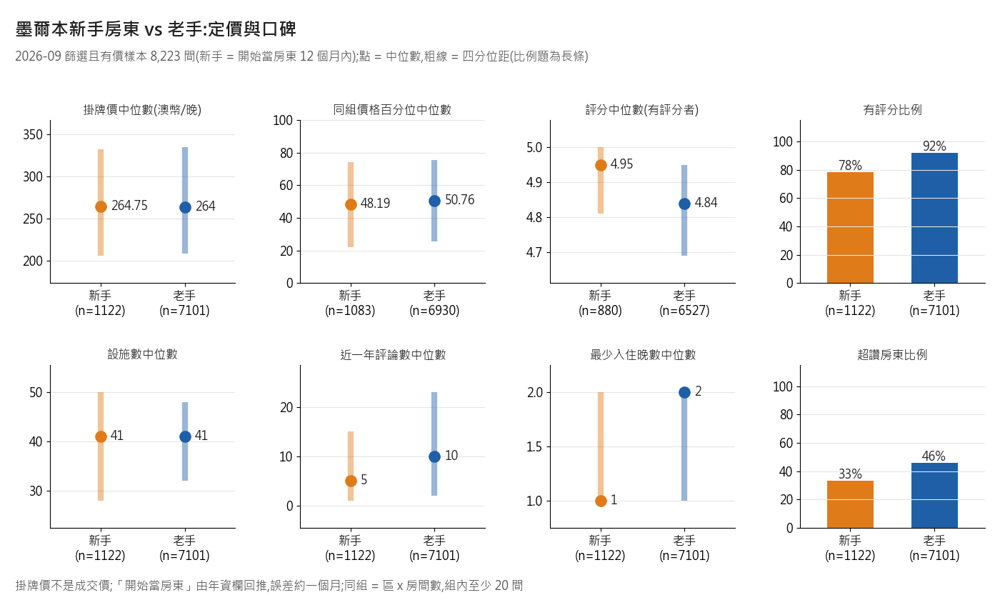
*圖:新手 vs 老手(縱軸不從 0 起;5.0 為評分上限)*

- 原始掛牌價中位數幾乎持平:264.75 對 264(這個比法沒控制房子組成);同組價格百分位 48.2 對 50.8,差約 2.6 個百分位點(單位是百分位點,不是 %),差很小但不是完全沒差。
- 差別 1,評論少:近一年評論數中位數 5 對 10。
- 差別 2,有評分的比例 78.4% 對 91.9%(評分中位 4.95 對 4.84,是評論少,不代表品質較好)。
- 差別 3,超讚房東比例 33.3% 對 45.9%。

## 6 時間與淡旺季
**評論逐年墊高:2025 年比 2024 年 +18.3%;2026 年 1–8 月比 2025 年同期 +24.2%。**  
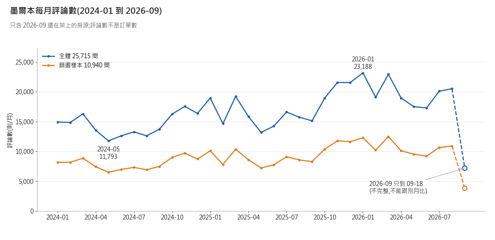
*圖:每月評論數(只含還在架上的房源)*  
怎麼讀:最多:2026-01(23,188)、2026-03、2025-11;最少:2024-05(11,793)。早年已下架的房源不在內,早年的評論數偏低;成長率偏高還是偏低無法確定。  
成長主要跟「有評論的房源變多」同步:全體房源裡當年有評論的房源數,2024 年 10,005 間 → 2025 年 12,806 間(+28%),每間有評論房源的評論數約 17.4 → 16.1。2026-11-12 對賬補入;來源鍵見 raw/reconcile_20_vs_19_2026-11-12.md #2  
最多月是最少月的 2.0 倍,這包含逐年成長,不全是季節差。2026-11-12 對賬補入;來源鍵見 raw/reconcile_20_vs_19_2026-11-12.md #28

**兩年平均:偏旺的是 11、12、3 月,偏淡的是 5、6、8 月;2024 與 2025 各月指數的相關係數 0.89,形狀很像。**  
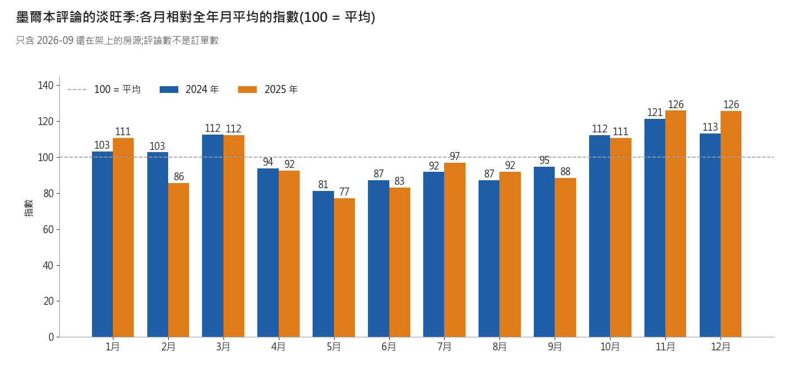
*圖:評論淡旺季指數(100 = 平均)*  
怎麼讀:這是「評論的」淡旺季,不等於入住的淡旺季:評論住完才寫,高峰比入住晚。每年評論量本來就在長,後半年的指數會被墊高一點。2026-11-12 對賬補入;來源鍵見 raw/reconcile_20_vs_19_2026-11-12.md #28  
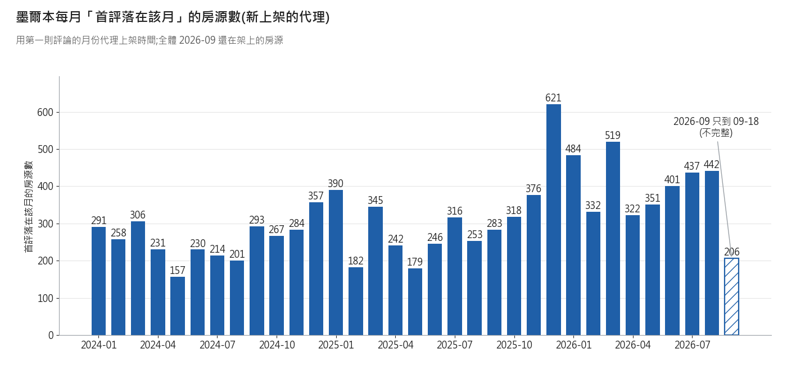
*圖:每月新上架(首評月份代理)*  
怎麼讀:首評落在當年的房源(母體:全體 25,715 間):2024 年 3,089、2025 年 3,751、2026 年(到 9/18)3,494 間。首評月不等於上架月,上架可能更早。用 2025-09-18(含)當截止日,篩選且有價 8,223 間裡首評在近 12 個月內的有 2,056 間;兩個母體不同,不能直接比。

**需求代理(2026-09 期,篩選且有價 8,223 間):推算近一年入住晚數中位數 60、平均 82.25;0 晚占 16.3%,達上限 255 晚占 7.2%。**不是真實入住。2026-11-12 對賬補入;來源鍵見 raw/reconcile_20_vs_19_2026-11-12.md #19

**四期抓取日後 30 天的不可訂占比,從 47.5%(3 月)到 65.6%(12 月)。**  
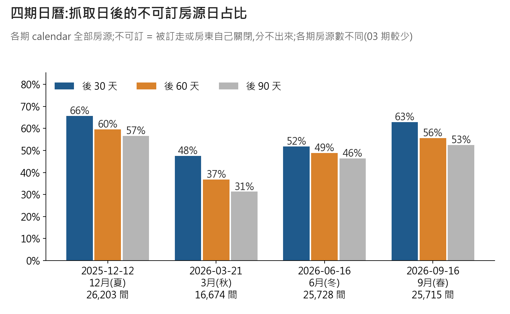
*圖:四期日曆:未來 30 / 60 / 90 天不可訂占比*

| 期別 | 房源數 | 30 天 | 60 天 | 90 天 |
|---|---|---|---|---|
| 2025-12-12 12月(夏) | 26,203 | 65.6% | 59.6% | 56.6% |
| 2026-03-21 3月(秋) | 16,674 | 47.5% | 36.8% | 31.3% |
| 2026-06-16 6月(冬) | 25,728 | 51.9% | 48.8% | 46.3% |
| 2026-09-16 9月(春) | 25,715 | 62.8% | 55.6% | 52.5% |

怎麼讀:不可訂 = 被訂走或房東自己關,分不出來。3 月那期只有 16,674 間,四期不能當同一批比。

**同一間房 3 到 9 月的掛牌價變化中位數 +1.5%(13,056 間),但單間差很大;各期報價的入住日落在不同季節,不能當成房東調價。**  
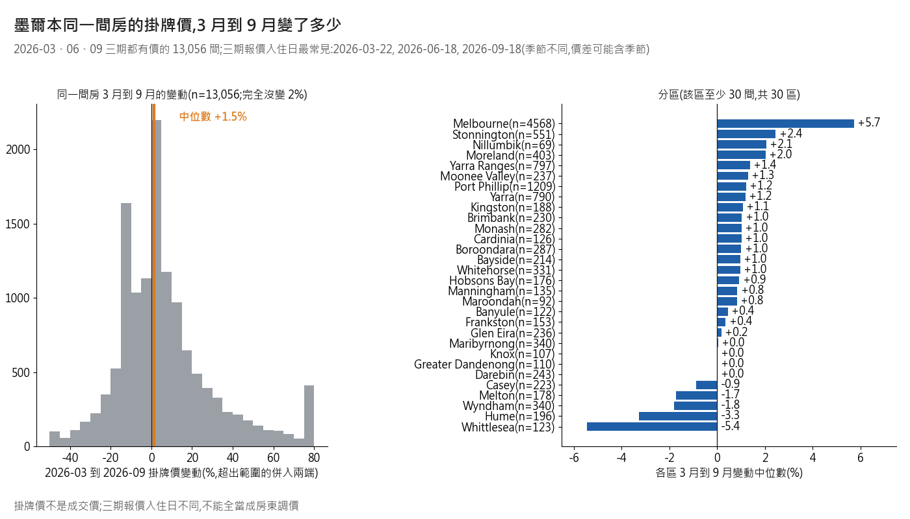
*圖:同一間房 3 到 9 月的掛牌價變動*  
怎麼讀:單間 p10 到 p90:-16.9% 到 +39.6%。三期報價的入住日最常見分別是 3 月 03-22(週日)、6 月 06-18(週四)、9 月 09-18(週五),落在秋、冬、春。只比「同星期、同晚數」的 1,692 間(約 13%)中位數 +1.2%,結論一樣,但季節仍沒排除。  
母體是 3、6、9 月三期都有價的房源 13,056 間(比篩選且有價 8,223 間多,不是篩選樣本);3 到 6 月中位數 +0.00%、6 到 9 月 +2.04%;3 到 9 月漲 57.2%、跌 40.9%。2026-11-12 對賬補入;來源鍵見 raw/reconcile_20_vs_19_2026-11-12.md #21  
新手與老手同方向:3 到 9 月中位數新手 +1.1%(n=1,402)、老手 +1.6%(n=10,293)(新手 = 2025-12 時當房東不超過 12 個月(≤ 12,年資欄推算);母體 = 3、6、9 月都有價且 12 月也出現的房源 11,695 間;和第 5 節的 1,122 間不是同一群),差不到 1 個百分點,別讀成「新手較保守」。

**3 月那期只有 16,674 間:最可能是沒收「休眠房源」(證據強度中高;官方為什麼這樣收,看不出)。**

| 2026-06 那期裡、12 月也在的房源 | 3 月缺席(8,006 間) | 3 月在(13,441 間) |
|---|---|---|
| 有價比例 | 26.7% | 96.6% |
| 全年可訂天數 = 0 | 70.8% | 2.2% |
| 來源為「前次爬取」 | 76.2% | 3.7% |
| 近一年評論數 = 0 | 76.9% | 16.0% |

怎麼讀:缺席的幾乎都是早就全年不可訂、沒評論的房源;3 月消失的 11,701 間,6 月回來 68.4%。

## 7 示範:系統最後會長這樣
> 輸入:Melbourne 區、整套(Entire rental unit)、1 房、2 人、1 床、1 浴、有 Kitchen + Washer + Wifi。
> 同類房源(步驟 1):1,788 間;掛牌價 p25 / p50 / p75 = 192 / 233 / 281。只看 2 人房:1,121 間,187 / 228 / 278。
> 模型參考(M2,照字面只有 3 項設施):約 222,參考區間 181–264。設施補到同類中位數 40 項:約 248,區間 202–295(只是關聯,不代表補了設施就會漲)。
> 缺的同類常見設施:Smoke alarm 96.6%、Hot water 90.0%、Hair dryer 89.8%。
> 同類一半以上有、且同組比較為正向:Dishwasher(69.0%,+13.2%)、Cooking basics(81.2%,+6.9%)、Toaster(71.2%,+5.8%)。

怎麼讀:這是示範輸出,不是定價建議;價格是別人的掛牌價,不是成交價。參考區間 = 模型點估 × 交叉驗證中間 50% 的誤差。

## 8 對專案的影響
- 新手定義建議改用年資欄 `hosts_time_as_host_*`,並列新舊筆數:年資欄 1,122 間、首評代理(首評 12 個月內)2,056 間(其中 857 間同時被年資欄推算為新手)。欄義官方說明寫報告前先補查。
- 實驗主線可寫成「同類定位為主、模型為輔」:同類分組 → 設施關聯(註明不是因果)→ 模型只比基準好一點。
- 跨期比較:價格只有 3、6、9 月三期可用(2025-12 期有價比例 0%);三期報價入住日季節不同,不能當成房東調價;3 月那期只有 16,674 間。
- 舊筆記更正(只列出,不改 `notes/16`、`17`、`18`):「`host_since` 整欄空」只描述 2026-09 那期;2026-03、06 也是空的,但 2025-12 那期 100% 有值,而且它是帳號註冊日,不是開始當房東。
- 舊筆記更正:`17` 的「新上架房源」(首評 12 個月內)代理(即首評代理),命中率只有 41.7%(抓到率 76.4%)。
- 後續要補:模型在年資欄推算的新手(年資欄 12 個月內)上的誤差,目前未計算。

## 9 看不到的事
| 不要這樣說 | 改這樣說 |
|---|---|
| 成交價:「墨爾本中位數 $263 是房東賺的」 | 「這是掛牌價中位數;成交價、清潔費、折扣看不到」 |
| 真實入住:「推算入住 = 住了幾晚」「評論數 = 訂單數」 | 「這是用評論推算的代理;0 晚也可能只是沒人留評論」 |
| 裝設施就漲:「裝 BBQ 能漲 24%」 | 「有 gas BBQ 的同類房源,掛牌價中位數高 24.3%(66 間;關聯不是因果)」 |
| 新手一定定低價:「新手定價比較低」 | 「新手同組價格百分位中位 48.2,老手 50.8,差約 2.6 個百分位點,差很小但不是完全沒差」 |
| 三期價格漲跌:「房東 3 月到 9 月漲價 1.5%」 | 「同一間房 3 月與 9 月報價中位差 +1.5%,但入住日季節不同,不等於調價」 |
| 模型誤差:「模型能預測房價」「準確率很高」 | 「模型猜別人的掛牌價,平均猜偏 75 澳幣,誤差中位數 19%,約一半猜在兩成內」 |
| 不可訂:「30 天不可訂 = 被訂走」 | 「不可訂 = 被訂走或房東自己關,分不出來」 |
| 新手:「首評 12 個月內 = 新手」 | 「首評代理只有 41.7% 同時被年資欄推算為新手;要精確請用年資欄」 |
| 3 月:「3 月那批房源下架了」 | 「3 月缺席的 8,006 間可能多半是休眠房源(推測,證據強度中高),6 月以前次爬取身分回來」 |
| 1 房 / 2 房中位數:「墨爾本 1 房中位數 229 或 230」不註明母體 | 要寫清楚用哪一組:全體整套房(不限人數與晚數)是 1 房 229、2 房 309;篩選且有價樣本(整套、2–4 人、最低 1–7 晚)是 1 房 230、2 房 311(310.8) |
| 大房東:「35.8% 是大房東」 | 「35.8% 的房源掛在名下 5 間以上的房東手上;35.8% 是房源占比」 |

## 10 資料與核對狀態
- 出處:Inside Airbnb 官方下載頁 https://insideairbnb.com/get-the-data/ ;墨爾本四期:2025-12-12 / 2026-03-21 / 2026-06-16 / 2026-09-16(深度分析以 2026-09-16 期為主)。
- 本機資料夾:`scratchpad/insideairbnb_melbourne/`(未進版控)。
- 樣本:全體 25,715 間;篩選(整套、1–2 房、2–4 人、最低 1–7 晚)10,940 間;篩選且有價 8,223 間。
- 核對狀態:2026-11-11 由未參與撰寫的 Claude 分身獨立重算 37 項數字(A 15、C 13、B 9),全部吻合;重跑 B 的程式,模型誤差重現;B 的特徵沒有洩漏答案、分組切分正確。核對者提出 8 處措辭意見(3 處必改、5 處建議),已修。
- 2026-11-12 對賬補入的數字(整體評分、需求代理、有評論房源數、三期價格變化、各期有價比例、跨期房東年資等)已由另一個未參與的 Claude 分身從原始 csv 重算:15 條裡 14 條吻合、1 條要註明母體(首評代理 2,056 是篩選且有價樣本;全體是 4,975),見 `raw/reconcile_verify_numbers_2026-11-12.md`。
- **沒有核對的**:A 的四期日曆占比、評分四分位、各區房源數;B 的設施關聯、特徵重要度、各分群誤差(只重跑重現,沒獨立重算);C 的新手對老手比較;圖只抽看。沒有其他家族模型核對。修改後的措辭只有修改者回讀。
- 限制:價格都是掛牌價;沒有成交價與真實入住;下架房源不在內(存活者偏誤);經緯度有隨機偏移;年資欄欄義是推斷。
- 有價比例各期不同:2025-12 0.0%、2026-03 98.7%、2026-06 74.5%、2026-09 73.9%,四期不能當同一批比。
- 來源檔(`notes/raw/`):A = `mel_a_market`、B = `mel_b_positioning`、C = `mel_c_hosts_time`、Y = `airbnb_melbourne_2024_2026`,皆為 `_2026-11-11.json`;分支短報告為同名 `.md`;R = `mel_review_2026-11-11.md`(獨立核對報告)。

### 數字來源對照(數字 → 來源檔 + 鍵名)

| 數字 | 檔 | JSON 鍵名 |
|---|---|---|
| 房型占比、房東規模、價格分位、p99 | A | a_supply.room_type / host_concentration;b_price.all_priced / by_room_type / entire_by_bedrooms / p99_value / n_above_p99 |
| 分區表、前 4 區占比 | A | c_districts.districts.* / d_maps.top8_by_listings |
| 四期不可訂占比 | A | e_demand.calendar_blocked.periods.<期別>.all.<30/60/90>.blocked_share |
| 60 組、631、8.3 公里 | B | a_grouping |
| 前 10 區價格區間 | B | b_positioning.table / top10_districts |
| 設施比例與價格關聯 | B | c_amenities.top30_prevalence_pct / association |
| MAE、誤差中位數、兩成內、分群 | B | d_experiment.results_group_cv / results_random_cv / random_minus_group_MAE_aud |
| 極端值、時間外部檢查 | B | extreme_rule / d_experiment.extreme_sensitivity_* / d_temporal_check.results |
| 示範案例 | B | e_demo_case |
| 欄位差在哪、欄位非空率 | C | a_validate_tenure_fields / recheck_initial |
| 年資欄推算的新手筆數、命中率與抓到率 | C | c_new_host_definition.definitions.T_* |
| 新手 vs 老手;3 月少一批 | C | d_new_vs_veteran.metrics;e_flows_and_march |
| 同一間房價格變化、入住日、新手路徑 | C | f_price_change / g_first_year_price_path |
| 時間檢查 M1 / M2(9 月內分房東 74.7 / 77.3;時間檢查 72.6 / 70.9) | B | d_temporal_check.same_rows_in_period_group_cv / results |
| 45.0%(820 間的房東在 6 月訓練集出現過)、1.14%(首評早於回推開始月超過 1 個月)、37 項(A 15 / C 13 / B 9) | R | `raw/mel_review_2026-11-11.md`:45.0% → L45;1.14% → L49;37 項 → L7、L19、L30、L37 |
| 每年評論、成長率、淡旺季、新上架 | Y | yearly / growth / seasonality / monthly / top3_months / bottom3_months |
