# 20 雪梨 Airbnb 深度分析
> IS-1111-SYD-NOTE,2026-11-11。給準備入行的新房東:競品定位工具的資料底稿,§0–§8 的章節和 19 墨爾本版對應,方便對著看;§9、§10 分別對應 19 的 §9、§10(雪梨版重編);§11、§12 為雪梨版新增。Inside Airbnb 雪梨 2026-09-16 期為主,另有 3 期;價格都是掛牌價,不是成交價。
> 2026-11-12 對賬更正:19 與 20 互相對過一次,並與 16、17、18、22 對過;更正清單見 raw/reconcile_20_vs_19_2026-11-12.md、raw/reconcile_20_vs_16-18_22_2026-11-12.md。

## 0 一分鐘看懂
- **規模**:雪梨 20,833 間房源,整套房占 78.9%(整套房 = 租下整間屋子,不是只租一個房間)。
- **大房東**:近一半(45.3%)的房源掛在名下 5 間以上的房東手上。這是「房源」的占比,不是「房東人數」的占比。
- **價格**:有標價的房源,每晚掛牌價中位數 $338(中位數 = 排在正中間那一間的價格);墨爾本是 $263。
- **猜價模型**:模型(M2)只比「同區、同房間數的中位數」好 8%。所以工具的重點是「找同類房源來比」,模型只是輔助。
- **新手房東**:篩選且有價 6,639 間裡,依平台年資欄推算的新手有 960 間(14.5%);原始掛牌價中位數比老手低約 6%,但同區、同房間數內的排名只差 1.4 個百分位點;評論比較少(近一年 5 則對 11 則)。
- **季節**:同一間房 3 月到 9 月的掛牌價變化(每間房算變化 %,再取中位數)是 +0.53%,6 月低一點。這不是年漲幅。
- **日曆**:12 月那期,未來 30 天「不可訂」占 62.6%;6 月那期最低,48.7%。不可訂 = 被訂走或房東自己關,分不出來。
- **可信度**:獨立驗算 18 條,16 條完全吻合,2 條要改措辭;沒有其他家族模型(Codex)核對。

## 1 市場長相
**整套房占 78.9%;45.3% 的房源屬於名下 5 間以上的房東(以房源算,不是以房東人數算)。**  
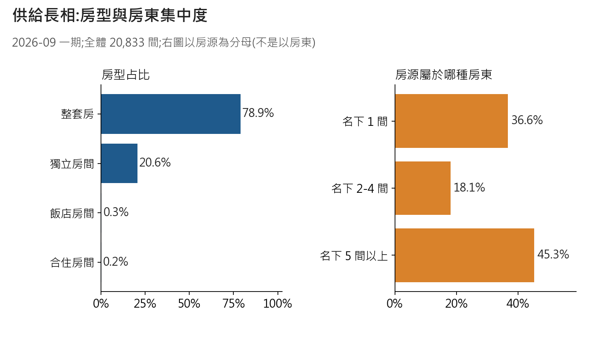
*圖:房型與房東集中度(右圖以房源為分母)*  
這張圖告訴我們:雪梨以整套房為主,而且大房東的房源占了近一半。右圖的分母是「房源」不是房東:名下 1 間 36.6%、2–4 間 18.1%、5 間以上 45.3%。

| 房型 | 房源數 | 占比 |
|---|---|---|
| 整套房 | 16,445 | 78.9% |
| 獨立房間 | 4,282 | 20.6% |
| 飯店房間 | 58 | 0.3% |
| 合住房間 | 48 | 0.2% |

獨立房間 20.6% = 4,282 ÷ 20,833;`syd_a_market` md 寫 20.5%,差在 md 先四捨五入再格式化,圖是 20.6%。  
來源:syd_a_market_2026-11-11.md

**有價 17,721 間,中位數 $338;整套 1 房 $293、2 房 $408、3 房 $567(全體整套房,不限人數與晚數)。**  
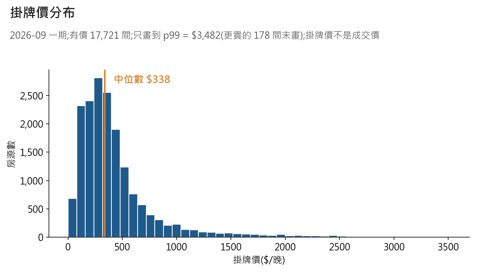
*圖:掛牌價分布(只畫到 p99)*  
這張圖告訴我們:大多數房源集中在中間價位,右邊有一條很長的尾巴(少數很貴的房源)。

| 範圍(有價) | n | p25 | p50 | p75 |
|---|---|---|---|---|
| 全體 | 17,721 | $209 | $338 | $514 |
| 整套房 | 13,899 | $284 | $394 | $583 |
| 獨立房間 | 3,726 | $91 | $125 | $179 |
| 整套 1 房 | 4,557 | $230 | $293 | $373 |
| 整套 2 房 | 4,553 | $319 | $408 | $525 |
| 整套 3 房 | 2,123 | $422 | $567 | $824 |

怎麼讀:p25 / p50 / p75 = 由低到高排好後,25% / 50% / 75% 位置的價格。高於 p99($3,482)有 178 間,最高 $96,888;圖已截掉。這張表的 1 房 $293、2 房 $408 是「全體整套房」;第 2 節的 299、414 是另一組樣本(篩選且有價),見第 9 節。

來源:syd_a_market_2026-11-11.md

**房源集中在 Sydney 區(5,024 間,占全體 24.1%);價格中位數最低 Fairfield $216(只有 35 間樣本)、最高 Manly $414(篩選且有價樣本)。**  
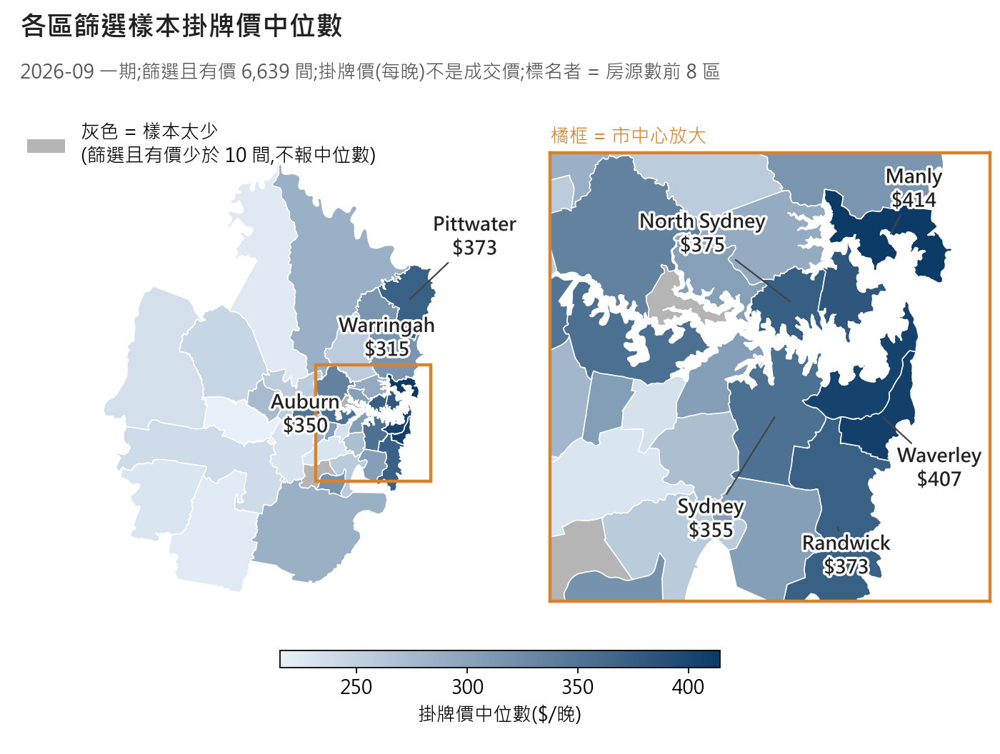
*圖:各區掛牌價中位數*  
這張圖告訴我們:價格高的區不等於房源多的區。  
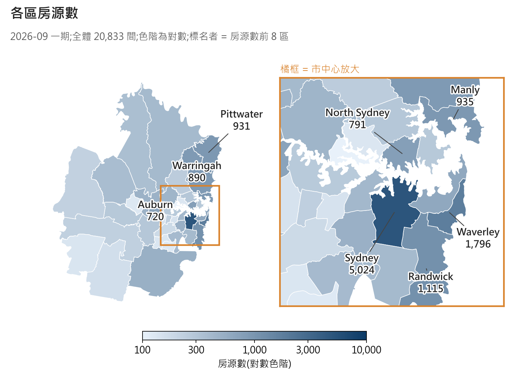
*圖:各區房源數*  
這張圖告訴我們:房源集中在少數幾個區,Sydney 區最多。

| 區 | 房源數 | 篩選且有價 | 價格中位數(篩選且有價) | 評分中位數(該區全部有評分房源) |
|---|---|---|---|---|
| Sydney | 5,024 | 1,855 | $355 | 4.80 |
| Waverley | 1,796 | 693 | $407 | 4.88 |
| Randwick | 1,115 | 318 | $373 | 4.88 |
| Manly | 935 | 372 | $414 | 4.89 |
| Pittwater | 931 | 214 | $373 | 4.95 |
| Warringah | 890 | 274 | $315 | 4.94 |

怎麼讀:上表僅列 38 區中的前 6 區;共 38 區(區 = 政府劃分的 LGA 行政區);樣本少於 10 間不報中位數的區有 2 個(Hunters Hill、Hurstville)。

來源:syd_a_market_2026-11-11.md

**有評分 17,623 間(84.6%),評分中位數 4.84(全體有評分);5.0 分占 25.0%,低於 4 分占 3.5%。**  
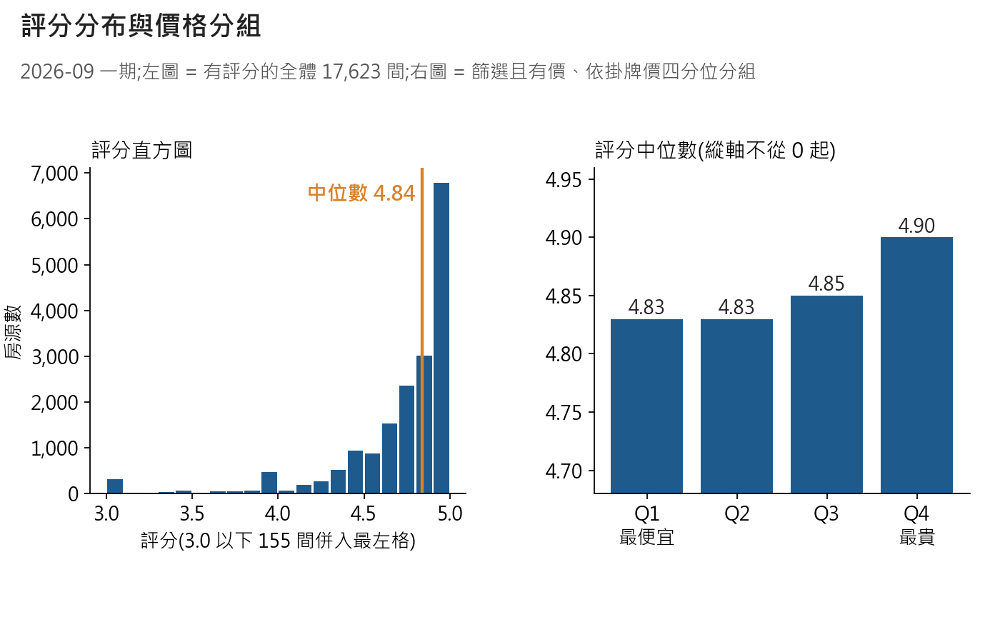
*圖:評分分布與價格分組*  
這張圖告訴我們:評分擠在接近滿分的地方,所以評分很難分出好壞;價格四分組(篩選且有價且有評分 6,051 間)的評分中位數 Q1 4.83、Q2 4.83、Q3 4.85、Q4 4.90,差距很小(右圖縱軸從 4.68 起,看起來差很多,實際只差 0.07 分)。  
怎麼讀:4.84 的母體是全體有評分 17,623 間;只看「篩選且有價且有評分」(6,051 間)中位數是 4.86,兩組不要混著講(見第 9 節)。

來源:syd_a_market_2026-11-11.md;syd_verify_2026-11-11.md(A6)

## 2 同類房源怎麼比
**區 × 房間數共 76 組,中位數 38.5 間;30 組不足 30 間,但只涵蓋 459 間(93.1% 的房源在 30 間以上的組)。**

1. 找同區、同房間數的房源;30 間以上就用這組。
2. 不足 30 間 → 改用全市同房間數、直線距離最近的 30 間(不限區)。
3. 記下用了哪一步(1 或 2),報告時一起寫。

怎麼讀:套用規則後,每間房的比較組中位數 166 間(p10 = 37);退回「最近 30 間」時,半徑中位數 5.7 公里(p25 2.1、p75 8.7)。

來源:syd_b_positioning_2026-11-11.json(a_grouping)

**前 10 大區內,1 房中位數以 Manly(366)最貴、Sutherland Shire(258)最便宜;2 房同樣是 Manly(575)最貴、Sutherland Shire(350)最便宜。**  
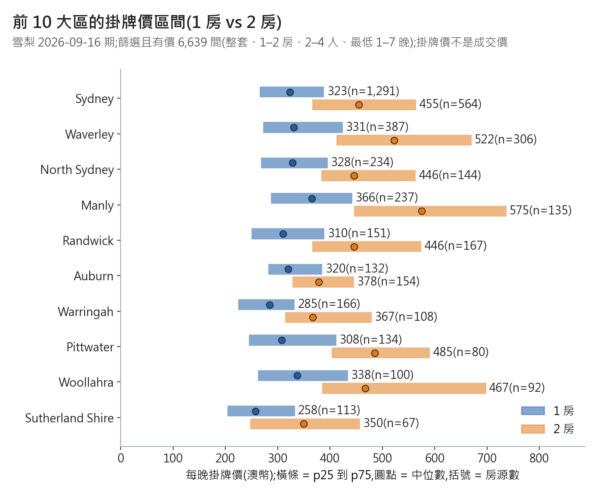
*圖:前 10 大區掛牌價區間(1 房、2 房)*  
這張圖告訴我們:橫條是 p25 到 p75、圓點是中位數;你的價落在橫條左邊 = 比同類 75% 便宜。同一區內 2 房的價位比 1 房高,區與區之間也有差。

| 區 | 1 房 中位數(p25–p75) | n | 2 房 中位數(p25–p75) | n |
|---|---|---|---|---|
| Sydney | 323(266–389) | 1,291 | 455(366–565) | 564 |
| Waverley | 331(272–425) | 387 | 522(412–671) | 306 |
| Manly | 366(287–442) | 237 | 575(446–737) | 135 |
| Randwick | 310(250–390) | 151 | 446(366–575) | 167 |
| Warringah | 285(224–333) | 166 | 367(314–479) | 108 |
| Sutherland Shire | 258(204–333) | 113 | 350(248–458) | 67 |

怎麼讀:表格僅列 10 區中的 6 區(含最高與最低),完整 10 區見圖。這裡用的是「篩選且有價」樣本(整套、2–4 人、最低 1–7 晚)。全市中位數:1 房 299(n=4,029)、2 房 414(n=2,610)。列入定位表的區(≥30 間)共 33 個。

來源:syd_b_positioning_2026-11-11.md;syd_verify_2026-11-11.md(B2、B3)

## 3 設施和價格
**篩選且有價 6,639 間,每間房設施中位數 41 項;最常見 Smoke alarm 96.8%、Kitchen 93.6%、Wifi 91.9%。**  
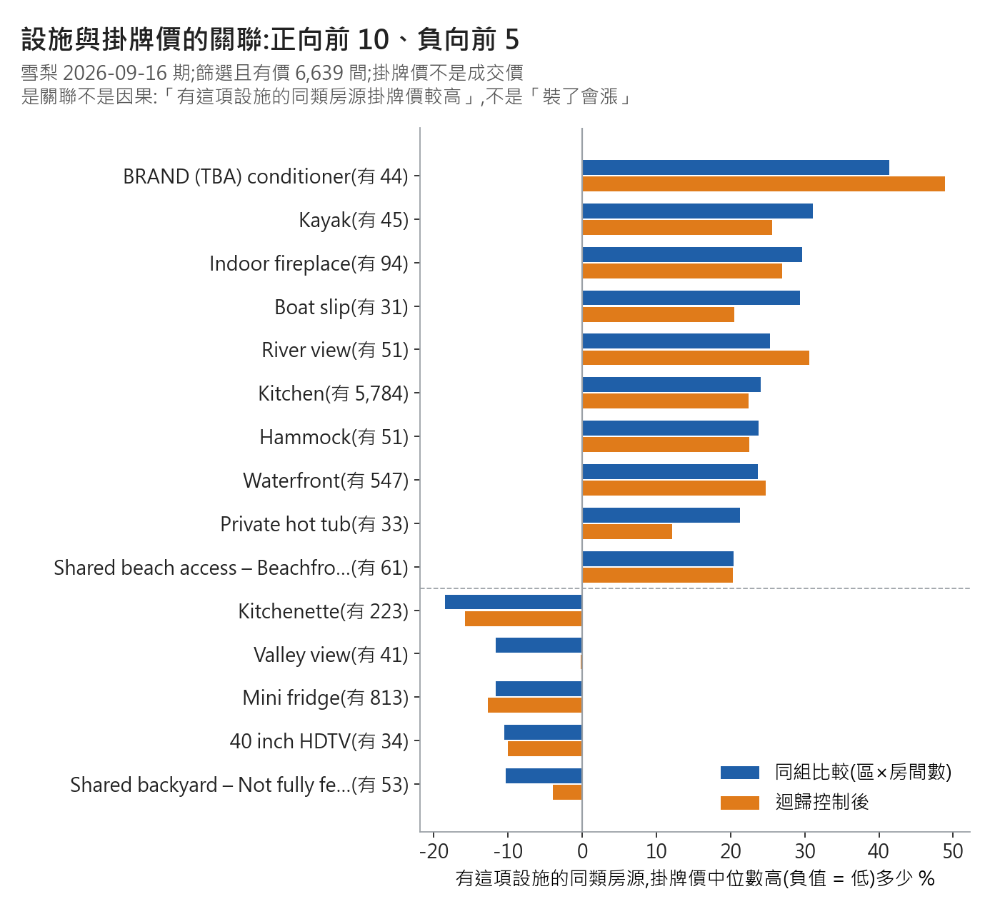
*圖:設施與掛牌價的關聯(同組比較)*  
這張圖告訴我們:有些設施的房源掛牌價較高、有些較低,但這是「有這項設施的房源價格較高」,不是「裝了就會漲」;可能只是房子本身等級不同。圖中第 6–10 名有 Kitchen、Waterfront 等樣本較大的項目;同組比較只用同組 ≥30 間的 6,180 間。

| 設施 | 有這項的房數 | 同組比較 | 迴歸控制後 |
|---|---|---|---|
| BRAND (TBA) conditioner | 44 | +41.4% | +48.9% |
| Kayak | 45 | +31.1% | +25.6% |
| Indoor fireplace | 94 | +29.6% | +26.9% |
| Kitchenette | 223 | -18.5% | -15.8% |
| Mini fridge | 813 | -11.7% | -12.7% |
| Valley view | 41 | -11.7% | -0.2% |

怎麼讀:固定說法:「有 Kayak 的同類房源,掛牌價中位數高 31.1%(45 間;關聯不是因果)」。「同組比較」= 同區同房間數內,有這項與沒有這項的中位數相比;「迴歸控制後」= 再把區、房間數、人數、床數、浴室數的差別扣掉。兩種算法方向一致的比例 88.7%(239 項可比設施)。正向前 5 名的有此設施房源只有 31–94 間,排名容易被少數房源左右;Valley view 迴歸控制後是 -0.2%,信賴區間 [-9.9, 10.6] 含 0,等於看不出差別。負向的設施(如 Kitchenette、Mini fridge)也可能只是房子類型不同的訊號,不一定是設施本身造成的。在篩選且有價 6,639 間裡共出現 2,445 種設施名稱,模型只用最常見的前 40 項。

來源:syd_b_positioning_2026-11-11.md;syd_b_positioning_2026-11-11.json(c_amenities)

## 4 價格模型實驗
**最好的模型 M2 比全市中位數(B0)好 24%、比「區 × 房間數中位數」(B1)只好 8%(算法:(基準 MAE − M2 MAE)÷基準 MAE;對 B1 是 (101.7−93.4)÷101.7=8.2%,對 B0 是 (122.5−93.4)÷122.5=23.8%);M1 與 M2 差距不大。這是老實的結果。**

- 目標:猜每晚掛牌價(取對數訓練,誤差換回澳幣);樣本 6,615 間。
- 特徵:只用新房東上架前就知道的(區、房間數、可住人數、床數、浴室數、設施數與前 40 項設施、經緯度、房型細類、最低入住晚數);不用評論、評分、可訂天數、營收。
- 切法:同一房東的房源分在同一折(5 折)。
- 指標:MAE(平均猜偏幾澳幣)、MdAPE(誤差中位數 %)、落在兩成內的比例。

| 方法 | MAE 澳幣 | 誤差中位數 | 差 20% 以內 |
|---|---|---|---|
| B0 全市中位數 | 122.5 | 26.0% | 40.1% |
| B1 區 × 房間數中位數 | 101.7 | 21.2% | 47.8% |
| M1 線性(Ridge) | 95.7 | 19.7% | 50.5% |
| M2 梯度提升樹 | 93.4 | 18.9% | 51.9% |
| M2 + 房東名下房源數(對照) | 92.6 | 18.7% | 52.5% |

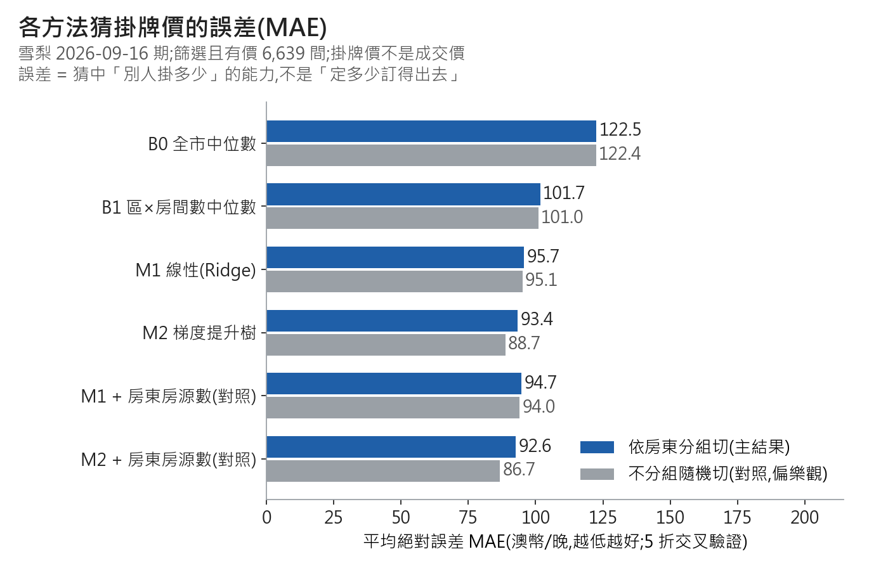
*圖:各方法 MAE 比較(越低越好)*  
這張圖告訴我們:模型一路比基準低,但降幅有限;加房東房源數(92.6 對 93.4)差距很小。誤差衡量「猜中別人掛多少」,不是「定多少訂得出去」。

- 不分房東隨機切會高估:M2 MAE 88.7(比分組切低 4.7)、M2 + 房東數 86.7;B0 122.4、B1 101.0、M1 95.1,跟分組切差不多。樹模型會記住同房東的習慣,所以主結果用分組切。
- 首評代理 =『新上架房源』指標(首評在近 12 個月內),不等於新手房東。首評代理的房源 2,017 間(不是新手房東,不等於年資欄推算的新手,見第 5 節;模型樣本 6,615 間,已排除 24 間極端高價,第 5 節的 2,028 間是排除前):M2 MAE 88.2、誤差中位數 18.1%、兩成內 53.4%;其他房源 95.7 / 19.3% / 51.2%。模型在年資欄推算的新手(12 個月內)上的誤差:這次沒算。
- 時間外部檢查:用 2026-06-16 期 6,747 間訓練,測 9 月新出現的 821 間,模型仍比基準好(M2 94.1、M1 99.3、B1 103.2、B0 122.0)。同一批 821 間用 9 月內分房東驗證時 M2 98.2、M1 99.1。這 821 間來自 569 位房東,其中 208 位(36.6%)在 6 月訓練集已有房源,407 間(49.6%)的房東模型看過,所以這只是「時間往後」的檢查,不是「沒看過的房東」的檢查(此數字為驗收者重算,來源 `syd_note_review_2026-11-11.md`)。
- 極端高價:每晚 2,000 澳幣以上 24 間不進訓練與主要誤差。放回去,M2 MAE 由 93.4 變 113.5,誤差中位數 18.9% 變 19.1%(幾乎不變)。

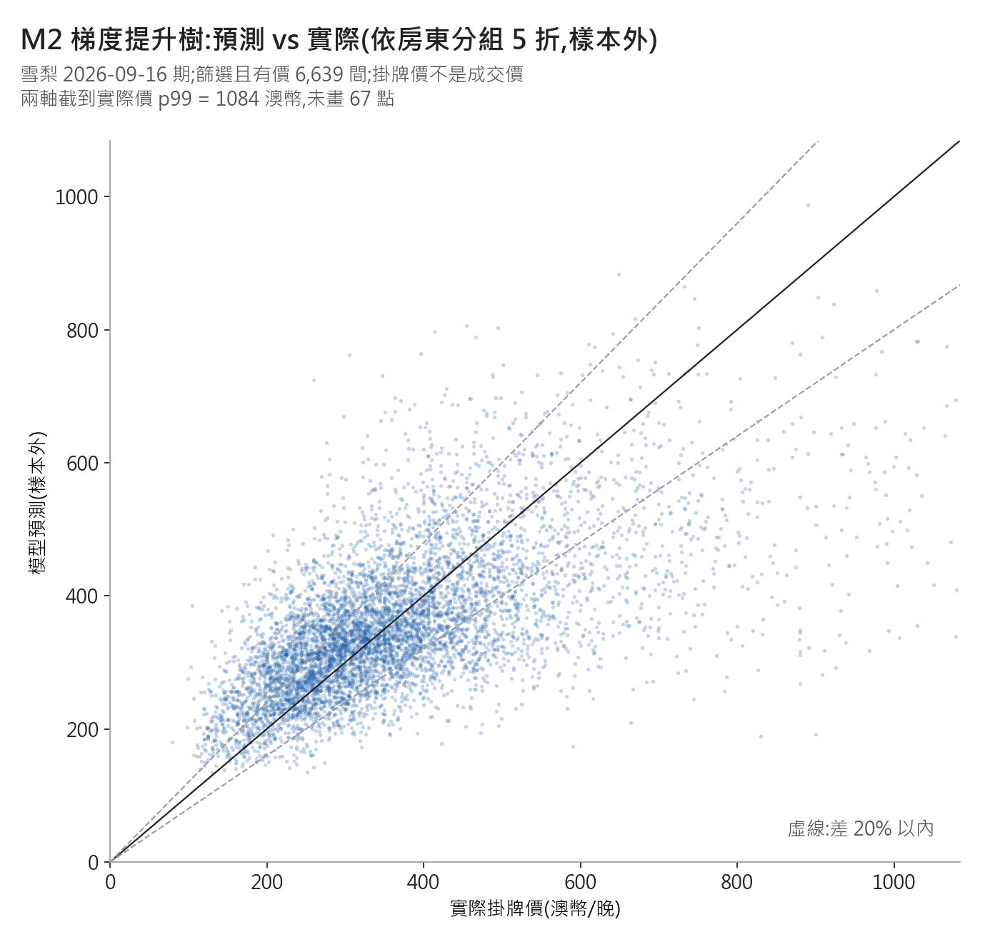
*圖:預測對實際(M2,依房東分組 5 折,樣本外;兩軸截到 p99,未畫 67 點)*  
這張圖告訴我們:點集中在中低價位、沿對角線分布;實際掛牌價很高的房源,模型多半猜得比較低。

來源:syd_b_positioning_2026-11-11.md;syd_b_positioning_2026-11-11.json(d_experiment、d_temporal_check);syd_verify_2026-11-11.md(B5);syd_note_review_2026-11-11.md(821 間的房東重疊)

## 5 新手房東
**`host_since` 是帳號註冊日(推斷);當房東多久,最像是看 `hosts_time_as_host_*`。用它推算的新手(開始當房東 ≤ 12 個月),篩選且有價 960 間(算法:年 × 12 + 月 ≤ 12,含剛好 12 個月;若改成『不到 12 個月』,雪梨是 897 間,少 63 間,見 17 §3)。**

| 欄位 | 實際意思 | 證據(2025-12 期,20,430 列有 host_since) |
|---|---|---|
| `host_since` | 帳號註冊日(推斷) | 跟 `hosts_time_as_user_*` 精確吻合 98.46%、差 1 個月內 99.99% |
| `hosts_time_as_user_*` | 帳號年資 | 同上 |
| `hosts_time_as_host_*` | 開始當房東以來(推測) | 對 `host_since` 精確吻合只有 37.3%,52.96% 比它短超過 1 個月;不大於帳號年資的比例 99.97%;跨 2025-12 與 2026-09 兩期都在的 7,966 位房東,其中 7,963 位年資欄增加 9 個月(6,663 位)或 10 個月(1,300 位) |

> 年資欄 = 當房東多久,是靠資料行為推的,官方說明未查,證據勉強;`host_since` 只有 2025-12 那期有值(其餘三期 0%),所以驗證只能用那一期。`hosts_time_as_user_*` 以抓取日為基準,仍有 98.46% 與 `host_since` 同月,所以 37.3% 的不吻合不是『兩欄基準日不同』造成的。

| 新手筆數(依年資欄) | 全體 | 篩選 | 篩選且有價 |
|---|---|---|---|
| 開始當房東 ≤ 12 個月 | 2,610 | 1,092 | 960 |
| 24 個月內 | 4,924 | 1,959 | 1,714 |
| 12 個月內且名下只有 1 間 | 1,249 | 647 | 569 |
| 24 個月內且名下只有 1 間 | 2,067 | 1,026 | 871 |

怎麼讀:用首評(第一則評論)在 12 個月內當新手房東的代理(準確度低),篩選且有價樣本裡有 2,028 間,其中 723 間同時被年資欄推算為新手(命中率 35.7%);年資欄推算的新手 960 間裡,有 723 間被首評代理抓到(抓到率 75.3%,沒被抓到的新手中 227 間還沒有評論)。  
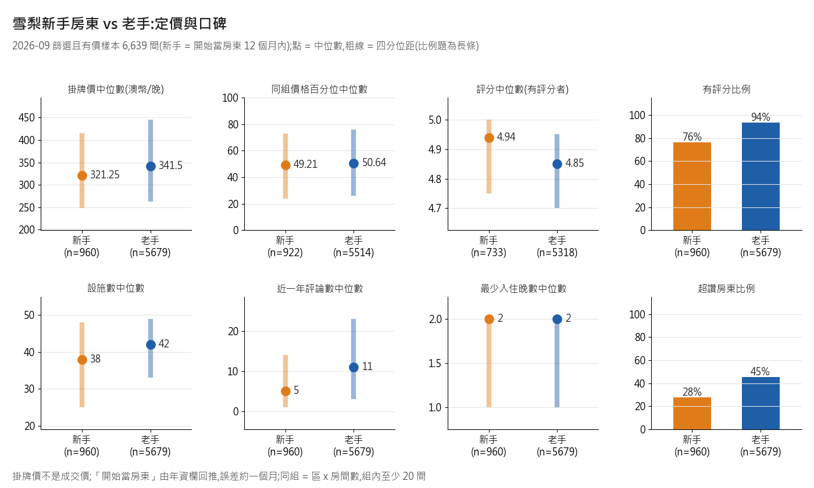
*圖:新手 vs 老手*  
這張圖告訴我們:新手與老手在評論數、有評分比例、超讚房東比例差得多;定價的原始中位數新手較低(第一格 321.25 對 341.5),但同組內的排名差別很小。

- 定價:原始掛牌價中位數新手 321.25 對老手 341.5(分支 C 報告 `syd_c` md 寫新手低約 6%),這個比法沒控制房子組成。「同組價格百分位」= 在同區、同房間數的房源裡,這間房的價格排第幾(0 = 最便宜、50 = 正中間,單位是百分位點,不是 %):新手 49.21、老手 50.64,只差 1.4 個百分位點。另一種算法(價格 ÷ 同組中位數)新手 0.990、老手 1.001(同組 = 同區同房間數,不設最小組大小;驗收者一次重算,來源 `syd_note_review_2026-11-11.md`)。所以扣掉組成後差很小,但不是完全沒差。
- 差別 1,評論少:近一年評論數中位數 5 對 11。
- 差別 2,有評分的比例 76.4% 對 93.6%(評分中位 4.94 對 4.85,可能是評論少、少量評論容易滿分,不代表品質較好)。
- 差別 3,超讚房東(Superhost,平台給表現好的房東的標章)比例 27.8% 對 45.2%;設施數中位數 38 對 42。
- 樣本:新手 960 間、老手 5,679 間(新手占 14.5%)。

來源:syd_c_hosts_time_2026-11-11.md;syd_c_hosts_time_2026-11-11.json(c_new_host_definition、d_new_vs_veteran);syd_verify_2026-11-11.md(C3、C5)

## 6 時間與淡旺季
**評論逐年墊高:2025 年比 2024 年 +34.9%;2026 年 1–8 月比 2025 年同期 +37.4%。**  
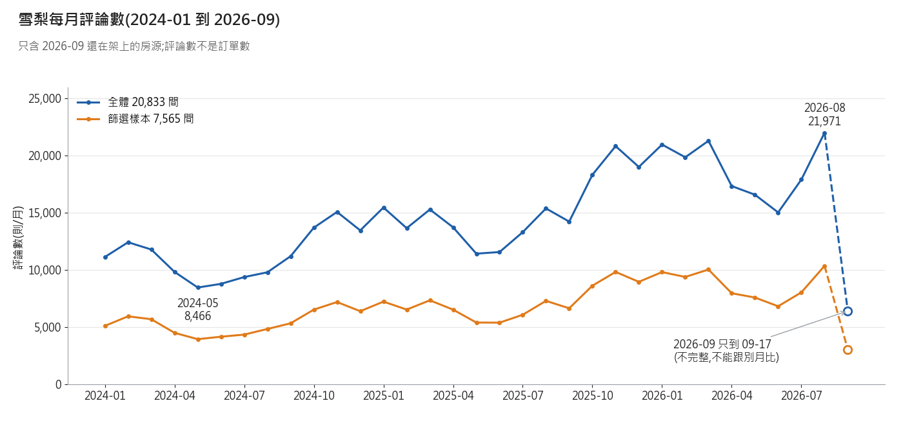
*圖:每月評論數(只含還在架上的房源)*  
這張圖告訴我們:評論量整體逐年墊高,2024 年 134,978 則、2025 年 182,045 則、2026 年到 09-17 已有 157,210 則;最後一個月只到 09-17,不能跟別月比。成長主要跟「有評論的房源變多」同步:全體房源裡當年有評論的房源數,2024 年 8,400 間 → 2025 年 11,619 間(+38%),每間有評論房源的評論數 16.1 → 15.7,幾乎持平(來源:`syd_y_verify_2026-11-11.md`)。  
怎麼讀:最多:2026-08(21,971)、2026-03(21,266)、2026-01(20,940);最少:2024-05(8,466),最多月是最少月的 2.6 倍,這包含逐年成長,不全是季節差。評論數是「有留評論的住宿」,不是訂單數;評論檔只含 2026-09 還在架上的房源,所以早年的評論數偏低(用 2025-12 期的檔案對照,2024 年至少少約 13%);成長率偏高還是偏低無法確定。

來源:syd_y_2024_2026;存活者偏差與每間評論數:syd_y_verify_2026-11-11.md

**兩年平均:偏旺的是 11、12、10 月,偏淡的是 5、6、7 月;最高月 11 月(指數 135.5)是最低月 5 月(指數 75.3)的 1.8 倍;2024 與 2025 各月指數的相關係數 0.90,形狀很像。**  
指數 = 當月評論數 ÷ 該年 12 個月的月平均 × 100(100 = 平均),用 2024、2025 兩個完整年度,再取兩年平均。  
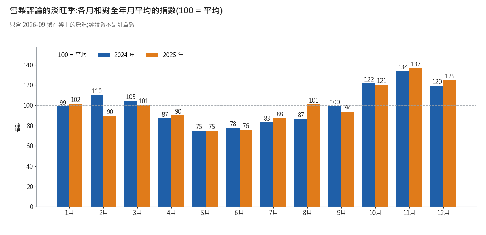
*圖:評論淡旺季指數(100 = 平均)*  
這張圖告訴我們:兩年的形狀接近,年底(10 到 12 月)偏高、年中(5 到 7 月)偏低,不是只有某一年這樣。  
怎麼讀:評論多的月份代表住完並留言的人多,可當需求的參考(只能當方向,不能當量),不等於訂房量;評論住完才寫,高峰比入住晚,所以這是「評論的」淡旺季,不等於入住的淡旺季。每年評論量本來就在長(主要跟有評論的房源變多同步,見上),後半年的指數會被墊高一點。

來源:syd_y_2024_2026

**首評落在當年的房源:2024 年 2,740、2025 年 3,805、2026 年(到 09-17)4,018 間(母體:全體 20,833 間)。**  
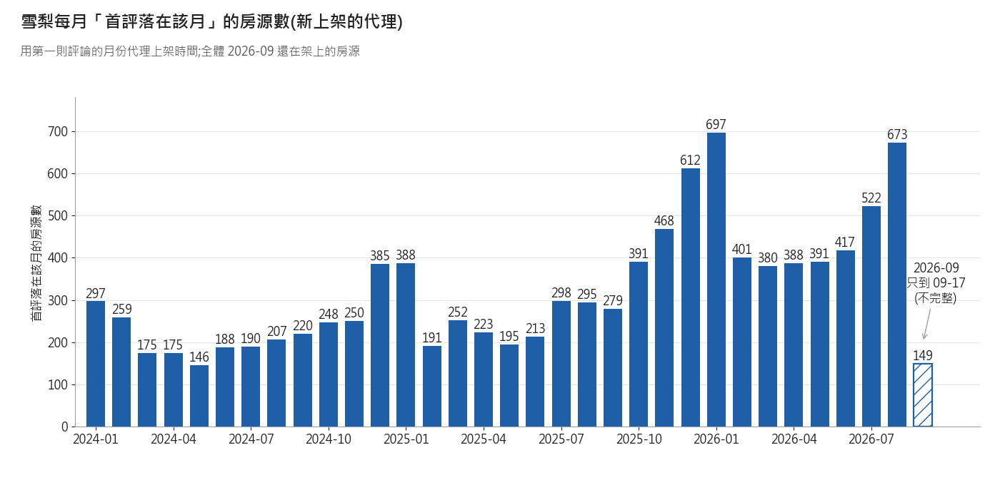
*圖:每月新上架(首評月份代理)*  
這張圖告訴我們:每月「第一則評論落在該月」的房源數逐年變多,圖上 2025-11 到 2026-01 與 2026-08 的柱子特別高;但評論檔只含 2026-09 還在架上的房源,早年數字偏低(用 2025-12 期對照,2024 年首評房源 3,419 → 2,740,少約 2 成),逐年增幅的偏差方向無法確定(來源:`syd_y_verify_2026-11-11.md`);最右邊的 2026-09 只到 09-17,是不完整的月份。  
怎麼讀:首評月不等於上架月,上架可能更早;只算 2026-09 還在架上的房源,早年已下架的不在內,數字偏低。用 2025-09-17(含)當截止日,篩選且有價 6,639 間裡首評在近 12 個月內的有 2,028 間(評論檔與 listings 的 first_review 欄算出來一致,差 0 間);篩選且有價裡一則評論都沒有的有 588 間,不算新上架。注意兩個母體不同:4,018 是全體 20,833 間,2,028 是篩選且有價 6,639 間,不能直接比。

來源:syd_y_2024_2026;下架影響:syd_y_verify_2026-11-11.md

**需求代理(2026-09 期,篩選且有價 6,639 間):推算近一年入住晚數中位數 60、平均 85.0;0 晚占 12.4%,達上限 255 晚占 6.4%。**  
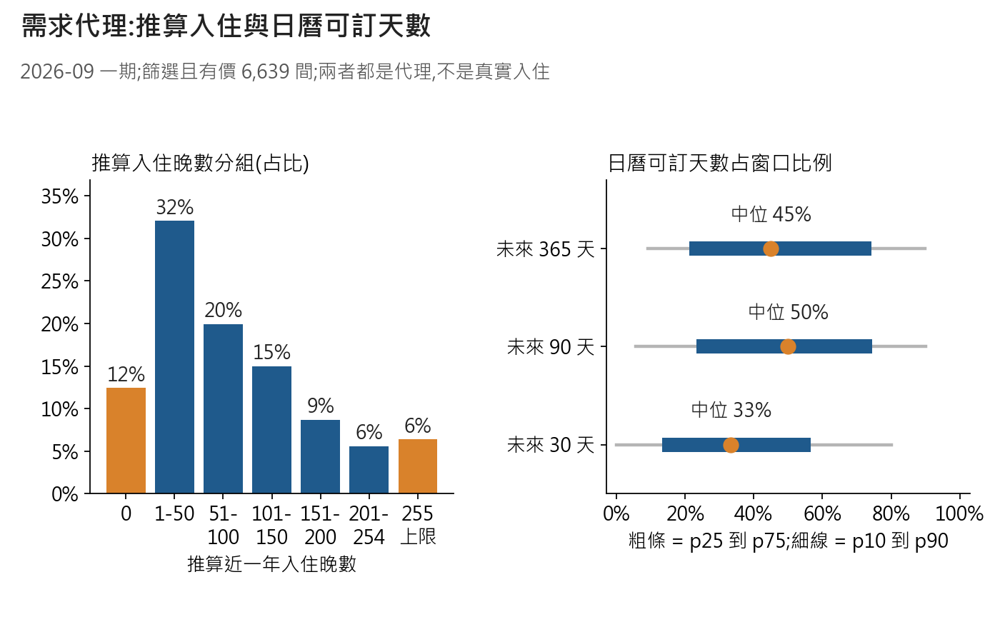
*圖:需求代理:推算入住與日曆可訂天數*  
這張圖告訴我們:推算入住晚數的分布;右圖是未來 30、90、365 天裡「還能訂」的天數占比。兩者都是代理,不是真實入住。

| 窗口 | 可訂天數 p50 | 占窗口 | 完全沒被擋占比 | 完全不可訂占比 |
|---|---|---|---|---|
| 未來 30 天 | 10.0 | 33% | 2.4% | 14.7% |
| 未來 90 天 | 45.0 | 50% | 1.9% | 6.0% |
| 未來 365 天 | 164.0 | 45% | 0.2% | 0.0% |

來源:syd_a_market_2026-11-11.md

**四期抓取日後 30 天的不可訂占比,從 48.7%(6 月)到 62.6%(12 月)。**  
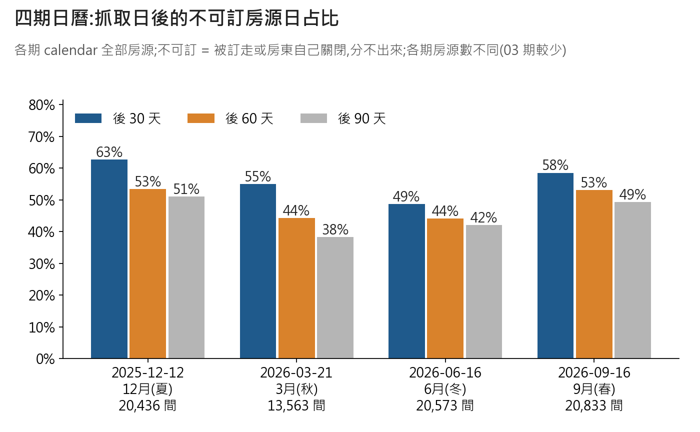
*圖:四期日曆:未來 30 / 60 / 90 天不可訂占比*  
這張圖告訴我們:四期的不可訂占比高低不同,12 月(夏)最高、6 月(冬)最低;季節只是期別標籤,不是原因;而且每期房源數不同,不能當同一批比。

| 期別 | calendar 房源數 | 30 天 | 60 天 | 90 天 |
|---|---|---|---|---|
| 2025-12-12 12月(夏) | 20,436 | 62.6% | 53.4% | 51.0% |
| 2026-03-21 3月(秋) | 13,563 | 55.0% | 44.2% | 38.3% |
| 2026-06-16 6月(冬) | 20,573 | 48.7% | 44.1% | 42.0% |
| 2026-09-16 9月(春) | 20,833 | 58.5% | 53.0% | 49.3% |

怎麼讀:不可訂 = 被訂走或房東自己關,分不出來。3 月那期只有 13,563 間。

來源:syd_a_market_2026-11-11.md;syd_verify_2026-11-11.md(A5)

**同一間房 3 到 9 月的掛牌價變化中位數 +0.53%(10,513 間),6 月最低;各期報價的入住日落在不同季節,不能當成房東調價。**  
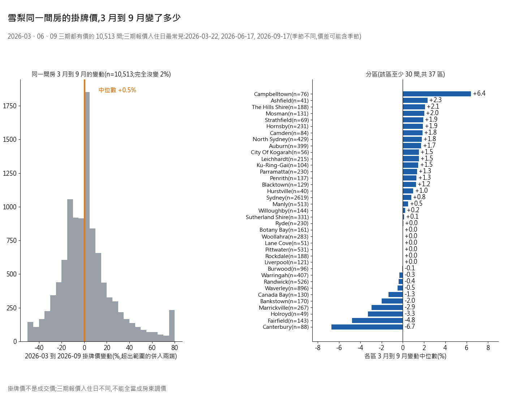
*圖:同一間房 3 到 9 月的掛牌價變動*  
這張圖告訴我們:中位數接近 0,但單間差很大;漲的 51.1%、跌的 46.8%、沒變的 2.1%。

| 區間 | 中位數 | 漲 | 跌 | 沒變 |
|---|---|---|---|---|
| 3 到 6 月 | -3.62% | 27.9% | 57.2% | 14.9% |
| 6 到 9 月 | +3.84% | 64.8% | 32.3% | 2.9% |
| 3 到 9 月 | +0.53% | 51.1% | 46.8% | 2.1% |

怎麼讀:母體是「3、6、9 月三期都有價」的全體房源(不限整套房、不限篩選)10,513 間;只要求 3、9 月兩期有價則是 10,698 間、中位數 +0.564%。3 到 9 月單間 p10 到 p90:-24.0% 到 +32.77%。三期報價的入住日最常見分別是 2026-03-22(週日)、2026-06-17(週三)、2026-09-17(週四),落在秋、冬、春。只比「同星期、同晚數」的 1,187 間(約 11.3%)中位數 +0.26%,結論一樣,但季節仍沒排除。分區(n≥30,共 37 區):最多漲 Campbelltown +6.4%,最多跌 Canterbury -6.7%;大多數區在 -1 到 +2% 之間。  
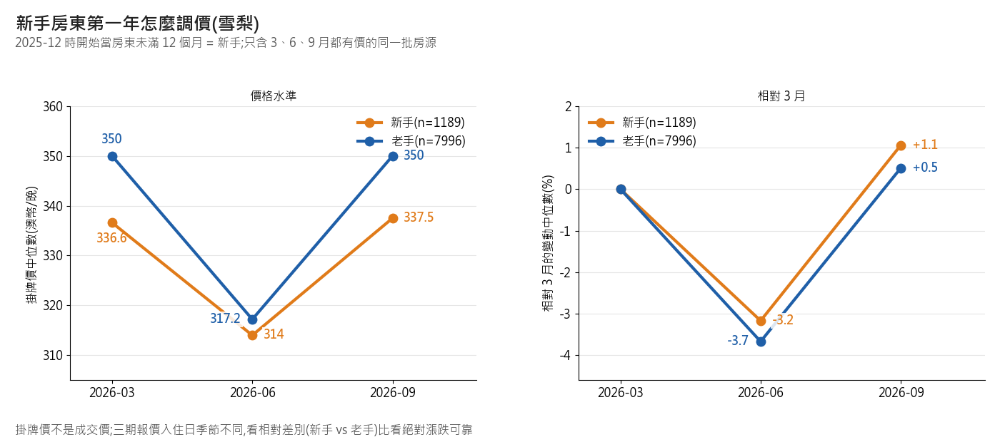
*圖:新手期怎麼調價(新手 = 2025-12 時當房東不超過 12 個月(≤ 12;圖上標籤寫『未滿』,實際算法含 12),年資欄推算,n=1,189;老手 n=7,996;母體 = 3、6、9 月都有價且 12 月也出現的房源 9,185 間)*  
注意:這張圖的新手跟第 5 節的 960 間(2026-09 時年資 ≤ 12 個月)不是同一群;追蹤期約為當房東第 3 ~ 21 個月(依 2025-12 到 2026-09 約隔 9 ~ 10 個月推算),不全是第一年。  
這張圖告訴我們:新手與老手的曲線形狀一樣,都是 6 月低、9 月回到 3 月附近。3 到 9 月中位數新手 +1.06%、老手 +0.51%,差別很小,別讀成「新手較保守」或「新手較激進」。

來源:syd_c_hosts_time_2026-11-11.md;syd_c_hosts_time_2026-11-11.json(f_price_change、g_first_year_price_path);syd_verify_2026-11-11.md(C6)

**3 月那期只有 13,563 間:2025-12 到 2026-03 之間有 8,968 間沒出現,其中 6 月回來 61.3%。**

| 2026-06 那期裡、12 月也在的房源 | 3 月缺席(5,498 間) | 3 月在(10,632 間) |
|---|---|---|
| 有價比例 | 62.1% | 96.3% |
| 全年可訂天數 = 0 | 28.3% | 2.7% |
| 來源為「前次爬取」占比(括號 = 間數) | 71.6%(3,937 間) | 5.1%(538 間) |
| 近一年評論數 = 0 | 58.1% | 8.7% |

怎麼讀:3 月缺席的那批,6 月有價比例低、全年可訂天數 0 的比例高、來源多為前次爬取,一種可能是原本就休眠的房源在 3 月沒被收錄(推測,未驗證),官方為什麼這樣收看不出;雪梨這次沒另外評估證據強度。

來源:syd_c_hosts_time_2026-11-11.json(e_flows_and_march)

## 7 示範:系統最後會長這樣
> 輸入:Sydney 區、整套(Entire rental unit)、1 房、2 人、1 床、1 浴、有 Kitchen + Washer + Wifi。
> 同類房源(步驟 1):1,291 間;掛牌價 p25 / p50 / p75 = 265.9 / 323.4 / 388.8。只看 2 人房:798 間,255.0 / 311.7 / 378.2。
> 模型參考(M2,照字面只有 3 項設施,這是很少見的輸入):約 209.0,參考區間 171.0–250.0,低於同類 p25(265.9)。設施補到同類中位數 42 項、回到典型輸入:約 356.0,區間 291.0–426.0。
> 缺的同類常見設施:Smoke alarm 97.1%、Hot water 93.1%、Dishes and silverware 91.2%。
> 同類一半以上有、且同組比較為正向:Dishwasher(59.6%,+17.5%)、Smoke alarm(97.1%,+13.3%)、Elevator(53.9%,+8.5%)。

怎麼讀:這是示範輸出,不是定價建議;價格是別人的掛牌價,不是成交價。參考區間 = 模型點估 × 交叉驗證中間 50% 的誤差。209 和 356 是同一個模型在兩種輸入下的輸出,不是「補設施就會漲價」的證據,也不要拿 209 當成合理報價;這個示範數字只能當參考。

來源:syd_b_positioning_2026-11-11.json(e_demo_case)

## 8 對專案的影響
- 新手房東固定用年資欄 `hosts_time_as_host_*` 不超過 12 個月(960 間,17 §3 v1.1 主口徑);『新上架房源』(首評 12 個月內,2,028 間)只當輔助指標,不叫新手;兩個數字並列時必須標清楚,並附命中率 35.7%、抓到率 75.3%。欄義官方說明寫報告前先補查。
- 工具敘事可寫成「同類定位為主、模型為輔」:同類分組 → 設施關聯(註明不是因果)→ 模型只比基準好一點。實驗設計仍以 17 AG1.2「基準 vs 樹模型」為唯一實驗主線。
- 跨期比較:價格只有 3、6、9 月三期可用(2025-12 期有價比例 0.0%);三期報價入住日季節不同,不能當成房東調價;3 月那期只有 13,563 間。
- 舊筆記更正:16、17、18 已於 2026-11-12 把新手房東改為年資欄 ≤ 12 個月(17 §3 v1.1;雪梨 960、墨爾本 1,122),並把本檔 §5 的雪梨 2025-12 期欄義驗證寫回 17。
- 後續要補:模型在年資欄推算的新手(12 個月內)上的誤差,目前未計算。

來源:syd_c_hosts_time_2026-11-11.md;syd_b_positioning_2026-11-11.md

## 9 這些數字怎麼講才對
| 不要這樣說 | 改這樣說 |
|---|---|
| 大房東:「45.3% 是大房東」「45.3% 的房東是大戶」 | 「近一半的房源掛在名下 5 間以上的房東手上」。45.3% 是房源占比;以房東人數計,名下 5 間以上的房東只有約 6.2% |
| 新手:「新手有 960 間」「首評 12 個月內 = 新手」 | 「依當房東年資欄(`hosts_time_as_host_*`)推算的新手有 960 間」。這一欄對註冊日(`host_since`)只有 37.3% 精確吻合(墨爾本 31.9%);對得上註冊日的是帳號年資欄(`hosts_time_as_user_*`,98.46%)。欄義是推斷;首評代理只有 35.7% 同時被年資欄推算為新手 |
| 年漲幅:「房東 3 月到 9 月漲價 0.53%」「雪梨掛牌價一年漲 0.53%」 | 「同一間房 3 月到 9 月掛牌價幾乎沒動,6 月低一點」。+0.53% 混了季節;母體是「3、6、9 月三期都有價」的全體房源 10,513 間,不是只看整套房或篩選樣本 |
| 1 房 / 2 房中位數:「雪梨 1 房中位數 299(或 293)、2 房 414(或 408)」不註明母體就混著用 | 要寫清楚用哪一組:篩選且有價樣本(整套、2–4 人、最低 1–7 晚)是 1 房 299、2 房 414;全體整套房(不限人數與晚數)是 1 房 293、2 房 408 |
| 評分中位數:「雪梨評分中位數 4.84 / 4.86」不註明母體 | 「全體有評分 17,623 間中位數 4.84;篩選且有價且有評分 6,051 間中位數 4.86」 |
| 成交價:「雪梨中位數 $338 是房東賺的」 | 「這是掛牌價中位數;成交價、清潔費、折扣看不到」 |
| 裝設施就漲:「裝 Kayak 能漲 31.1%」 | 「有 Kayak 的同類房源,掛牌價中位數高 31.1%(45 間),但可能是房子本身等級不同;關聯不是因果」 |
| 模型誤差:「模型能預測房價」「準確率很高」 | 「模型猜別人的掛牌價,平均猜偏 93.4 澳幣,誤差中位數 18.9%,約一半(51.9%)猜在兩成內」 |
| 不可訂:「30 天不可訂 = 被訂走」 | 「不可訂 = 被訂走或房東自己關,分不出來」 |
| 新手定價:「新手定價比老手低 6%」 | 「原始中位數新手低約 6%,但同區同房間數內的排名只差 1.4 個百分位點;扣掉房子組成後差很小」 |
| 3 月缺席:「3 月那批房源被官方砍掉了」 | 「3 月缺席的房源 6 月有價比例低、全年可訂天數 0 的比例高,可能是原本就休眠(推測,未驗證)」 |
| 真實入住:「推算入住 = 住了幾晚」「評論數 = 訂單數」 | 「這是用評論推算的代理;0 晚也可能只是沒人留評論」 |

來源:syd_verify_2026-11-11.md(A4、A6、B3、C6 與定義備註);syd_c_hosts_time_2026-11-11.md;syd_a_market_2026-11-11.md

## 10 可信度
- §6 評論逐年、評論淡旺季、每月新上架這三塊的數字來源是 `syd_y_2024_2026`,已由驗收者(另一個 Claude 分身,不是產出者)從原始檔獨立重算:7 條數字全吻合(Y1–Y7 全 ✅),見 `syd_y_verify_2026-11-11.md`;Codex 沒驗。
- **獨立驗算:18 條(B5 三小項合算一條),16 ✅ 2 ⚠️ 0 ❌**(`syd_verify_2026-11-11.md`;驗算者不是產出者,從原始 csv 自己重算)。兩個 ⚠️:A6(評分 4.84 的母體是全體有評分,不是篩選且有價;後者是 4.86)、C6(價格變化的母體是「3、6、9 月都有價」,不是「3 月與 9 月都在」;兩期有價是 10,698 間、+0.564%)。數字本身都重現,差在文字描述。
- B 重跑後模型誤差與 JSON 零差異;特徵沒有用到價格推出來的欄位;raw 檔沒有姓名、名稱、評論或個別 id。
- 2026-11-12 對賬:本檔與 19、16、17、18、22 互相對過;§11 的墨爾本數字(含評分 4.86)、跨期房東 7,966 位、雪梨 2025-12 期欄義驗證(98.46% / 37.3%)、960 對 897 的邊界,已由另一個未參與的 Claude 分身從原始 csv 重算吻合,見 `raw/reconcile_verify_numbers_2026-11-12.md`。
- **只有 Claude 驗過,Codex 沒驗。** 這 18 條以外:3 月缺席表、821 間新房源的房東重疊、價格 ÷ 同組中位數,由筆記驗收者(另一個 Claude 分身)各重算一次,腳本沒進 repo;3 到 6、6 到 9 月變化、時間外部檢查、示範案例沒有獨立驗算。圖:驗收者打開核對了 14 張中的 12 張;§6 新增的三張 `syd_y_*` 圖中,驗收者核對了 reviews_monthly、seasonality 兩張,new_listings 的註解箭頭壓到標籤的問題已修,修後驗收者 R2 再打開複核通過。
- **資料限制:**
  - §6 的評論檔與新上架統計只含 2026-09 還在架上的房源;已下架的看不到,早年評論數偏低(用 2025-12 期對照,2024 年至少少約 13%),早年的新上架房源數也偏低(2024 年首評房源少約 2 成),成長率偏高或偏低無法確定(來源:`syd_y_verify_2026-11-11.md`)。
  - 2025-12 期沒有價格(價格欄整欄空),價格只能用 3、6、9 月三期比。
  - 有價比例各期不同:2025-12 0.0%、2026-03 99.4%、2026-06 86.5%、2026-09 85.1%,四期不能當同一批比。
  - 掛牌價不是成交價;推算入住與日曆可訂天數都是需求代理,不是真實入住。
  - `host_since` 只有 2025-12 那期有值;年資欄欄義是推斷,官方說明未查。
- 出處:Inside Airbnb 官方下載頁 https://insideairbnb.com/get-the-data/ ;雪梨四期:2025-12-12 / 2026-03-21 / 2026-06-16 / 2026-09-16(深度分析以 2026-09-16 期為主)。本機資料夾:`scratchpad/insideairbnb_sydney/`(未進版控)。
- 樣本:全體 20,833 間;篩選(整套、1–2 房、2–4 人、最低 1–7 晚)7,565 間;篩選且有價 6,639 間;全體有價 17,721 間。
- 來源檔(`notes/raw/`):A = `syd_a_market`、B = `syd_b_positioning`、C = `syd_c_hosts_time`,皆為 `_2026-11-11.json`,分支短報告為同名 `.md`;驗算 = `syd_verify_2026-11-11.md`。

來源:syd_verify_2026-11-11.md;syd_c_hosts_time_2026-11-11.md;syd_a_market_2026-11-11.md

## 11 雪梨 vs 墨爾本
| 指標 | 雪梨 | 墨爾本 | 來源 |
|---|---|---|---|
| 全體房源數 | 20,833 | 25,715 | A |
| 篩選且有價數 | 6,639 | 8,223 | A |
| 整套房占全體 | 78.9% | 73.7% | A |
| 房源屬名下 5 間以上房東 | 45.3% | 35.8% | A |
| 全體有價 掛牌價中位數 | $338 | $263 | A |
| 整套房 1 房 掛牌價中位數(全體整套房) | $293 | $229 | A |
| 整套房 2 房 掛牌價中位數(全體整套房) | $408 | $309 | A |
| 評分中位數(全體有評分) | 4.84 | 4.86 | A |
| 模型 M2 的 MAE(依房東分組,澳幣) | 93.4 | 75.1 | B |
| M2 的誤差中位數 | 18.9% | 19.2% | B |
| M2 落在兩成內 | 51.9% | 51.9% | B |
| M2 比 B1 少猜錯 % | 8.2% | 4.2% | B |
| 新手占比(年資欄推算) | 14.5% | 13.6% | C |
| 同組價格百分位(新手 / 老手;百分位點,兩城不互比) | 49.21 / 50.64 | 48.19 / 50.76 | C |
| 近一年評論數中位數(新手 / 老手) | 5 / 11 | 5 / 10 | C |
| 同一間房 3 到 9 月價格中位數變動 | +0.53% | +1.47% | C |

怎麼讀:雪梨掛牌價水準比墨爾本高,模型誤差金額也比較大,金額不能直接比;百分比比較能比:兩城 M2 落在兩成內都是 51.9%。新手與老手的差別方向一致(評論少、有評分比例低、超讚房東少)。兩城的 3 到 9 月都只是「3 月報價 vs 9 月報價」,季節沒排除。

來源:syd_a_market_2026-11-11.md、syd_b_positioning_2026-11-11.md、syd_c_hosts_time_2026-11-11.md 最後的「雪梨 vs 墨爾本」對照表

## 12 下一步可以做什麼
1. 新手房東固定用年資欄(960 間),並補查官方欄位說明;另列新上架房源 2,028 間當輔助(不等於新手)。
2. 補算模型在年資欄推算的新手(12 個月內)上的誤差;目前只有首評代理 2,017 間有算。
3. 跨期價格只用 3、6、9 月三期,並改看同星期、同晚數的子樣本(1,187 間),才比較接近調價。
4. 工具主線寫成「同類比較為主、模型為輔」;設施關聯補上信賴區間,有此設施房源很少的項目另外標註(實驗設計的主線仍是 17 AG1.2 基準 vs 模型)。
