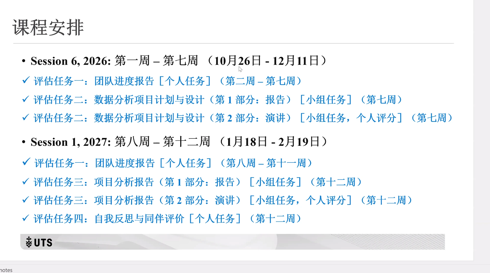
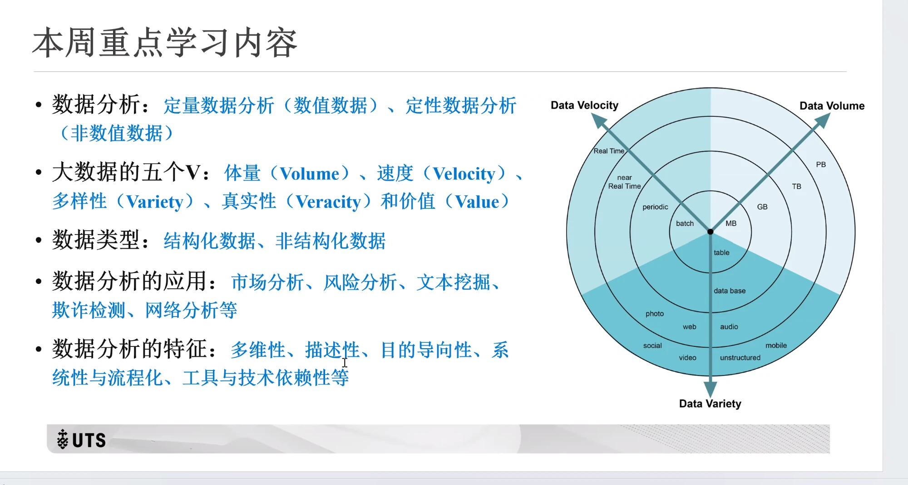
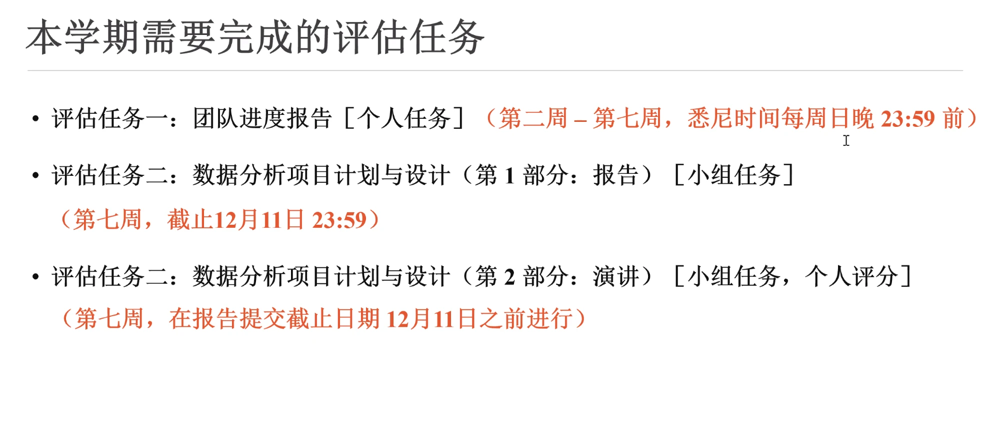
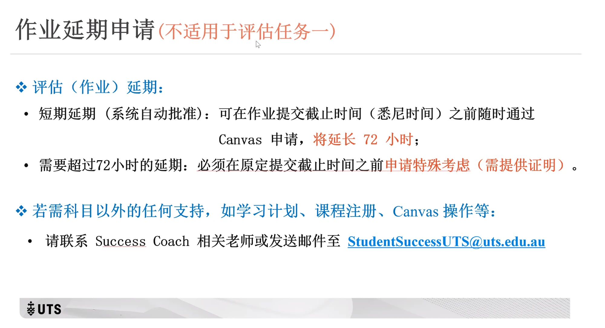
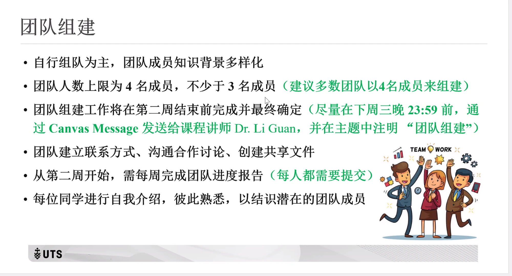
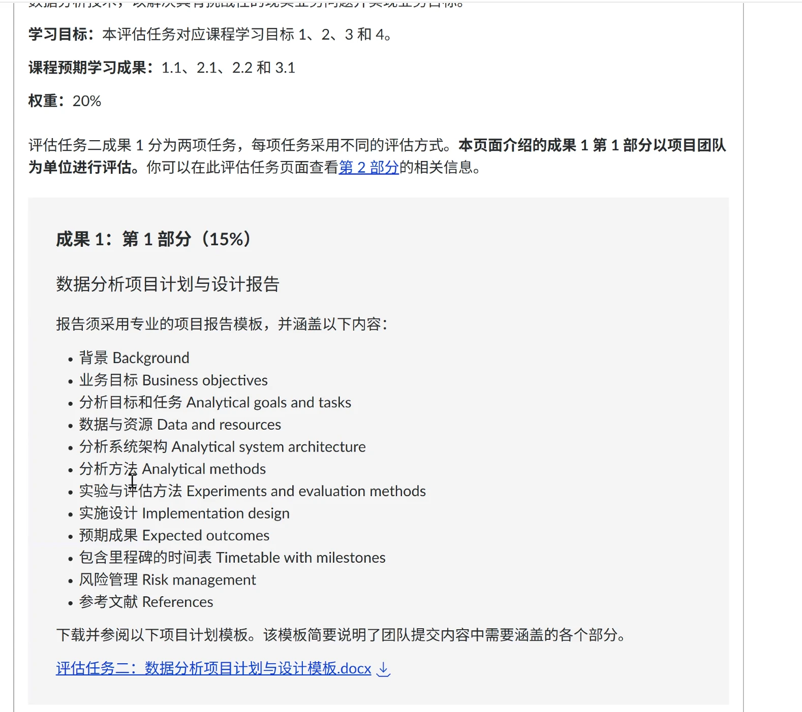

# 91 ｜上課紀錄(每場 Zoom)

> 每場 Zoom 的投影片、老師口述重點都記在這裡,依日期排。老師講的規則若和 Canvas 不同,另外寫進 [README §5](../README.md)。
> 截圖放在 [`zoom/`](zoom/)。

---

## 2026-10-29(四)第 1 次 Zoom —— 組隊工作坊

### 投影片:課程安排

**投影片內容**(原文簡體,轉繁體):

- **Session 6, 2026:第一週 – 第七週(10 月 26 日 – 12 月 11 日)**
  - 評估任務一:團隊進度報告[個人任務](第二週 – 第七週)
  - 評估任務二:數據分析項目計劃與設計(第 1 部分:報告)[小組任務](第七週)
  - 評估任務二:數據分析項目計劃與設計(第 2 部分:演講)[小組任務,個人評分](第七週)
- **Session 1, 2027:第八週 – 第十二週(1 月 18 日 – 2 月 19 日)**
  - 評估任務一:團隊進度報告[個人任務](第八週 – 第十一週)
  - 評估任務三:項目分析報告(第 1 部分:報告)[小組任務](第十二週)
  - 評估任務三:項目分析報告(第 2 部分:演講)[小組任務,個人評分](第十二週)
  - 評估任務四:自我反思與同伴評價[個人任務](第十二週)

**和已知資料對照**:
- ✅ 全部對得上:AT2 12/11 截止、AT3/AT4 2/19 截止、週報第 2–11 週〔README §1.1〕。
- 🆕 **課程跨兩個學期**:前半段算 Session 6, 2026(到 12/11),後半段算 Session 1, 2027(1/18 起)。Canvas 只寫 Session 6 2026。
- 🆕 投影片把 AT3 第 2 部分寫成「演講」;Canvas 作業名稱是「項目展示幻燈片／材料」〔Canvas AT3〕。內容一樣都是第 12 週上台。
- 週報拆成兩段:第 2–7 週 6 份、第 8–11 週 4 份,合計 10 份,和 README §2.1 一致。

### 投影片:本週重點學習內容(第 1 週)

**投影片內容**(轉繁體):

- **數據分析**:定量數據分析(數值數據)、定性數據分析(非數值數據)
- **大數據的五個 V**:體量(Volume)、速度(Velocity)、多樣性(Variety)、真實性(Veracity)、價值(Value)
- **數據類型**:結構化數據、非結構化數據
- **數據分析的應用**:市場分析、風險分析、文本挖掘、欺詐檢測、網絡分析等
- **數據分析的特徵**:多維性、描述性、目的導向性、系統性與流程化、工具與技術依賴性等
- 右圖:3V 同心圓 —— Data Velocity(batch → periodic → near real time → real time)、Data Volume(MB → GB → TB → PB)、Data Variety(table → database → photo/web/audio/social/video/mobile → unstructured)

**和已知資料對照**:
- ✅ 定量/定性、5V、結構化/非結構化、應用:Canvas 單元一 1.1–1.4 都有〔11 §3–§6〕。Canvas 1.4 列 6 種應用,多一個「智能查詢回答」〔11 §6〕。右圖和 1.2 頁的圖相同,一樣只畫 3 個 V〔materials/images/images_unit1〕。
- 🆕 **「數據分析的特徵」5 點是投影片才有的**:Canvas 1.5 頁只有一題意見調查(6 句敘述讓你選),沒有列這 5 個特徵〔11 §7〕。老師講課的重點常會變成評分時看的觀念,先記下來。

### 投影片:本學期需要完成的評估任務

**投影片內容**(轉繁體):

- 評估任務一:團隊進度報告[個人任務](**第二週 – 第七週,悉尼時間每週日晚 23:59 前**)
- 評估任務二:數據分析項目計劃與設計(第 1 部分:報告)[小組任務](**第七週,截止 12 月 11 日 23:59**)
- 評估任務二:數據分析項目計劃與設計(第 2 部分:演講)[小組任務,個人評分](**第七週,在報告提交截止日期 12 月 11 日之前進行**)

**和已知資料對照**:
- ✅ 全部對得上。老師明講是**悉尼時間** → 台灣每週日 **20:59**、AT2 報告 12/11(五)**20:59**〔README §1.1〕。
- ✅ 簡報確定排在 12/11 **之前**(第 7 週 12/7–12/10 之間),所以報告最晚 12/6 要先完成大部分〔03 §4〕。

### 投影片:作業延期申請(不適用於評估任務一)

**投影片內容**(轉繁體):

- **評估(作業)延期**:
  - 短期延期(系統自動批准):可在作業提交截止時間(悉尼時間)之前隨時通過 Canvas 申請,**將延長 72 小時**;
  - 需要超過 72 小時的延期:必須在原定提交截止時間之前**申請特殊考量(需提供證明)**。
- **若需科目以外的任何支持**(學習計劃、課程註冊、Canvas 操作等):請聯繫 Success Coach 相關老師或發送郵件至 StudentSuccessUTS@uts.edu.au

**和已知資料對照**:
- 🆕 **延期「不適用於評估任務一」**(標題寫的)→ **週報不能延期**。之前 03 §2.6 只是推論「週報遲了當 0 分」,現在老師確認了。README §2.1、03 §2.6 已更新。
- ✅ 72 小時自動延期、超過要申請特殊考量:和課程導學「CinLearn 重要指引」頁一致〔materials/canvas_embeds/00_03〕。
- 🆕 課外支援信箱:StudentSuccessUTS@uts.edu.au(選課、學習計畫、Canvas 操作問題)。

### 投影片:團隊組建 ⭐(規則有更新)

**投影片內容**(轉繁體):

- 自行組隊為主,團隊成員知識背景多樣化
- 團隊人數**上限為 4 名成員,不少於 3 名成員**(建議多數團隊以 4 名成員來組建)
- 團隊組建工作將在第二週結束前完成並最終確定(**盡量在下週三晚 23:59 前,通過 Canvas Message 發送給課程講師 Dr. Li Guan,並在主題中註明「團隊組建」**)
- 團隊建立聯繫方式、溝通合作討論、創建共享文件
- 從第二週開始,需每週完成團隊進度報告(**每人都需要提交**)
- 每位同學進行自我介紹,彼此熟悉,以結識潛在的團隊成員

**和已知資料對照**:
- 🆕 **3 人隊不用另外申請了**:Canvas 團隊組建頁寫 3 人隊要 email 課程負責人申請;投影片直接寫「3–4 人」,建議 4 人 → README §5 #7 改為已解決。
- 🆕 **組好隊要寫信通知老師,期限是下週三 11/4**:用 Canvas Message 寄給 Dr. Li Guan,主旨寫「團隊組建」。Canvas 頁原本的說法是 10/30(五)前到「人員 → 小組」按 Join → 以老師最新的投影片為準。時區沒寫;老師其他截止日都用雪梨時間 → 保險當作**台灣 11/4(三)20:59**。
- ✅ 第 2 週結束前定案、每人都要交週報:和 Canvas 一致。

### 畫面:老師展示 AT2 第 1 部分作業頁(Canvas)

- 內容和 Canvas 作業頁一樣(已收錄在 [`assessments/_Canvas原文_AT1-AT4_2026-10-22.md`](../assessments/_Canvas原文_AT1-AT4_2026-10-22.md)):12 項內容、範本下載。
- ⚠️ 畫面上仍是「權重:20%」配「成果 1:第 1 部分(15%)」→ README §5 #1 的矛盾還在;Zoom 上可以直接問。
