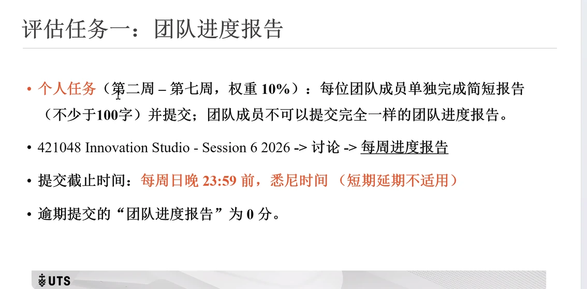

# 91 ｜上課紀錄(每場 Zoom)

> 每場 Zoom 的投影片、老師口述重點都記在這裡,依日期排。老師講的規則若和 Canvas 不同,另外寫進 [README §5](../README.md)。
> 截圖放在 [`zoom/`](zoom/)。

---

## 2026-10-29(四)第 1 次 Zoom —— 組隊工作坊

### 投影片:課程安排

**投影片內容**(原文簡體,轉繁體):

- **Session 6, 2026:第一週 – 第七週(10 月 26 日 – 12 月 11 日)**
  - 評估任務一:團隊進度報告[個人任務](第二週 – 第七週)
  - 評估任務二:數據分析項目計劃與設計(第 1 部分:報告)[小組任務](第七週)
  - 評估任務二:數據分析項目計劃與設計(第 2 部分:演講)[小組任務,個人評分](第七週)
- **Session 1, 2027:第八週 – 第十二週(1 月 18 日 – 2 月 19 日)**
  - 評估任務一:團隊進度報告[個人任務](第八週 – 第十一週)
  - 評估任務三:項目分析報告(第 1 部分:報告)[小組任務](第十二週)
  - 評估任務三:項目分析報告(第 2 部分:演講)[小組任務,個人評分](第十二週)
  - 評估任務四:自我反思與同伴評價[個人任務](第十二週)

**和已知資料對照**:
- ✅ 全部對得上:AT2 12/11 截止、AT3/AT4 2/19 截止、週報第 2–11 週〔README §1.1〕。
- 🆕 **課程跨兩個學期**:前半段算 Session 6, 2026(到 12/11),後半段算 Session 1, 2027(1/18 起)。Canvas 只寫 Session 6 2026。
- 🆕 投影片把 AT3 第 2 部分寫成「演講」;Canvas 作業名稱是「項目展示幻燈片／材料」〔Canvas AT3〕。內容一樣都是第 12 週上台。
- 週報拆成兩段:第 2–7 週 6 份、第 8–11 週 4 份,合計 10 份,和 README §2.1 一致。

### 投影片:本週重點學習內容(第 1 週)

**投影片內容**(轉繁體):

- **數據分析**:定量數據分析(數值數據)、定性數據分析(非數值數據)
- **大數據的五個 V**:體量(Volume)、速度(Velocity)、多樣性(Variety)、真實性(Veracity)、價值(Value)
- **數據類型**:結構化數據、非結構化數據
- **數據分析的應用**:市場分析、風險分析、文本挖掘、欺詐檢測、網絡分析等
- **數據分析的特徵**:多維性、描述性、目的導向性、系統性與流程化、工具與技術依賴性等
- 右圖:3V 同心圓 —— Data Velocity(batch → periodic → near real time → real time)、Data Volume(MB → GB → TB → PB)、Data Variety(table → database → photo/web/audio/social/video/mobile → unstructured)

**和已知資料對照**:
- ✅ 定量/定性、5V、結構化/非結構化、應用:Canvas 單元一 1.1–1.4 都有〔11 §3–§6〕。Canvas 1.4 列 6 種應用,多一個「智能查詢回答」〔11 §6〕。右圖和 1.2 頁的圖相同,一樣只畫 3 個 V〔materials/images/images_unit1〕。
- 🆕 **「數據分析的特徵」5 點是投影片才有的**:Canvas 1.5 頁只有一題意見調查(6 句敘述讓你選),沒有列這 5 個特徵〔11 §7〕。老師講課的重點常會變成評分時看的觀念,先記下來。

### 投影片:本學期需要完成的評估任務

**投影片內容**(轉繁體):

- 評估任務一:團隊進度報告[個人任務](**第二週 – 第七週,悉尼時間每週日晚 23:59 前**)
- 評估任務二:數據分析項目計劃與設計(第 1 部分:報告)[小組任務](**第七週,截止 12 月 11 日 23:59**)
- 評估任務二:數據分析項目計劃與設計(第 2 部分:演講)[小組任務,個人評分](**第七週,在報告提交截止日期 12 月 11 日之前進行**)

**和已知資料對照**:
- ✅ 全部對得上。老師明講是**悉尼時間** → 台灣每週日 **20:59**、AT2 報告 12/11(五)**20:59**〔README §1.1〕。
- ✅ 簡報確定排在 12/11 **之前**(第 7 週 12/7–12/10 之間),所以報告最晚 12/6 要先完成大部分〔03 §4〕。

### 投影片:作業延期申請(不適用於評估任務一)

**投影片內容**(轉繁體):

- **評估(作業)延期**:
  - 短期延期(系統自動批准):可在作業提交截止時間(悉尼時間)之前隨時通過 Canvas 申請,**將延長 72 小時**;
  - 需要超過 72 小時的延期:必須在原定提交截止時間之前**申請特殊考量(需提供證明)**。
- **若需科目以外的任何支持**(學習計劃、課程註冊、Canvas 操作等):請聯繫 Success Coach 相關老師或發送郵件至 StudentSuccessUTS@uts.edu.au

**和已知資料對照**:
- 🆕 **延期「不適用於評估任務一」**(標題寫的)→ **週報不能延期**。之前 03 §2.6 只是推論「週報遲了當 0 分」,現在老師確認了。README §2.1、03 §2.6 已更新。
- ✅ 72 小時自動延期、超過要申請特殊考量:和課程導學「CinLearn 重要指引」頁一致〔materials/canvas_embeds/00_03〕。
- 🆕 課外支援信箱:StudentSuccessUTS@uts.edu.au(選課、學習計畫、Canvas 操作問題)。

### 投影片:團隊組建 ⭐(規則有更新)

**投影片內容**(轉繁體):

- 自行組隊為主,團隊成員知識背景多樣化
- 團隊人數**上限為 4 名成員,不少於 3 名成員**(建議多數團隊以 4 名成員來組建)
- 團隊組建工作將在第二週結束前完成並最終確定(**盡量在下週三晚 23:59 前,通過 Canvas Message 發送給課程講師 Dr. Li Guan,並在主題中註明「團隊組建」**)
- 團隊建立聯繫方式、溝通合作討論、創建共享文件
- 從第二週開始,需每週完成團隊進度報告(**每人都需要提交**)
- 每位同學進行自我介紹,彼此熟悉,以結識潛在的團隊成員

**和已知資料對照**:
- 🆕 **3 人隊不用另外申請了**:Canvas 團隊組建頁寫 3 人隊要 email 課程負責人申請;投影片直接寫「3–4 人」,建議 4 人 → README §5 #7 改為已解決。
- 🆕 **組好隊要寫信通知老師,期限是下週三 11/4**:用 Canvas Message 寄給 Dr. Li Guan,主旨寫「團隊組建」。Canvas 頁原本的說法是 10/30(五)前到「人員 → 小組」按 Join → 以老師最新的投影片為準。時區沒寫;老師其他截止日都用雪梨時間 → 保險當作**台灣 11/4(三)20:59**。
- ✅ 第 2 週結束前定案、每人都要交週報:和 Canvas 一致。

### 畫面:老師展示 AT2 第 1 部分作業頁(Canvas)

- 內容和 Canvas 作業頁一樣(已收錄在 [`assessments/_Canvas原文_AT1-AT4_2026-10-22.md`](../assessments/_Canvas原文_AT1-AT4_2026-10-22.md)):12 項內容、範本下載。
- ⚠️ 畫面上仍是「權重:20%」配「成果 1:第 1 部分(15%)」→ README §5 #1 的矛盾還在;Zoom 上可以直接問。

### 老師口述重點(Kenny 11/4 貼的 10/29 Zoom 逐字稿＋聊天室;原文含同學姓名與聯絡方式,不存進 repo)

**課程安排**
- 課程分兩段:第 1–7 週(10/26–12/11)、第 8–12 週(2027/1/18–2/19),中間是期中休假。
- ⚠️ **下學期(Session 1, 2027)要不要重新註冊,老師也不確定,請學生自己查。**
- 第 6、7 週的單元還在最後核對與審查,之後兩週會陸續開放。第 6 週 = 分析系統架構與方法選擇;第 7 週 = 向利害關係人溝通(演講)。
- 全班 34 人(當晚線上 21 人)。建議多數隊伍 4 人,理想是 7 隊 4 人＋2 隊 3 人。

**AT1 週報**
- **每個人自己發**,不是隊長代發。發在自己隊的小組討論區:每週進度報告 → 小組討論 → 選自己的項目團隊 → 回覆發帖。
- 每週日雪梨 23:59 截止。**當週要交當週的;遲交、下週才補、一次補好幾週,都不給分。** 不能延期。
- 至少 100 字;內容沒問題「基本上交了都會給分」,但要準時。
- 寫什麼:團隊溝通、協調個人進度、學習體驗、項目進展、團隊協作、個人貢獻。還沒輪到自己的工作也可以寫:怎麼討論定業務問題、團隊分工、你在團隊裡的角色、遇到什麼問題、怎麼解決。同學說「基本就是留痕記錄、佐證一下」,老師同意。
- Canvas 上 AT1 顯示「截止 2/14」是最後一週(第 11 週)那篇的截止日。

**AT2 計畫(30%)**
- 報告:以小組為單位,**12/11(五)雪梨 23:59** 截止;照範本的 12 項寫;範本只有提綱,沒有範例內容。
- 演講:小組一起上台,每人分一段講,**每個人分開評分**;整隊最多 15 分鐘;問答時指定某人就只能那人答,問全隊就誰都可以答。
- 🆕 **演講用的 PPT 也要上傳,和報告一起 12/11 交** → 解決了 README §5「第 2 部分上傳框要交什麼」。
- 🆕 **演講最好排在第 7 週的週三、週四**,因為報告要補上演講收到的回饋。時段之後再討論。
- 「可供使用的截止日期 12/18」是系統關閉時間:12/11 之後 7 天內還能交,但**每晚一天扣 5%**,最多扣 35%;超過 7 天 0 分、系統關閉。
- AT2 只是計畫,不用做出具體產品。老師會問課程負責人能不能分享以前學生的範例。

**AT3 成果(40%)**
- 建立在 AT2 的項目上:AT2 定好的業務問題,AT3 落實成分析解決方案。
- ⚠️ **「系統」要做到什麼程度,老師也不確定**:她的理解是可以是**系統原型(prototype)或機器學習模型**,不一定要真正的系統。她會問課程負責人(subject coordinator)後再說明。同學指出 AT3 展示評分有「系統運行流暢、界面專業友好」20%。
- 第 8 週起學分析解決方案開發、超參數調優;第 10–11 週學評估與部署。

**題目與資料**
- 題目由隊伍自己討論決定,老師不指定。
- 資料可以用:①工作上**不涉密**的實際項目資料;②拿不到就用 Kaggle 這類資料網站;③自己設定一個**假設項目**,提供足夠背景和資料。

**組隊**
- 自行組隊為主,背景要多元。同學整理成三個方向:商業需求、項目管理協調、技術實現。
- 🆕 組好後**派一個代表**寄給老師就好,**Email 或 Canvas 訊息都可以**,主旨寫「團隊組建」,列出全部成員。盡量 11/4(三)晚上 12 點前。(10/29 公告寫的是 Email:Li.Guan@uts.edu.au)
- 老師在 Canvas 建了 11 個項目小組(每組上限 4 人);隊伍可以自己加入一個項目團隊,也可以寄信請老師放。
- 11/5(四)老師會統一看誰還沒組隊,依背景分配,當晚 Zoom 說明;最晚週四或週五上午定案。
- 有同學建了全班組隊微信群。Kenny 在聊天室留了自我介紹(擅長項目管理、測試開發、錯誤分析)和微信。

**其他**
- 短期延期:Canvas 申請,自動批准,延 72 小時;超過要申請特殊考量並附證明;**AT1 不能延期**。
- 課程問題:寄老師 Email 或 Canvas 訊息都收得到;課外問題(選課、學習計畫、Canvas 操作)寄 StudentSuccessUTS@uts.edu.au。
- Zoom 有錄影;老師 Email 在課程導學「教學團隊」頁。

---

## 2026-11-05(四)第 2 次 Zoom —— 專案諮詢

> 來源:①Kenny 當晚 20:14 起邊上課邊貼的投影片截圖;②Kenny 課後貼的 Zoom 雲端錄影自動逐字稿＋聊天室(約 1 小時 27 分)。投影片上的規則(週報不能一樣、逾期 0 分、第 4 週結束前選簡報時段)老師課上都講到了 → 確認是 Zoom 2 的投影片。
> 逐字稿是機器轉的、有錯字,又含同學姓名 → 原文只放本機 `private/zoom2_2026-11-05_逐字稿與聊天室.md`(不進版控)。下面〔L數字〕是那份檔案的行號。

### 投影片:評估任務一:團隊進度報告

**投影片內容**(原文簡體,轉繁體):

- **個人任務(第二週 – 第七週,權重 10%)**:每位團隊成員單獨完成簡短報告(不少於 100 字)並提交;**團隊成員不可以提交完全一樣的團隊進度報告。**
- 421048 Innovation Studio - Session 6 2026 → 討論 → 每週進度報告
- **提交截止時間:每週日晚 23:59 前,悉尼時間(短期延期不適用)**
- **逾期提交的「團隊進度報告」為 0 分。**

**和已知資料對照**:
- 🆕 **隊友之間的週報不能完全一樣**:以前只知道「每個人自己發」〔10/29 Zoom 1〕,現在明講內容不能一樣 → 格式可以一樣,內容寫自己這週做的事。
- 🆕 **遲交 0 分有書面了**:10/29 是老師口述(「當週交當週,遲交不給分」),現在寫在投影片上。
- ✅ 至少 100 字、每週日雪梨 23:59(台灣 20:59)、不能延期:和 Zoom 1 投影片、Canvas 一致。
- ℹ️ 「第二週 – 第七週」只是 Session 6, 2026 這一段:Zoom 1 課程安排投影片把週報拆成第 2–7 週、第 8–11 週;Canvas 評分表和 Subject Outline 都寫第 2–11 週、共 10 份、每份 1 分 → **2027 年第 8–11 週(1/24–2/14)還是要交**。這頁把「權重 10%」寫在「第二週 – 第七週」旁邊,看起來像前 6 份就佔 10%;照 Subject Outline 和 Canvas 評分表(10 份共 10%),做法不變。

### 投影片:評估任務二:數據分析項目計劃與設計

(截圖是上課中途傳的,沒有存到本機,只記文字。)

**投影片內容**(轉繁體):

- **第 1 部分:報告[小組任務](權重 20%)**:提交截止時間:第七週星期五,12 月 11 日 23:59 前,悉尼時間
- **第 2 部分:演講[小組任務,個人評分](權重 20%)**
  - 小組演講截止時間:第七週週中舉行,在報告提交截止日期 12 月 11 日之前進行
  - 小組演講時間安排:**將在第四週結束時完成時間安排的選擇**

**和已知資料對照**:
- 🆕 **簡報時段在第 4 週結束前選好**(第 4 週 = 11/16–11/22 → **11/22(日)前**;怎麼選沒寫)。以前只知道「時段另排、老師建議週三週四」〔10/29 Zoom 1〕。→ 第 4 週前全隊先對好第 7 週週三、週四(12/9、12/10)誰能上;時段確定後,Kenny 馬上向公司請假。
- ⚠️ **權重又寫「各 20%」**:Subject Outline 寫第 1 部分 15%、第 2 部分 15%,AT2 共 30%〔`refs/421048_Subject_Information_2026S6.txt` 第 121、153、185 行〕;Canvas 作業組也是 30%。各 20% 的話總分會變 110%(10 + 40 + 40 + 20)→ **仍照 15% + 15%**;README §5 #1 還沒解決,要問老師(不影響做法:兩部分都要做)。
- ✅ 報告 12/11(五)雪梨 23:59(台灣 20:59)、演講在報告截止前的第 7 週週中:和 Zoom 1 一致。

### 老師口述重點(11/5 逐字稿＋聊天室)

**題目(業務問題)**
- 🆕 **最晚第 3 週結束前(11/15 日)要定,越早越好**,因為 AT2 第 7 週就要交〔L62–64〕→ 第 1 次組會要問的「題目一定要週日前定嗎」有答案了:**不用這週日 11/8 就定,但最晚 11/15**〔[92](92_組會紀錄.md)〕。
- 題目沒有限制,什麼都可以選〔L48、L540〕(有同學原本以為是出租車行業〔L543〕)。✅ 和 10/29 一致。
- 兩種選法:①工作上遇到的實際問題,資料敏感就先做模擬或脫敏處理〔L50–56〕;②有興趣的方向,用 Kaggle 這類公開資料,或自己假設一個業務場景〔L57–62〕。資料量不用到大數據,但不能太少〔L64–67〕。
- 原則是**先定業務問題**(描述性還是預測性分析、怎麼轉成數據分析問題),再找資料〔L346–355、L532〕;🆕 但以完成作業來說,也可以先找資料、再定業務問題〔L381、L442〕。
- 🆕 拿不到資料可以**用模擬工具生成**,不要手動填〔L408–420、L533〕;也可以用 AI 生成,但提示詞要概括、不要帶很強的假設〔L486–488〕。這點是 **Kenny 在課上提的**:提示詞先預設了結論,AI 會從答案倒推資料,分析就變得太簡單、不是老師要看的〔L447–485〕。
- 政府統計局、國際組織的公開資料也可以〔L515–517〕。

**AT1 週報**
- ✅ 和投影片、Zoom 1 一致:個人任務、10%、不能和隊友一樣、至少 100 字、週日雪梨 23:59、不能短期延期、逾期 0 分(例:週一才交上週的也是 0 分)、第 2–11 週共 10 份〔L165–212〕。生病等特殊情況,要附證明申請長期延期(特殊考量)〔L210–212〕。
- 標題寫「第二週進度報告」「第三週進度報告」……〔L187–188〕;另外,小組討論區說明頁(11/4 讀,不是這次逐字稿)的官方格式是「第 # 周进度报告 - 学号」〔[06 骨架 B2](06_第2週準備與AT1週報.md)〕→ B3 標題不用改。
- 🆕 沒有統一格式,寫:自己在團隊的職責、過去一週為項目做的事、遇到的問題和怎麼解決(或正在解決)、下週要做什麼〔L189–194〕。
- 🆕 第 2–7 週寫 AT2(計畫)的進度,第 8–11 週寫 AT3 的進度〔L300–310〕;組會討論的內容(做什麼、怎麼做、誰負責、什麼時候完成、順序、資源)都可以寫進週報〔L139–143〕。

**AT2**
- ✅ 報告每組交一份,**指定一位組員上傳**〔L248〕;第 7 週週五 12/11 雪梨 23:59;PDF,照作業頁的命名規則〔L568–569〕。
- 🆕 **嚴格照範本的框架寫**〔L574〕:封面(項目組編號、全部組員姓名、提交日期、學期和年份)、目錄(要有頁碼,標題可以編號)、管理層摘要、引言、項目方案……結論、參考文獻、附錄(有才放)〔L574–597〕→ [03 §6](03_注意事項.md) 第 20 題(範本和 Canvas 12 項照哪個)= **照範本**。
- 🆕 **報告可以全中文**,目錄和正文都不用英文〔L593–597〕。繁體可不可以沒講。
- 🆕 老師說 AT2、AT3 **應該不會**提供以前學生的範例,照範本寫〔L583–584〕(10/29 她說會去問)。
- 演講:
  - 🆕 **Zoom 線上直播,不能交錄好的影片**;老師會錄影存檔;和每週的 Zoom 課分開,另外排時段;用 PPT 分享螢幕講〔L546–564〕。
  - 🆕 每組時段**暫定約半小時**(含緩衝)〔L255–257〕;怎麼拆(講多久、問答多久)沒講。推論和 Canvas「簡報最多 15 分鐘,問答另計」不衝突:半小時是整個時段。
  - ✅ 每人主要講自己完成的部分,整體要連貫有邏輯;**按個人表現評分**〔L257–259〕;PPT 也指定一人上傳〔L254〕,和報告同一天截止〔L220–221〕;要在報告截止前講完,因為報告要寫進演講收到的回饋〔L547–548〕。
  - ✅ 時段第 4 週結束前選好〔L549〕(投影片也寫);老師會給幾個時段選,可能全班同一時段,也可能各組自己選〔L555–556〕;可以提前兩週安排時間〔L614〕。
  - 🆕 老師提議把第 7 週週四(12/10)的 Zoom 課提前(例如週一或週二晚上),讓週三、週四可以排演講;還要再討論〔L550–554〕。
  - 🆕 **演講也不能申請短期延期**(和週報一樣)〔L612〕→ [03 §2.6](03_注意事項.md) 的推論確認了。
- ✅ AT2、AT3 是同一個業務問題:AT2 是計畫和設計報告,AT3 是做完的項目報告〔L599–606〕。

**延期**
- ✅ 短期延期:截止前在 Canvas 自己申請,自動延 72 小時〔L611〕。老師只點名排除**週報**和**演講**〔L612〕,沒提報告 → AT2 報告應該可以申請(推論;課程導學的規則只排除測驗、課堂評估、考試〔[03 §2.6](03_注意事項.md)〕)。
- ✅ 超過 72 小時:截止前向學生中心申請特殊考量,要附證明,由學生中心看證明決定〔L615–618〕。

**第 2 週內容(老師複習)**
- CRISP-DM 六階段、敏捷方法(缺點:需求一直變、範圍蔓延)、總體目標與具體目標、可交付成果、利害關係人(依關注程度×影響力分類)、成功標準(業務面、技術面)、項目規劃(做什麼、怎麼做、誰負責、何時完成、順序、資源)→ ✅ 都在 [11](11_單元一_整合筆記.md)。
- 🆕 **AT2 主要涉及「技術目標類」可交付成果**(設計報告 → 概念驗證 → 原型 → 可部署組件),「研究目標類」(文獻綜述、研究論文)不涉及〔L100–106〕。
- 🆕 **1.12 目標設定活動不計分**,但建議每人都貼;前提是業務問題先定好,之後全隊一起定最終目標〔L146–156〕。
- 第 3 週:企業數據科學與分析方法論;第 4、5 週:數據分析與機器學習技術概述(一)(二)〔L159–163〕→ ✅ 和 README §1.2 一致。

**團隊活動(老師建議)**
- 定一個大家都習慣的溝通平台(微信、Teams 都可以)〔L35–38〕;建共享文件一起寫〔L41–42〕→ ✅ Zoom 1 投影片也寫。
- 🆕 第 2–7 週**每週開一次組會**,最好視訊〔L19、L39〕;小組要有**工作日誌/會議紀錄**,之後查問題、找溝通紀錄比較容易〔L43–45〕(我們的 [92](92_組會紀錄.md) 就是)。
- 🆕 每組**至少一人參加每週 Zoom**,回組裡更新〔L25–26〕;沒來的人要看 Canvas 每週公告〔L626〕。
- 全班 9 個小組:項目團隊 1–8 各 4 人,項目團隊 9 暫定 2 人〔L33–34〕。

**聊天室**
- 07:42 聊天室有一位同學說「昨天我們組內先會議溝通了一下」〔L646〕。他是我們隊負責開發的隊友(身分是對照 Canvas 項目團隊#5 名單和 Kenny 11/4 告知的分工,對照表在 private/;逐字稿本身看不出)→ **第 1 次組會是 11/4**,[92](92_組會紀錄.md) 推定的日期確認了。
- 同學問的(老師都答了,上面已記):Kaggle 找資料、AT2/AT3 是不是同一題、演講要不要做成影片、PDF、作者寫誰、要不要中英文。

**提問清單對照**([03 §6](03_注意事項.md)、[06 §4](06_第2週準備與AT1週報.md))
- ✅ 有答案:第 15 題(示範提案)→ 課上沒有講示範提案(逐字稿沒出現),老師說應該不會有以前學生的範例,看範本;第 20 題 → 照範本;第 24 題 → 週報和演講都不能短期延期;第 26 題 → 上傳 PPT,指定一人。
- 部分答案:第 16 題、06 第 4 題(時段)→ 第 4 週結束前選、每組暫定約半小時、可能排週三週四;第 5 題(公司資料)→ 敏感資料先模擬或脫敏處理。
- ❌ 還沒答案:★ 繁體中文(只說「中文就可以、不用英文」)、★ 生成式 AI 寫程式寫報告要不要標註(只講了用 AI 生成資料)、★ 字數怎麼算、AT2 權重 20% 還是 15%([README §5](../README.md) #1)→ 11/12 Zoom 3 前貼「Zoom 會議」討論區,或寄信問老師(老師說課程問題都可以寄信〔L621〕)。
