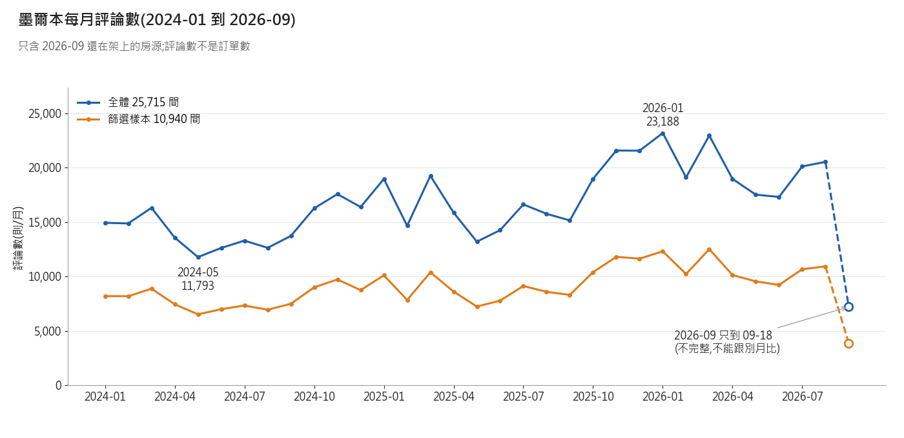
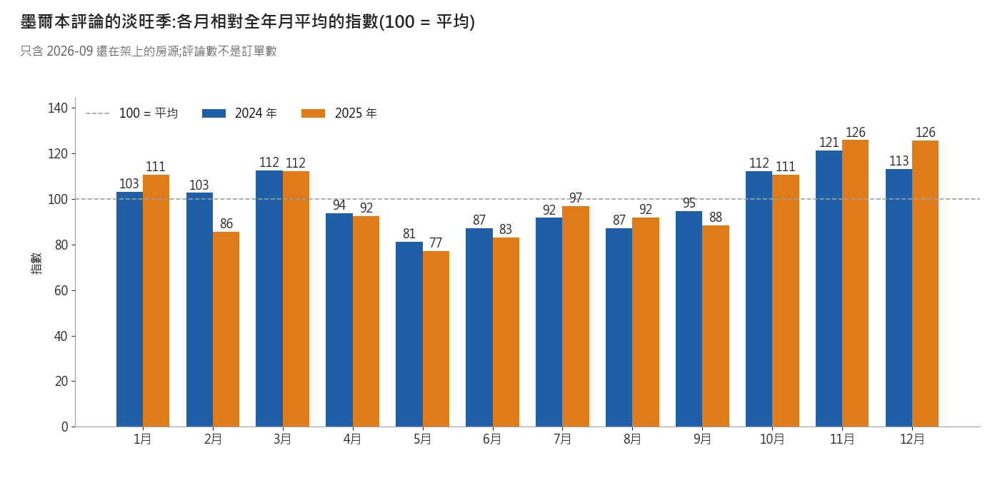
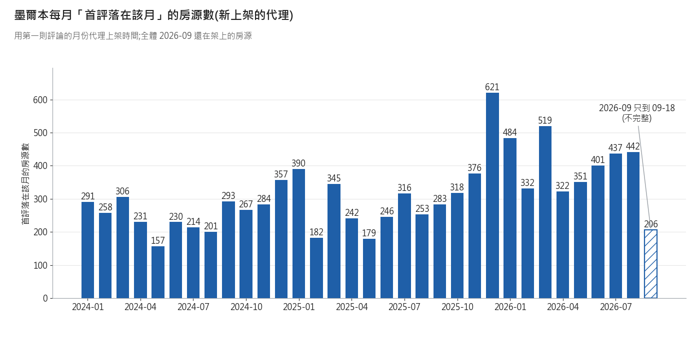

# 墨爾本 2024–2026:手上這批看得到什麼(2026-11-11)

**結論:這批看得到「現在還在架上的房源」在 2024-01 到 2026-09 留下的評論量、淡旺季、新上架代理;看不到當時的價格、已下架的房源、真實訂單與入住率。**

資料:Inside Airbnb 墨爾本 2026-09-16 批。listings 25,715 列;篩選樣本 10,940(整套 / 1–2 房 / 2–4 人 / 最低 1–7 晚);其中有價 8,223。評論檔最後一則是 2026-09-18,所以 2026 年只到 9 月 18 日。

## 1. 每年總覽
結論:評論量 2025 年比 2024 年 +18.3%;2026 年 1–8 月比 2025 年 1–8 月 +24.2%(只含還在架上的房源,早年被低估,成長率會偏高)。

| 年 | 評論數 全體 | 評論數 篩選樣本 | 有評論的房源 全體 | 有評論的房源 篩選 | 首評落在當年 全體 | 首評落在當年 篩選 |
|---|---|---|---|---|---|---|
| 2024 | 174,079 | 95,581 | 10,005 | 4,831 | 3,089 | 1,413 |
| 2025 | 205,936 | 111,933 | 12,806 | 6,229 | 3,751 | 1,751 |
| 2026(到 09-18) | 166,957 | 89,511 | 14,869 | 7,233 | 3,494 | 1,551 |
| 2024 起累計 | 546,972 | 297,025 | | | | |

**對賬:過。** 2024 年評論數 174,079 = 11/07 記錄 174,079;2024 起累計 546,972 = 546,972(差 0)。
評論檔 1,042,226 列,有日期 1,042,226 列(11/07 記錄 1,042,226);評論對不到 listings 的有 0 則。「全體」= 評論檔全部;「篩選」= 房源在篩選樣本 10,940 間內。「有評論的房源」只算 listings 檔裡有的房源。

## 2. 每月走勢
結論:評論逐年墊高;最多的月份都在近年,最少的月份是 2024-05 前後(只看 2024-01 到 2026-08 完整月份)。

| 排名 | 評論最多的 3 個月(全體) | 評論最少的 3 個月(全體) |
|---|---|---|
| 1 | 2026-01:23,188 | 2024-05:11,793 |
| 2 | 2026-03:22,955 | 2024-06:12,628 |
| 3 | 2025-11:21,582 | 2024-08:12,643 |
2026-09 只到 09-18,不參與排名。

## 3. 淡旺季
結論:兩年平均來看,偏高的是 11月、12月、3月;偏低的是 5月、6月、8月;2024 和 2025 的各月指數相關係數 0.89,形狀很像。

注意:每年評論量本來就在長,後半年的指數會被墊高一點;評論是住完才寫,評論的高峰會比入住晚一些。所以這是「評論的淡旺季」,不等於「入住的淡旺季」。

## 4. 新上架(首評月份代理)
結論:首評落在當年的房源,2024 年 3,089 間、2025 年 3,751 間、2026 年到 09-18 3,494 間(全體;早年已下架的房源不在內,數字偏低)。

對照已知的「首評在最近 12 個月內 = 2,056」:那是「篩選且有價 8,223」的子集。我這裡的年度表是「全體」與「篩選(不限有價)」,分母不同,數字不能直接比。用同一截止日 2025-09-18(含)重算:

| 口徑 | 首評在近 12 個月內的房源數 |
|---|---|
| 全體 25,715(評論檔最早日期) | 4,975 |
| 篩選 10,940(評論檔最早日期) | 2,231 |
| 篩選且有價 8,223(評論檔最早日期) | 2,056 |
| 篩選且有價 8,223(listings 的 first_review 欄) | 2,056 |

最後一列對上 2,056。評論檔與 listings 欄的首評日不同的有 0 間;篩選且有價裡一則評論都沒有的有 816 間(不算新上架)。

## 5. 現在這一期的價格(只有 2026-09,不是歷史)
結論:篩選且有價 8,223 間,掛牌價 p25 / 中位 / p75 = 209 / 264 / 334.5(當地幣別,每晚,掛牌價不是成交價)。

| 區(neighbourhood_cleansed) | 房源數 | 掛牌價中位數 |
|---|---|---|
| Melbourne | 3,487 | 269 |
| Port Phillip | 1,062 | 267.75 |
| Yarra | 674 | 286.5 |
| Stonnington | 478 | 261.75 |
| Yarra Ranges | 465 | 310 |
| Moreland | 228 | 251.75 |
| Whitehorse | 169 | 238 |
| Boroondara | 150 | 263.25 |
| Darebin | 137 | 207.46 |
| Maribyrnong | 136 | 229.25 |

## 6. 看不到的事
| 看不到什麼 | 不要這樣說 | 改這樣說 |
|---|---|---|
| 2024、2025 當時的價格 | 「2024 年墨爾本均價是 X」 | 「2026-09 這一期的掛牌價中位數是 X;2024、2025 的價格這批沒有」 |
| 已經下架的房源(存活者偏誤) | 「2024 年墨爾本一共有 X 則評論」 | 「2024 年仍在架上的房源留下 X 則評論;下架房源不在內,實際較多」 |
| 真實訂單量與入住率 | 「評論數 = 訂單數」「入住率 X%」 | 「評論數是訂單的下限代理;不是每位房客都留評論」 |
| 評論有延遲(住完才寫) | 「9 月評論多 = 9 月旺季」 | 「評論集中在 9 月;入住可能在 8–9 月」 |
| 上架日期 | 「這間 2025-03 上架」 | 「這間第一則評論在 2025-03;上架可能更早」 |
| 篩選條件是 2026-09 的狀態 | 「這些房源 2024 年就是整套 1–2 房」 | 「以 2026-09 的房型 / 房數篩出的樣本」 |

## 7. 資料出處連結(11/07 紀錄,今天未重開)
- listings:[https://data.insideairbnb.com/australia/vic/melbourne/2026-09-16/data/listings.csv.gz](https://data.insideairbnb.com/australia/vic/melbourne/2026-09-16/data/listings.csv.gz)
- 評論摘要檔:[https://data.insideairbnb.com/australia/vic/melbourne/2026-09-16/visualisations/reviews.csv](https://data.insideairbnb.com/australia/vic/melbourne/2026-09-16/visualisations/reviews.csv)

## 8. 數字來源對照(JSON:`airbnb_melbourne_2024_2026_2026-11-11.json`)
| 數字 | JSON 鍵名 |
|---|---|
| 每年評論數 全體 / 篩選 | `yearly.<年>.reviews_all / reviews_scope` |
| 有評論的房源 全體 / 篩選 | `yearly.<年>.active_listings_all / active_listings_scope` |
| 首評落在當年 全體 / 篩選 | `yearly.<年>.first_review_listings_all / first_review_listings_scope` |
| 2024 起累計 | `since_2024.reviews_all / reviews_scope` |
| 對賬(11/07 記錄 vs 本次) | `recon.*` |
| 成長率 | `growth.*` |
| 每月評論 / 新上架 | `monthly.<YYYY-MM>.reviews_all / new_listings_all` |
| 最多 / 最少 3 個月 | `top3_months / bottom3_months` |
| 淡旺季指數、相關係數 | `seasonality.index_2024 / index_2025 / avg_index / corr_2024_2025` |
| 12 個月口徑對照 | `new_12m.*` |
| 價格 p25 / 中位 / p75、前 10 區 | `price.p25 / median / p75 / top10_neighbourhoods` |
| 樣本與抓取日 | `definitions.*` |
