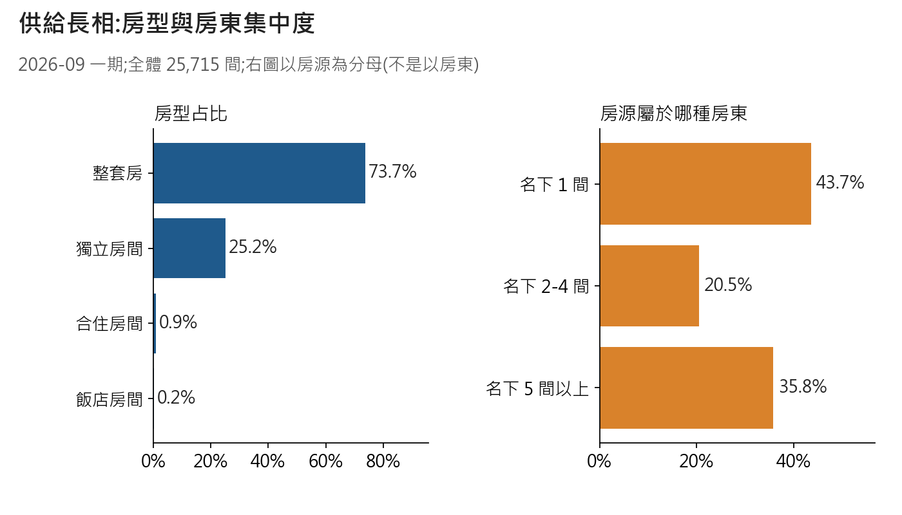
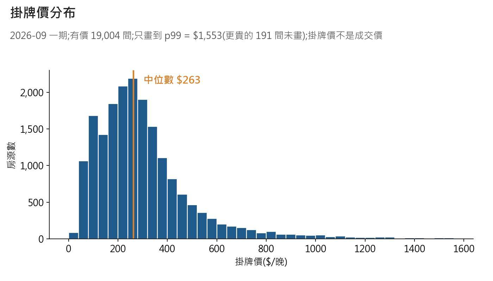
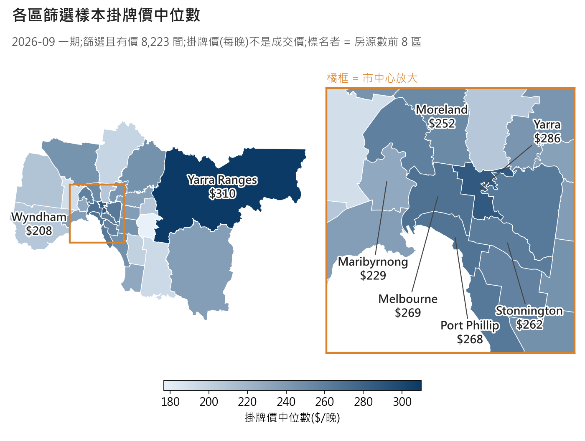
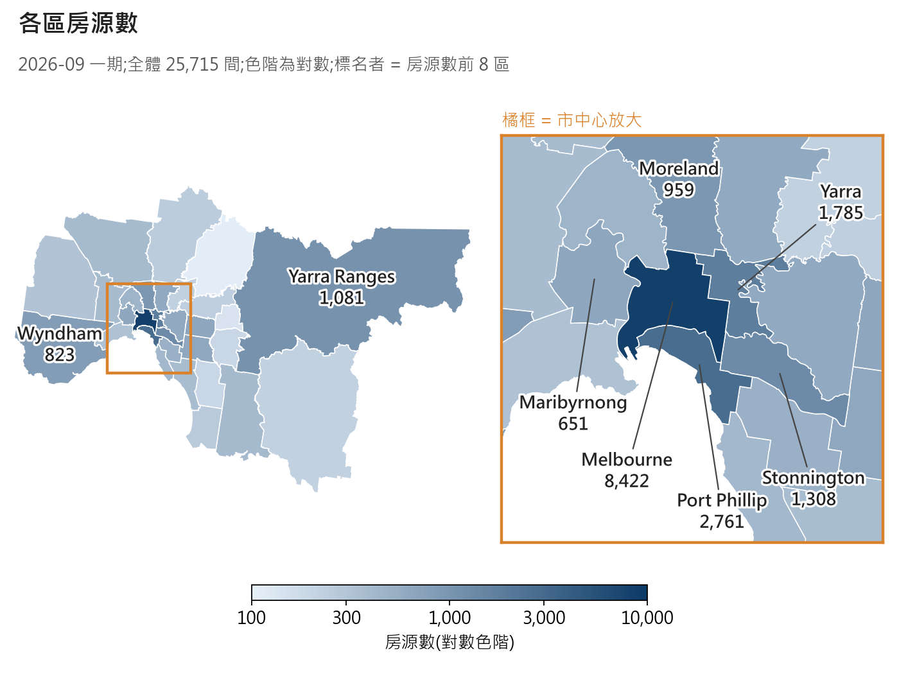
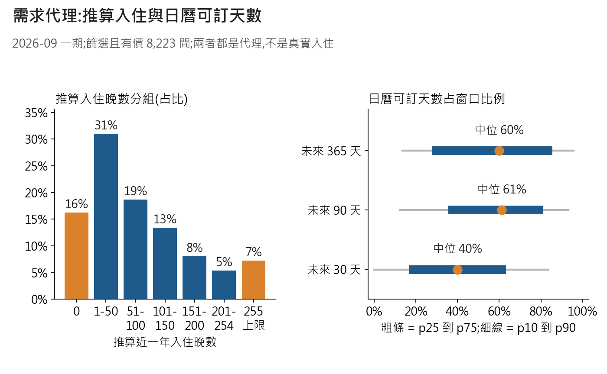
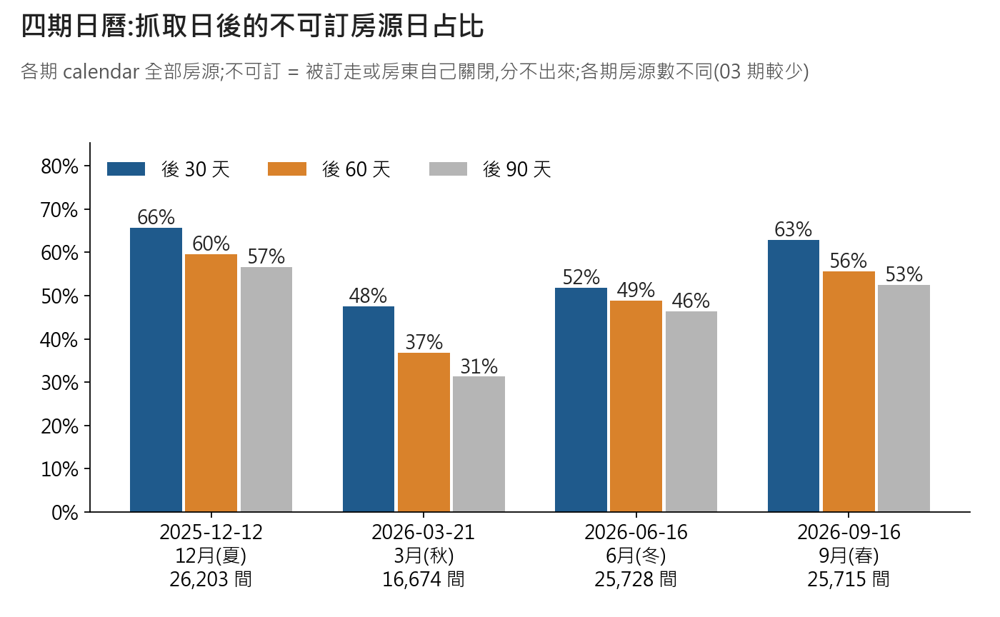
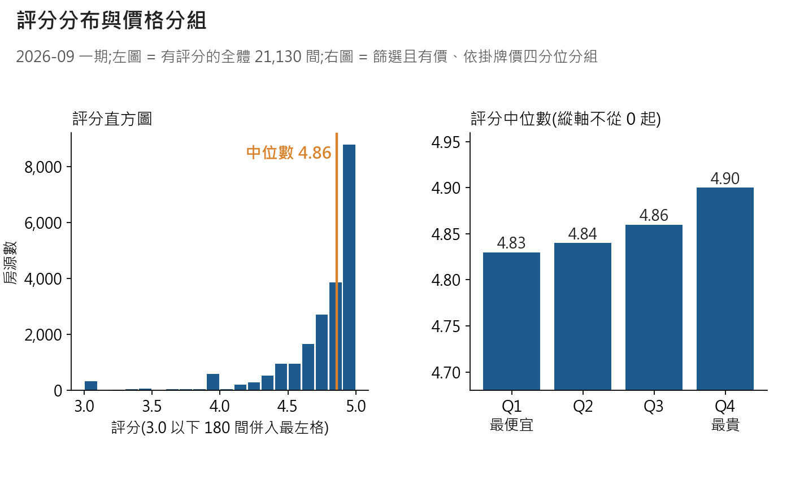

# 墨爾本 A:市場概況、地圖、需求(2026-09-16 一期)
> IS-1111-MEL-A。對賬已過:全體 25,715 / 篩選 10,940 / 篩選且有價 8,223。價格 = 掛牌價,不是成交價。

## 1 供給長相
**整套房占 73.7%;35.8% 的房源屬於名下 5 間以上的房東。**

整套房裡 1 房 34.0%、2 房 38.6%。前 3 種類型:Entire rental unit 44.1%、Entire home 17.9%、Private room in home 13.5%。
怎麼讀:右圖是「房源」的分母,名下 1 間 43.6%、2-4 間 20.5%、5 間以上 35.8%。

## 2 掛牌價分布
**有價 19,004 間,中位數 $263;整套房 $302,隨房間數往上。**

| 範圍(有價) | n | p10 | p25 | p50 | p75 | p90 |
|---|---|---|---|---|---|---|
| 全體 | 19,004 | $96 | $172 | $263 | $375 | $550 |
| 整套房 | 14,504 | $181 | $230 | $302 | $413 | $601 |
| 獨立房間 | 4,253 | $64 | $82 | $109 | $151 | $231 |
| 整套 1 房 | 4,749 | $152 | $186 | $229 | $285 | $358 |
| 整套 2 房 | 5,592 | $210 | $256 | $309 | $380 | $487 |
| 整套 3 房 | 2,267 | $265 | $338 | $430 | $576 | $801 |
怎麼讀:高於 p99($1,553)的有 191 筆,最高 $109,084;圖已截掉,分位數不受影響。

## 3 分區表(完整 30 區在 JSON)
**房源集中市中心:房源數前 4 區占全體 55.5%;篩選樣本中位數最高 Yarra Ranges $310、最低 Knox $177。**
| 區 | 房源數 | 篩選且有價 | 掛牌價中位 | 評分中位 | 整套房占比 |
|---|---|---|---|---|---|
| Melbourne | 8,422 | 3,487 | $269 | 4.82 | 83% |
| Port Phillip | 2,761 | 1,062 | $268 | 4.90 | 82% |
| Yarra | 1,785 | 674 | $286 | 4.91 | 80% |
| Stonnington | 1,308 | 478 | $262 | 4.89 | 81% |
| Yarra Ranges | 1,081 | 465 | $310 | 4.92 | 89% |
| Moreland | 959 | 228 | $252 | 4.86 | 59% |
| Wyndham | 823 | 48 | $208 | 4.83 | 42% |
| Maribyrnong | 651 | 136 | $229 | 4.85 | 59% |
怎麼讀:30 區篩選且有價最少也有 22 間,沒有被標「樣本太少」的區。

## 4 兩張地圖(右側為市中心放大)
**價格高的區不等於房源多的區:房源集中在市中心的 Melbourne 區(8,422 間)。**

怎麼讀:顏色越深越高;房源數用對數色階。灰色 = 樣本太少(這期沒有)。

## 5 需求代理(兩者都是代理)
**篩選且有價樣本:推算入住 0 晚占 16.3%,頂到 255 上限占 7.2%,中位數 60 晚。**

日曆未來 30 / 90 / 365 天可訂天數中位數:12 / 55 / 219 天。
**四期抓取日後 30 天不可訂房源日占比:48%(3月(秋))到 66%(12月(夏))。**

| 期別 | 房源數 | 30 天 | 60 天 | 90 天 |
|---|---|---|---|---|
| 2025-12-12 12月(夏) | 26,203 | 65.6% | 59.6% | 56.6% |
| 2026-03-21 3月(秋) | 16,674 | 47.5% | 36.8% | 31.3% |
| 2026-06-16 6月(冬) | 25,728 | 51.9% | 48.8% | 46.3% |
| 2026-09-16 9月(春) | 25,715 | 62.8% | 55.6% | 52.5% |
怎麼讀:不可訂 = 被訂走或房東自己關閉,分不出來;窗口從 calendar 最早日期起算。

## 6 評分
**有評分者(占 82%)中位數 4.86,87% 在 4.5 分以上;最貴四分位比最便宜高 0.07 分。**

怎麼讀:分數擠在 4.5 到 5.0,差 0.07 分很小;右圖縱軸不從 0 起。

## 數字來源對照(數字 → JSON 鍵名)
| 數字 | 鍵名 |
|---|---|
| 房型占比 / 房東規模 | a_supply.room_type / a_supply.host_concentration |
| 房間數 / 前 8 類型 | a_supply.entire_home_bedrooms / property_type_top8 |
| 分位數、p99、極端值 | b_price.all_priced / by_room_type / entire_by_bedrooms / p99_value / n_above_p99 |
| 分區表 | c_districts.districts.* |
| 前 8 區、樣本太少區 | d_maps.top8_by_listings / low_sample_districts |
| 推算入住 0 / 255 / 中位 | e_demand.occupancy_proxy.share_zero / share_at_cap / median |
| 可訂天數 | e_demand.availability_proxy.by_window.30 / 90 / 365 |
| 四期不可訂占比 | e_demand.calendar_blocked.periods.<期別>.all.<30/60/90>.blocked_share |
| 評分、價格四分位 | f_rating.all_rated / scope_priced_by_price_quartile |

## 看不到的事(不要這樣說 → 改這樣說)
- 「中位數 $263 是房東賺的」 → 「這是掛牌價中位數;成交價、清潔費、折扣看不到」。
- 「推算入住 60 晚 = 住了 60 晚」 → 「這是用評論數推算的代理;0 晚也可能只是沒人留評論」。
- 「63% 被訂走」 → 「63% 不可訂,被訂走或房東自己關,分不出來」。
- 「秋天最空、夏天最滿」 → 「03 期只有 16,674 間,房源組成與其他期不同,四期不能當同一批比」。
- 「某區最貴 / 最便宜」 → 「該區篩選樣本中位數較高 / 較低(各區樣本 22 間起),區內差距看不到」。
- 「35.8% 的房東有 5 間以上」 → 「35.8% 的房源屬於這類房東;房東人數比例看不到」。
- 「評分高所以貴」 → 「越貴的組評分中位數略高,只是相關;評分只有約 82% 的房源有」。
- 「價格四期趨勢」 → 「2025-12 那期 price 全空,價格只有 2026-09 一期可用」。
