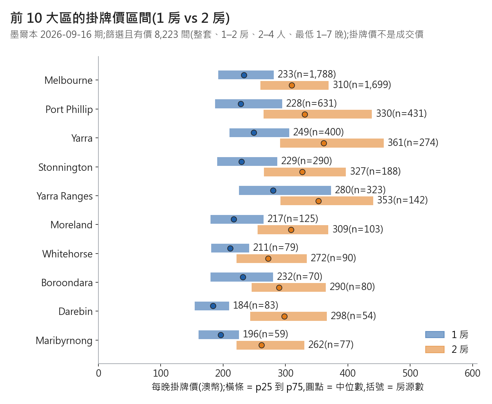
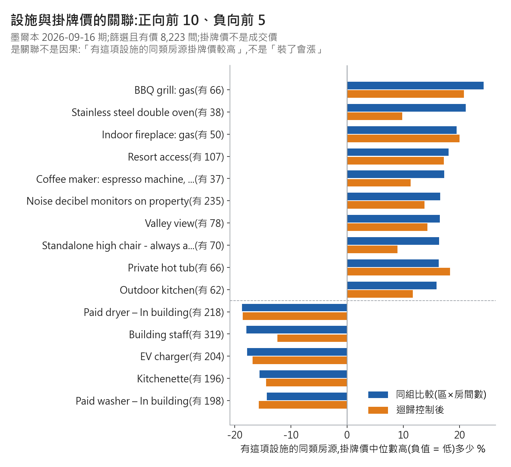
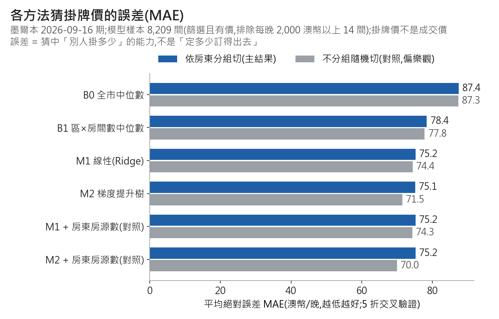
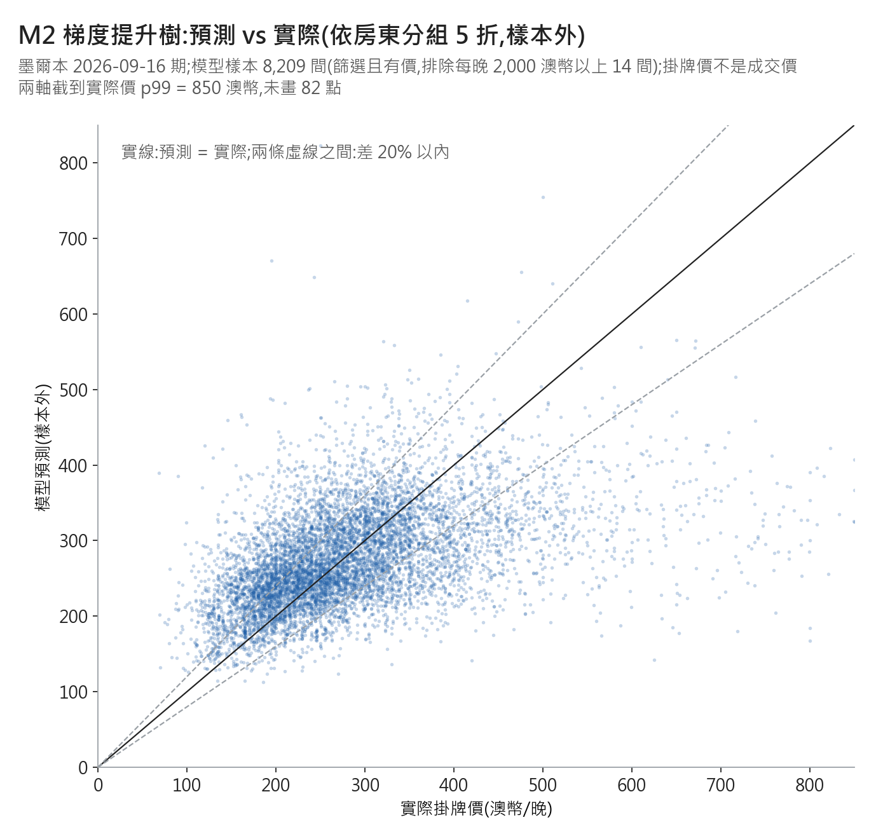

# 墨爾本 B 分支:競品定位與掛牌價模型實驗(IS-1111-MEL-B,2026-11-11)

資料:Inside Airbnb 墨爾本 2026-09-16 期。樣本 = 篩選(整套、1–2 房、2–4 人、最低 1–7 晚)且有價 8,223 間。
價格一律是**掛牌價**,不是成交價。程式 `analysis/melbourne/mel_b_positioning.py`;數字全在 `mel_b_positioning_2026-11-11.json`。
對賬:25,715 / 10,940 / 8,223 / 首評在 12 個月內(新上架的代理)2,056 全部 assert 通過(基準日 2026-09-18,首評 2025-09-18 起算)。

## 1. 同類房源怎麼分組
結論:區 × 房間數共 60 組,中位數 41.5 間;24 組不足 30 間,但只涵蓋 432 間(94.7% 房源在 30 間以上的組)。

| 項目 | 數字 |
|---|---|
| 組數 / 組大小中位數 / 最小–最大 | 60 / 41.5 / 5–1,788 |
| 不足 30 間的組 / 涵蓋房源 | 24 組 / 432 間 |
| 套用規則後,每間房的比較組大小中位數 | 631 間(p10 = 51) |
| 退回到「最近 30 間」時的半徑中位數 | 8.3 公里(p25–p75:6.3–11.9) |

組太小就放大(照做即可):
1. 找同區、同房間數的房源;30 間以上就用這組。
2. 不足 30 間 → 改用全市同房間數、經緯度直線距離最近的 30 間(不限區)。
3. 記下用了哪一步(1 或 2),報告時一起寫。

怎麼讀:大部分人落在步驟 1;小區的房會借用附近約 8 公里內的房源。

## 2. 定位表:各區掛牌價區間
結論:前 10 大區內,2 房比 1 房中位數高 58–114 澳幣;1 房以 Yarra Ranges(280)最貴、Darebin(184)最便宜。

怎麼讀:橫條是中間一半房源的掛牌價範圍;你的價在橫條左邊 = 比同類 75% 便宜。完整 27 區(30 間以上)× 房間數的 p10–p90 在 JSON `b_positioning.table`;不足 30 間的 3 區不列。

## 3. 設施
結論:每間房中位數 41 項設施(p25–p75:32–49);最常見是 Smoke alarm 95.7%、Kitchen 93.9%、Wifi 90.4%。

| 最明顯的關聯 | 有這項的房數 | 同組比較 | 迴歸控制後 |
|---|---|---|---|
| BBQ grill: gas | 66 | +24.3% | +20.8% |
| Indoor fireplace: gas | 50 | +19.5% | +20.0% |
| Paid dryer – In building | 218 | -18.7% | -18.6% |

怎麼讀:「有 BBQ grill: gas 的同類房源,掛牌價中位數高 24%」——是關聯,不是裝了就會漲。兩種算法方向一致的比例 87.1%(264 項合格設施)。正向前 10 多是少數房源才有的設施(37–235 間),信賴區間寬;負向多是公寓大樓型設施(Building staff、Paid washer),比較像「房源類型」的訊號。264 項取最大的 10 項,個別估計偏高(贏家詛咒);圖與表沒畫信賴區間,Stainless steel double oven 的迴歸信賴區間 [-0.7, 21.4] 含 0。

## 4. 實驗:猜掛牌價
結論:模型(M1 / M2)比「區 × 房間數中位數」(B1)少猜錯約 3 澳幣,比全市中位數(B0)少約 12 澳幣;M1 與 M2 幾乎打平。

| 方法(依房東分組 5 折,8,209 間) | MAE 澳幣 | 誤差中位數 % | 差 20% 以內 |
|---|---|---|---|
| B0 全市中位數 | 87.4 | 23.3% | 43.7% |
| B1 區×房間數中位數 | 78.4 | 20.5% | 49.0% |
| M1 線性(Ridge) | 75.2 | 19.7% | 50.5% |
| M2 梯度提升樹(HistGradientBoosting) | 75.1 | 19.2% | 51.9% |
| M2 + 房東名下房源數(對照) | 75.2 | 19.3% | 51.3% |

怎麼讀:一般房源猜偏約 19%,大約一半能猜在 20% 以內。加房東房源數沒幫助。

分群(M2,MAE / 誤差中位數):1 房 62.5 / 19.1%;2 房 90.3 / 19.3%;前 5 大區 77.6 / 18.9%;其他區 67.5 / 19.9%;**首評在 12 個月內的房源(新上架的代理)2,056 間 67.6 / 18.4%**(差 20% 以內 53.7%;其中只有 41.7% 是真的新手房東,見 C 報告);其他 77.6 / 19.4%。模型在真新手 1,122 間上的誤差:未計算,列為後續。
(其他區剛好也是 2,056 間,是巧合。)

不分房東隨機切的對照:M2 MAE 71.5(低 3.6)、M2 + 房東房源數 70.0(低 5.2);B0 / B1 / M1 只差 0.1–0.8。
怎麼讀:樹模型會「記住」同房東的定價習慣,不分組會高估準度約 5%;所以主結果用分組切。

怎麼讀:點集中在 200–350;高價房(500 以上)系統性被猜低——模型把極端往中間拉。

特徵重要度(M2 排列重要度,打亂後 MAE 增加,澳幣):區 5.4、設施數 4.0、經度 3.7、房間數 3.6、房型細類 2.2、Dishwasher 1.4、最少入住晚數 1.4、浴室數 1.4、可住人數 0.9、Self check-in 0.7。

時間外部檢查(有做):用 2026-06-16 期 8,255 間訓練,測 9 月期「6 月整期沒出現過」的 820 間。

| 方法 | MAE | 誤差中位數 % | 差 20% 以內 |
|---|---|---|---|
| B0 / B1 | 85.3 / 77.8 | 22.2% / 20.3% | 46.2% / 49.5% |
| M1 / M2 | 72.6 / 70.9 | 18.7% / 17.7% | 53.2% / 55.1% |

怎麼讀:用 6 月訓練、測 9 月新出現的 820 間,模型仍比基準好(M2 70.9、B1 77.8)。但這 820 間裡有 45.0% 的房東在 6 月訓練集出現過(核對報告 `mel_review_2026-11-11.md` L45),所以這不是「完全沒看過的房東」的檢查;線性和樹模型誰比較好,兩種檢查的結果不一致(9 月內分房東驗證時線性 74.7、樹 77.3;時間檢查時樹 70.9、線性 72.6),所以只能說「兩個模型差不多」。

## 5. 示範:一位新房東會看到什麼(示範輸出,不是定價建議)
輸入:Melbourne 區、整套、1 房、2 人、1 床、1 浴、有 Kitchen + Washer + Wifi。
- 同類房源(步驟 1:Melbourne × 1 房):1,788 間;掛牌價 p25 / p50 / p75 = 192 / 233 / 281。只看 2 人房:1,121 間,187 / 228 / 278。
- 模型參考(M2,照字面只有 3 項設施):約 222,參考區間 181–264。若設施補到同類中位數 40 項:約 248,區間 202–295。這只是關聯,不代表補了設施就會漲。
- 缺的同類常見設施(出現比例最高):Smoke alarm 96.6%、Hot water 90.0%、Hair dryer 89.8%。
- 同類一半以上有、且同組比較為正向的:Dishwasher(69.0%,+13.2%)、Cooking basics(81.2%,+6.9%)、Toaster(71.2%,+5.8%)。
怎麼讀:參考區間 = 模型點估 × 交叉驗證中間 50% 的誤差;大約一半的同類房源實際價會落在這區間內。

## 6. 方法與防呆
- 切分:5 折 GroupKFold,同一 `host_id` 的房源全在同一折;另跑不分組隨機 5 折當對照。種子 42。
- 目標:log(掛牌價)訓練,exp 回澳幣報誤差;B0 / B1 直接用訓練折的澳幣中位數。B1 的小組退回規則同第 1 節,只用訓練折資料。
- 用的特徵(新房東上架前就知道):區、經緯度、房型細類、房間數、可住人數、床數、浴室數(由 `bathrooms_text` 解析)、設施數與前 40 項設施旗標、最少入住晚數。M1 只用區、房間數、可住人數、床數、浴室數、設施數、前 40 項設施。
- 故意不用:評論數 / 評分 / `first_review` / `reviews_per_month`(新房東沒有評論);`estimated_revenue_l365d`(= 價格 × 入住,直接洩漏答案)、`estimated_occupancy_l365d`(由評論推算);`availability_*`(上架後的行事曆);`price_quote_*`(就是報價本身);超讚房東等經營資料(新房東沒有)。房東名下房源數只放在對照版本。
- 前 40 項設施依「出現比例」挑,不看價格,所以用全樣本挑不會洩漏。
- 極端值:每晚 2,000 澳幣以上 14 間(最高 90,000)不進訓練與主要誤差;分組、定位表、同組設施比較用全部 8,223(中位數不受影響)。影響:把這 14 間放回評估,M2 MAE 由 75.1 變 92.6,誤差中位數 19.2% 幾乎不變;再拿掉實際價 p99 以上,M2 MAE 68.2。
- 缺值:床數缺 73 間,用房間數補並加缺值旗標;浴室 0 缺值;「Half-bath」記 0.5。

## 7. 誠實的限制
- 誤差衡量的是「猜中別人掛多少」,不是「定多少訂得出去」;資料沒有成交價。
- 掛牌價會隨抓取當天的報價日期變(週末、旺季),同一間房不同期可能不同價。
- MAE 被少數高價房拉大;報告以誤差中位數與「差 20% 以內」為主比較好懂。
- 設施關聯是相關不是因果;少數房源才有的設施(37–235 間)估計不穩。
- 只做墨爾本 2026-09 期;經緯度在 Inside Airbnb 有隨機偏移,最近 30 間的距離是近似值。

## 數字來源對照(JSON 鍵,檔案 `notes/raw/mel_b_positioning_2026-11-11.json`)
| 數字 | 鍵 |
|---|---|
| 25,715 / 10,940 / 8,223 / 2,056 | `reconciliation` |
| 60 組、24 組不足 30、631、8.3 公里 | `a_grouping` |
| 各區 p10–p90 | `b_positioning.table` |
| 設施比例、設施數分布、關聯 | `c_amenities` |
| 各方法 MAE 與分群 | `d_experiment.results_group_cv` / `results_random_cv` |
| 14 間極端值與影響 | `extreme_rule`、`d_experiment.extreme_sensitivity_*` |
| 特徵重要度 | `d_experiment.permutation_importance_M2_fold1` |
| 時間外部檢查 | `d_temporal_check` |
| 示範案例 | `e_demo_case` |

## 不要這樣說 → 改這樣說
- 「模型能預測房價」→「模型猜別人的掛牌價,一般誤差約 19%,約一半猜在 20% 以內」。
- 「裝 BBQ 能漲 24%」→「有 gas BBQ 的同類房源,掛牌價中位數高 24%(66 間,關聯不是因果)」。
- 「建議你定 222 元」→「同類掛牌價中間一半落在 192–281;模型參考 181–264,這是示範,不是定價建議」。
- 「樹模型比線性好很多」→「分房東切時兩者打平(75.1 vs 75.2);不分房東切才看起來比較好」。
- 「準確率 93%」→ 不要把 MAE 換成準確率;改說「平均猜偏 75 澳幣,誤差中位數 19%」。
- 「新上架的房源猜不準」→「首評在 12 個月內的 2,056 間(新上架的代理,只有 41.7% 是真新手)誤差中位數 18.4%,跟其他房源差不多;真新手的誤差未計算」。
