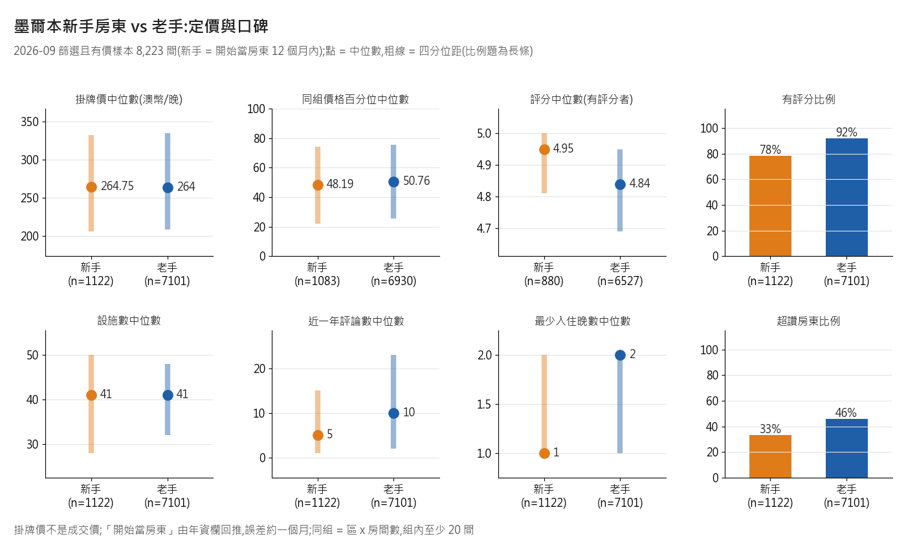
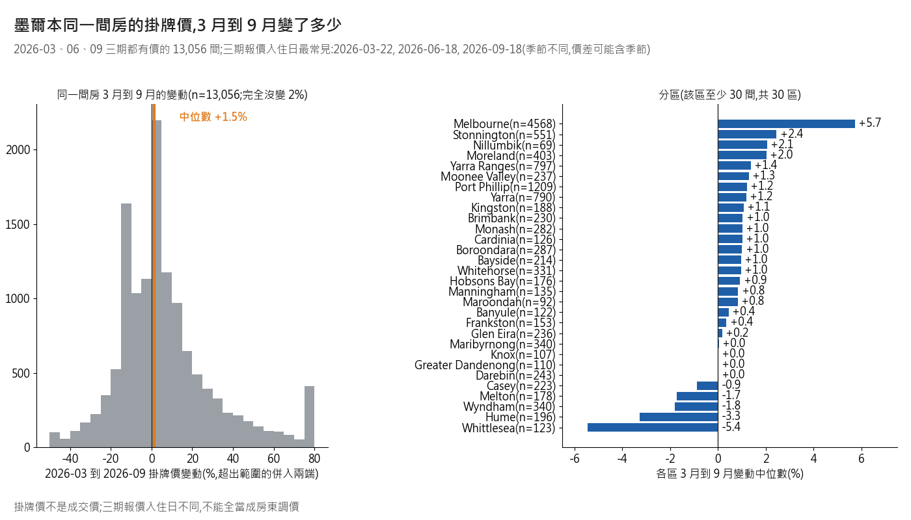
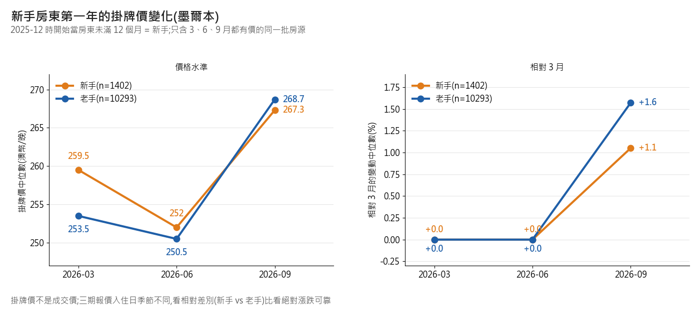

# 墨爾本 C:新手房東驗證與跨期變化(IS-1111-MEL-C)
資料:Inside Airbnb 墨爾本四期(2025-12-12 / 2026-03-21 / 2026-06-16 / 2026-09-16),掛牌價不是成交價。
數字全在 `mel_c_hosts_time_2026-11-11.json`;程式 `analysis/melbourne/mel_c_hosts_time.py`(開頭 assert 四期列數與 10,940 / 8,223 / 2,056)。
**一句話:年資欄不是 host_since 的時間;用它抓真新手有 1,122 間;新手的定價與掛牌價變化跟老手幾乎一樣,差在口碑還沒累積。**
初查數字重算:四期列數、欄數、host_since / 年資欄 / price 非空率、10,940 / 8,223 / 2,056 / 713 / 514 全部吻合(price 非空 0 / 98.7 / 74.5 / 73.9%)。
## a. 年資欄在量什麼
**結論:是別的意思。`host_since` 對得上 `hosts_time_as_user_*`(帳號年資);`hosts_time_as_host_*` 比它短,最可能是「開始當房東以來」。**
| 2025-12 內,對 host_since 算出的整月數(26,199 列) | 完全相同 | 差 1 個月內 | 差更多 |
|---|---|---|---|
| `hosts_time_as_host_*` | 31.9% | 40.5% | 59.5%(全是欄位較短,中位差 6 個月,最多 190) |
| `hosts_time_as_user_*` | 98.5% | 100% | 0% |
- 跨期:2026-09 的房東在 2025-12 找得到 11,745 / 13,999 = 83.9%(房源層 88.1%)。
- 找得到的人,2026-09 回推的開始月與 2025-12 host_since 差 1 個月內:`user_*` 99.98%,`host_*` 只有 29.5%(中位晚 17 個月)。
- 怎麼讀:`host_*` 從 2025-12 到 2026-09 每位房東剛好增加 9 或 10 個月,是跟著時間走的真日期;它不大於 `user_*` 的比例 99.98%。最像「帳號早就有,後來才開始當房東」。
- 「兩欄基準日不同」已被排除:`user_*` 對得上抓取日(98.5% 同月),基準日不同只會造成固定小偏移,但 `host_*` 偏差中位 6 個月、最多 190 個月。
- 核對者補的檢驗:首評比 `host_*` 回推開始月早超過 1 個月的只有 1.14%,與「開始當房東」不矛盾,但鑑別力有限(來源:`mel_review_2026-11-11.md` L49)。
- 證據強度:中(欄義是資料行為推斷,官方說明還沒查)。
## b. 2026-09 每間房的「房東開始日」
**結論:任務單口徑(H,host_since 優先)88% 用得到 2025-12 的值,12% 回推;但 H 量的是帳號年資,不是當房東。**
| H 口徑來源 | 全部 25,715 | 篩選且有價 8,223 |
|---|---|---|
| 2025-12 host_since | 22,647(88.1%) | 7,127(86.7%) |
| 年資欄回推(約 ±1 個月) | 3,068(11.9%) | 1,096(13.3%) |
- 怎麼讀:H 的回推改用 `user_*`,因為 a 證明它才對得上 host_since。
- 另一口徑 T = `hosts_time_as_host_*`(當房東起算):25,715 間全部用年資欄回推,誤差約一個月。主口徑用 T,H 當對照(JSON 兩邊都有)。
## c. 新手房東(開始當房東 12 個月內)
**結論:真新手篩選且有價 1,122 間;舊代理(首評 12 個月內)只有 41.7% 是真新手,但抓得到 76.4% 的真新手。**
| T 口徑(主) | 全體 25,715 | 篩選 10,940 | 篩選且有價 8,223 |
|---|---|---|---|
| 12 個月內 | 3,045 | 1,216 | 1,122 |
| 24 個月內 | 5,405 | 2,238 | 2,013 |
| 12 個月內且名下只有一間 | 1,698 | 732 | 667 |
| 24 個月內且名下只有一間 | 2,778 | 1,240 | 1,082 |
| 篩選且有價 8,223 間 | 真新手 | 非新手 |
|---|---|---|
| 首評 12 個月內(代理說新) | 857 | 1,199 |
| 首評 12 個月前 | 23 | 5,328 |
| 無評論 | 242 | 574 |
- 怎麼讀:命中率 857 / 2,056 = 41.7%;抓到率 857 / 1,122 = 76.4%(漏掉的 242 間還沒有評論)。非新手卻有新首評的 1,199 間,多半是老房東開新房源(其中 1,000 間 = 83.4% 名下 2 間以上,來源:核對報告 L51)。
- H 口徑(全體 / 篩選 / 篩選且有價):12 個月 1,198 / 511 / 480;24 個月 2,483 / 1,035 / 952;12 個月且只有一間 529 / 217 / 203;命中率 17.5%、抓到率 74.8%。
- 「只有一間」= `calculated_host_listings_count` 為 1(本城這批資料內)。
- 邊界是「≤ 12 個月」(含剛好 12 個月);改成「< 12 個月」(years = 0)會少 193 / 69 / 61 間,命中率 39.2%、抓到率 76.0%,結論不變(來源:核對報告 L25)。
## d. 新手 vs 老手(2026-09 篩選且有價,T 口徑)
**結論:新手定價跟老手幾乎一樣,只略低(同組百分位中位 48.2 對 50.8);差在評論少、超讚房東少。**

| 項目(中位數,括號 = 四分位) | 新手 n=1,122 | 老手 n=7,101 |
|---|---|---|
| 掛牌價(澳幣/晚) | 264.75(206–332) | 264(209–335) |
| 同組價格百分位(n=1,083 / 6,930) | 48.2(22–74) | 50.8(26–75) |
| 評分(n=880 / 6,527) | 4.95(4.81–5.00) | 4.84(4.69–4.95) |
| 有評分比例 | 78.4% | 91.9% |
| 設施數 | 41(28–50) | 41(32–48) |
| 近一年評論數 | 5(1–15) | 10(2–23) |
| 最少入住晚數 | 1(1–2) | 2(1–2) |
| 超讚房東比例 | 33.3% | 45.9% |
- 怎麼讀:最明顯的兩個差別是近一年評論數(5 對 10)與有評分比例(78% 對 92%)。新手評分中位較高是評論少,不代表品質較好。
- 同組 = 區 x 房間數,組內至少 20 間,共 45 組、8,013 間入列。H 口徑下百分位 50.5 對 50.2,結論不變。
## e. 四期進出與 2026-03 為什麼只有 16,674 間
**結論:最可能是 3 月那期沒收「休眠房源」,它們 6 月才以「前次爬取」身分回來。證據強度:中高(誰缺席很清楚,為什麼缺席是推論)。**
| 相鄰兩期 | 留下 | 消失 | 新出現 |
|---|---|---|---|
| 2025-12 到 2026-03 | 14,502 | 11,701 | 2,172 |
| 2026-03 到 2026-06 | 15,238 | 1,436 | 10,490 |
| 2026-06 到 2026-09 | 23,526 | 2,202 | 2,189 |
| 在 2026-06 那期看 | 3 月缺席(12、6 月在)8,006 | 3 月在(12、3、6 月都在)13,441 |
|---|---|---|
| 有價比例 | 26.7% | 96.6% |
| availability_365 = 0 | 70.8% | 2.2% |
| source 為 previous scrape | 76.2% | 3.7% |
| 近一年評論數 = 0 | 76.9% | 16.0% |
- 怎麼讀:缺席的幾乎都是早就全年不可訂、沒評論的房源(2025-12 時 availability_365 = 0 就已 66.3%,對照組 1.1%)。
- 3 月全是 city scrape(16,674 間);3 月消失的 11,701 間,6 月回來 68.4%。
- `has_availability` 兩邊都約 99% 為 t,分不出差別。為什麼 3 月沒收,資料裡看不出,判斷不了。
## f. 同一間房的價格變化(3、6、9 月都有價 13,056 間)
**結論:3 到 9 月中位數只動 +1.5%,但單間差很大,而且三期報價入住日不同,不能當成房東調價。**

| 變動 % | p10 | p25 | p50 | p75 | p90 | 完全沒變 |
|---|---|---|---|---|---|---|
| 3 到 6 月 | -19.8 | -8.3 | 0.0 | +5.3 | +19.9 | 21.9% |
| 6 到 9 月 | -14.0 | -7.0 | +2.0 | +16.8 | +40.2 | 2.8% |
| 3 到 9 月 | -16.9 | -9.5 | +1.5 | +15.7 | +39.6 | 1.9% |
| 報價入住日(這 13,056 間) | 最常見日 | 日期種類 | 最常見晚數 |
|---|---|---|---|
| 2026-03 | 03-22(週日)3,372 間 | 228 | 2 晚、1 晚 |
| 2026-06 | 06-18(週四)2,806 間 | 249 | 2 晚、1 晚 |
| 2026-09 | 09-18(週五)2,794 間 | 247 | 2 晚、1 晚 |
- 怎麼讀:三期的入住日分別落在秋、冬、春,星期也不同;price 欄 100% 等於當次報價的每晚價。
- 只比「同星期、同晚數」子集(約 13%):3 到 9 月中位 +1.2%(n=1,692),完全沒變 3.9%,結論一樣;季節仍沒排除。
- 3 到 6 月 21.9% 完全沒變,6 到 9 月只有 2.8%;為什麼不對稱,判斷不了。
- 分區(30 區都至少 30 間)3 到 9 月中位:Melbourne +5.7%(n=4,568)、Stonnington +2.4%、Nillumbik +2.1%(n=69)、Moreland +2.0%;最低 Whittlesea -5.4%(n=123)、Hume -3.3%、Wyndham -1.8%;其餘 -0.9% 到 +2.1%。
## g. 新手第一年的掛牌價變化
**結論:樣本夠;新手的價格路徑跟老手同方向,3 到 9 月中位數新手 +1.1%、老手 +1.6%。**

| 2025-12 時的身分(T 口徑) | n | 3 / 6 / 9 月中位價(澳幣) | 相對 3 月:6 月 / 9 月 | 3 到 9 月完全沒變 |
|---|---|---|---|---|
| 新手(開始當房東未滿 12 個月) | 1,402 | 259.5 / 252.0 / 267.3 | 0.0% / +1.05% | 1.1% |
| 老手 | 10,293 | 253.5 / 250.5 / 268.7 | 0.0% / +1.57% | 2.1% |
- 怎麼讀:新手沒有明顯在第一年大幅降價或漲價;差距不到 1 個百分點,且受報價日期影響,別讀成「新手較保守」。
- H 口徑:新手 n=574,3 到 9 月 +0.47%,老手 +1.5%,方向相同。
## 數字來源對照
- JSON 鍵:重算初查 `recheck_initial`;a `a_validate_tenure_fields`;b `b_start_date_source_H`;c `c_new_host_definition.definitions`(T、H 各一份);d `d_new_vs_veteran`;e `e_flows_and_march`;f `f_price_change`;g `g_first_year_price_path`。
- 圖:`notes/figures/mel_c_newbie_vs_veteran.png`、`mel_c_price_change_3_to_9.png`、`mel_c_newbie_first_year_price_path.png`。
## 不要這樣說 → 改這樣說
- 「host_since 就是開始當房東的日期」→「host_since 對得上帳號年資;當房東多久看 `hosts_time_as_host_*`,欄義是推斷,官方說明未查」。
- 「新手房源 = 首評 12 個月內」→「首評代理只有 41.7% 是真新手,但抓得到 76.4%;要精確請用年資欄」。
- 「新手定價比較低」→「新手同組價格百分位中位 48.2,老手 50.8,幾乎沒差」。
- 「新手評分比較好」→「新手評論少(近一年中位 5 對 10),評分高是樣本小」。
- 「3 月有 9,000 多間下架」→「3 月缺席的 8,006 間多半是休眠房源,6 月以前次爬取身分回來;沒收的原因判斷不了」。
- 「房東 3 月到 9 月漲價 1.5%」→「同一間房 3 月與 9 月的報價中位差 +1.5%,但入住日季節不同,不等於調價」。
- 「新手第一年會降價」→「新手與老手 3 到 9 月中位變動都在 +1 到 +2%,差距不到 1 個百分點」。
