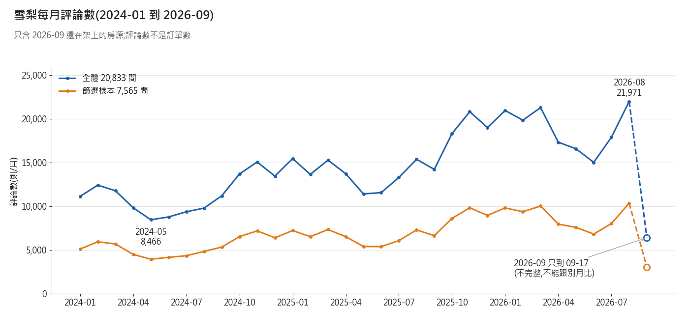
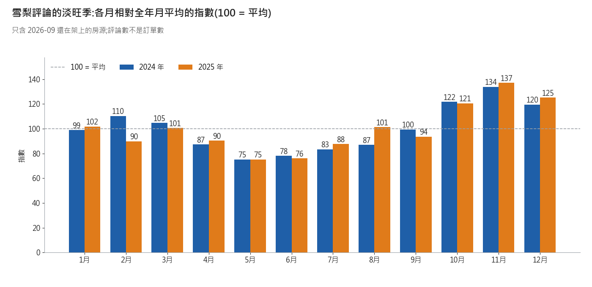
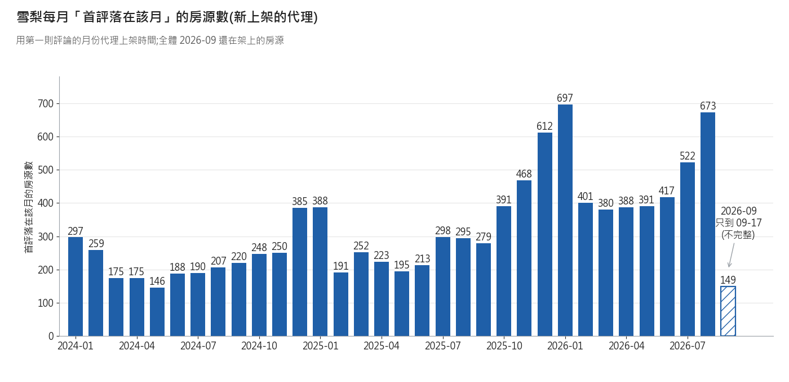

# 雪梨 2024–2026:手上這批看得到什麼(2026-11-11)

**結論:這批看得到「現在還在架上的房源」在 2024-01 到 2026-09 留下的評論量、淡旺季、新上架代理;看不到當時的價格、已下架的房源、真實訂單與入住率。**

資料:Inside Airbnb 雪梨 2026-09-16 批。listings 20,833 列;篩選樣本 7,565(整套 / 1–2 房 / 2–4 人 / 最低 1–7 晚);其中有價 6,639。評論檔最後一則是 2026-09-17,所以 2026 年只到 9 月 17 日。

## 1. 每年總覽
結論:評論量 2025 年比 2024 年 +34.9%;2026 年 1–8 月比 2025 年 1–8 月 +37.4%(只含還在架上的房源,早年被低估,成長率會偏高)。

| 年 | 評論數 全體 | 評論數 篩選樣本 | 有評論的房源 全體 | 有評論的房源 篩選 | 首評落在當年 全體 | 首評落在當年 篩選 |
|---|---|---|---|---|---|---|
| 2024 | 134,978 | 64,111 | 8,400 | 3,490 | 2,740 | 1,064 |
| 2025 | 182,045 | 85,939 | 11,619 | 4,940 | 3,805 | 1,529 |
| 2026(到 09-17) | 157,210 | 73,076 | 14,397 | 6,285 | 4,018 | 1,620 |
| 2024 起累計 | 474,233 | 223,126 | | | | |

**對賬:過。** 2024 年評論數 134,978 = 11/07 記錄 134,978;2024 起累計 474,233 = 474,233(差 0)。
評論檔 829,163 列,有日期 829,163 列(11/07 記錄 829,163);評論對不到 listings 的有 0 則。「全體」= 評論檔全部;「篩選」= 房源在篩選樣本 7,565 間內。「有評論的房源」只算 listings 檔裡有的房源。

## 2. 每月走勢
結論:評論最多的月份是 2026-08、最少的是 2024-05(只看 2024-01 到 2026-08 完整月份;最多月是最少月的 2.6 倍,這包含逐年成長,不全是季節差)。

| 排名 | 評論最多的 3 個月(全體) | 評論最少的 3 個月(全體) |
|---|---|---|
| 1 | 2026-08:21,971 | 2024-05:8,466 |
| 2 | 2026-03:21,266 | 2024-06:8,786 |
| 3 | 2026-01:20,940 | 2024-07:9,377 |
2026-09 只到 09-17,不參與排名。

## 3. 淡旺季
結論:兩年平均來看,偏高的是 11月、12月、10月;偏低的是 5月、6月、7月;最高月 11 月(指數 135.5)是最低月 5 月(指數 75.3)的 1.8 倍;2024 和 2025 的各月指數相關係數 0.90,形狀很像。

注意:評論數是「有留評論的住宿」,不是訂單數。評論多的月份代表住完並留言的人多,可當需求的參考,不等於訂房量;評論是住完才寫,高峰會比入住晚一些,所以這是「評論的淡旺季」,不等於「入住的淡旺季」。每年評論量本來就在長,後半年的指數會被墊高一點。

## 4. 新上架(首評月份代理)
結論:首評落在當年的房源,2024 年 2,740 間、2025 年 3,805 間、2026 年到 09-17 4,018 間(全體;早年已下架的房源不在內,數字偏低)。

對照已知的「首評在最近 12 個月內 = 2,028」:那是「篩選且有價 6,639」的子集。我這裡的年度表是「全體」與「篩選(不限有價)」,分母不同,數字不能直接比。用同一截止日 2025-09-17(含)重算:

| 口徑 | 首評在近 12 個月內的房源數 |
|---|---|
| 全體 20,833(評論檔最早日期) | 5,642 |
| 篩選 7,565(評論檔最早日期) | 2,324 |
| 篩選且有價 6,639(評論檔最早日期) | 2,028 |
| 篩選且有價 6,639(listings 的 first_review 欄) | 2,028 |

最後一列對上 2,028。評論檔與 listings 欄的首評日不同的有 0 間;篩選且有價裡一則評論都沒有的有 588 間(不算新上架)。

## 5. 現在這一期的價格(只有 2026-09,不是歷史)
結論:篩選且有價 6,639 間,掛牌價 p25 / 中位 / p75 = 260.3 / 338.5 / 442.4(當地幣別,每晚,掛牌價不是成交價)。

| 區(neighbourhood_cleansed) | 房源數 | 掛牌價中位數 |
|---|---|---|
| Sydney | 1,855 | 355 |
| Waverley | 693 | 407.3 |
| North Sydney | 378 | 374.595 |
| Manly | 372 | 414.35 |
| Randwick | 318 | 372.775 |

## 6. 看不到的事
| 看不到什麼 | 不要這樣說 | 改這樣說 |
|---|---|---|
| 2024、2025 當時的價格 | 「2024 年雪梨均價是 X」 | 「2026-09 這一期的掛牌價中位數是 X;2024、2025 的價格這批沒有」 |
| 已經下架的房源(存活者偏誤) | 「2024 年雪梨一共有 X 則評論」 | 「2024 年仍在架上的房源留下 X 則評論;下架房源不在內,實際較多」 |
| 真實訂單量與入住率 | 「評論數 = 訂單數」「入住率 X%」 | 「評論數是訂單的下限代理;不是每位房客都留評論」 |
| 評論有延遲(住完才寫) | 「9 月評論多 = 9 月旺季」 | 「評論集中在 9 月;入住可能在 8–9 月」 |
| 上架日期 | 「這間 2025-03 上架」 | 「這間第一則評論在 2025-03;上架可能更早」 |
| 篩選條件是 2026-09 的狀態 | 「這些房源 2024 年就是整套 1–2 房」 | 「以 2026-09 的房型 / 房數篩出的樣本」 |

## 7. 資料來源(本機,不上網)
- listings:`scratchpad/insideairbnb_sydney/2026-09-16/data/listings.csv.gz`;評論:同資料夾 `reviews.csv.gz`(只讀 listing_id、date 兩欄)。
- 對賬用的 11/07 紀錄:`airbnb_two_city_profile_2026-11-07.json`(cities.sydney)。

## 8. 雪梨 vs 墨爾本(墨爾本取自 `airbnb_melbourne_2024_2026_2026-11-11.json`,兩份 JSON 鍵名相同)
| 項目 | 雪梨 | 墨爾本 | JSON 鍵名 |
|---|---|---|---|
| listings 列數 | 20,833 | 25,715 | `definitions.n_listings` |
| 篩選樣本 | 7,565 | 10,940 | `definitions.n_scope` |
| 篩選且有價 | 6,639 | 8,223 | `definitions.n_scope_price` |
| 評論檔最後一則日期 | 2026-09-17 | 2026-09-18 | `definitions.review_date_max` |
| 評論數 2024 / 2025 / 2026(全體) | 134,978 / 182,045 / 157,210 | 174,079 / 205,936 / 166,957 | `yearly.<年>.reviews_all` |
| 2025 比 2024 | +34.9% | +18.3% | `growth.y2025_vs_y2024_pct` |
| 2026 年 1–8 月比 2025 年同期 | +37.4% | +24.2% | `growth.jan_aug_2026_vs_2025_pct` |
| 評論最多的月份 | 2026-08(21,971) | 2026-01(23,188) | `top3_months[0]` |
| 評論最少的月份 | 2024-05(8,466) | 2024-05(11,793) | `bottom3_months[0]` |
| 最多月 ÷ 最少月(含逐年成長) | 2.60 倍 | 1.97 倍 | `top3_months[0] / bottom3_months[0]` |
| 淡旺季指數 最高月 / 最低月 / 倍數 | 11 月 135.5 / 5 月 75.3 = 1.80 倍 | 11 月 123.5 / 5 月 79.2 = 1.56 倍 | `seasonality.avg_index` |
| 偏高的 3 個月 | 11月、12月、10月 | 11月、12月、3月 | `seasonality.high3_months` |
| 偏低的 3 個月 | 5月、6月、7月 | 5月、6月、8月 | `seasonality.low3_months` |
| 兩年指數相關係數 | 0.90 | 0.89 | `seasonality.corr_2024_2025` |
| 首評落在當年 2024 / 2025 / 2026(全體) | 2,740 / 3,805 / 4,018 | 3,089 / 3,751 / 3,494 | `yearly.<年>.first_review_listings_all` |
| 首評在近 12 個月內(篩選且有價,listings 欄) | 2,028 | 2,056 | `new_12m.scope_price_listings_field` |
| 掛牌價中位數(篩選且有價,當地幣別 / 晚) | 338.5 | 264 | `price.median` |
